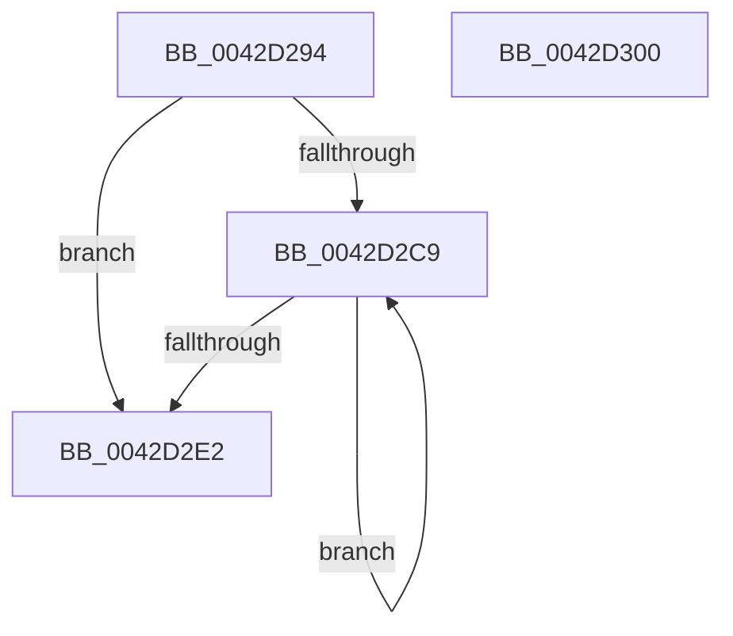

# HalpSetCmosData

- RVA: `0x0042D294`–`0x0042D301` (길이 `109` bytes)
- VA: `0x000000014042D294`
- 실행 섹션: `.text`
- PDB 이름 있음: `예`; PDB Function 태그: `아니요`
- unwind 정보 RVA: `0x0005C954`
- 디코드: `34`개 명령, `109/109` bytes 표시
- 미해석 바이트: `0` (있으면 어셈블리에 `.byte`로 보존)

> 이 문서는 커널 이미지의 기계어와 PDB 기호를 분석해 생성했습니다. 4번과 5번은 함수 원형과 자료형을 바이너리 사용 방식에서 추정한 C 해석이며 원본 소스 복구 결과는 아닙니다.

## 1. Dependencies

- 직접 호출 지점: **3**; 고유 호출 대상: **3**
- 직접 호출자로 확인된 함수: **1**
- RIP 상대 이미지 참조: **2**

### Outgoing calls
- `0x0042D2C0` → [HalpAcquireCmosSpinLock](HalpAcquireCmosSpinLock_function_0042DEE8.md) (function, `0x0042DEE8`)
- `0x0042D2D4` → [guard_dispatch_icall](../6B/guard_dispatch_icall_function_006BAAD0.md) (function, `0x006BAAD0`)
- `0x0042D2E2` → [HalpReleaseCmosSpinLock](HalpReleaseCmosSpinLock_function_0042DE04.md) (function, `0x0042DE04`)

### Direct callers
- [HalWriteBootRegister](../../pagelk/B6/HalWriteBootRegister_function_00B60F00.md) at `0x00B60F5D`

### Static image references
- `0x0042D2A8` → RVA `0x00E003D0` (`.data`; read)
- `0x0042D2C9` → RVA `0x00E003E0` (`.data`; read)

## 2. Other-region calls and transfers

- 다른 실행 섹션으로 향하는 call: **0**
- 별도 외부 분기/꼬리 이동을 확인하지 못했습니다.

## 3. Assembly (complete function range)

```asm
0042D294  48 89 5C 24 08                  mov qword ptr [rsp + 8], rbx
0042D299  48 89 6C 24 10                  mov qword ptr [rsp + 0x10], rbp
0042D29E  48 89 74 24 18                  mov qword ptr [rsp + 0x18], rsi
0042D2A3  57                              push rdi
0042D2A4  48 83 EC 20                     sub rsp, 0x20
0042D2A8  8B 2D 22 31 9D 00               mov ebp, dword ptr [rip + 0x9d3122]
0042D2AE  41 8D 41 FF                     lea eax, [r9 - 1]
0042D2B2  03 C2                           add eax, edx
0042D2B4  49 8B F0                        mov rsi, r8
0042D2B7  3B C5                           cmp eax, ebp
0042D2B9  8B FA                           mov edi, edx
0042D2BB  8B DA                           mov ebx, edx
0042D2BD  0F 46 E8                        cmovbe ebp, eax
0042D2C0  E8 23 0C 00 00                  call 0x14042dee8
0042D2C5  3B DD                           cmp ebx, ebp
0042D2C7  77 19                           ja 0x14042d2e2
0042D2C9  48 8B 05 10 31 9D 00            mov rax, qword ptr [rip + 0x9d3110]
0042D2D0  8B CB                           mov ecx, ebx
0042D2D2  8A 16                           mov dl, byte ptr [rsi]
0042D2D4  E8 F7 D7 28 00                  call 0x1406baad0
0042D2D9  FF C3                           inc ebx
0042D2DB  48 FF C6                        inc rsi
0042D2DE  3B DD                           cmp ebx, ebp
0042D2E0  76 E7                           jbe 0x14042d2c9
0042D2E2  E8 1D 0B 00 00                  call 0x14042de04
0042D2E7  48 8B 6C 24 38                  mov rbp, qword ptr [rsp + 0x38]
0042D2EC  2B DF                           sub ebx, edi
0042D2EE  48 8B 74 24 40                  mov rsi, qword ptr [rsp + 0x40]
0042D2F3  8B C3                           mov eax, ebx
0042D2F5  48 8B 5C 24 30                  mov rbx, qword ptr [rsp + 0x30]
0042D2FA  48 83 C4 20                     add rsp, 0x20
0042D2FE  5F                              pop rdi
0042D2FF  C3                              ret
0042D300  CC                              int3
```

## 4. C-style interpretation (structured pseudocode)

```c
__int64 __fastcall HalpSetCmosData(__int64 a1, int a2, __int64 a3, __int64 a4)
{
    __int64 result;
    __int64 v_rbp;
    __int64 v_rbx;
    __int64 v_rsi;
    __int64 v_rsp;
    unsigned __int64 v_stack_p10;
    unsigned __int64 v_stack_p18;
    unsigned __int64 v_stack_p8;

    v_stack_p8 = v_rbx;
    v_stack_p10 = v_rbp;
    v_stack_p18 = v_rsi;
    v_rsp = (v_rsp) - (32);
    result = (unsigned int)((a4 - 1) + (a2));
    v_rbp = (unsigned int)(*(unsigned int *)(v_rip + 10301730));
    if (((unsigned int)(result)) <= ((unsigned int)((unsigned int)(*(unsigned int *)(v_rip + 10301730))))) { v_rbp = (unsigned int)(result); }
    result = HalpAcquireCmosSpinLock(a1, a2, a3, a4);
    if (((unsigned int)((unsigned int)(a2))) > ((unsigned int)(v_rbp))) goto loc_0042D2E2;
loc_0042D2C9:
    result = guard_dispatch_icall((unsigned int)((unsigned int)((unsigned int)(a2))), *(unsigned __int8 *)(a3), a3, a4);
    v_rbx = (unsigned int)(((unsigned int)(a2)) + 1);
    v_rsi = (a3) + 1;
    if (((unsigned int)(v_rbx)) <= ((unsigned int)(v_rbp))) goto loc_0042D2C9;
loc_0042D2E2:
    result = HalpReleaseCmosSpinLock((unsigned int)((unsigned int)((unsigned int)(a2))), *(unsigned __int8 *)(a3), a3, a4);
    v_rbx = (unsigned int)((v_rbx) - ((unsigned int)((unsigned int)(a2))));
    v_rsp = (v_rsp) + (32);
    return (unsigned int)((unsigned int)(v_rbx));
}
```

## 5. (Beta) C Style

```c
int64_t HalpSetCmosData(int64_t Arg1, int32_t Arg2, int64_t Arg3, void *Arg4)
{
    uint8_t *arg4 = (uint8_t *)Arg4;

    int64_t result;
    int64_t local_rbp;
    int64_t local_rbx;
    int64_t local_rsi;
    int64_t local_rsp;
    uint64_t v_stack_p10;
    uint64_t v_stack_p18;
    uint64_t v_stack_p8;

    v_stack_p8 = local_rbx;
    v_stack_p10 = local_rbp;
    v_stack_p18 = local_rsi;
    local_rsp = (local_rsp) - (32);
    result = (uint32_t)((Arg4 - 1) + (Arg2));
    local_rbp = (uint32_t)(*(uint32_t *)(v_rip + 0x9D3122));
    if (((uint32_t)(result)) <= ((uint32_t)((uint32_t)(*(uint32_t *)(v_rip + 0x9D3122))))) { local_rbp = (uint32_t)(result); }
    result = HalpAcquireCmosSpinLock(Arg1, Arg2, Arg3, Arg4);
    if (((uint32_t)((uint32_t)(Arg2))) > ((uint32_t)(local_rbp))) goto loc_0042D2E2;
loc_0042D2C9:
    result = guard_dispatch_icall((uint32_t)((uint32_t)((uint32_t)(Arg2))), *(uint8_t *)(Arg3), Arg3, Arg4);
    local_rbx = (uint32_t)(((uint32_t)(Arg2)) + 1);
    local_rsi = (Arg3) + 1;
    if (((uint32_t)(local_rbx)) <= ((uint32_t)(local_rbp))) goto loc_0042D2C9;
loc_0042D2E2:
    result = HalpReleaseCmosSpinLock((uint32_t)((uint32_t)((uint32_t)(Arg2))), *(uint8_t *)(Arg3), Arg3, Arg4);
    local_rbx = (uint32_t)((local_rbx) - ((uint32_t)((uint32_t)(Arg2))));
    local_rsp = (local_rsp) + (32);
    return (uint32_t)((uint32_t)(local_rbx));
}
```

### 관측된 메모리 오프셋

구조체 형식이 확인되지 않은 접근은 인자 기준의 오프셋으로만 기록했습니다.

| 기준 인자 | 오프셋 표현 | 폭 (bit) | 접근 |
|---|---:|---:|---|
| `Arg4` | `- 0x1` | `32` | `R` |

## 6. Execution-region graph

[열기: 2D/3D 그래프와 함수 탐색 컨트롤 패널](../../../control-panel.html?section=text&rva=0x0042D294&view=graph)

- 2D 그래프는 위에서 아래로 흐르고, 3D 그래프는 빈 공간을 드래그해 회전합니다. Shift+드래그는 이동, 휠은 확대·축소, 함수 노드 선택은 대상 보고서 이동입니다.

### Static fallback


