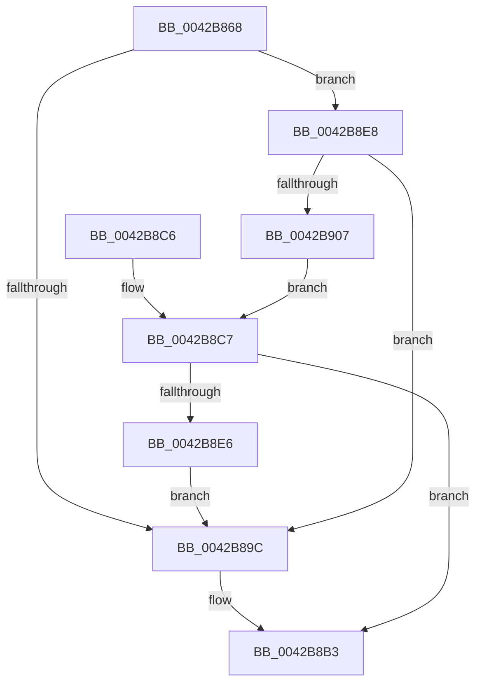

# HalpSetTimerAnyMode

- RVA: `0x0042B868`–`0x0042B909` (길이 `161` bytes)
- VA: `0x000000014042B868`
- 실행 섹션: `.text`
- PDB 이름 있음: `예`; PDB Function 태그: `아니요`
- unwind 정보 RVA: `0x000A182C`
- 디코드: `47`개 명령, `161/161` bytes 표시
- 미해석 바이트: `0` (있으면 어셈블리에 `.byte`로 보존)

> 이 문서는 커널 이미지의 기계어와 PDB 기호를 분석해 생성했습니다. 4번과 5번은 함수 원형과 자료형을 바이너리 사용 방식에서 추정한 C 해석이며 원본 소스 복구 결과는 아닙니다.

## 1. Dependencies

- 직접 호출 지점: **5**; 고유 호출 대상: **2**
- 직접 호출자로 확인된 함수: **2**
- RIP 상대 이미지 참조: **0**

### Outgoing calls
- `0x0042B890` → [HalpSetTimer](HalpSetTimer_function_0042BD30.md) (function, `0x0042BD30`)
- `0x0042B8A4` → [HalpTimerClearProblem](HalpTimerClearProblem_function_0042B910.md) (function, `0x0042B910`)
- `0x0042B8AE` → [HalpTimerClearProblem](HalpTimerClearProblem_function_0042B910.md) (function, `0x0042B910`)
- `0x0042B8DA` → [HalpSetTimer](HalpSetTimer_function_0042BD30.md) (function, `0x0042BD30`)
- `0x0042B8FB` → [HalpSetTimer](HalpSetTimer_function_0042BD30.md) (function, `0x0042BD30`)

### Direct callers
- [HalpVpptUpdatePhysicalTimer](../2D/HalpVpptUpdatePhysicalTimer_function_002D23D8.md) at `0x002D2445`
- [HalpTimerClockPowerChange](../54/HalpTimerClockPowerChange_function_005481A0.md) at `0x005482AD`

### Static image references
- 디코드된 RIP-relative 메모리 참조가 없습니다.

## 2. Other-region calls and transfers

- 다른 실행 섹션으로 향하는 call: **0**
- 별도 외부 분기/꼬리 이동을 확인하지 못했습니다.

## 3. Assembly (complete function range)

```asm
0042B868  48 89 5C 24 08                  mov qword ptr [rsp + 8], rbx
0042B86D  48 89 74 24 10                  mov qword ptr [rsp + 0x10], rsi
0042B872  57                              push rdi
0042B873  48 83 EC 30                     sub rsp, 0x30
0042B877  49 8B F9                        mov rdi, r9
0042B87A  4C 89 4C 24 20                  mov qword ptr [rsp + 0x20], r9
0042B87F  48 8B F2                        mov rsi, rdx
0042B882  4C 8B C2                        mov r8, rdx
0042B885  41 B1 01                        mov r9b, 1
0042B888  BA 03 00 00 00                  mov edx, 3
0042B88D  48 8B D9                        mov rbx, rcx
0042B890  E8 9B 04 00 00                  call 0x14042bd30
0042B895  44 8B C0                        mov r8d, eax
0042B898  85 C0                           test eax, eax
0042B89A  78 4C                           js 0x14042b8e8
0042B89C  BA 11 00 00 00                  mov edx, 0x11
0042B8A1  48 8B CB                        mov rcx, rbx
0042B8A4  E8 67 00 00 00                  call 0x14042b910
0042B8A9  BA 12 00 00 00                  mov edx, 0x12
0042B8AE  E8 5D 00 00 00                  call 0x14042b910
0042B8B3  48 8B 5C 24 40                  mov rbx, qword ptr [rsp + 0x40]
0042B8B8  41 8B C0                        mov eax, r8d
0042B8BB  48 8B 74 24 48                  mov rsi, qword ptr [rsp + 0x48]
0042B8C0  48 83 C4 30                     add rsp, 0x30
0042B8C4  5F                              pop rdi
0042B8C5  C3                              ret
0042B8C6  CC                              int3
0042B8C7  41 B1 01                        mov r9b, 1
0042B8CA  48 89 7C 24 20                  mov qword ptr [rsp + 0x20], rdi
0042B8CF  4C 8B C6                        mov r8, rsi
0042B8D2  BA 01 00 00 00                  mov edx, 1
0042B8D7  48 8B CB                        mov rcx, rbx
0042B8DA  E8 51 04 00 00                  call 0x14042bd30
0042B8DF  44 8B C0                        mov r8d, eax
0042B8E2  85 C0                           test eax, eax
0042B8E4  78 CD                           js 0x14042b8b3
0042B8E6  EB B4                           jmp 0x14042b89c
0042B8E8  41 B1 01                        mov r9b, 1
0042B8EB  48 89 7C 24 20                  mov qword ptr [rsp + 0x20], rdi
0042B8F0  4C 8B C6                        mov r8, rsi
0042B8F3  BA 02 00 00 00                  mov edx, 2
0042B8F8  48 8B CB                        mov rcx, rbx
0042B8FB  E8 30 04 00 00                  call 0x14042bd30
0042B900  44 8B C0                        mov r8d, eax
0042B903  85 C0                           test eax, eax
0042B905  79 95                           jns 0x14042b89c
0042B907  EB BE                           jmp 0x14042b8c7
```

## 4. C-style interpretation (structured pseudocode)

```c
__int64 __fastcall HalpSetTimerAnyMode(__int64 a1, __int64 a2, __int64 a3, __int64 a4)
{
    __int64 result;
    __int64 v_rsp;
    unsigned __int64 v_stack_m18;
    unsigned __int64 v_stack_p10;
    unsigned __int64 v_stack_p20;
    unsigned __int64 v_stack_p8;

    v_stack_p8 = v_rbx;
    v_stack_p10 = v_rsi;
    v_rsp = (v_rsp) - (48);
    v_stack_m18 = a4;
    result = HalpSetTimer(a1, 3, a2, 1);
    if (sign_flag) goto loc_0042B8E8;
loc_0042B89C:
    result = HalpTimerClearProblem(a1, 17, (unsigned int)((unsigned int)(result)), 1);
    result = HalpTimerClearProblem(a1, 18, (unsigned int)((unsigned int)(result)), 1);
loc_0042B8B3:
    v_rsp = (v_rsp) + (48);
    return (unsigned int)((unsigned int)((unsigned int)((unsigned int)(result))));
loc_0042B8C7:
    v_stack_p20 = a4;
    result = HalpSetTimer(v_stack_p8, 1, v_stack_p10, 1);
    if (sign_flag) goto loc_0042B8B3;
    goto loc_0042B89C;
loc_0042B8E8:
    v_stack_p20 = a4;
    result = HalpSetTimer(v_stack_p8, 2, v_stack_p10, 1);
    if (!sign_flag) goto loc_0042B89C;
    goto loc_0042B8C7;
}
```

## 5. (Beta) C Style

```c
int64_t HalpSetTimerAnyMode(int64_t Arg1, int64_t Arg2, int64_t Arg3, int64_t Arg4)
{
    int64_t result;
    int64_t local_rsp;
    uint64_t v_stack_m18;
    uint64_t v_stack_p10;
    uint64_t v_stack_p20;
    uint64_t v_stack_p8;

    v_stack_p8 = local_rbx;
    v_stack_p10 = local_rsi;
    local_rsp = (local_rsp) - (48);
    v_stack_m18 = Arg4;
    result = HalpSetTimer(Arg1, 3, Arg2, 1);
    if (sign_flag) goto loc_0042B8E8;
loc_0042B89C:
    result = HalpTimerClearProblem(Arg1, 17, (uint32_t)((uint32_t)(result)), 1);
    result = HalpTimerClearProblem(Arg1, 18, (uint32_t)((uint32_t)(result)), 1);
loc_0042B8B3:
    local_rsp = (local_rsp) + (48);
    return (uint32_t)((uint32_t)((uint32_t)((uint32_t)(result))));
loc_0042B8C7:
    v_stack_p20 = Arg4;
    result = HalpSetTimer(v_stack_p8, 1, v_stack_p10, 1);
    if (sign_flag) goto loc_0042B8B3;
    goto loc_0042B89C;
loc_0042B8E8:
    v_stack_p20 = Arg4;
    result = HalpSetTimer(v_stack_p8, 2, v_stack_p10, 1);
    if (!sign_flag) goto loc_0042B89C;
    goto loc_0042B8C7;
}
```

## 6. Execution-region graph

[열기: 2D/3D 그래프와 함수 탐색 컨트롤 패널](../../../control-panel.html?section=text&rva=0x0042B868&view=graph)

- 2D 그래프는 위에서 아래로 흐르고, 3D 그래프는 빈 공간을 드래그해 회전합니다. Shift+드래그는 이동, 휠은 확대·축소, 함수 노드 선택은 대상 보고서 이동입니다.

### Static fallback


