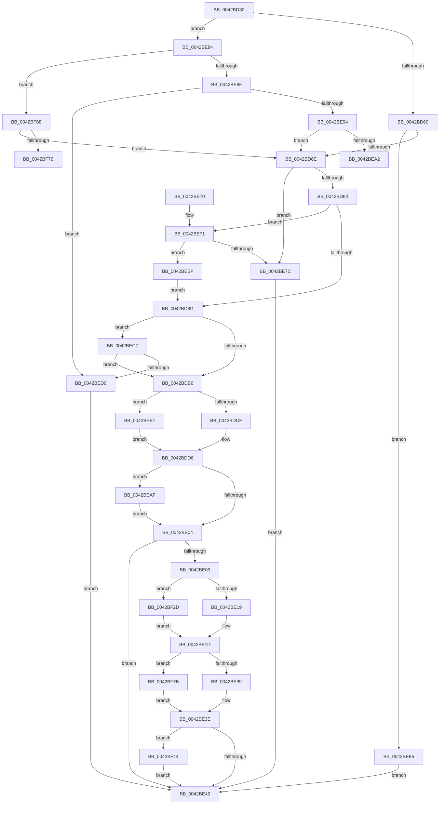

# HalpSetTimer

- RVA: `0x0042BD30`–`0x0042BF85` (길이 `597` bytes)
- VA: `0x000000014042BD30`
- 실행 섹션: `.text`
- PDB 이름 있음: `예`; PDB Function 태그: `예`
- unwind 정보 RVA: `0x000A1908`
- 디코드: `131`개 명령, `597/597` bytes 표시
- 미해석 바이트: `0` (있으면 어셈블리에 `.byte`로 보존)

> 이 문서는 커널 이미지의 기계어와 PDB 기호를 분석해 생성했습니다. 4번과 5번은 함수 원형과 자료형을 바이너리 사용 방식에서 추정한 C 해석이며 원본 소스 복구 결과는 아닙니다.

## 1. Dependencies

- 직접 호출 지점: **4**; 고유 호출 대상: **4**
- 직접 호출자로 확인된 함수: **10**
- RIP 상대 이미지 참조: **3**

### Outgoing calls
- `0x0042BE39` → [HalpHvWatchdogArm](HalpHvWatchdogArm_function_0042BF90.md) (function, `0x0042BF90`)
- `0x0042BEEB` → [HalpTimerScaleCounter](../37/HalpTimerScaleCounter_function_0037B354.md) (function, `0x0037B354`)
- `0x0042BF5E` → [HalpTimerSetProblemEx](../4F/HalpTimerSetProblemEx_function_004FAEC4.md) (function, `0x004FAEC4`)
- `0x0042BF7B` → [guard_dispatch_icall](../6B/guard_dispatch_icall_function_006BAAD0.md) (function, `0x006BAAD0`)

### Direct callers
- [HalpTimerWatchdogResetCountdown](../39/HalpTimerWatchdogResetCountdown_function_0039B3B0.md) at `0x0039B3E2`
- [HalpTimerWatchdogTriggerSystemReset](../39/HalpTimerWatchdogTriggerSystemReset_function_0039B410.md) at `0x0039B4F0`
- [HalpSetTimerAnyMode](HalpSetTimerAnyMode_function_0042B868.md) at `0x0042B890`
- [HalpSetTimerAnyMode](HalpSetTimerAnyMode_function_0042B868.md) at `0x0042B8DA`
- [HalpSetTimerAnyMode](HalpSetTimerAnyMode_function_0042B868.md) at `0x0042B8FB`
- [HalpTimerInitializeClock](../54/HalpTimerInitializeClock_function_00548424.md) at `0x00548555`
- [HalpTimerRestartProfileInterrupt](../54/HalpTimerRestartProfileInterrupt_function_0054B6A4.md) at `0x0054B75D`
- [HalpTimerSetTimerBackedProfileInterval](../54/HalpTimerSetTimerBackedProfileInterval_function_0054B774.md) at `0x0054B7D7`
- [HalpTimerStartProfileInterrupt](../54/HalpTimerStartProfileInterrupt_function_0054B80C.md) at `0x0054B87F`
- [HalpTimerTestHypervisorTimer](../54/HalpTimerTestHypervisorTimer_function_0054BBC0.md) at `0x0054BCA2`
- [HalpTimerWatchdogStart](../54/HalpTimerWatchdogStart_function_0054C710.md) at `0x0054C77B`
- [HalpWatchdogDelayExpiration](../54/HalpWatchdogDelayExpiration_function_0054C8E0.md) at `0x0054C94E`

### Static image references
- `0x0042BE24` → RVA `0x0042BF90` (`HalpHvWatchdogArm`; read)
- `0x0042BEF5` → RVA `0x000144D8` (`.rdata`; read)
- `0x0042BEFC` → RVA `0x00E10358` (`.data`; write)

## 2. Other-region calls and transfers

- 다른 실행 섹션으로 향하는 call: **0**
- call이 아닌 외부 분기/꼬리 이동: **2**
  - `0x0042BEAA` → [sub_006EE40E + 0x8](../6E/Unknown_function_006EE40E.md) (`tail-transfer`)
  - `0x0042BF76` → [sub_006EE40E](../6E/Unknown_function_006EE40E.md) (`tail-transfer`)

## 3. Assembly (complete function range)

```asm
0042BD30  48 89 5C 24 08                  mov qword ptr [rsp + 8], rbx
0042BD35  48 89 6C 24 10                  mov qword ptr [rsp + 0x10], rbp
0042BD3A  48 89 74 24 18                  mov qword ptr [rsp + 0x18], rsi
0042BD3F  57                              push rdi
0042BD40  41 56                           push r14
0042BD42  41 57                           push r15
0042BD44  48 83 EC 40                     sub rsp, 0x40
0042BD48  45 33 DB                        xor r11d, r11d
0042BD4B  45 0F B6 F1                     movzx r14d, r9b
0042BD4F  8B F2                           mov esi, edx
0042BD51  48 8B F9                        mov rdi, rcx
0042BD54  41 8B DB                        mov ebx, r11d
0042BD57  83 FA 03                        cmp edx, 3
0042BD5A  0F 85 24 01 00 00               jne 0x14042be84
0042BD60  8B 81 E0 00 00 00               mov eax, dword ptr [rcx + 0xe0]
0042BD66  A8 20                           test al, 0x20
0042BD68  0F 84 87 01 00 00               je 0x14042bef5
0042BD6E  49 8B C0                        mov rax, r8
0042BD71  48 F7 A7 C0 00 00 00            mul qword ptr [rdi + 0xc0]
0042BD78  48 8B C8                        mov rcx, rax
0042BD7B  48 85 D2                        test rdx, rdx
0042BD7E  0F 85 F8 00 00 00               jne 0x14042be7c
0042BD84  83 FE 03                        cmp esi, 3
0042BD87  0F 84 E4 00 00 00               je 0x14042be71
0042BD8D  48 B8 BD 42 7A E5 D5 94 BF D6   movabs rax, 0xd6bf94d5e57a42bd
0042BD97  41 BF 01 00 00 00               mov r15d, 1
0042BD9D  48 F7 E1                        mul rcx
0042BDA0  8B 8F DC 00 00 00               mov ecx, dword ptr [rdi + 0xdc]
0042BDA6  48 8B EA                        mov rbp, rdx
0042BDA9  48 C1 ED 17                     shr rbp, 0x17
0042BDAD  83 F9 40                        cmp ecx, 0x40
0042BDB0  0F 82 11 01 00 00               jb 0x14042bec7
0042BDB6  49 B8 00 E4 0B 54 02 00 00 00   movabs r8, 0x2540be400
0042BDC0  49 8B C0                        mov rax, r8
0042BDC3  48 F7 E5                        mul rbp
0042BDC6  48 85 D2                        test rdx, rdx
0042BDC9  0F 85 12 01 00 00               jne 0x14042bee1
0042BDCF  48 F7 B7 C0 00 00 00            div qword ptr [rdi + 0xc0]
0042BDD6  48 8B D8                        mov rbx, rax
0042BDD9  48 89 6F 10                     mov qword ptr [rdi + 0x10], rbp
0042BDDD  48 B8 77 BE 9F 1A 2F DD 24 06   movabs rax, 0x624dd2f1a9fbe77
0042BDE7  44 89 7F 34                     mov dword ptr [rdi + 0x34], r15d
0042BDEB  48 F7 E3                        mul rbx
0042BDEE  48 2B DA                        sub rbx, rdx
0042BDF1  48 D1 EB                        shr rbx, 1
0042BDF4  48 03 DA                        add rbx, rdx
0042BDF7  48 C1 EB 09                     shr rbx, 9
0042BDFB  83 FE 02                        cmp esi, 2
0042BDFE  0F 84 AB 00 00 00               je 0x14042beaf
0042BE04  45 84 F6                        test r14b, r14b
0042BE07  74 40                           je 0x14042be49
0042BE09  F7 87 E0 00 00 00 00 00 01 00   test dword ptr [rdi + 0xe0], 0x10000
0042BE13  0F 85 14 01 00 00               jne 0x14042bf2d
0042BE19  48 8B 4F 48                     mov rcx, qword ptr [rdi + 0x48]
0042BE1D  48 8B 87 80 00 00 00            mov rax, qword ptr [rdi + 0x80]
0042BE24  48 8D 15 65 01 00 00            lea rdx, [rip + 0x165]
0042BE2B  48 3B C2                        cmp rax, rdx
0042BE2E  4C 8B C5                        mov r8, rbp
0042BE31  8B D6                           mov edx, esi
0042BE33  0F 85 42 01 00 00               jne 0x14042bf7b
0042BE39  E8 52 01 00 00                  call 0x14042bf90
0042BE3E  44 8B D8                        mov r11d, eax
0042BE41  85 C0                           test eax, eax
0042BE43  0F 88 FB 00 00 00               js 0x14042bf44
0042BE49  48 8B 84 24 80 00 00 00         mov rax, qword ptr [rsp + 0x80]
0042BE51  48 8B 6C 24 68                  mov rbp, qword ptr [rsp + 0x68]
0042BE56  48 8B 74 24 70                  mov rsi, qword ptr [rsp + 0x70]
0042BE5B  48 89 18                        mov qword ptr [rax], rbx
0042BE5E  41 8B C3                        mov eax, r11d
0042BE61  48 8B 5C 24 60                  mov rbx, qword ptr [rsp + 0x60]
0042BE66  48 83 C4 40                     add rsp, 0x40
0042BE6A  41 5F                           pop r15
0042BE6C  41 5E                           pop r14
0042BE6E  5F                              pop rdi
0042BE6F  C3                              ret
0042BE70  CC                              int3
0042BE71  48 05 7F 96 98 00               add rax, 0x98967f
0042BE77  48 3B C1                        cmp rax, rcx
0042BE7A  73 43                           jae 0x14042bebf
0042BE7C  41 BB 95 00 00 C0               mov r11d, 0xc0000095
0042BE82  EB C5                           jmp 0x14042be49
0042BE84  8B CE                           mov ecx, esi
0042BE86  83 E9 01                        sub ecx, 1
0042BE89  0F 84 D9 00 00 00               je 0x14042bf68
0042BE8F  83 F9 01                        cmp ecx, 1
0042BE92  75 42                           jne 0x14042bed6
0042BE94  8B 87 E0 00 00 00               mov eax, dword ptr [rdi + 0xe0]
0042BE9A  A8 50                           test al, 0x50
0042BE9C  0F 85 CC FE FF FF               jne 0x14042bd6e
0042BEA2  C7 44 24 20 AB 02 00 00         mov dword ptr [rsp + 0x20], 0x2ab
0042BEAA  E9 67 25 2C 00                  jmp 0x1406ee416
0042BEAF  F6 87 E0 00 00 00 40            test byte ptr [rdi + 0xe0], 0x40
0042BEB6  41 0F 44 F7                     cmove esi, r15d
0042BEBA  E9 45 FF FF FF                  jmp 0x14042be04
0042BEBF  48 8B C8                        mov rcx, rax
0042BEC2  E9 C6 FE FF FF                  jmp 0x14042bd8d
0042BEC7  49 8B C7                        mov rax, r15
0042BECA  48 D3 E0                        shl rax, cl
0042BECD  48 3B E8                        cmp rbp, rax
0042BED0  0F 82 E0 FE FF FF               jb 0x14042bdb6
0042BED6  41 BB 0D 00 00 C0               mov r11d, 0xc000000d
0042BEDC  E9 68 FF FF FF                  jmp 0x14042be49
0042BEE1  48 8B 97 C0 00 00 00            mov rdx, qword ptr [rdi + 0xc0]
0042BEE8  48 8B CD                        mov rcx, rbp
0042BEEB  E8 64 F4 F4 FF                  call 0x14037b354
0042BEF0  E9 E1 FE FF FF                  jmp 0x14042bdd6
0042BEF5  4C 8D 0D DC 85 BE FF            lea r9, [rip - 0x417a24]
0042BEFC  C7 05 52 44 9E 00 11 00 00 00   mov dword ptr [rip + 0x9e4452], 0x11
0042BF06  4C 89 89 08 01 00 00            mov qword ptr [rcx + 0x108], r9
0042BF0D  41 BB BB 00 00 C0               mov r11d, 0xc00000bb
0042BF13  48 C7 81 FC 00 00 00 11 00 00 00  mov qword ptr [rcx + 0xfc], 0x11
0042BF1E  C7 81 10 01 00 00 9F 02 00 00   mov dword ptr [rcx + 0x110], 0x29f
0042BF28  E9 1C FF FF FF                  jmp 0x14042be49
0042BF2D  65 8B 04 25 A4 01 00 00         mov eax, dword ptr gs:[0x1a4]
0042BF35  0F AF 47 50                     imul eax, dword ptr [rdi + 0x50]
0042BF39  8B C8                           mov ecx, eax
0042BF3B  48 03 4F 48                     add rcx, qword ptr [rdi + 0x48]
0042BF3F  E9 D9 FE FF FF                  jmp 0x14042be1d
0042BF44  C7 44 24 20 0E 03 00 00         mov dword ptr [rsp + 0x20], 0x30e
0042BF4C  45 8B C3                        mov r8d, r11d
0042BF4F  BA 12 00 00 00                  mov edx, 0x12
0042BF54  4C 8D 0D 7D 85 BE FF            lea r9, [rip - 0x417a83]
0042BF5B  48 8B CF                        mov rcx, rdi
0042BF5E  E8 61 EF 0C 00                  call 0x1404faec4
0042BF63  E9 E1 FE FF FF                  jmp 0x14042be49
0042BF68  8B 87 E0 00 00 00               mov eax, dword ptr [rdi + 0xe0]
0042BF6E  A8 10                           test al, 0x10
0042BF70  0F 85 F8 FD FF FF               jne 0x14042bd6e
0042BF76  E9 93 24 2C 00                  jmp 0x1406ee40e
0042BF7B  E8 50 EB 28 00                  call 0x1406baad0
0042BF80  E9 B9 FE FF FF                  jmp 0x14042be3e
```

## 4. C-style interpretation (structured pseudocode)

```c
__int64 __fastcall HalpSetTimer(__int64 a1, __int64 a2, __int64 a3, unsigned __int8 a4, __int64 a5)
{
    __int64 result;
    __int64 v_r11;
    __int64 v_rbp;
    __int64 v_rbx;
    __int64 v_rsi;
    __int64 v_rsp;
    unsigned __int64 v_stack_p10;
    unsigned __int64 v_stack_p18;
    unsigned int v_stack_p20;
    unsigned __int64 v_stack_p8;

    v_stack_p8 = v_rbx;
    v_stack_p10 = v_rbp;
    v_stack_p18 = v_rsi;
    v_rsp = (v_rsp) - (64);
    v_r11 = 0;
    if (((unsigned int)(a2)) != 3) goto loc_0042BE84;
    if ((((unsigned __int8)((unsigned int)(*(unsigned int *)(a1 + 224)))) & (32)) == 0) goto loc_0042BEF5;
loc_0042BD6E:
    if (a2 != 0) goto loc_0042BE7C;
    if (((unsigned int)((unsigned int)((unsigned int)(a2)))) == 3) goto loc_0042BE71;
loc_0042BD8D:
    v_rbp = (a2) >> (23);
    if (((unsigned int)((unsigned int)(*(unsigned int *)(a1 + 220)))) < 64) goto loc_0042BEC7;
loc_0042BDB6:
    if (a2 != 0) goto loc_0042BEE1;
loc_0042BDD6:
    *(unsigned __int64 *)(a1 + 16) = v_rbp;
    *(unsigned int *)(a1 + 52) = 1;
    v_rbx = (a3) - (a2);
    v_rbx = (v_rbx) >> (1);
    v_rbx = (v_rbx) + (a2);
    v_rbx = (v_rbx) >> (9);
    if (((unsigned int)((unsigned int)((unsigned int)(a2)))) == 2) goto loc_0042BEAF;
loc_0042BE04:
    if (a4 == 0) goto loc_0042BE49;
    if (((*(unsigned int *)(a1 + 224)) & (0x10000ULL)) != 0) goto loc_0042BF2D;
loc_0042BE1D:
    if ((*(unsigned __int64 *)(a1 + 128)) != (v_rip + 357)) goto loc_0042BF7B;
    result = HalpHvWatchdogArm(*(unsigned __int64 *)(a1 + 72), (unsigned int)((unsigned int)((unsigned int)((unsigned int)(a2)))), v_rbp, a4);
loc_0042BE3E:
    if (sign_flag) goto loc_0042BF44;
loc_0042BE49:
    *(unsigned __int64 *)(a5) = v_rbx;
    v_rsp = (v_rsp) + (64);
    return (unsigned int)((unsigned int)((unsigned int)((unsigned int)(result))));
loc_0042BE71:
    result = ((unsigned int)((unsigned int)((unsigned int)((unsigned int)(result))))) + (0x98967FULL);
    if (result >= (*(unsigned __int64 *)(a1 + 72))) goto loc_0042BEBF;
loc_0042BE7C:
    goto loc_0042BE49;
loc_0042BE84:
    a1 = (unsigned int)(((unsigned int)((unsigned int)(v_stack_p18))) - (1));
    if (condition_is_equal) goto loc_0042BF68;
    if (((unsigned int)(a1)) != 1) goto loc_0042BED6;
    if ((((unsigned __int8)((unsigned int)(*(unsigned int *)(a1 + 224)))) & (80)) != 0) goto loc_0042BD6E;
    v_stack_p20 = 683;
loc_0042BEAF:
    v_rsi = v_stack_p18;
    if (((*(unsigned __int8 *)(a1 + 224)) & (64)) == 0) { v_rsi = 1; }
    goto loc_0042BE04;
loc_0042BEBF:
    goto loc_0042BD8D;
loc_0042BEC7:
    result = (1) << ((unsigned __int8)((unsigned int)(*(unsigned int *)(a1 + 224))));
    if (v_stack_p10 < result) goto loc_0042BDB6;
loc_0042BED6:
    goto loc_0042BE49;
loc_0042BEE1:
    result = HalpTimerScaleCounter(v_stack_p10, *(unsigned __int64 *)(a1 + 192), v_rbp, a4);
    goto loc_0042BDD6;
loc_0042BEF5:
    *(unsigned int *)(v_rip + 10372178) = 17;
    *(unsigned __int64 *)(v_stack_p10 + 264) = v_rip - 4291108;
    *(unsigned __int64 *)(v_stack_p10 + 252) = 17;
    *(unsigned int *)(v_stack_p10 + 272) = 671;
    goto loc_0042BE49;
loc_0042BF2D:
    result = (unsigned int)(((unsigned int)(*(unsigned int *)(gs_base + (0 + 420)))) * (*(unsigned int *)(a1 + 80)));
    a1 = ((unsigned int)((unsigned int)(result))) + (*(unsigned __int64 *)(a1 + 72));
    goto loc_0042BE1D;
loc_0042BF44:
    v_stack_p20 = 782;
    result = HalpTimerSetProblemEx(a1, 18, (unsigned int)((unsigned int)((unsigned int)(0xC00000BBULL))), v_rip - 4291203);
    goto loc_0042BE49;
loc_0042BF68:
    if ((((unsigned __int8)((unsigned int)(*(unsigned int *)(a1 + 224)))) & (16)) != 0) goto loc_0042BD6E;
loc_0042BF7B:
    result = guard_dispatch_icall(a1, 18, (unsigned int)((unsigned int)((unsigned int)(0xC00000BBULL))), v_rip - 4291203);
    goto loc_0042BE3E;
}
```

## 5. (Beta) C Style

```c
int64_t HalpSetTimer(void *Arg1, int64_t Arg2, int64_t Arg3, uint8_t Arg4, void *Arg5)
{
    uint8_t *arg1 = (uint8_t *)Arg1;
    uint8_t *arg5 = (uint8_t *)Arg5;

    int64_t result;
    int64_t local_r11;
    int64_t local_rbp;
    int64_t local_rbx;
    int64_t local_rsi;
    int64_t local_rsp;
    uint64_t v_stack_p10;
    uint64_t v_stack_p18;
    uint32_t v_stack_p20;
    uint64_t v_stack_p8;

    v_stack_p8 = local_rbx;
    v_stack_p10 = local_rbp;
    v_stack_p18 = local_rsi;
    local_rsp = (local_rsp) - (64);
    local_r11 = 0;
    if (((uint32_t)(Arg2)) != 3) goto loc_0042BE84;
    if ((((uint8_t)((uint32_t)(*(uint32_t *)(arg1 + 0xE0)))) & (32)) == 0) goto loc_0042BEF5;
loc_0042BD6E:
    if (Arg2 != 0) goto loc_0042BE7C;
    if (((uint32_t)((uint32_t)((uint32_t)(Arg2)))) == 3) goto loc_0042BE71;
loc_0042BD8D:
    local_rbp = (Arg2) >> (23);
    if (((uint32_t)((uint32_t)(*(uint32_t *)(arg1 + 0xDC)))) < 64) goto loc_0042BEC7;
loc_0042BDB6:
    if (Arg2 != 0) goto loc_0042BEE1;
loc_0042BDD6:
    *(uint64_t *)(arg1 + 0x10) = local_rbp;
    *(uint32_t *)(arg1 + 0x34) = 1;
    local_rbx = (Arg3) - (Arg2);
    local_rbx = (local_rbx) >> (1);
    local_rbx = (local_rbx) + (Arg2);
    local_rbx = (local_rbx) >> (9);
    if (((uint32_t)((uint32_t)((uint32_t)(Arg2)))) == 2) goto loc_0042BEAF;
loc_0042BE04:
    if (Arg4 == 0) goto loc_0042BE49;
    if (((*(uint32_t *)(arg1 + 0xE0)) & (0x10000ULL)) != 0) goto loc_0042BF2D;
loc_0042BE1D:
    if ((*(uint64_t *)(arg1 + 0x80)) != (v_rip + 357)) goto loc_0042BF7B;
    result = HalpHvWatchdogArm(*(uint64_t *)(arg1 + 0x48), (uint32_t)((uint32_t)((uint32_t)((uint32_t)(Arg2)))), local_rbp, Arg4);
loc_0042BE3E:
    if (sign_flag) goto loc_0042BF44;
loc_0042BE49:
    *(uint64_t *)(arg5) = local_rbx;
    local_rsp = (local_rsp) + (64);
    return (uint32_t)((uint32_t)((uint32_t)((uint32_t)(result))));
loc_0042BE71:
    result = ((uint32_t)((uint32_t)((uint32_t)((uint32_t)(result))))) + (0x98967FULL);
    if (result >= (*(uint64_t *)(arg1 + 0x48))) goto loc_0042BEBF;
loc_0042BE7C:
    goto loc_0042BE49;
loc_0042BE84:
    Arg1 = (uint32_t)(((uint32_t)((uint32_t)(v_stack_p18))) - (1));
    if (condition_is_equal) goto loc_0042BF68;
    if (((uint32_t)(Arg1)) != 1) goto loc_0042BED6;
    if ((((uint8_t)((uint32_t)(*(uint32_t *)(arg1 + 0xE0)))) & (80)) != 0) goto loc_0042BD6E;
    v_stack_p20 = 683;
loc_0042BEAF:
    local_rsi = v_stack_p18;
    if (((*(uint8_t *)(arg1 + 0xE0)) & (64)) == 0) { local_rsi = 1; }
    goto loc_0042BE04;
loc_0042BEBF:
    goto loc_0042BD8D;
loc_0042BEC7:
    result = (1) << ((uint8_t)((uint32_t)(*(uint32_t *)(arg1 + 0xE0))));
    if (v_stack_p10 < result) goto loc_0042BDB6;
loc_0042BED6:
    goto loc_0042BE49;
loc_0042BEE1:
    result = HalpTimerScaleCounter(v_stack_p10, *(uint64_t *)(arg1 + 0xC0), local_rbp, Arg4);
    goto loc_0042BDD6;
loc_0042BEF5:
    *(uint32_t *)(v_rip + 0x9E4452) = 17;
    *(uint64_t *)(v_stack_p10 + 0x108) = v_rip - 4291108;
    *(uint64_t *)(v_stack_p10 + 0xFC) = 17;
    *(uint32_t *)(v_stack_p10 + 0x110) = 671;
    goto loc_0042BE49;
loc_0042BF2D:
    result = (uint32_t)(((uint32_t)(*(uint32_t *)(gs_base + (0 + 0x1A4)))) * (*(uint32_t *)(arg1 + 0x50)));
    Arg1 = ((uint32_t)((uint32_t)(result))) + (*(uint64_t *)(arg1 + 0x48));
    goto loc_0042BE1D;
loc_0042BF44:
    v_stack_p20 = 782;
    result = HalpTimerSetProblemEx(Arg1, 18, (uint32_t)((uint32_t)((uint32_t)(0xC00000BBULL))), v_rip - 4291203);
    goto loc_0042BE49;
loc_0042BF68:
    if ((((uint8_t)((uint32_t)(*(uint32_t *)(arg1 + 0xE0)))) & (16)) != 0) goto loc_0042BD6E;
loc_0042BF7B:
    result = guard_dispatch_icall(Arg1, 18, (uint32_t)((uint32_t)((uint32_t)(0xC00000BBULL))), v_rip - 4291203);
    goto loc_0042BE3E;
}
```

### 관측된 메모리 오프셋

구조체 형식이 확인되지 않은 접근은 인자 기준의 오프셋으로만 기록했습니다.

| 기준 인자 | 오프셋 표현 | 폭 (bit) | 접근 |
|---|---:|---:|---|
| `Arg1` | `+ 0x10` | `64` | `W` |
| `Arg1` | `+ 0x34` | `32` | `W` |
| `Arg1` | `+ 0x48` | `64` | `R` |
| `Arg1` | `+ 0x50` | `32` | `R` |
| `Arg1` | `+ 0x80` | `64` | `R` |
| `Arg1` | `+ 0xC0` | `64` | `R` |
| `Arg1` | `+ 0xDC` | `32` | `R` |
| `Arg1` | `+ 0xE0` | `8` | `R` |
| `Arg1` | `+ 0xE0` | `32` | `R` |
| `Arg1` | `+ 0xFC` | `64` | `W` |
| `Arg1` | `+ 0x108` | `64` | `W` |
| `Arg1` | `+ 0x110` | `32` | `W` |
| `Arg5` | `+ 0x0` | `64` | `W` |

## 6. Execution-region graph

[열기: 2D/3D 그래프와 함수 탐색 컨트롤 패널](../../../control-panel.html?section=text&rva=0x0042BD30&view=graph)

- 2D 그래프는 위에서 아래로 흐르고, 3D 그래프는 빈 공간을 드래그해 회전합니다. Shift+드래그는 이동, 휠은 확대·축소, 함수 노드 선택은 대상 보고서 이동입니다.

### Static fallback


