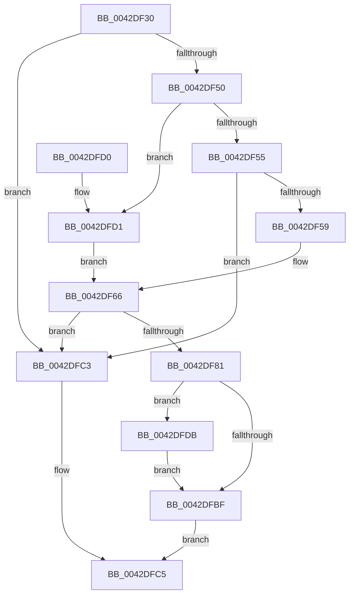

# HalpSetVirtualRtc

- RVA: `0x0042DF30`–`0x0042DFE4` (길이 `180` bytes)
- VA: `0x000000014042DF30`
- 실행 섹션: `.text`
- PDB 이름 있음: `예`; PDB Function 태그: `아니요`
- unwind 정보 RVA: `0x000A1AF4`
- 디코드: `48`개 명령, `180/180` bytes 표시
- 미해석 바이트: `0` (있으면 어셈블리에 `.byte`로 보존)

> 이 문서는 커널 이미지의 기계어와 PDB 기호를 분석해 생성했습니다. 4번과 5번은 함수 원형과 자료형을 바이너리 사용 방식에서 추정한 C 해석이며 원본 소스 복구 결과는 아닙니다.

## 1. Dependencies

- 직접 호출 지점: **3**; 고유 호출 대상: **3**
- 직접 호출자로 확인된 함수: **3**
- RIP 상대 이미지 참조: **8**

### Outgoing calls
- `0x0042DF59` → [RtlGetSystemTimePrecise](../37/RtlGetSystemTimePrecise_function_0037EDD0.md) (function, `0x0037EDD0`)
- `0x0042DF70` → [RtlpTimeToTimeFields](RtlpTimeToTimeFields_function_0042E110.md) (function, `0x0042E110`)
- `0x0042DF83` → [KeQueryPerformanceCounter](../37/KeQueryPerformanceCounter_function_0037E7E0.md) (function, `0x0037E7E0`)

### Direct callers
- [HalQueryRealTimeClock](HalQueryRealTimeClock_function_0042D810.md) at `0x0042D855`
- [HalCalibratePerformanceCounter](../53/HalCalibratePerformanceCounter_function_0053C010.md) at `0x0053C0F1`
- [HalpSetResumeTime](../55/HalpSetResumeTime_function_0055BC08.md) at `0x0055BD6A`

### Static image references
- `0x0042DF3A` → RVA `0x00FC1A98` (`.data`; read)
- `0x0042DF93` → RVA `0x00FC21C0` (`.data`; write)
- `0x0042DF99` → RVA `0x00FC21B8` (`.data`; write)
- `0x0042DFA0` → RVA `0x00FC21B4` (`.data`; write)
- `0x0042DFA6` → RVA `0x00FC21AC` (`.data`; write)
- `0x0042DFAD` → RVA `0x00FC21A8` (`.data`; write)
- `0x0042DFB3` → RVA `0x00FC21A0` (`.data`; write)
- `0x0042DFDB` → RVA `0x00FC21C4` (`.data`; write)

## 2. Other-region calls and transfers

- 다른 실행 섹션으로 향하는 call: **0**
- 별도 외부 분기/꼬리 이동을 확인하지 못했습니다.

## 3. Assembly (complete function range)

```asm
0042DF30  48 89 5C 24 08                  mov qword ptr [rsp + 8], rbx
0042DF35  57                              push rdi
0042DF36  48 83 EC 30                     sub rsp, 0x30
0042DF3A  8B 05 58 3B B9 00               mov eax, dword ptr [rip + 0xb93b58]
0042DF40  0F 57 C0                        xorps xmm0, xmm0
0042DF43  48 8B F9                        mov rdi, rcx
0042DF46  0F 11 44 24 20                  movups xmmword ptr [rsp + 0x20], xmm0
0042DF4B  83 F8 02                        cmp eax, 2
0042DF4E  74 73                           je 0x14042dfc3
0042DF50  48 85 C9                        test rcx, rcx
0042DF53  75 7C                           jne 0x14042dfd1
0042DF55  85 C0                           test eax, eax
0042DF57  75 6A                           jne 0x14042dfc3
0042DF59  E8 72 0E F5 FF                  call 0x14037edd0
0042DF5E  48 8B D8                        mov rbx, rax
0042DF61  48 89 44 24 48                  mov qword ptr [rsp + 0x48], rax
0042DF66  48 8D 54 24 20                  lea rdx, [rsp + 0x20]
0042DF6B  48 8D 4C 24 48                  lea rcx, [rsp + 0x48]
0042DF70  E8 9B 01 00 00                  call 0x14042e110
0042DF75  B8 41 06 00 00                  mov eax, 0x641
0042DF7A  66 39 44 24 20                  cmp word ptr [rsp + 0x20], ax
0042DF7F  7E 42                           jle 0x14042dfc3
0042DF81  33 C9                           xor ecx, ecx
0042DF83  E8 58 08 F5 FF                  call 0x14037e7e0
0042DF88  8B 4C 24 4C                     mov ecx, dword ptr [rsp + 0x4c]
0042DF8C  48 8B D0                        mov rdx, rax
0042DF8F  48 C1 EA 20                     shr rdx, 0x20
0042DF93  89 15 27 42 B9 00               mov dword ptr [rip + 0xb94227], edx
0042DF99  48 89 05 18 42 B9 00            mov qword ptr [rip + 0xb94218], rax
0042DFA0  89 0D 0E 42 B9 00               mov dword ptr [rip + 0xb9420e], ecx
0042DFA6  48 89 1D FF 41 B9 00            mov qword ptr [rip + 0xb941ff], rbx
0042DFAD  89 15 F5 41 B9 00               mov dword ptr [rip + 0xb941f5], edx
0042DFB3  48 89 05 E6 41 B9 00            mov qword ptr [rip + 0xb941e6], rax
0042DFBA  48 85 FF                        test rdi, rdi
0042DFBD  75 1C                           jne 0x14042dfdb
0042DFBF  B0 01                           mov al, 1
0042DFC1  EB 02                           jmp 0x14042dfc5
0042DFC3  32 C0                           xor al, al
0042DFC5  48 8B 5C 24 40                  mov rbx, qword ptr [rsp + 0x40]
0042DFCA  48 83 C4 30                     add rsp, 0x30
0042DFCE  5F                              pop rdi
0042DFCF  C3                              ret
0042DFD0  CC                              int3
0042DFD1  48 8B 19                        mov rbx, qword ptr [rcx]
0042DFD4  48 89 5C 24 48                  mov qword ptr [rsp + 0x48], rbx
0042DFD9  EB 8B                           jmp 0x14042df66
0042DFDB  C6 05 E2 41 B9 00 00            mov byte ptr [rip + 0xb941e2], 0
0042DFE2  EB DB                           jmp 0x14042dfbf
```

## 4. C-style interpretation (structured pseudocode)

```c
__int64 __fastcall HalpSetVirtualRtc(__int64 a1)
{
    __int64 result;
    __int64 v_rsp;
    unsigned __int64 v_stack_m18;
    unsigned __int64 v_stack_p10;
    unsigned int v_stack_p14;
    unsigned __int64 v_stack_p48;
    unsigned __int64 v_stack_p8;

    v_stack_p8 = v_rbx;
    v_rsp = (v_rsp) - (48);
    v_stack_m18 = v_xmm0;
    if (((unsigned int)((unsigned int)(*(unsigned int *)(v_rip + 12139352)))) == 2) goto loc_0042DFC3;
    if (a1 != 0) goto loc_0042DFD1;
    if ((unsigned int)((unsigned int)(*(unsigned int *)(v_rip + 12139352))) != 0) goto loc_0042DFC3;
    result = RtlGetSystemTimePrecise(a1, a2, a3, a4);
    v_stack_p10 = result;
loc_0042DF66:
    result = RtlpTimeToTimeFields(v_stack_p10, v_stack_m18, a3, a4);
    if (v_stack_m18 <= ((unsigned __int16)((unsigned int)(0x641ULL)))) goto loc_0042DFC3;
    a1 = 0;
    result = KeQueryPerformanceCounter(a1, v_stack_m18, a3, a4);
    a2 = (result) >> (32);
    *(unsigned int *)(v_rip + 12141095) = (unsigned int)(a2);
    *(unsigned __int64 *)(v_rip + 12141080) = result;
    *(unsigned int *)(v_rip + 12141070) = (unsigned int)((unsigned int)(v_stack_p14));
    *(unsigned __int64 *)(v_rip + 12141055) = result;
    *(unsigned int *)(v_rip + 12141045) = (unsigned int)(a2);
    *(unsigned __int64 *)(v_rip + 12141030) = result;
    if (0 != 0) goto loc_0042DFDB;
loc_0042DFBF:
    goto loc_0042DFC5;
loc_0042DFC3:
    result = 0;
loc_0042DFC5:
    v_rsp = (v_rsp) + (48);
    return result;
loc_0042DFD1:
    v_stack_p48 = *(unsigned __int64 *)((unsigned int)(v_stack_p14));
    goto loc_0042DF66;
loc_0042DFDB:
    *(unsigned __int8 *)(v_rip + 12141026) = 0;
    goto loc_0042DFBF;
}
```

## 5. (Beta) C Style

```c
int64_t HalpSetVirtualRtc(int64_t Arg1)
{
    int64_t result;
    int64_t local_rsp;
    uint64_t v_stack_m18;
    uint64_t v_stack_p10;
    uint32_t v_stack_p14;
    uint64_t v_stack_p48;
    uint64_t v_stack_p8;

    v_stack_p8 = local_rbx;
    local_rsp = (local_rsp) - (48);
    v_stack_m18 = v_xmm0;
    if (((uint32_t)((uint32_t)(*(uint32_t *)(v_rip + 0xB93B58)))) == 2) goto loc_0042DFC3;
    if (Arg1 != 0) goto loc_0042DFD1;
    if ((uint32_t)((uint32_t)(*(uint32_t *)(v_rip + 0xB93B58))) != 0) goto loc_0042DFC3;
    result = RtlGetSystemTimePrecise(Arg1, a2, a3, a4);
    v_stack_p10 = result;
loc_0042DF66:
    result = RtlpTimeToTimeFields(v_stack_p10, v_stack_m18, a3, a4);
    if (v_stack_m18 <= ((uint16_t)((uint32_t)(0x641ULL)))) goto loc_0042DFC3;
    Arg1 = 0;
    result = KeQueryPerformanceCounter(Arg1, v_stack_m18, a3, a4);
    a2 = (result) >> (32);
    *(uint32_t *)(v_rip + 0xB94227) = (uint32_t)(a2);
    *(uint64_t *)(v_rip + 0xB94218) = result;
    *(uint32_t *)(v_rip + 0xB9420E) = (uint32_t)((uint32_t)(v_stack_p14));
    *(uint64_t *)(v_rip + 0xB941FF) = result;
    *(uint32_t *)(v_rip + 0xB941F5) = (uint32_t)(a2);
    *(uint64_t *)(v_rip + 0xB941E6) = result;
    if (0 != 0) goto loc_0042DFDB;
loc_0042DFBF:
    goto loc_0042DFC5;
loc_0042DFC3:
    result = 0;
loc_0042DFC5:
    local_rsp = (local_rsp) + (48);
    return result;
loc_0042DFD1:
    v_stack_p48 = *(uint64_t *)((uint32_t)(v_stack_p14));
    goto loc_0042DF66;
loc_0042DFDB:
    *(uint8_t *)(v_rip + 0xB941E2) = 0;
    goto loc_0042DFBF;
}
```

## 6. Execution-region graph

[열기: 2D/3D 그래프와 함수 탐색 컨트롤 패널](../../../control-panel.html?section=text&rva=0x0042DF30&view=graph)

- 2D 그래프는 위에서 아래로 흐르고, 3D 그래프는 빈 공간을 드래그해 회전합니다. Shift+드래그는 이동, 휠은 확대·축소, 함수 노드 선택은 대상 보고서 이동입니다.

### Static fallback


