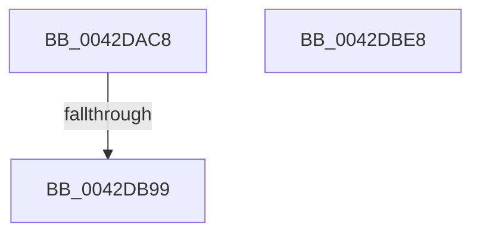

# HalpSetWakeAlarm

- RVA: `0x0042DAC8`–`0x0042DBE9` (길이 `289` bytes)
- VA: `0x000000014042DAC8`
- 실행 섹션: `.text`
- PDB 이름 있음: `예`; PDB Function 태그: `예`
- unwind 정보 RVA: `0x0005CF00`
- 디코드: `125`개 명령, `289/289` bytes 표시
- 미해석 바이트: `0` (있으면 어셈블리에 `.byte`로 보존)

> 이 문서는 커널 이미지의 기계어와 PDB 기호를 분석해 생성했습니다. 4번과 5번은 함수 원형과 자료형을 바이너리 사용 방식에서 추정한 C 해석이며 원본 소스 복구 결과는 아닙니다.

## 1. Dependencies

- 직접 호출 지점: **2**; 고유 호출 대상: **2**
- 직접 호출자로 확인된 함수: **2**
- RIP 상대 이미지 참조: **1**

### Outgoing calls
- `0x0042DAD1` → [HalpAcquireCmosSpinLockAndWait](HalpAcquireCmosSpinLockAndWait_function_0042DE20.md) (function, `0x0042DE20`)
- `0x0042DBDB` → [HalpReleaseCmosSpinLock](HalpReleaseCmosSpinLock_function_0042DE04.md) (function, `0x0042DE04`)

### Direct callers
- [HalpCheckWakeupTimeAndAdjust](../55/HalpCheckWakeupTimeAndAdjust_function_0055BB14.md) at `0x0055BBA8`
- [HaliSetWakeAlarm](../../pagelk/B7/HaliSetWakeAlarm_function_00B7D300.md) at `0x00B7D3DB`

### Static image references
- `0x0042DB8B` → RVA `0x00FC1B4A` (`.data`; read)

## 2. Other-region calls and transfers

- 다른 실행 섹션으로 향하는 call: **0**
- call이 아닌 외부 분기/꼬리 이동: **1**
  - `0x0042DB93` → [sub_006EE5B2](../6E/Unknown_function_006EE5B2.md) (`tail-transfer`)

## 3. Assembly (complete function range)

```asm
0042DAC8  40 53                           push rbx
0042DACA  48 83 EC 20                     sub rsp, 0x20
0042DACE  48 8B DA                        mov rbx, rdx
0042DAD1  E8 4A 03 00 00                  call 0x14042de20
0042DAD6  0F B6 4B 0A                     movzx ecx, byte ptr [rbx + 0xa]
0042DADA  41 BB CD CC CC CC               mov r11d, 0xcccccccd
0042DAE0  90                              nop
0042DAE1  44 8B C1                        mov r8d, ecx
0042DAE4  41 B9 70 00 00 00               mov r9d, 0x70
0042DAEA  B0 01                           mov al, 1
0042DAEC  41 8B D1                        mov edx, r9d
0042DAEF  EE                              out dx, al
0042DAF0  90                              nop
0042DAF1  41 8B C3                        mov eax, r11d
0042DAF4  F7 E1                           mul ecx
0042DAF6  90                              nop
0042DAF7  45 8D 51 01                     lea r10d, [r9 + 1]
0042DAFB  8B CA                           mov ecx, edx
0042DAFD  41 8B C3                        mov eax, r11d
0042DB00  41 F7 E0                        mul r8d
0042DB03  C1 E9 03                        shr ecx, 3
0042DB06  C1 EA 03                        shr edx, 3
0042DB09  C0 E1 04                        shl cl, 4
0042DB0C  8D 04 92                        lea eax, [rdx + rdx*4]
0042DB0F  41 8B D2                        mov edx, r10d
0042DB12  03 C0                           add eax, eax
0042DB14  44 2B C0                        sub r8d, eax
0042DB17  41 8D 04 08                     lea eax, [r8 + rcx]
0042DB1B  EE                              out dx, al
0042DB1C  90                              nop
0042DB1D  41 8B D1                        mov edx, r9d
0042DB20  0F B6 4B 08                     movzx ecx, byte ptr [rbx + 8]
0042DB24  B0 03                           mov al, 3
0042DB26  90                              nop
0042DB27  44 8B C1                        mov r8d, ecx
0042DB2A  EE                              out dx, al
0042DB2B  90                              nop
0042DB2C  41 8B C3                        mov eax, r11d
0042DB2F  F7 E1                           mul ecx
0042DB31  90                              nop
0042DB32  41 8B C3                        mov eax, r11d
0042DB35  8B CA                           mov ecx, edx
0042DB37  41 F7 E0                        mul r8d
0042DB3A  C1 E9 03                        shr ecx, 3
0042DB3D  C1 EA 03                        shr edx, 3
0042DB40  C0 E1 04                        shl cl, 4
0042DB43  8D 04 92                        lea eax, [rdx + rdx*4]
0042DB46  41 8B D2                        mov edx, r10d
0042DB49  03 C0                           add eax, eax
0042DB4B  44 2B C0                        sub r8d, eax
0042DB4E  41 8D 04 08                     lea eax, [r8 + rcx]
0042DB52  EE                              out dx, al
0042DB53  90                              nop
0042DB54  41 8B D1                        mov edx, r9d
0042DB57  0F B6 4B 06                     movzx ecx, byte ptr [rbx + 6]
0042DB5B  B0 05                           mov al, 5
0042DB5D  90                              nop
0042DB5E  44 8B C1                        mov r8d, ecx
0042DB61  EE                              out dx, al
0042DB62  90                              nop
0042DB63  41 8B C3                        mov eax, r11d
0042DB66  F7 E1                           mul ecx
0042DB68  90                              nop
0042DB69  41 8B C3                        mov eax, r11d
0042DB6C  8B CA                           mov ecx, edx
0042DB6E  41 F7 E0                        mul r8d
0042DB71  C1 E9 03                        shr ecx, 3
0042DB74  C1 EA 03                        shr edx, 3
0042DB77  C0 E1 04                        shl cl, 4
0042DB7A  8D 04 92                        lea eax, [rdx + rdx*4]
0042DB7D  41 8B D2                        mov edx, r10d
0042DB80  03 C0                           add eax, eax
0042DB82  44 2B C0                        sub r8d, eax
0042DB85  41 8D 04 08                     lea eax, [r8 + rcx]
0042DB89  EE                              out dx, al
0042DB8A  90                              nop
0042DB8B  8A 05 B9 3F B9 00               mov al, byte ptr [rip + 0xb93fb9]
0042DB91  3C 09                           cmp al, 9
0042DB93  0F 87 19 0A 2C 00               ja 0x1406ee5b2
0042DB99  90                              nop
0042DB9A  B0 0B                           mov al, 0xb
0042DB9C  41 8B D1                        mov edx, r9d
0042DB9F  EE                              out dx, al
0042DBA0  90                              nop
0042DBA1  41 8B D2                        mov edx, r10d
0042DBA4  90                              nop
0042DBA5  EC                              in al, dx
0042DBA6  90                              nop
0042DBA7  8A C8                           mov cl, al
0042DBA9  90                              nop
0042DBAA  B0 0B                           mov al, 0xb
0042DBAC  80 E1 41                        and cl, 0x41
0042DBAF  41 8B D1                        mov edx, r9d
0042DBB2  EE                              out dx, al
0042DBB3  90                              nop
0042DBB4  80 C9 22                        or cl, 0x22
0042DBB7  90                              nop
0042DBB8  8A C1                           mov al, cl
0042DBBA  41 8B D2                        mov edx, r10d
0042DBBD  EE                              out dx, al
0042DBBE  90                              nop
0042DBBF  B0 0C                           mov al, 0xc
0042DBC1  90                              nop
0042DBC2  41 8B D1                        mov edx, r9d
0042DBC5  EE                              out dx, al
0042DBC6  90                              nop
0042DBC7  41 8B D2                        mov edx, r10d
0042DBCA  90                              nop
0042DBCB  EC                              in al, dx
0042DBCC  90                              nop
0042DBCD  B0 0D                           mov al, 0xd
0042DBCF  90                              nop
0042DBD0  41 8B D1                        mov edx, r9d
0042DBD3  EE                              out dx, al
0042DBD4  90                              nop
0042DBD5  41 8B D2                        mov edx, r10d
0042DBD8  90                              nop
0042DBD9  EC                              in al, dx
0042DBDA  90                              nop
0042DBDB  E8 24 02 00 00                  call 0x14042de04
0042DBE0  33 C0                           xor eax, eax
0042DBE2  48 83 C4 20                     add rsp, 0x20
0042DBE6  5B                              pop rbx
0042DBE7  C3                              ret
0042DBE8  CC                              int3
```

## 4. C-style interpretation (structured pseudocode)

```c
__int64 __fastcall HalpSetWakeAlarm(__int64 a1, __int64 a2)
{
    __int64 result;
    __int64 v_rsp;

    v_rsp = (v_rsp) - (32);
    result = HalpAcquireCmosSpinLockAndWait(a1, a2, a3, a4);
    a1 = (unsigned int)((112) >> (3));
    a2 = (unsigned int)((112) >> (3));
    a1 = (unsigned __int8)((a1) << (4));
    result = (unsigned int)((a2 + a2 * 4) + ((unsigned int)(a2 + a2 * 4)));
    a3 = (unsigned int)(((unsigned int)((unsigned int)(*(unsigned __int8 *)(a2 + 10)))) - ((unsigned int)(result)));
    a1 = (unsigned int)((112) >> (3));
    a2 = (unsigned int)((112) >> (3));
    a1 = (unsigned __int8)((a1) << (4));
    result = (unsigned int)((a2 + a2 * 4) + ((unsigned int)(a2 + a2 * 4)));
    a3 = (unsigned int)(((unsigned int)((unsigned int)(*(unsigned __int8 *)(a2 + 8)))) - ((unsigned int)(result)));
    a1 = (unsigned int)((112) >> (3));
    a2 = (unsigned int)((112) >> (3));
    a1 = (unsigned __int8)((a1) << (4));
    result = (unsigned int)((a2 + a2 * 4) + ((unsigned int)(a2 + a2 * 4)));
    a3 = (unsigned int)(((unsigned int)((unsigned int)(*(unsigned __int8 *)(a2 + 6)))) - ((unsigned int)(result)));
    a1 = (unsigned __int8)((11) & (65));
    a1 = (unsigned __int8)((a1) | (34));
    result = HalpReleaseCmosSpinLock(a1, (unsigned int)((unsigned int)(112 + 1)), a3, 112);
    result = 0;
    v_rsp = (v_rsp) + (32);
    return result;
}
```

## 5. (Beta) C Style

```c
int64_t HalpSetWakeAlarm(int64_t Arg1, void *Arg2)
{
    uint8_t *arg2 = (uint8_t *)Arg2;

    int64_t result;
    int64_t local_rsp;

    local_rsp = (local_rsp) - (32);
    result = HalpAcquireCmosSpinLockAndWait(Arg1, Arg2, a3, a4);
    Arg1 = (uint32_t)((112) >> (3));
    Arg2 = (uint32_t)((112) >> (3));
    Arg1 = (uint8_t)((Arg1) << (4));
    result = (uint32_t)((Arg2 + Arg2 * 4) + ((uint32_t)(Arg2 + Arg2 * 4)));
    a3 = (uint32_t)(((uint32_t)((uint32_t)(*(uint8_t *)(arg2 + 0xA)))) - ((uint32_t)(result)));
    Arg1 = (uint32_t)((112) >> (3));
    Arg2 = (uint32_t)((112) >> (3));
    Arg1 = (uint8_t)((Arg1) << (4));
    result = (uint32_t)((Arg2 + Arg2 * 4) + ((uint32_t)(Arg2 + Arg2 * 4)));
    a3 = (uint32_t)(((uint32_t)((uint32_t)(*(uint8_t *)(arg2 + 0x8)))) - ((uint32_t)(result)));
    Arg1 = (uint32_t)((112) >> (3));
    Arg2 = (uint32_t)((112) >> (3));
    Arg1 = (uint8_t)((Arg1) << (4));
    result = (uint32_t)((Arg2 + Arg2 * 4) + ((uint32_t)(Arg2 + Arg2 * 4)));
    a3 = (uint32_t)(((uint32_t)((uint32_t)(*(uint8_t *)(arg2 + 0x6)))) - ((uint32_t)(result)));
    Arg1 = (uint8_t)((11) & (65));
    Arg1 = (uint8_t)((Arg1) | (34));
    result = HalpReleaseCmosSpinLock(Arg1, (uint32_t)((uint32_t)(112 + 1)), a3, 112);
    result = 0;
    local_rsp = (local_rsp) + (32);
    return result;
}
```

### 관측된 메모리 오프셋

구조체 형식이 확인되지 않은 접근은 인자 기준의 오프셋으로만 기록했습니다.

| 기준 인자 | 오프셋 표현 | 폭 (bit) | 접근 |
|---|---:|---:|---|
| `Arg2` | `+ 0x6` | `8` | `R` |
| `Arg2` | `+ 0x8` | `8` | `R` |
| `Arg2` | `+ 0xA` | `8` | `R` |

## 6. Execution-region graph

[열기: 2D/3D 그래프와 함수 탐색 컨트롤 패널](../../../control-panel.html?section=text&rva=0x0042DAC8&view=graph)

- 2D 그래프는 위에서 아래로 흐르고, 3D 그래프는 빈 공간을 드래그해 회전합니다. Shift+드래그는 이동, 휠은 확대·축소, 함수 노드 선택은 대상 보고서 이동입니다.

### Static fallback


