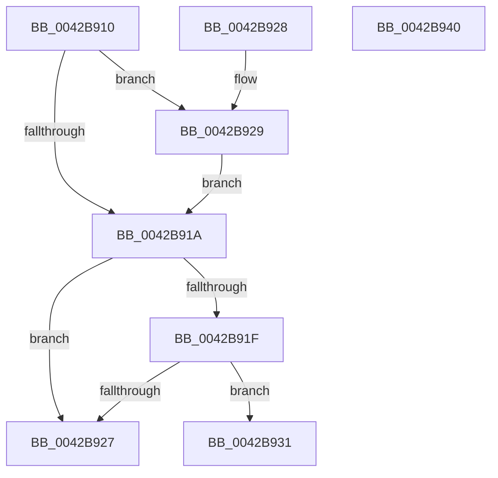

# HalpTimerClearProblem

- RVA: `0x0042B910`–`0x0042B941` (길이 `49` bytes)
- VA: `0x000000014042B910`
- 실행 섹션: `.text`
- PDB 이름 있음: `예`; PDB Function 태그: `아니요`
- unwind 정보 RVA: `0x000DB714`
- 디코드: `15`개 명령, `49/49` bytes 표시
- 미해석 바이트: `0` (있으면 어셈블리에 `.byte`로 보존)

> 이 문서는 커널 이미지의 기계어와 PDB 기호를 분석해 생성했습니다. 4번과 5번은 함수 원형과 자료형을 바이너리 사용 방식에서 추정한 C 해석이며 원본 소스 복구 결과는 아닙니다.

## 1. Dependencies

- 직접 호출 지점: **0**; 고유 호출 대상: **0**
- 직접 호출자로 확인된 함수: **1**
- RIP 상대 이미지 참조: **2**

### Outgoing calls
- 직접 디코드된 call 명령이 없습니다.

### Direct callers
- [HalpSetTimerAnyMode](HalpSetTimerAnyMode_function_0042B868.md) at `0x0042B8A4`
- [HalpSetTimerAnyMode](HalpSetTimerAnyMode_function_0042B868.md) at `0x0042B8AE`

### Static image references
- `0x0042B912` → RVA `0x00E10358` (`.data`; read)
- `0x0042B929` → RVA `0x00E10358` (`.data`; write)

## 2. Other-region calls and transfers

- 다른 실행 섹션으로 향하는 call: **0**
- 별도 외부 분기/꼬리 이동을 확인하지 못했습니다.

## 3. Assembly (complete function range)

```asm
0042B910  33 C0                           xor eax, eax
0042B912  39 15 40 4A 9E 00               cmp dword ptr [rip + 0x9e4a40], edx
0042B918  74 0F                           je 0x14042b929
0042B91A  48 85 C9                        test rcx, rcx
0042B91D  74 08                           je 0x14042b927
0042B91F  39 91 FC 00 00 00               cmp dword ptr [rcx + 0xfc], edx
0042B925  74 0A                           je 0x14042b931
0042B927  C3                              ret
0042B928  CC                              int3
0042B929  89 05 29 4A 9E 00               mov dword ptr [rip + 0x9e4a29], eax
0042B92F  EB E9                           jmp 0x14042b91a
0042B931  48 89 81 FC 00 00 00            mov qword ptr [rcx + 0xfc], rax
0042B938  48 89 81 08 01 00 00            mov qword ptr [rcx + 0x108], rax
0042B93F  C3                              ret
0042B940  CC                              int3
```

## 4. C-style interpretation (structured pseudocode)

```c
__int64 __fastcall HalpTimerClearProblem(__int64 a1, int a2)
{
    __int64 result;

    result = 0;
    if ((*(unsigned int *)(v_rip + 10373696)) == a2) goto loc_0042B929;
loc_0042B91A:
    if (a1 == 0) goto loc_0042B927;
    if ((*(unsigned int *)(a1 + 252)) == a2) goto loc_0042B931;
loc_0042B927:
    return result;
loc_0042B929:
    *(unsigned int *)(v_rip + 10373673) = 0;
    goto loc_0042B91A;
loc_0042B931:
    *(unsigned __int64 *)(a1 + 252) = 0;
    *(unsigned __int64 *)(a1 + 264) = 0;
    return result;
}
```

## 5. (Beta) C Style

```c
int64_t HalpTimerClearProblem(int64_t Arg1, int32_t Arg2)
{
    int64_t result;

    result = 0;
    if ((*(uint32_t *)(v_rip + 0x9E4A40)) == Arg2) goto loc_0042B929;
loc_0042B91A:
    if (Arg1 == 0) goto loc_0042B927;
    if ((*(uint32_t *)(Arg1 + 0xFC)) == Arg2) goto loc_0042B931;
loc_0042B927:
    return result;
loc_0042B929:
    *(uint32_t *)(v_rip + 0x9E4A29) = 0;
    goto loc_0042B91A;
loc_0042B931:
    *(uint64_t *)(Arg1 + 0xFC) = 0;
    *(uint64_t *)(Arg1 + 0x108) = 0;
    return result;
}
```

## 6. Execution-region graph

[열기: 2D/3D 그래프와 함수 탐색 컨트롤 패널](../../../control-panel.html?section=text&rva=0x0042B910&view=graph)

- 2D 그래프는 위에서 아래로 흐르고, 3D 그래프는 빈 공간을 드래그해 회전합니다. Shift+드래그는 이동, 휠은 확대·축소, 함수 노드 선택은 대상 보고서 이동입니다.

### Static fallback


