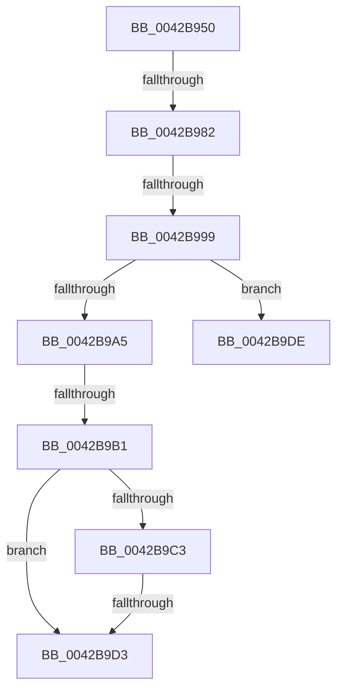

# HalpTimerClockArm

- RVA: `0x0042B950`–`0x0042B9E0` (길이 `144` bytes)
- VA: `0x000000014042B950`
- 실행 섹션: `.text`
- PDB 이름 있음: `예`; PDB Function 태그: `아니요`
- unwind 정보 RVA: `0x000A1840`
- 디코드: `34`개 명령, `144/144` bytes 표시
- 미해석 바이트: `0` (있으면 어셈블리에 `.byte`로 보존)

> 이 문서는 커널 이미지의 기계어와 PDB 기호를 분석해 생성했습니다. 4번과 5번은 함수 원형과 자료형을 바이너리 사용 방식에서 추정한 C 해석이며 원본 소스 복구 결과는 아닙니다.

## 1. Dependencies

- 직접 호출 지점: **0**; 고유 호출 대상: **0**
- 직접 호출자로 확인된 함수: **1**
- RIP 상대 이미지 참조: **3**

### Outgoing calls
- 직접 디코드된 call 명령이 없습니다.

### Direct callers
- [HalpTimerSwitchToNormalClock](../54/HalpTimerSwitchToNormalClock_function_00548814.md) at `0x0054889D`

### Static image references
- `0x0042B95D` → RVA `0x00FC40F0` (`.data`; read)
- `0x0042B972` → RVA `0x00FC22D8` (`.data`; read)
- `0x0042B982` → RVA `0x00FC22D0` (`.data`; read)

## 2. Other-region calls and transfers

- 다른 실행 섹션으로 향하는 call: **0**
- call이 아닌 외부 분기/꼬리 이동: **5**
  - `0x0042B97C` → [sub_0042BC55](Unknown_function_0042BC55.md) (`tail-transfer`)
  - `0x0042B993` → [sub_0042BC55 + 0x1C](Unknown_function_0042BC55.md) (`tail-transfer`)
  - `0x0042B9AB` → [sub_0042BBEF](Unknown_function_0042BBEF.md) (`tail-transfer`)
  - `0x0042B9CD` → [sub_0042BAC2](Unknown_function_0042BAC2.md) (`tail-transfer`)
  - `0x0042B9D9` → [sub_0042BAC2 + 0xAA](Unknown_function_0042BAC2.md) (`tail-transfer`)

## 3. Assembly (complete function range)

```asm
0042B950  48 89 5C 24 18                  mov qword ptr [rsp + 0x18], rbx
0042B955  56                              push rsi
0042B956  57                              push rdi
0042B957  41 56                           push r14
0042B959  48 83 EC 30                     sub rsp, 0x30
0042B95D  48 8B 35 8C 87 B9 00            mov rsi, qword ptr [rip + 0xb9878c]
0042B964  8B F9                           mov edi, ecx
0042B966  65 48 8B 0C 25 20 00 00 00      mov rcx, qword ptr gs:[0x20]
0042B96F  4D 8B F0                        mov r14, r8
0042B972  48 3B 15 5F 69 B9 00            cmp rdx, qword ptr [rip + 0xb9695f]
0042B979  48 8B DA                        mov rbx, rdx
0042B97C  0F 87 D3 02 00 00               ja 0x14042bc55
0042B982  8B 05 48 69 B9 00               mov eax, dword ptr [rip + 0xb96948]
0042B988  48 3B D0                        cmp rdx, rax
0042B98B  48 0F 42 D8                     cmovb rbx, rax
0042B98F  F6 41 22 02                     test byte ptr [rcx + 0x22], 2
0042B993  0F 85 D8 02 00 00               jne 0x14042bc71
0042B999  44 8B 9E E0 00 00 00            mov r11d, dword ptr [rsi + 0xe0]
0042B9A0  83 FF 01                        cmp edi, 1
0042B9A3  75 39                           jne 0x14042b9de
0042B9A5  33 FF                           xor edi, edi
0042B9A7  41 F6 C3 20                     test r11b, 0x20
0042B9AB  0F 84 3E 02 00 00               je 0x14042bbef
0042B9B1  4C 8B 8E C0 00 00 00            mov r9, qword ptr [rsi + 0xc0]
0042B9B8  48 8B C3                        mov rax, rbx
0042B9BB  49 F7 E1                        mul r9
0042B9BE  48 85 D2                        test rdx, rdx
0042B9C1  75 10                           jne 0x14042b9d3
0042B9C3  48 8D 88 7F 96 98 00            lea rcx, [rax + 0x98967f]
0042B9CA  48 3B C8                        cmp rcx, rax
0042B9CD  0F 83 EF 00 00 00               jae 0x14042bac2
0042B9D3  41 BA 95 00 00 C0               mov r10d, 0xc0000095
0042B9D9  E9 8E 01 00 00                  jmp 0x14042bb6c
0042B9DE  33 FF                           xor edi, edi
```

## 4. C-style interpretation (structured pseudocode)

```c
__int64 __fastcall HalpTimerClockArm(int a1, __int64 a2, __int64 a3)
{
    __int64 v_rdi;
    __int64 v_rsp;
    unsigned __int64 v_stack_p18;

    v_stack_p18 = v_rbx;
    v_rsp = (v_rsp) - (48);
    if (a2 < ((unsigned int)(*(unsigned int *)(v_rip + 12151112)))) { a2 = (unsigned int)(*(unsigned int *)(v_rip + 12151112)); }
    if (((unsigned int)((unsigned int)(a1))) != 1) goto loc_0042B9DE;
    v_rdi = 0;
    if (a2 != 0) goto loc_0042B9D3;
loc_0042B9D3:
loc_0042B9DE:
    v_rdi = 0;
    return a2;
}
```

## 5. (Beta) C Style

```c
int64_t HalpTimerClockArm(int32_t Arg1, int64_t Arg2, int64_t Arg3)
{
    int64_t local_rdi;
    int64_t local_rsp;
    uint64_t v_stack_p18;

    v_stack_p18 = local_rbx;
    local_rsp = (local_rsp) - (48);
    if (Arg2 < ((uint32_t)(*(uint32_t *)(v_rip + 0xB96948)))) { Arg2 = (uint32_t)(*(uint32_t *)(v_rip + 0xB96948)); }
    if (((uint32_t)((uint32_t)(Arg1))) != 1) goto loc_0042B9DE;
    local_rdi = 0;
    if (Arg2 != 0) goto loc_0042B9D3;
loc_0042B9D3:
loc_0042B9DE:
    local_rdi = 0;
    return Arg2;
}
```

## 6. Execution-region graph

[열기: 2D/3D 그래프와 함수 탐색 컨트롤 패널](../../../control-panel.html?section=text&rva=0x0042B950&view=graph)

- 2D 그래프는 위에서 아래로 흐르고, 3D 그래프는 빈 공간을 드래그해 회전합니다. Shift+드래그는 이동, 휠은 확대·축소, 함수 노드 선택은 대상 보고서 이동입니다.

### Static fallback


