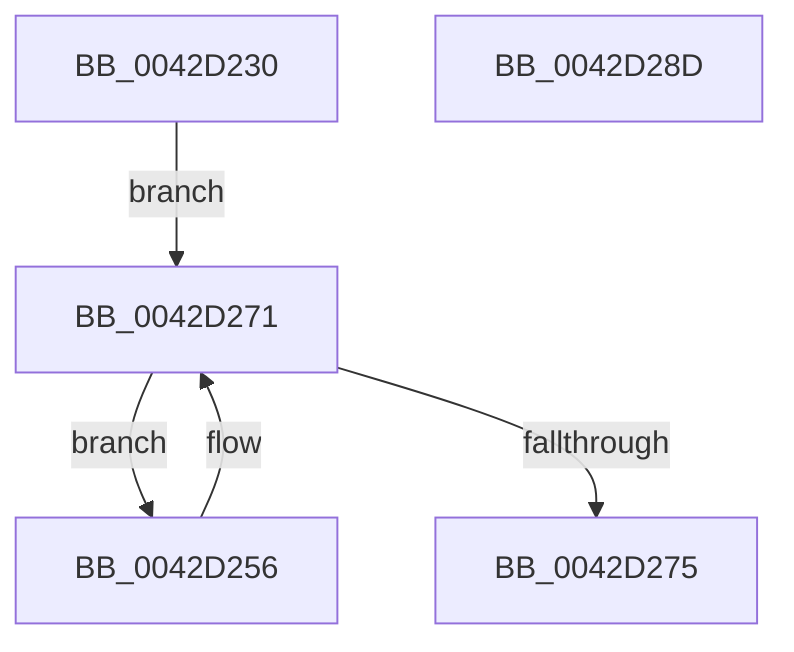

# HalpWriteCmosDataByPort

- RVA: `0x0042D230`–`0x0042D28E` (길이 `94` bytes)
- VA: `0x000000014042D230`
- 실행 섹션: `.text`
- PDB 이름 있음: `예`; PDB Function 태그: `아니요`
- unwind 정보 RVA: `0x00060BC4`
- 디코드: `33`개 명령, `94/94` bytes 표시
- 미해석 바이트: `0` (있으면 어셈블리에 `.byte`로 보존)

> 이 문서는 커널 이미지의 기계어와 PDB 기호를 분석해 생성했습니다. 4번과 5번은 함수 원형과 자료형을 바이너리 사용 방식에서 추정한 C 해석이며 원본 소스 복구 결과는 아닙니다.

## 1. Dependencies

- 직접 호출 지점: **2**; 고유 호출 대상: **2**
- 직접 호출자로 확인된 함수: **1**
- RIP 상대 이미지 참조: **0**

### Outgoing calls
- `0x0042D24C` → [HalpAcquireCmosSpinLock](HalpAcquireCmosSpinLock_function_0042DEE8.md) (function, `0x0042DEE8`)
- `0x0042D275` → [HalpReleaseCmosSpinLock](HalpReleaseCmosSpinLock_function_0042DE04.md) (function, `0x0042DE04`)

### Direct callers
- [HalpWriteStdCmosData](HalpWriteStdCmosData_function_0042D210.md) at `0x0042D21F`

### Static image references
- 디코드된 RIP-relative 메모리 참조가 없습니다.

## 2. Other-region calls and transfers

- 다른 실행 섹션으로 향하는 call: **0**
- 별도 외부 분기/꼬리 이동을 확인하지 못했습니다.

## 3. Assembly (complete function range)

```asm
0042D230  48 89 5C 24 08                  mov qword ptr [rsp + 8], rbx
0042D235  48 89 74 24 10                  mov qword ptr [rsp + 0x10], rsi
0042D23A  57                              push rdi
0042D23B  48 83 EC 20                     sub rsp, 0x20
0042D23F  8B 7C 24 50                     mov edi, dword ptr [rsp + 0x50]
0042D243  49 8B F1                        mov rsi, r9
0042D246  41 03 F8                        add edi, r8d
0042D249  41 8B D8                        mov ebx, r8d
0042D24C  E8 97 0C 00 00                  call 0x14042dee8
0042D251  45 33 C0                        xor r8d, r8d
0042D254  EB 1B                           jmp 0x14042d271
0042D256  90                              nop
0042D257  8A C3                           mov al, bl
0042D259  BA 70 00 00 00                  mov edx, 0x70
0042D25E  FF C3                           inc ebx
0042D260  EE                              out dx, al
0042D261  90                              nop
0042D262  BA 71 00 00 00                  mov edx, 0x71
0042D267  41 8A 04 30                     mov al, byte ptr [r8 + rsi]
0042D26B  90                              nop
0042D26C  EE                              out dx, al
0042D26D  90                              nop
0042D26E  41 FF C0                        inc r8d
0042D271  3B DF                           cmp ebx, edi
0042D273  72 E1                           jb 0x14042d256
0042D275  E8 8A 0B 00 00                  call 0x14042de04
0042D27A  48 8B 5C 24 30                  mov rbx, qword ptr [rsp + 0x30]
0042D27F  41 8B C0                        mov eax, r8d
0042D282  48 8B 74 24 38                  mov rsi, qword ptr [rsp + 0x38]
0042D287  48 83 C4 20                     add rsp, 0x20
0042D28B  5F                              pop rdi
0042D28C  C3                              ret
0042D28D  CC                              int3
```

## 4. C-style interpretation (structured pseudocode)

```c
__int64 __fastcall HalpWriteCmosDataByPort(__int64 a1, __int64 a2, int a3, __int64 a4, unsigned int a5)
{
    __int64 result;
    __int64 v_rbx;
    __int64 v_rdi;
    __int64 v_rsp;
    unsigned __int64 v_stack_p10;
    unsigned __int64 v_stack_p8;

    v_stack_p8 = v_rbx;
    v_stack_p10 = v_rsi;
    v_rsp = (v_rsp) - (32);
    v_rdi = (unsigned int)(((unsigned int)(a5)) + (a3));
    result = HalpAcquireCmosSpinLock(a1, a2, a3, a4);
    a3 = 0;
    goto loc_0042D271;
loc_0042D256:
    v_rbx = (unsigned int)(((unsigned int)(a3)) + 1);
    a3 = (unsigned int)((a3) + 1);
loc_0042D271:
    if (((unsigned int)(v_rbx)) < ((unsigned int)(v_rdi))) goto loc_0042D256;
    result = HalpReleaseCmosSpinLock(a1, 113, a3, a4);
    v_rsp = (v_rsp) + (32);
    return (unsigned int)(a3);
}
```

## 5. (Beta) C Style

```c
int64_t HalpWriteCmosDataByPort(int64_t Arg1, int64_t Arg2, int32_t Arg3, int64_t Arg4, uint32_t Arg5)
{
    int64_t result;
    int64_t local_rbx;
    int64_t local_rdi;
    int64_t local_rsp;
    uint64_t v_stack_p10;
    uint64_t v_stack_p8;

    v_stack_p8 = local_rbx;
    v_stack_p10 = local_rsi;
    local_rsp = (local_rsp) - (32);
    local_rdi = (uint32_t)(((uint32_t)(Arg5)) + (Arg3));
    result = HalpAcquireCmosSpinLock(Arg1, Arg2, Arg3, Arg4);
    Arg3 = 0;
    goto loc_0042D271;
loc_0042D256:
    local_rbx = (uint32_t)(((uint32_t)(Arg3)) + 1);
    Arg3 = (uint32_t)((Arg3) + 1);
loc_0042D271:
    if (((uint32_t)(local_rbx)) < ((uint32_t)(local_rdi))) goto loc_0042D256;
    result = HalpReleaseCmosSpinLock(Arg1, 113, Arg3, Arg4);
    local_rsp = (local_rsp) + (32);
    return (uint32_t)(Arg3);
}
```

## 6. Execution-region graph

[열기: 2D/3D 그래프와 함수 탐색 컨트롤 패널](../../../control-panel.html?section=text&rva=0x0042D230&view=graph)

- 2D 그래프는 위에서 아래로 흐르고, 3D 그래프는 빈 공간을 드래그해 회전합니다. Shift+드래그는 이동, 휠은 확대·축소, 함수 노드 선택은 대상 보고서 이동입니다.

### Static fallback


