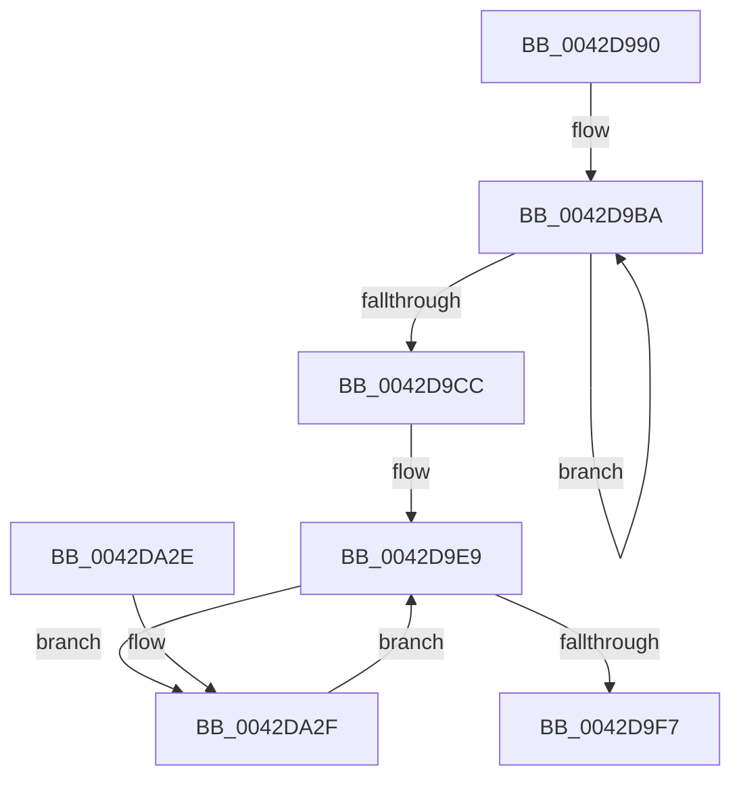

# HalpWriteRtcStdPCAT

- RVA: `0x0042D990`–`0x0042DA3E` (길이 `174` bytes)
- VA: `0x000000014042D990`
- 실행 섹션: `.text`
- PDB 이름 있음: `예`; PDB Function 태그: `아니요`
- unwind 정보 RVA: `0x00073EA0`
- 디코드: `81`개 명령, `174/174` bytes 표시
- 미해석 바이트: `0` (있으면 어셈블리에 `.byte`로 보존)

> 이 문서는 커널 이미지의 기계어와 PDB 기호를 분석해 생성했습니다. 4번과 5번은 함수 원형과 자료형을 바이너리 사용 방식에서 추정한 C 해석이며 원본 소스 복구 결과는 아닙니다.

## 1. Dependencies

- 직접 호출 지점: **2**; 고유 호출 대상: **2**
- 직접 호출자로 확인된 함수: **0**
- RIP 상대 이미지 참조: **0**

### Outgoing calls
- `0x0042D9A8` → [HalpAcquireCmosSpinLock](HalpAcquireCmosSpinLock_function_0042DEE8.md) (function, `0x0042DEE8`)
- `0x0042DA16` → [HalpReleaseCmosSpinLock](HalpReleaseCmosSpinLock_function_0042DE04.md) (function, `0x0042DE04`)

### Direct callers
- 이 함수 시작 RVA로 연결되는 직접 call은 확인되지 않았습니다. 간접 호출은 완전히 역산할 수 없습니다.

### Static image references
- 디코드된 RIP-relative 메모리 참조가 없습니다.

## 2. Other-region calls and transfers

- 다른 실행 섹션으로 향하는 call: **0**
- 별도 외부 분기/꼬리 이동을 확인하지 못했습니다.

## 3. Assembly (complete function range)

```asm
0042D990  48 89 5C 24 08                  mov qword ptr [rsp + 8], rbx
0042D995  48 89 74 24 10                  mov qword ptr [rsp + 0x10], rsi
0042D99A  57                              push rdi
0042D99B  48 83 EC 20                     sub rsp, 0x20
0042D99F  48 8B F2                        mov rsi, rdx
0042D9A2  42 8D 3C 01                     lea edi, [rcx + r8]
0042D9A6  8B D9                           mov ebx, ecx
0042D9A8  E8 3B 05 00 00                  call 0x14042dee8
0042D9AD  41 B9 70 00 00 00               mov r9d, 0x70
0042D9B3  45 33 C0                        xor r8d, r8d
0042D9B6  45 8D 51 01                     lea r10d, [r9 + 1]
0042D9BA  90                              nop
0042D9BB  41 8B D1                        mov edx, r9d
0042D9BE  B0 0A                           mov al, 0xa
0042D9C0  EE                              out dx, al
0042D9C1  90                              nop
0042D9C2  41 8B D2                        mov edx, r10d
0042D9C5  90                              nop
0042D9C6  EC                              in al, dx
0042D9C7  90                              nop
0042D9C8  84 C0                           test al, al
0042D9CA  78 EE                           js 0x14042d9ba
0042D9CC  90                              nop
0042D9CD  41 8B D1                        mov edx, r9d
0042D9D0  B0 0B                           mov al, 0xb
0042D9D2  EE                              out dx, al
0042D9D3  90                              nop
0042D9D4  41 8B D2                        mov edx, r10d
0042D9D7  90                              nop
0042D9D8  EC                              in al, dx
0042D9D9  8A C8                           mov cl, al
0042D9DB  90                              nop
0042D9DC  B0 0B                           mov al, 0xb
0042D9DE  90                              nop
0042D9DF  41 8B D1                        mov edx, r9d
0042D9E2  80 C9 80                        or cl, 0x80
0042D9E5  EE                              out dx, al
0042D9E6  90                              nop
0042D9E7  8A C1                           mov al, cl
0042D9E9  90                              nop
0042D9EA  41 8B D2                        mov edx, r10d
0042D9ED  EE                              out dx, al
0042D9EE  90                              nop
0042D9EF  90                              nop
0042D9F0  41 8B D1                        mov edx, r9d
0042D9F3  3B DF                           cmp ebx, edi
0042D9F5  72 38                           jb 0x14042da2f
0042D9F7  B0 0B                           mov al, 0xb
0042D9F9  EE                              out dx, al
0042D9FA  90                              nop
0042D9FB  41 8B D2                        mov edx, r10d
0042D9FE  90                              nop
0042D9FF  EC                              in al, dx
0042DA00  90                              nop
0042DA01  8A C8                           mov cl, al
0042DA03  90                              nop
0042DA04  B0 0B                           mov al, 0xb
0042DA06  41 8B D1                        mov edx, r9d
0042DA09  80 E1 7F                        and cl, 0x7f
0042DA0C  EE                              out dx, al
0042DA0D  90                              nop
0042DA0E  8A C1                           mov al, cl
0042DA10  90                              nop
0042DA11  41 8B D2                        mov edx, r10d
0042DA14  EE                              out dx, al
0042DA15  90                              nop
0042DA16  E8 E9 03 00 00                  call 0x14042de04
0042DA1B  48 8B 5C 24 30                  mov rbx, qword ptr [rsp + 0x30]
0042DA20  41 8B C0                        mov eax, r8d
0042DA23  48 8B 74 24 38                  mov rsi, qword ptr [rsp + 0x38]
0042DA28  48 83 C4 20                     add rsp, 0x20
0042DA2C  5F                              pop rdi
0042DA2D  C3                              ret
0042DA2E  CC                              int3
0042DA2F  8A C3                           mov al, bl
0042DA31  FF C3                           inc ebx
0042DA33  EE                              out dx, al
0042DA34  90                              nop
0042DA35  41 8A 04 30                     mov al, byte ptr [r8 + rsi]
0042DA39  41 FF C0                        inc r8d
0042DA3C  EB AB                           jmp 0x14042d9e9
```

## 4. C-style interpretation (structured pseudocode)

```c
__int64 __fastcall HalpWriteRtcStdPCAT(__int64 a1, __int64 a2, __int64 a3)
{
    __int64 result;
    __int64 v_rbx;
    __int64 v_rsp;
    unsigned __int64 v_stack_p10;
    unsigned __int64 v_stack_p8;

    v_stack_p8 = v_rbx;
    v_stack_p10 = v_rsi;
    v_rsp = (v_rsp) - (32);
    result = HalpAcquireCmosSpinLock(a1, a2, a3, a4);
    a3 = 0;
loc_0042D9BA:
    if (sign_flag) goto loc_0042D9BA;
    a1 = (unsigned __int8)((11) | (128));
loc_0042D9E9:
    if (((unsigned int)((unsigned int)((unsigned int)(a1)))) < ((unsigned int)(a1 + a3 * 1))) goto loc_0042DA2F;
    a1 = (unsigned __int8)((11) & (127));
    result = HalpReleaseCmosSpinLock(a1, (unsigned int)((unsigned int)(112 + 1)), a3, 112);
    v_rsp = (v_rsp) + (32);
    return 0;
loc_0042DA2F:
    v_rbx = (unsigned int)((v_stack_p8) + 1);
    a3 = (unsigned int)((a3) + 1);
    goto loc_0042D9E9;
}
```

## 5. (Beta) C Style

```c
int64_t HalpWriteRtcStdPCAT(void *Arg1, int64_t Arg2, int64_t Arg3)
{
    uint8_t *arg1 = (uint8_t *)Arg1;

    int64_t result;
    int64_t local_rbx;
    int64_t local_rsp;
    uint64_t v_stack_p10;
    uint64_t v_stack_p8;

    v_stack_p8 = local_rbx;
    v_stack_p10 = local_rsi;
    local_rsp = (local_rsp) - (32);
    result = HalpAcquireCmosSpinLock(Arg1, Arg2, Arg3, a4);
    Arg3 = 0;
loc_0042D9BA:
    if (sign_flag) goto loc_0042D9BA;
    Arg1 = (uint8_t)((11) | (128));
loc_0042D9E9:
    if (((uint32_t)((uint32_t)((uint32_t)(Arg1)))) < ((uint32_t)(Arg1 + Arg3 * 1))) goto loc_0042DA2F;
    Arg1 = (uint8_t)((11) & (127));
    result = HalpReleaseCmosSpinLock(Arg1, (uint32_t)((uint32_t)(112 + 1)), Arg3, 112);
    local_rsp = (local_rsp) + (32);
    return 0;
loc_0042DA2F:
    local_rbx = (uint32_t)((v_stack_p8) + 1);
    Arg3 = (uint32_t)((Arg3) + 1);
    goto loc_0042D9E9;
}
```

### 관측된 메모리 오프셋

구조체 형식이 확인되지 않은 접근은 인자 기준의 오프셋으로만 기록했습니다.

| 기준 인자 | 오프셋 표현 | 폭 (bit) | 접근 |
|---|---:|---:|---|
| `Arg1` | `+ 0x0 + r8*1` | `32` | `R` |

## 6. Execution-region graph

[열기: 2D/3D 그래프와 함수 탐색 컨트롤 패널](../../../control-panel.html?section=text&rva=0x0042D990&view=graph)

- 2D 그래프는 위에서 아래로 흐르고, 3D 그래프는 빈 공간을 드래그해 회전합니다. Shift+드래그는 이동, 휠은 확대·축소, 함수 노드 선택은 대상 보고서 이동입니다.

### Static fallback


