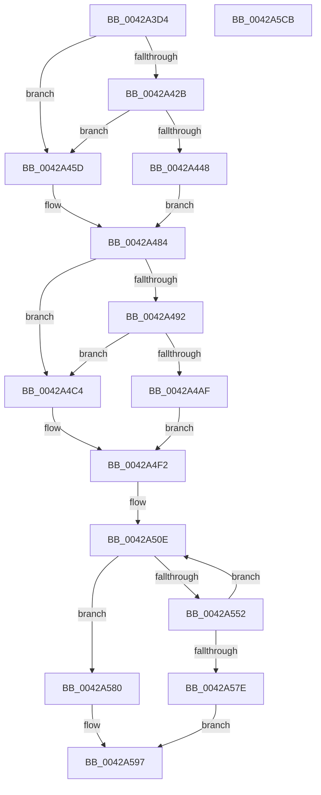

# HvlGetGpaPagesAccessState

- RVA: `0x0042A3D4`–`0x0042A5CC` (길이 `504` bytes)
- VA: `0x000000014042A3D4`
- 실행 섹션: `.text`
- PDB 이름 있음: `예`; PDB Function 태그: `아니요`
- unwind 정보 RVA: `0x000A1004`
- 디코드: `134`개 명령, `504/504` bytes 표시
- 미해석 바이트: `0` (있으면 어셈블리에 `.byte`로 보존)

> 이 문서는 커널 이미지의 기계어와 PDB 기호를 분석해 생성했습니다. 4번과 5번은 함수 원형과 자료형을 바이너리 사용 방식에서 추정한 C 해석이며 원본 소스 복구 결과는 아닙니다.

## 1. Dependencies

- 직접 호출 지점: **9**; 고유 호출 대상: **6**
- 직접 호출자로 확인된 함수: **1**
- RIP 상대 이미지 참조: **1**

### Outgoing calls
- `0x0042A43B` → [ExpInterlockedPopEntrySList](../6B/ExpInterlockedPopEntrySList_function_006BA570.md) (function, `0x006BA570`)
- `0x0042A461` → [KeDisableInterrupts](../21/KeDisableInterrupts_function_00217BE0.md) (function, `0x00217BE0`)
- `0x0042A4A2` → [ExpInterlockedPopEntrySList](../6B/ExpInterlockedPopEntrySList_function_006BA570.md) (function, `0x006BA570`)
- `0x0042A4C8` → [KeDisableInterrupts](../21/KeDisableInterrupts_function_00217BE0.md) (function, `0x00217BE0`)
- `0x0042A545` → [HvcallInitiateHypercall](../31/HvcallInitiateHypercall_function_00313630.md) (function, `0x00313630`)
- `0x0042A569` → [memcpy](../6C/memcpy_function_006C6840.md) (function, `0x006C6840`)
- `0x0042A58F` → [HvlpHvToNtStatus](../30/HvlpHvToNtStatus_function_00307BD8.md) (function, `0x00307BD8`)
- `0x0042A59B` → [HvlpReleaseHypercallPage](../31/HvlpReleaseHypercallPage_function_00313480.md) (function, `0x00313480`)
- `0x0042A5A4` → [HvlpReleaseHypercallPage](../31/HvlpReleaseHypercallPage_function_00313480.md) (function, `0x00313480`)

### Direct callers
- [VmpProcessAccessedBatch](VmpProcessAccessedBatch_function_0042A2DC.md) at `0x0042A38F`

### Static image references
- `0x0042A419` → RVA `0x00FC6A90` (`ALMOSTRO`; read)

## 2. Other-region calls and transfers

- 다른 실행 섹션으로 향하는 call: **0**
- 별도 외부 분기/꼬리 이동을 확인하지 못했습니다.

## 3. Assembly (complete function range)

```asm
0042A3D4  48 8B C4                        mov rax, rsp
0042A3D7  48 89 58 10                     mov qword ptr [rax + 0x10], rbx
0042A3DB  4C 89 48 20                     mov qword ptr [rax + 0x20], r9
0042A3DF  4C 89 40 18                     mov qword ptr [rax + 0x18], r8
0042A3E3  48 89 48 08                     mov qword ptr [rax + 8], rcx
0042A3E7  55                              push rbp
0042A3E8  56                              push rsi
0042A3E9  57                              push rdi
0042A3EA  41 54                           push r12
0042A3EC  41 55                           push r13
0042A3EE  41 56                           push r14
0042A3F0  41 57                           push r15
0042A3F2  48 8B EC                        mov rbp, rsp
0042A3F5  48 83 EC 60                     sub rsp, 0x60
0042A3F9  33 C0                           xor eax, eax
0042A3FB  45 33 ED                        xor r13d, r13d
0042A3FE  0F 57 C0                        xorps xmm0, xmm0
0042A401  48 89 45 D0                     mov qword ptr [rbp - 0x30], rax
0042A405  89 45 D8                        mov dword ptr [rbp - 0x28], eax
0042A408  48 8B DA                        mov rbx, rdx
0042A40B  48 89 45 F0                     mov qword ptr [rbp - 0x10], rax
0042A40F  45 8B FD                        mov r15d, r13d
0042A412  89 45 F8                        mov dword ptr [rbp - 8], eax
0042A415  45 8D 65 04                     lea r12d, [r13 + 4]
0042A419  8B 05 71 C6 B9 00               mov eax, dword ptr [rip + 0xb9c671]
0042A41F  0F 11 45 C0                     movups xmmword ptr [rbp - 0x40], xmm0
0042A423  0F 11 45 E0                     movups xmmword ptr [rbp - 0x20], xmm0
0042A427  A8 08                           test al, 8
0042A429  74 32                           je 0x14042a45d
0042A42B  65 48 8B 3C 25 20 00 00 00      mov rdi, qword ptr gs:[0x20]
0042A434  48 8D 8F C0 8B 00 00            lea rcx, [rdi + 0x8bc0]
0042A43B  E8 30 01 29 00                  call 0x1406ba570
0042A440  4C 8B F0                        mov r14, rax
0042A443  48 85 C0                        test rax, rax
0042A446  74 15                           je 0x14042a45d
0042A448  48 89 45 D0                     mov qword ptr [rbp - 0x30], rax
0042A44C  48 8B 40 10                     mov rax, qword ptr [rax + 0x10]
0042A450  C7 45 C0 01 00 00 00            mov dword ptr [rbp - 0x40], 1
0042A457  48 89 7D C8                     mov qword ptr [rbp - 0x38], rdi
0042A45B  EB 27                           jmp 0x14042a484
0042A45D  44 89 65 C0                     mov dword ptr [rbp - 0x40], r12d
0042A461  E8 7A D7 DE FF                  call 0x140217be0
0042A466  88 45 C8                        mov byte ptr [rbp - 0x38], al
0042A469  65 48 8B 04 25 20 00 00 00      mov rax, qword ptr gs:[0x20]
0042A472  C7 45 CC 01 00 00 00            mov dword ptr [rbp - 0x34], 1
0042A479  4C 8B B0 00 8C 00 00            mov r14, qword ptr [rax + 0x8c00]
0042A480  49 8B 46 10                     mov rax, qword ptr [r14 + 0x10]
0042A484  48 89 45 D8                     mov qword ptr [rbp - 0x28], rax
0042A488  8B 05 02 C6 B9 00               mov eax, dword ptr [rip + 0xb9c602]
0042A48E  A8 08                           test al, 8
0042A490  74 32                           je 0x14042a4c4
0042A492  65 48 8B 3C 25 20 00 00 00      mov rdi, qword ptr gs:[0x20]
0042A49B  48 8D 8F C0 8B 00 00            lea rcx, [rdi + 0x8bc0]
0042A4A2  E8 C9 00 29 00                  call 0x1406ba570
0042A4A7  48 8B F0                        mov rsi, rax
0042A4AA  48 85 C0                        test rax, rax
0042A4AD  74 15                           je 0x14042a4c4
0042A4AF  4C 8B 60 10                     mov r12, qword ptr [rax + 0x10]
0042A4B3  C7 45 E0 01 00 00 00            mov dword ptr [rbp - 0x20], 1
0042A4BA  48 89 7D E8                     mov qword ptr [rbp - 0x18], rdi
0042A4BE  48 89 45 F0                     mov qword ptr [rbp - 0x10], rax
0042A4C2  EB 2E                           jmp 0x14042a4f2
0042A4C4  44 89 65 E0                     mov dword ptr [rbp - 0x20], r12d
0042A4C8  E8 13 D7 DE FF                  call 0x140217be0
0042A4CD  88 45 E8                        mov byte ptr [rbp - 0x18], al
0042A4D0  65 48 8B 04 25 20 00 00 00      mov rax, qword ptr gs:[0x20]
0042A4D9  C7 45 EC 02 00 00 00            mov dword ptr [rbp - 0x14], 2
0042A4E0  48 8B B0 00 8C 00 00            mov rsi, qword ptr [rax + 0x8c00]
0042A4E7  48 81 C6 00 10 00 00            add rsi, 0x1000
0042A4EE  4C 8B 66 10                     mov r12, qword ptr [rsi + 0x10]
0042A4F2  48 8B 45 40                     mov rax, qword ptr [rbp + 0x40]
0042A4F6  BF C9 00 00 00                  mov edi, 0xc9
0042A4FB  49 89 06                        mov qword ptr [r14], rax
0042A4FE  48 8B 45 50                     mov rax, qword ptr [rbp + 0x50]
0042A502  4C 89 65 F8                     mov qword ptr [rbp - 8], r12
0042A506  49 89 5E 08                     mov qword ptr [r14 + 8], rbx
0042A50A  48 89 7D 40                     mov qword ptr [rbp + 0x40], rdi
0042A50E  48 8B 55 D8                     mov rdx, qword ptr [rbp - 0x28]
0042A512  B9 00 10 00 00                  mov ecx, 0x1000
0042A517  48 3B C1                        cmp rax, rcx
0042A51A  4D 8B C4                        mov r8, r12
0042A51D  48 0F 42 C8                     cmovb rcx, rax
0042A521  48 8B 45 58                     mov rax, qword ptr [rbp + 0x58]
0042A525  49 03 C7                        add rax, r15
0042A528  48 C1 EF 20                     shr rdi, 0x20
0042A52C  49 89 46 10                     mov qword ptr [r14 + 0x10], rax
0042A530  8B C7                           mov eax, edi
0042A532  33 C1                           xor eax, ecx
0042A534  25 FF 0F 00 00                  and eax, 0xfff
0042A539  33 C7                           xor eax, edi
0042A53B  89 45 44                        mov dword ptr [rbp + 0x44], eax
0042A53E  48 8B 7D 40                     mov rdi, qword ptr [rbp + 0x40]
0042A542  48 8B CF                        mov rcx, rdi
0042A545  E8 E6 90 EE FF                  call 0x140313630
0042A54A  48 8B D8                        mov rbx, rax
0042A54D  66 85 C0                        test ax, ax
0042A550  75 2E                           jne 0x14042a580
0042A552  48 8B 4D 68                     mov rcx, qword ptr [rbp + 0x68]
0042A556  48 8B D6                        mov rdx, rsi
0042A559  48 C1 EB 20                     shr rbx, 0x20
0042A55D  49 03 CF                        add rcx, r15
0042A560  81 E3 FF 0F 00 00               and ebx, 0xfff
0042A566  44 8B C3                        mov r8d, ebx
0042A569  E8 D2 C2 29 00                  call 0x1406c6840
0042A56E  48 8B 45 50                     mov rax, qword ptr [rbp + 0x50]
0042A572  4C 03 FB                        add r15, rbx
0042A575  48 2B C3                        sub rax, rbx
0042A578  48 89 45 50                     mov qword ptr [rbp + 0x50], rax
0042A57C  75 90                           jne 0x14042a50e
0042A57E  EB 17                           jmp 0x14042a597
0042A580  48 C1 E8 20                     shr rax, 0x20
0042A584  0F B7 CB                        movzx ecx, bx
0042A587  25 FF 0F 00 00                  and eax, 0xfff
0042A58C  4C 03 F8                        add r15, rax
0042A58F  E8 44 D6 ED FF                  call 0x140307bd8
0042A594  44 8B E8                        mov r13d, eax
0042A597  48 8D 4D E0                     lea rcx, [rbp - 0x20]
0042A59B  E8 E0 8E EE FF                  call 0x140313480
0042A5A0  48 8D 4D C0                     lea rcx, [rbp - 0x40]
0042A5A4  E8 D7 8E EE FF                  call 0x140313480
0042A5A9  48 8B 4D 60                     mov rcx, qword ptr [rbp + 0x60]
0042A5AD  41 8B C5                        mov eax, r13d
0042A5B0  48 8B 9C 24 A8 00 00 00         mov rbx, qword ptr [rsp + 0xa8]
0042A5B8  4C 89 39                        mov qword ptr [rcx], r15
0042A5BB  48 83 C4 60                     add rsp, 0x60
0042A5BF  41 5F                           pop r15
0042A5C1  41 5E                           pop r14
0042A5C3  41 5D                           pop r13
0042A5C5  41 5C                           pop r12
0042A5C7  5F                              pop rdi
0042A5C8  5E                              pop rsi
0042A5C9  5D                              pop rbp
0042A5CA  C3                              ret
0042A5CB  CC                              int3
```

## 4. C-style interpretation (structured pseudocode)

```c
__int64 __fastcall HvlGetGpaPagesAccessState(__int64 a1, __int64 a2, __int64 a3, __int64 a4, __int64 a5, __int64 a6)
{
    __int64 result;
    __int64 v_r13;
    __int64 v_r15;
    __int64 v_rbx;
    __int64 v_rdi;
    __int64 v_rsi;
    __int64 v_rsp;
    unsigned int v_stack_m40;
    unsigned __int64 v_stack_m48;
    unsigned int v_stack_m4C;
    unsigned __int64 v_stack_m50;
    unsigned __int64 v_stack_m58;
    unsigned int v_stack_m60;
    unsigned __int64 v_stack_m68;
    unsigned int v_stack_m6C;
    unsigned __int64 v_stack_m70;
    unsigned __int64 v_stack_m78;
    unsigned __int64 v_stack_p10;
    unsigned __int64 v_stack_p18;
    unsigned __int64 v_stack_p20;
    unsigned __int64 v_stack_p8;
    unsigned int v_stack_pC;

    *(unsigned __int64 *)(v_rsp + 16) = v_rbx;
    *(unsigned __int64 *)(v_rsp + 32) = a4;
    *(unsigned __int64 *)(v_rsp + 24) = a3;
    *(unsigned __int64 *)(v_rsp + 8) = a1;
    v_rsp = (v_rsp) - (96);
    result = 0;
    v_r13 = 0;
    v_stack_m68 = 0;
    v_stack_m60 = 0;
    v_stack_m48 = 0;
    v_stack_m40 = 0;
    v_stack_m78 = v_xmm0;
    v_stack_m58 = v_xmm0;
    if ((((unsigned __int8)((unsigned int)(*(unsigned int *)(v_rip + 12174961)))) & (8)) == 0) goto loc_0042A45D;
    result = ExpInterlockedPopEntrySList(*(unsigned __int64 *)(gs_base + (0 + 32)) + 35776, a2, a3, a4);
    if (result == 0) goto loc_0042A45D;
    v_stack_m68 = result;
    v_stack_m78 = 1;
    v_stack_m70 = *(unsigned __int64 *)(gs_base + (0 + 32));
    goto loc_0042A484;
loc_0042A45D:
    v_stack_m78 = (unsigned int)(v_r13 + 4);
    result = KeDisableInterrupts(*(unsigned __int64 *)(gs_base + (0 + 32)) + 35776, a2, a3, a4);
    v_stack_m70 = (unsigned __int8)(result);
    v_stack_m6C = 1;
loc_0042A484:
    v_stack_m60 = *(unsigned __int64 *)(*(unsigned __int64 *)(*(unsigned __int64 *)(gs_base + (0 + 32)) + 35840) + 16);
    if ((((unsigned __int8)((unsigned int)(*(unsigned int *)(v_rip + 12174850)))) & (8)) == 0) goto loc_0042A4C4;
    result = ExpInterlockedPopEntrySList(*(unsigned __int64 *)(gs_base + (0 + 32)) + 35776, a2, a3, a4);
    if (result == 0) goto loc_0042A4C4;
    v_stack_m58 = 1;
    v_stack_m50 = *(unsigned __int64 *)(gs_base + (0 + 32));
    v_stack_m48 = result;
    goto loc_0042A4F2;
loc_0042A4C4:
    v_stack_m58 = (unsigned int)(*(unsigned __int64 *)(result + 16));
    result = KeDisableInterrupts(*(unsigned __int64 *)(gs_base + (0 + 32)) + 35776, a2, a3, a4);
    v_stack_m50 = (unsigned __int8)(result);
    v_stack_m4C = 2;
    v_rsi = (*(unsigned __int64 *)(*(unsigned __int64 *)(gs_base + (0 + 32)) + 35840)) + (0x1000ULL);
loc_0042A4F2:
    *(unsigned __int64 *)(*(unsigned __int64 *)(*(unsigned __int64 *)(gs_base + (0 + 32)) + 35840)) = v_stack_p8;
    v_stack_m40 = *(unsigned __int64 *)(v_rsi + 16);
    *(unsigned __int64 *)(*(unsigned __int64 *)(*(unsigned __int64 *)(gs_base + (0 + 32)) + 35840) + 8) = a2;
    v_stack_p8 = 201;
loc_0042A50E:
    a1 = (unsigned int)(0x1000ULL);
    if (v_stack_p18 < ((unsigned int)(0x1000ULL))) { a1 = v_stack_p18; }
    result = (v_stack_p20) + (0);
    v_rdi = (201) >> (32);
    *(unsigned __int64 *)(*(unsigned __int64 *)(*(unsigned __int64 *)(gs_base + (0 + 32)) + 35840) + 16) = result;
    result = (unsigned int)(((unsigned int)((unsigned int)(v_rdi))) ^ ((unsigned int)(a1)));
    result = (unsigned int)((result) & (0xFFFULL));
    result = (unsigned int)((result) ^ ((unsigned int)(v_rdi)));
    v_stack_pC = (unsigned int)(result);
    result = HvcallInitiateHypercall(v_stack_p8, v_stack_m60, *(unsigned __int64 *)(v_rsi + 16), a4);
    if ((unsigned __int16)(result) != 0) goto loc_0042A580;
    v_rbx = (result) >> (32);
    a1 = (a6) + (0);
    v_rbx = (unsigned int)((v_rbx) & (0xFFFULL));
    result = memcpy(a1, v_rsi, (unsigned int)((unsigned int)(v_rbx)), a4);
    v_r15 = (0) + (v_rbx);
    result = (v_stack_p18) - (v_rbx);
    v_stack_p18 = result;
    if (condition_is_not_equal) goto loc_0042A50E;
    goto loc_0042A597;
loc_0042A580:
    result = (result) >> (32);
    result = (unsigned int)((result) & (0xFFFULL));
    v_r15 = (v_r15) + (result);
    result = HvlpHvToNtStatus((unsigned __int16)(v_rbx), v_rsi, (unsigned int)((unsigned int)(v_rbx)), a4);
loc_0042A597:
    result = HvlpReleaseHypercallPage(v_stack_m58, v_rsi, (unsigned int)((unsigned int)(v_rbx)), a4);
    result = HvlpReleaseHypercallPage(v_stack_m78, v_rsi, (unsigned int)((unsigned int)(v_rbx)), a4);
    *(unsigned __int64 *)(a5) = v_r15;
    v_rsp = (v_rsp) + (96);
    return (unsigned int)((unsigned int)((unsigned int)((unsigned int)(result))));
}
```

## 5. (Beta) C Style

```c
int64_t HvlGetGpaPagesAccessState(int64_t Arg1, int64_t Arg2, int64_t Arg3, int64_t Arg4, void *Arg5, int64_t Arg6)
{
    uint8_t *arg5 = (uint8_t *)Arg5;

    int64_t result;
    int64_t local_r13;
    int64_t local_r15;
    int64_t local_rbx;
    int64_t local_rdi;
    int64_t local_rsi;
    int64_t local_rsp;
    uint32_t v_stack_m40;
    uint64_t v_stack_m48;
    uint32_t v_stack_m4C;
    uint64_t v_stack_m50;
    uint64_t v_stack_m58;
    uint32_t v_stack_m60;
    uint64_t v_stack_m68;
    uint32_t v_stack_m6C;
    uint64_t v_stack_m70;
    uint64_t v_stack_m78;
    uint64_t v_stack_p10;
    uint64_t v_stack_p18;
    uint64_t v_stack_p20;
    uint64_t v_stack_p8;
    uint32_t v_stack_pC;

    *(uint64_t *)(local_rsp + 0x10) = local_rbx;
    *(uint64_t *)(local_rsp + 0x20) = Arg4;
    *(uint64_t *)(local_rsp + 0x18) = Arg3;
    *(uint64_t *)(local_rsp + 0x8) = Arg1;
    local_rsp = (local_rsp) - (96);
    result = 0;
    local_r13 = 0;
    v_stack_m68 = 0;
    v_stack_m60 = 0;
    v_stack_m48 = 0;
    v_stack_m40 = 0;
    v_stack_m78 = v_xmm0;
    v_stack_m58 = v_xmm0;
    if ((((uint8_t)((uint32_t)(*(uint32_t *)(v_rip + 0xB9C671)))) & (8)) == 0) goto loc_0042A45D;
    result = ExpInterlockedPopEntrySList(*(uint64_t *)(gs_base + (0 + 0x20)) + 35776, Arg2, Arg3, Arg4);
    if (result == 0) goto loc_0042A45D;
    v_stack_m68 = result;
    v_stack_m78 = 1;
    v_stack_m70 = *(uint64_t *)(gs_base + (0 + 0x20));
    goto loc_0042A484;
loc_0042A45D:
    v_stack_m78 = (uint32_t)(local_r13 + 4);
    result = KeDisableInterrupts(*(uint64_t *)(gs_base + (0 + 0x20)) + 35776, Arg2, Arg3, Arg4);
    v_stack_m70 = (uint8_t)(result);
    v_stack_m6C = 1;
loc_0042A484:
    v_stack_m60 = *(uint64_t *)(*(uint64_t *)(*(uint64_t *)(gs_base + (0 + 0x20)) + 0x8C00) + 0x10);
    if ((((uint8_t)((uint32_t)(*(uint32_t *)(v_rip + 0xB9C602)))) & (8)) == 0) goto loc_0042A4C4;
    result = ExpInterlockedPopEntrySList(*(uint64_t *)(gs_base + (0 + 0x20)) + 35776, Arg2, Arg3, Arg4);
    if (result == 0) goto loc_0042A4C4;
    v_stack_m58 = 1;
    v_stack_m50 = *(uint64_t *)(gs_base + (0 + 0x20));
    v_stack_m48 = result;
    goto loc_0042A4F2;
loc_0042A4C4:
    v_stack_m58 = (uint32_t)(*(uint64_t *)(result + 0x10));
    result = KeDisableInterrupts(*(uint64_t *)(gs_base + (0 + 0x20)) + 35776, Arg2, Arg3, Arg4);
    v_stack_m50 = (uint8_t)(result);
    v_stack_m4C = 2;
    local_rsi = (*(uint64_t *)(*(uint64_t *)(gs_base + (0 + 0x20)) + 0x8C00)) + (0x1000ULL);
loc_0042A4F2:
    *(uint64_t *)(*(uint64_t *)(*(uint64_t *)(gs_base + (0 + 0x20)) + 0x8C00)) = v_stack_p8;
    v_stack_m40 = *(uint64_t *)(local_rsi + 0x10);
    *(uint64_t *)(*(uint64_t *)(*(uint64_t *)(gs_base + (0 + 0x20)) + 0x8C00) + 0x8) = Arg2;
    v_stack_p8 = 201;
loc_0042A50E:
    Arg1 = (uint32_t)(0x1000ULL);
    if (v_stack_p18 < ((uint32_t)(0x1000ULL))) { Arg1 = v_stack_p18; }
    result = (v_stack_p20) + (0);
    local_rdi = (201) >> (32);
    *(uint64_t *)(*(uint64_t *)(*(uint64_t *)(gs_base + (0 + 0x20)) + 0x8C00) + 0x10) = result;
    result = (uint32_t)(((uint32_t)((uint32_t)(local_rdi))) ^ ((uint32_t)(Arg1)));
    result = (uint32_t)((result) & (0xFFFULL));
    result = (uint32_t)((result) ^ ((uint32_t)(local_rdi)));
    v_stack_pC = (uint32_t)(result);
    result = HvcallInitiateHypercall(v_stack_p8, v_stack_m60, *(uint64_t *)(local_rsi + 0x10), Arg4);
    if ((uint16_t)(result) != 0) goto loc_0042A580;
    local_rbx = (result) >> (32);
    Arg1 = (Arg6) + (0);
    local_rbx = (uint32_t)((local_rbx) & (0xFFFULL));
    result = memcpy(Arg1, local_rsi, (uint32_t)((uint32_t)(local_rbx)), Arg4);
    local_r15 = (0) + (local_rbx);
    result = (v_stack_p18) - (local_rbx);
    v_stack_p18 = result;
    if (condition_is_not_equal) goto loc_0042A50E;
    goto loc_0042A597;
loc_0042A580:
    result = (result) >> (32);
    result = (uint32_t)((result) & (0xFFFULL));
    local_r15 = (local_r15) + (result);
    result = HvlpHvToNtStatus((uint16_t)(local_rbx), local_rsi, (uint32_t)((uint32_t)(local_rbx)), Arg4);
loc_0042A597:
    result = HvlpReleaseHypercallPage(v_stack_m58, local_rsi, (uint32_t)((uint32_t)(local_rbx)), Arg4);
    result = HvlpReleaseHypercallPage(v_stack_m78, local_rsi, (uint32_t)((uint32_t)(local_rbx)), Arg4);
    *(uint64_t *)(arg5) = local_r15;
    local_rsp = (local_rsp) + (96);
    return (uint32_t)((uint32_t)((uint32_t)((uint32_t)(result))));
}
```

### 관측된 메모리 오프셋

구조체 형식이 확인되지 않은 접근은 인자 기준의 오프셋으로만 기록했습니다.

| 기준 인자 | 오프셋 표현 | 폭 (bit) | 접근 |
|---|---:|---:|---|
| `Arg5` | `+ 0x0` | `64` | `W` |

## 6. Execution-region graph

[열기: 2D/3D 그래프와 함수 탐색 컨트롤 패널](../../../control-panel.html?section=text&rva=0x0042A3D4&view=graph)

- 2D 그래프는 위에서 아래로 흐르고, 3D 그래프는 빈 공간을 드래그해 회전합니다. Shift+드래그는 이동, 휠은 확대·축소, 함수 노드 선택은 대상 보고서 이동입니다.

### Static fallback


