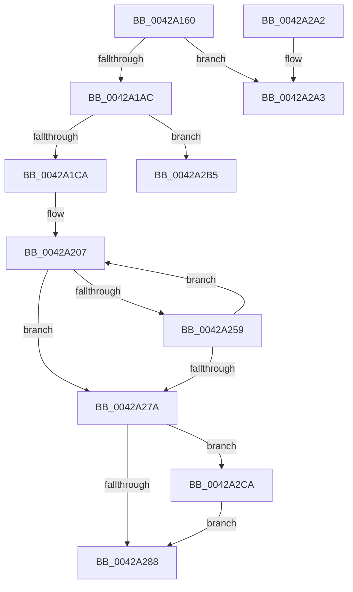

# HvlMapSparseGpaPages

- RVA: `0x0042A160`–`0x0042A2D6` (길이 `374` bytes)
- VA: `0x000000014042A160`
- 실행 섹션: `.text`
- PDB 이름 있음: `예`; PDB Function 태그: `예`
- unwind 정보 RVA: `0x000A0FB0`
- 디코드: `106`개 명령, `374/374` bytes 표시
- 미해석 바이트: `0` (있으면 어셈블리에 `.byte`로 보존)

> 이 문서는 커널 이미지의 기계어와 PDB 기호를 분석해 생성했습니다. 4번과 5번은 함수 원형과 자료형을 바이너리 사용 방식에서 추정한 C 해석이며 원본 소스 복구 결과는 아닙니다.

## 1. Dependencies

- 직접 호출 지점: **7**; 고유 호출 대상: **6**
- 직접 호출자로 확인된 함수: **2**
- RIP 상대 이미지 참조: **1**

### Outgoing calls
- `0x0042A1BC` → [ExpInterlockedPopEntrySList](../6B/ExpInterlockedPopEntrySList_function_006BA570.md) (function, `0x006BA570`)
- `0x0042A223` → [memcpy](../6C/memcpy_function_006C6840.md) (function, `0x006C6840`)
- `0x0042A24C` → [HvcallInitiateHypercall](../31/HvcallInitiateHypercall_function_00313630.md) (function, `0x00313630`)
- `0x0042A27E` → [HvlpReleaseHypercallPage](../31/HvlpReleaseHypercallPage_function_00313480.md) (function, `0x00313480`)
- `0x0042A2AA` → [KeDisableInterrupts](../21/KeDisableInterrupts_function_00217BE0.md) (function, `0x00217BE0`)
- `0x0042A2BC` → [KeDisableInterrupts](../21/KeDisableInterrupts_function_00217BE0.md) (function, `0x00217BE0`)
- `0x0042A2CD` → [HvlpHvToNtStatus](../30/HvlpHvToNtStatus_function_00307BD8.md) (function, `0x00307BD8`)

### Direct callers
- [VmpProcessInvalidateList](VmpProcessInvalidateList_function_00428A54.md) at `0x00428B31`
- [VmpFillSlat](VmpFillSlat_function_0042A014.md) at `0x0042A064`

### Static image references
- `0x0042A18E` → RVA `0x00FC6A90` (`ALMOSTRO`; read)

## 2. Other-region calls and transfers

- 다른 실행 섹션으로 향하는 call: **0**
- call이 아닌 외부 분기/꼬리 이동: **2**
  - `0x0042A2B0` → [sub_006EE2A4](../6E/Unknown_function_006EE2A4.md) (`tail-transfer`)
  - `0x0042A2C5` → [sub_006EE2A4](../6E/Unknown_function_006EE2A4.md) (`tail-transfer`)

## 3. Assembly (complete function range)

```asm
0042A160  48 89 5C 24 10                  mov qword ptr [rsp + 0x10], rbx
0042A165  4C 89 4C 24 20                  mov qword ptr [rsp + 0x20], r9
0042A16A  55                              push rbp
0042A16B  56                              push rsi
0042A16C  57                              push rdi
0042A16D  41 54                           push r12
0042A16F  41 55                           push r13
0042A171  41 56                           push r14
0042A173  41 57                           push r15
0042A175  48 8B EC                        mov rbp, rsp
0042A178  48 83 EC 40                     sub rsp, 0x40
0042A17C  4C 8B 65 60                     mov r12, qword ptr [rbp + 0x60]
0042A180  33 C0                           xor eax, eax
0042A182  33 F6                           xor esi, esi
0042A184  48 89 45 F0                     mov qword ptr [rbp - 0x10], rax
0042A188  89 45 F8                        mov dword ptr [rbp - 8], eax
0042A18B  0F 57 C0                        xorps xmm0, xmm0
0042A18E  8B 05 FC C8 B9 00               mov eax, dword ptr [rip + 0xb9c8fc]
0042A194  4D 8B E8                        mov r13, r8
0042A197  49 89 34 24                     mov qword ptr [r12], rsi
0042A19B  8B FA                           mov edi, edx
0042A19D  4C 8B F9                        mov r15, rcx
0042A1A0  0F 11 45 E0                     movups xmmword ptr [rbp - 0x20], xmm0
0042A1A4  A8 08                           test al, 8
0042A1A6  0F 84 F7 00 00 00               je 0x14042a2a3
0042A1AC  65 48 8B 1C 25 20 00 00 00      mov rbx, qword ptr gs:[0x20]
0042A1B5  48 8D 8B C0 8B 00 00            lea rcx, [rbx + 0x8bc0]
0042A1BC  E8 AF 03 29 00                  call 0x1406ba570
0042A1C1  48 85 C0                        test rax, rax
0042A1C4  0F 84 EB 00 00 00               je 0x14042a2b5
0042A1CA  4C 8B 4D 58                     mov r9, qword ptr [rbp + 0x58]
0042A1CE  C7 45 E0 01 00 00 00            mov dword ptr [rbp - 0x20], 1
0042A1D5  48 89 5D E8                     mov qword ptr [rbp - 0x18], rbx
0042A1D9  48 89 45 F0                     mov qword ptr [rbp - 0x10], rax
0042A1DD  4C 8B 70 10                     mov r14, qword ptr [rax + 0x10]
0042A1E1  B9 FF 00 00 00                  mov ecx, 0xff
0042A1E6  4C 89 75 F8                     mov qword ptr [rbp - 8], r14
0042A1EA  89 70 0C                        mov dword ptr [rax + 0xc], esi
0042A1ED  4C 89 38                        mov qword ptr [rax], r15
0042A1F0  4D 8B FD                        mov r15, r13
0042A1F3  89 78 08                        mov dword ptr [rax + 8], edi
0042A1F6  BF 6E 00 00 00                  mov edi, 0x6e
0042A1FB  48 83 C0 10                     add rax, 0x10
0042A1FF  48 89 7D 60                     mov qword ptr [rbp + 0x60], rdi
0042A203  48 89 45 40                     mov qword ptr [rbp + 0x40], rax
0042A207  49 8B 14 24                     mov rdx, qword ptr [r12]
0042A20B  4C 3B F9                        cmp r15, rcx
0042A20E  4C 0F 43 F9                     cmovae r15, rcx
0042A212  48 C1 E2 04                     shl rdx, 4
0042A216  4D 8B C7                        mov r8, r15
0042A219  49 03 D1                        add rdx, r9
0042A21C  49 C1 E0 04                     shl r8, 4
0042A220  48 8B C8                        mov rcx, rax
0042A223  E8 18 C6 29 00                  call 0x1406c6840
0042A228  48 C1 EF 20                     shr rdi, 0x20
0042A22C  45 33 C0                        xor r8d, r8d
0042A22F  8B C7                           mov eax, edi
0042A231  49 8B D6                        mov rdx, r14
0042A234  41 33 C7                        xor eax, r15d
0042A237  41 BF FF 0F 00 00               mov r15d, 0xfff
0042A23D  41 23 C7                        and eax, r15d
0042A240  33 C7                           xor eax, edi
0042A242  89 45 64                        mov dword ptr [rbp + 0x64], eax
0042A245  48 8B 7D 60                     mov rdi, qword ptr [rbp + 0x60]
0042A249  48 8B CF                        mov rcx, rdi
0042A24C  E8 DF 93 EE FF                  call 0x140313630
0042A251  48 8B D8                        mov rbx, rax
0042A254  66 85 C0                        test ax, ax
0042A257  75 21                           jne 0x14042a27a
0042A259  4C 8B 4D 58                     mov r9, qword ptr [rbp + 0x58]
0042A25D  B9 FF 00 00 00                  mov ecx, 0xff
0042A262  48 C1 E8 20                     shr rax, 0x20
0042A266  49 23 C7                        and rax, r15
0042A269  4D 8B FD                        mov r15, r13
0042A26C  49 01 04 24                     add qword ptr [r12], rax
0042A270  48 8B 45 40                     mov rax, qword ptr [rbp + 0x40]
0042A274  4D 2B 3C 24                     sub r15, qword ptr [r12]
0042A278  75 8D                           jne 0x14042a207
0042A27A  48 8D 4D E0                     lea rcx, [rbp - 0x20]
0042A27E  E8 FD 91 EE FF                  call 0x140313480
0042A283  66 85 DB                        test bx, bx
0042A286  75 42                           jne 0x14042a2ca
0042A288  48 8B 9C 24 88 00 00 00         mov rbx, qword ptr [rsp + 0x88]
0042A290  8B C6                           mov eax, esi
0042A292  48 83 C4 40                     add rsp, 0x40
0042A296  41 5F                           pop r15
0042A298  41 5E                           pop r14
0042A29A  41 5D                           pop r13
0042A29C  41 5C                           pop r12
0042A29E  5F                              pop rdi
0042A29F  5E                              pop rsi
0042A2A0  5D                              pop rbp
0042A2A1  C3                              ret
0042A2A2  CC                              int3
0042A2A3  C7 45 E0 04 00 00 00            mov dword ptr [rbp - 0x20], 4
0042A2AA  E8 31 D9 DE FF                  call 0x140217be0
0042A2AF  90                              nop
0042A2B0  E9 EF 3F 2C 00                  jmp 0x1406ee2a4
0042A2B5  C7 45 E0 04 00 00 00            mov dword ptr [rbp - 0x20], 4
0042A2BC  E8 1F D9 DE FF                  call 0x140217be0
0042A2C1  4C 8B 4D 58                     mov r9, qword ptr [rbp + 0x58]
0042A2C5  E9 DA 3F 2C 00                  jmp 0x1406ee2a4
0042A2CA  0F B7 CB                        movzx ecx, bx
0042A2CD  E8 06 D9 ED FF                  call 0x140307bd8
0042A2D2  8B F0                           mov esi, eax
0042A2D4  EB B2                           jmp 0x14042a288
```

## 4. C-style interpretation (structured pseudocode)

```c
__int64 __fastcall HvlMapSparseGpaPages(__int64 a1, int a2, __int64 a3, __int64 a4, __int64 a5)
{
    __int64 result;
    __int64 v_r15;
    __int64 v_rdi;
    __int64 v_rsi;
    __int64 v_rsp;
    unsigned int v_stack_m40;
    unsigned __int64 v_stack_m48;
    unsigned __int64 v_stack_m50;
    unsigned __int64 v_stack_m58;
    unsigned __int64 v_stack_p10;
    unsigned __int64 v_stack_p20;
    unsigned __int64 v_stack_p28;
    unsigned int v_stack_p2C;
    unsigned __int64 v_stack_p8;

    v_stack_p10 = v_rbx;
    v_stack_p20 = a4;
    v_rsp = (v_rsp) - (64);
    result = 0;
    v_rsi = 0;
    v_stack_m48 = 0;
    v_stack_m40 = 0;
    *(unsigned __int64 *)(a5) = 0;
    v_stack_m58 = v_xmm0;
    if ((((unsigned __int8)((unsigned int)(*(unsigned int *)(v_rip + 12175612)))) & (8)) == 0) goto loc_0042A2A3;
    result = ExpInterlockedPopEntrySList(*(unsigned __int64 *)(gs_base + (0 + 32)) + 35776, a2, a3, a4);
    if (result == 0) goto loc_0042A2B5;
    v_stack_m58 = 1;
    v_stack_m50 = *(unsigned __int64 *)(gs_base + (0 + 32));
    v_stack_m48 = result;
    v_stack_m40 = *(unsigned __int64 *)(result + 16);
    *(unsigned int *)(result + 12) = 0;
    *(unsigned __int64 *)(result) = a1;
    *(unsigned int *)(result + 8) = (unsigned int)((unsigned int)(a2));
    result = (result) + (16);
    v_stack_p28 = 110;
    v_stack_p8 = result;
loc_0042A207:
    if (a3 >= 255) { a3 = 255; }
    a2 = (*(unsigned __int64 *)(a5)) << (4);
    a2 = (a2) + (v_stack_p20);
    a3 = (a3) << (4);
    result = memcpy(result, a2, a3, v_stack_p20);
    v_rdi = (110) >> (32);
    a3 = 0;
    result = (unsigned int)(((unsigned int)((unsigned int)(v_rdi))) ^ (0));
    result = (unsigned int)((result) & ((unsigned int)((unsigned int)(0xFFFULL))));
    result = (unsigned int)((result) ^ ((unsigned int)(v_rdi)));
    v_stack_p2C = (unsigned int)(result);
    result = HvcallInitiateHypercall(a5, *(unsigned __int64 *)(result + 16), a3, v_stack_p20);
    if ((unsigned __int16)(result) != 0) goto loc_0042A27A;
    result = (result) >> (32);
    result = (result) & ((unsigned int)(0xFFFULL));
    v_r15 = (0) - (*(unsigned __int64 *)(a5));
    if (condition_is_not_equal) goto loc_0042A207;
loc_0042A27A:
    result = HvlpReleaseHypercallPage(v_stack_m58, *(unsigned __int64 *)(result + 16), a3, v_stack_p20);
    if ((unsigned __int16)(result) != 0) goto loc_0042A2CA;
loc_0042A288:
    v_rsp = (v_rsp) + (64);
    return 0;
loc_0042A2A3:
    v_stack_m58 = 4;
    result = KeDisableInterrupts(v_stack_m58, *(unsigned __int64 *)(result + 16), a3, v_stack_p20);
loc_0042A2B5:
    v_stack_m58 = 4;
    result = KeDisableInterrupts(v_stack_m58, *(unsigned __int64 *)(result + 16), a3, v_stack_p20);
loc_0042A2CA:
    result = HvlpHvToNtStatus((unsigned __int16)(v_stack_p10), *(unsigned __int64 *)(result + 16), a3, v_stack_p20);
    goto loc_0042A288;
}
```

## 5. (Beta) C Style

```c
int64_t HvlMapSparseGpaPages(int64_t Arg1, int32_t Arg2, int64_t Arg3, int64_t Arg4, void *Arg5)
{
    uint8_t *arg5 = (uint8_t *)Arg5;

    int64_t result;
    int64_t local_r15;
    int64_t local_rdi;
    int64_t local_rsi;
    int64_t local_rsp;
    uint32_t v_stack_m40;
    uint64_t v_stack_m48;
    uint64_t v_stack_m50;
    uint64_t v_stack_m58;
    uint64_t v_stack_p10;
    uint64_t v_stack_p20;
    uint64_t v_stack_p28;
    uint32_t v_stack_p2C;
    uint64_t v_stack_p8;

    v_stack_p10 = local_rbx;
    v_stack_p20 = Arg4;
    local_rsp = (local_rsp) - (64);
    result = 0;
    local_rsi = 0;
    v_stack_m48 = 0;
    v_stack_m40 = 0;
    *(uint64_t *)(arg5) = 0;
    v_stack_m58 = v_xmm0;
    if ((((uint8_t)((uint32_t)(*(uint32_t *)(v_rip + 0xB9C8FC)))) & (8)) == 0) goto loc_0042A2A3;
    result = ExpInterlockedPopEntrySList(*(uint64_t *)(gs_base + (0 + 0x20)) + 35776, Arg2, Arg3, Arg4);
    if (result == 0) goto loc_0042A2B5;
    v_stack_m58 = 1;
    v_stack_m50 = *(uint64_t *)(gs_base + (0 + 0x20));
    v_stack_m48 = result;
    v_stack_m40 = *(uint64_t *)(result + 0x10);
    *(uint32_t *)(result + 0xC) = 0;
    *(uint64_t *)(result) = Arg1;
    *(uint32_t *)(result + 0x8) = (uint32_t)((uint32_t)(Arg2));
    result = (result) + (16);
    v_stack_p28 = 110;
    v_stack_p8 = result;
loc_0042A207:
    if (Arg3 >= 255) { Arg3 = 255; }
    Arg2 = (*(uint64_t *)(arg5)) << (4);
    Arg2 = (Arg2) + (v_stack_p20);
    Arg3 = (Arg3) << (4);
    result = memcpy(result, Arg2, Arg3, v_stack_p20);
    local_rdi = (110) >> (32);
    Arg3 = 0;
    result = (uint32_t)(((uint32_t)((uint32_t)(local_rdi))) ^ (0));
    result = (uint32_t)((result) & ((uint32_t)((uint32_t)(0xFFFULL))));
    result = (uint32_t)((result) ^ ((uint32_t)(local_rdi)));
    v_stack_p2C = (uint32_t)(result);
    result = HvcallInitiateHypercall(Arg5, *(uint64_t *)(result + 0x10), Arg3, v_stack_p20);
    if ((uint16_t)(result) != 0) goto loc_0042A27A;
    result = (result) >> (32);
    result = (result) & ((uint32_t)(0xFFFULL));
    local_r15 = (0) - (*(uint64_t *)(arg5));
    if (condition_is_not_equal) goto loc_0042A207;
loc_0042A27A:
    result = HvlpReleaseHypercallPage(v_stack_m58, *(uint64_t *)(result + 0x10), Arg3, v_stack_p20);
    if ((uint16_t)(result) != 0) goto loc_0042A2CA;
loc_0042A288:
    local_rsp = (local_rsp) + (64);
    return 0;
loc_0042A2A3:
    v_stack_m58 = 4;
    result = KeDisableInterrupts(v_stack_m58, *(uint64_t *)(result + 0x10), Arg3, v_stack_p20);
loc_0042A2B5:
    v_stack_m58 = 4;
    result = KeDisableInterrupts(v_stack_m58, *(uint64_t *)(result + 0x10), Arg3, v_stack_p20);
loc_0042A2CA:
    result = HvlpHvToNtStatus((uint16_t)(v_stack_p10), *(uint64_t *)(result + 0x10), Arg3, v_stack_p20);
    goto loc_0042A288;
}
```

### 관측된 메모리 오프셋

구조체 형식이 확인되지 않은 접근은 인자 기준의 오프셋으로만 기록했습니다.

| 기준 인자 | 오프셋 표현 | 폭 (bit) | 접근 |
|---|---:|---:|---|
| `Arg5` | `+ 0x0` | `64` | `R` |
| `Arg5` | `+ 0x0` | `64` | `R/W` |
| `Arg5` | `+ 0x0` | `64` | `W` |

## 6. Execution-region graph

[열기: 2D/3D 그래프와 함수 탐색 컨트롤 패널](../../../control-panel.html?section=text&rva=0x0042A160&view=graph)

- 2D 그래프는 위에서 아래로 흐르고, 3D 그래프는 빈 공간을 드래그해 회전합니다. Shift+드래그는 이동, 휠은 확대·축소, 함수 노드 선택은 대상 보고서 이동입니다.

### Static fallback


