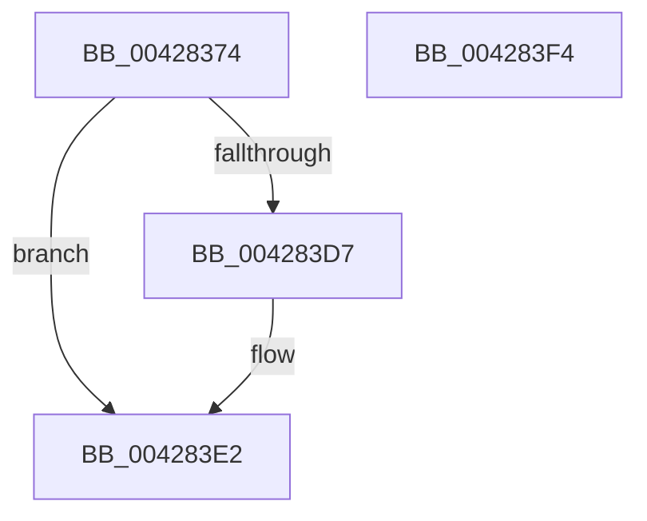

# IoAddTriageDumpDataBlock

- RVA: `0x00428374`–`0x004283F5` (길이 `129` bytes)
- VA: `0x0000000140428374`
- 실행 섹션: `.text`
- PDB 이름 있음: `예`; PDB Function 태그: `아니요`
- unwind 정보 RVA: `0x000718AC`
- 디코드: `34`개 명령, `129/129` bytes 표시
- 미해석 바이트: `0` (있으면 어셈블리에 `.byte`로 보존)

> 이 문서는 커널 이미지의 기계어와 PDB 기호를 분석해 생성했습니다. 4번과 5번은 함수 원형과 자료형을 바이너리 사용 방식에서 추정한 C 해석이며 원본 소스 복구 결과는 아닙니다.

## 1. Dependencies

- 직접 호출 지점: **2**; 고유 호출 대상: **2**
- 직접 호출자로 확인된 함수: **103**
- RIP 상대 이미지 참조: **4**

### Outgoing calls
- `0x004283BA` → [IopAddTriageDumpDataBlock](IopAddTriageDumpDataBlock_function_004283FC.md) (function, `0x004283FC`)
- `0x004283DD` → [KeAddTriageDumpDataBlock](../5B/KeAddTriageDumpDataBlock_function_005B26B0.md) (function, `0x005B26B0`)

### Direct callers
- [IopCheckVpbMounted](../27/IopCheckVpbMounted_function_00270540.md) at `0x002708CD`
- [IopCheckVpbMounted](../27/IopCheckVpbMounted_function_00270540.md) at `0x002708E4`
- [IopCheckVpbMounted](../27/IopCheckVpbMounted_function_00270540.md) at `0x002708F9`
- [IopCheckVpbMounted](../27/IopCheckVpbMounted_function_00270540.md) at `0x00270928`
- [IopCheckVpbMounted](../27/IopCheckVpbMounted_function_00270540.md) at `0x00270939`
- [IopDecrementDeviceObjectRef](../27/IopDecrementDeviceObjectRef_function_00270970.md) at `0x00270B8D`
- [IopDecrementDeviceObjectRef](../27/IopDecrementDeviceObjectRef_function_00270970.md) at `0x00270B9E`
- [sub_0027289E](../27/Unknown_function_0027289E.md) at `0x002728AC`
- [sub_0027289E](../27/Unknown_function_0027289E.md) at `0x002728C3`
- [sub_0027289E](../27/Unknown_function_0027289E.md) at `0x002728D8`
- [IopCheckDeviceAndDriver](../3F/IopCheckDeviceAndDriver_function_003FCBE0.md) at `0x003FCE14`
- [IopCheckDeviceAndDriver](../3F/IopCheckDeviceAndDriver_function_003FCBE0.md) at `0x003FCE25`
- [sub_0041B341](../41/Unknown_function_0041B341.md) at `0x0041B353`
- [sub_0041B341](../41/Unknown_function_0041B341.md) at `0x0041B364`
- [IopDecrementDeviceObjectRefCount](IopDecrementDeviceObjectRefCount_function_00428220.md) at `0x00428267`
- [IopDecrementDeviceObjectRefCount](IopDecrementDeviceObjectRefCount_function_00428220.md) at `0x00428278`
- [IoReportTargetDeviceChangeAsynchronous](../47/IoReportTargetDeviceChangeAsynchronous_function_00475DA0.md) at `0x00475F75`
- [IoReportTargetDeviceChangeAsynchronous](../47/IoReportTargetDeviceChangeAsynchronous_function_00475DA0.md) at `0x00475F8B`
- [IoReportTargetDeviceChangeAsynchronous](../47/IoReportTargetDeviceChangeAsynchronous_function_00475DA0.md) at `0x00475FA4`
- [IoReportTargetDeviceChangeAsynchronous](../47/IoReportTargetDeviceChangeAsynchronous_function_00475DA0.md) at `0x00475FB5`
- [IoInvalidateDeviceState](../47/IoInvalidateDeviceState_function_00477F10.md) at `0x00477FA7`
- [IoInvalidateDeviceState](../47/IoInvalidateDeviceState_function_00477F10.md) at `0x00477FBD`
- [IoInvalidateDeviceState](../47/IoInvalidateDeviceState_function_00477F10.md) at `0x00477FD5`
- [IoInvalidateDeviceState](../47/IoInvalidateDeviceState_function_00477F10.md) at `0x00477FE6`
- [IoInvalidateDeviceRelations](../49/IoInvalidateDeviceRelations_function_0049E160.md) at `0x0049E239`
- [IoInvalidateDeviceRelations](../49/IoInvalidateDeviceRelations_function_0049E160.md) at `0x0049E24F`
- [IoInvalidateDeviceRelations](../49/IoInvalidateDeviceRelations_function_0049E160.md) at `0x0049E267`
- [IoInvalidateDeviceRelations](../49/IoInvalidateDeviceRelations_function_0049E160.md) at `0x0049E278`
- [IopQueueInvalidateBusRelationsRequest](../49/IopQueueInvalidateBusRelationsRequest_function_0049E28C.md) at `0x0049E401`
- [IopQueueInvalidateBusRelationsRequest](../49/IopQueueInvalidateBusRelationsRequest_function_0049E28C.md) at `0x0049E417`
- [IopQueueInvalidateBusRelationsRequest](../49/IopQueueInvalidateBusRelationsRequest_function_0049E28C.md) at `0x0049E430`
- [IopQueueInvalidateBusRelationsRequest](../49/IopQueueInvalidateBusRelationsRequest_function_0049E28C.md) at `0x0049E441`
- [IoGetDeviceInstanceName](../4A/IoGetDeviceInstanceName_function_004AADA4.md) at `0x004AAE25`
- [IoGetDeviceInstanceName](../4A/IoGetDeviceInstanceName_function_004AADA4.md) at `0x004AAE3B`
- [IoGetDeviceInstanceName](../4A/IoGetDeviceInstanceName_function_004AADA4.md) at `0x004AAE53`
- [IoGetDeviceInstanceName](../4A/IoGetDeviceInstanceName_function_004AADA4.md) at `0x004AAE64`
- [KiMarkBugCheckRegions](../50/KiMarkBugCheckRegions_function_0050A188.md) at `0x0050A1C8`
- [KiMarkBugCheckRegions](../50/KiMarkBugCheckRegions_function_0050A188.md) at `0x0050A1EC`
- [KiMarkBugCheckRegions](../50/KiMarkBugCheckRegions_function_0050A188.md) at `0x0050A2D1`
- [KiMarkBugCheckRegions](../50/KiMarkBugCheckRegions_function_0050A188.md) at `0x0050A314`
- [KiMarkBugCheckRegions](../50/KiMarkBugCheckRegions_function_0050A188.md) at `0x0050A345`
- [KiMarkBugCheckRegions](../50/KiMarkBugCheckRegions_function_0050A188.md) at `0x0050A357`
- [KiMarkBugCheckRegions](../50/KiMarkBugCheckRegions_function_0050A188.md) at `0x0050A404`
- [KiMarkBugCheckRegions](../50/KiMarkBugCheckRegions_function_0050A188.md) at `0x0050A4AD`
- [KiMarkBugCheckRegions](../50/KiMarkBugCheckRegions_function_0050A188.md) at `0x0050A4CC`
- [KiMarkBugCheckRegions](../50/KiMarkBugCheckRegions_function_0050A188.md) at `0x0050A4E6`
- [KiMarkBugCheckRegions](../50/KiMarkBugCheckRegions_function_0050A188.md) at `0x0050A513`
- [KiMarkBugCheckRegions](../50/KiMarkBugCheckRegions_function_0050A188.md) at `0x0050A53C`
- [sub_0051C6D8](../51/Unknown_function_0051C6D8.md) at `0x0051C728`
- [sub_0051C6D8](../51/Unknown_function_0051C6D8.md) at `0x0051C7DB`
- [sub_0051C6D8](../51/Unknown_function_0051C6D8.md) at `0x0051C804`
- [HvlpInitializeHvCrashdumpPhase2](../58/HvlpInitializeHvCrashdumpPhase2_function_0058C01C.md) at `0x0058C02C`
- [HvlpInitializeHvCrashdumpPhase2](../58/HvlpInitializeHvCrashdumpPhase2_function_0058C01C.md) at `0x0058C03D`
- [HvlpInitializeHvCrashdumpPhase2](../58/HvlpInitializeHvCrashdumpPhase2_function_0058C01C.md) at `0x0058C04E`
- [HvlpInitializeHvCrashdumpPhase2](../58/HvlpInitializeHvCrashdumpPhase2_function_0058C01C.md) at `0x0058C05F`
- [HvlpInitializeHvCrashdumpPhase2](../58/HvlpInitializeHvCrashdumpPhase2_function_0058C01C.md) at `0x0058C079`
- [HvlpInitializeHvCrashdumpPhase2](../58/HvlpInitializeHvCrashdumpPhase2_function_0058C01C.md) at `0x0058C08A`
- [HvlpInitializeHvCrashdumpPhase2](../58/HvlpInitializeHvCrashdumpPhase2_function_0058C01C.md) at `0x0058C09C`
- [IopAddBugcheckTriageDataFromParameters](../59/IopAddBugcheckTriageDataFromParameters_function_00593E54.md) at `0x00593E91`
- [IopAddBugcheckTriageDataFromParameters](../59/IopAddBugcheckTriageDataFromParameters_function_00593E54.md) at `0x00593E9F`
- [IopAddBugcheckTriageDataFromParameters](../59/IopAddBugcheckTriageDataFromParameters_function_00593E54.md) at `0x00593EAD`
- [IopAddBugcheckTriageDataFromParameters](../59/IopAddBugcheckTriageDataFromParameters_function_00593E54.md) at `0x00593EC3`
- [IopAddBugcheckTriageDataFromParameters](../59/IopAddBugcheckTriageDataFromParameters_function_00593E54.md) at `0x00593EE5`
- [IopAddBugcheckTriageDataFromParameters](../59/IopAddBugcheckTriageDataFromParameters_function_00593E54.md) at `0x00593F1E`
- [IopAddBugcheckTriageDataFromParameters](../59/IopAddBugcheckTriageDataFromParameters_function_00593E54.md) at `0x00593FB1`
- [IopAddBugcheckTriageDataFromParameters](../59/IopAddBugcheckTriageDataFromParameters_function_00593E54.md) at `0x005940E8`
- [IopAddBugcheckTriageDataFromParameters](../59/IopAddBugcheckTriageDataFromParameters_function_00593E54.md) at `0x005940F9`
- [IopAddBugcheckTriageDataFromParameters](../59/IopAddBugcheckTriageDataFromParameters_function_00593E54.md) at `0x00594189`
- [IopUpdateMinidumpContext](../59/IopUpdateMinidumpContext_function_00596360.md) at `0x00596454`
- [IopUpdateMinidumpContext](../59/IopUpdateMinidumpContext_function_00596360.md) at `0x005964AC`
- [IopUpdateMinidumpContext](../59/IopUpdateMinidumpContext_function_00596360.md) at `0x0059655C`
- [IopUpdateMinidumpContext](../59/IopUpdateMinidumpContext_function_00596360.md) at `0x00596585`
- [IopUpdateMinidumpContext](../59/IopUpdateMinidumpContext_function_00596360.md) at `0x00596599`
- [IopUpdateMinidumpContext](../59/IopUpdateMinidumpContext_function_00596360.md) at `0x005965CB`
- [IopUpdateMinidumpContext](../59/IopUpdateMinidumpContext_function_00596360.md) at `0x005965F8`
- [IopUpdateMinidumpContext](../59/IopUpdateMinidumpContext_function_00596360.md) at `0x00596615`
- [IopAddBugcheckDirectedTransitionTriageData](../5A/IopAddBugcheckDirectedTransitionTriageData_function_005A0518.md) at `0x005A05B3`
- [IopAddBugcheckPnpWatchdogTriageData](../5A/IopAddBugcheckPnpWatchdogTriageData_function_005A0608.md) at `0x005A0651`
- [IopAddBugcheckPowerTriageData](../5A/IopAddBugcheckPowerTriageData_function_005A06C8.md) at `0x005A0715`
- [IopAddBugcheckTriageCompletionQueue](../5A/IopAddBugcheckTriageCompletionQueue_function_005A0758.md) at `0x005A078C`
- [IopAddBugcheckTriageCompletionQueue](../5A/IopAddBugcheckTriageCompletionQueue_function_005A0758.md) at `0x005A07CD`
- [IopAddBugcheckTriageDevice](../5A/IopAddBugcheckTriageDevice_function_005A0814.md) at `0x005A0881`
- [IopAddBugcheckTriageDevice](../5A/IopAddBugcheckTriageDevice_function_005A0814.md) at `0x005A08A6`
- [IopAddBugcheckTriageDevice](../5A/IopAddBugcheckTriageDevice_function_005A0814.md) at `0x005A08C4`
- [IopAddBugcheckTriageDeviceNode](../5A/IopAddBugcheckTriageDeviceNode_function_005A091C.md) at `0x005A0956`
- [IopAddBugcheckTriageDeviceNode](../5A/IopAddBugcheckTriageDeviceNode_function_005A091C.md) at `0x005A09B5`
- [IopAddBugcheckTriageIrp](../5A/IopAddBugcheckTriageIrp_function_005A0A0C.md) at `0x005A0A95`
- [IopAddBugcheckTriageIrp](../5A/IopAddBugcheckTriageIrp_function_005A0A0C.md) at `0x005A0B5A`
- [IopAddBugcheckTriagePowerIrpWorkers](../5A/IopAddBugcheckTriagePowerIrpWorkers_function_005A0B84.md) at `0x005A0BBF`
- [IopAddBugcheckTriagePowerIrpWorkers](../5A/IopAddBugcheckTriagePowerIrpWorkers_function_005A0B84.md) at `0x005A0BF4`
- [IopAddBugcheckTriagePowerIrps](../5A/IopAddBugcheckTriagePowerIrps_function_005A0C38.md) at `0x005A0C73`
- [IopAddBugcheckTriagePowerIrps](../5A/IopAddBugcheckTriagePowerIrps_function_005A0C38.md) at `0x005A0CA8`
- [IopAddBugcheckTriageThread](../5A/IopAddBugcheckTriageThread_function_005A0CF8.md) at `0x005A0D31`
- [IopAddBugcheckTriageThread](../5A/IopAddBugcheckTriageThread_function_005A0CF8.md) at `0x005A0D7C`
- [IopAddBugcheckTriageUnicodeString](../5A/IopAddBugcheckTriageUnicodeString_function_005A0DF4.md) at `0x005A0E43`
- [IopAddBugcheckTriageUnicodeString](../5A/IopAddBugcheckTriageUnicodeString_function_005A0DF4.md) at `0x005A0E63`
- [IopAddBugcheckTriageWorkQueue](../5A/IopAddBugcheckTriageWorkQueue_function_005A0E88.md) at `0x005A0EBE`
- [IoRequestDeviceEjectEx](../5A/IoRequestDeviceEjectEx_function_005A59D0.md) at `0x005A5AF2`
- [IoRequestDeviceEjectEx](../5A/IoRequestDeviceEjectEx_function_005A59D0.md) at `0x005A5B04`
- [IoRequestDeviceEjectEx](../5A/IoRequestDeviceEjectEx_function_005A59D0.md) at `0x005A5B1A`
- [IoRequestDeviceEjectEx](../5A/IoRequestDeviceEjectEx_function_005A59D0.md) at `0x005A5B2B`
- [IoRequestDeviceEjectEx](../5A/IoRequestDeviceEjectEx_function_005A59D0.md) at `0x005A5B4D`
- [IoRequestDeviceEjectEx](../5A/IoRequestDeviceEjectEx_function_005A59D0.md) at `0x005A5B5E`
- [IoRequestDeviceEjectEx](../5A/IoRequestDeviceEjectEx_function_005A59D0.md) at `0x005A5B6A`
- [IoRequestDeviceEjectEx](../5A/IoRequestDeviceEjectEx_function_005A59D0.md) at `0x005A5B87`
- [IoRequestDeviceEjectEx](../5A/IoRequestDeviceEjectEx_function_005A59D0.md) at `0x005A5B9F`
- [IoRequestDeviceEjectEx](../5A/IoRequestDeviceEjectEx_function_005A59D0.md) at `0x005A5BC5`
- [IoRequestDeviceEjectEx](../5A/IoRequestDeviceEjectEx_function_005A59D0.md) at `0x005A5BE1`
- [PiProcessDeviceResetAction](../5A/PiProcessDeviceResetAction_function_005A5CD8.md) at `0x005A5DA0`
- [PiProcessDeviceResetAction](../5A/PiProcessDeviceResetAction_function_005A5CD8.md) at `0x005A5DB6`
- [PiProcessDeviceResetAction](../5A/PiProcessDeviceResetAction_function_005A5CD8.md) at `0x005A5DCE`
- [PiProcessDeviceResetAction](../5A/PiProcessDeviceResetAction_function_005A5CD8.md) at `0x005A5DE3`
- [PiProcessDeviceResetAction](../5A/PiProcessDeviceResetAction_function_005A5CD8.md) at `0x005A5E12`
- [PiProcessDeviceResetAction](../5A/PiProcessDeviceResetAction_function_005A5CD8.md) at `0x005A5E23`
- [PiProcessDeviceResetAction](../5A/PiProcessDeviceResetAction_function_005A5CD8.md) at `0x005A5E30`
- [PiProcessDeviceResetAction](../5A/PiProcessDeviceResetAction_function_005A5CD8.md) at `0x005A5E6F`
- [PiProcessDeviceResetAction](../5A/PiProcessDeviceResetAction_function_005A5CD8.md) at `0x005A5E9B`
- [PiProcessDeviceResetAction](../5A/PiProcessDeviceResetAction_function_005A5CD8.md) at `0x005A5EF8`
- [PiProcessDeviceResetAction](../5A/PiProcessDeviceResetAction_function_005A5CD8.md) at `0x005A5F2C`
- [PnpSaveGlobalsToMinidump](../5A/PnpSaveGlobalsToMinidump_function_005A6440.md) at `0x005A6450`
- [PnpSaveGlobalsToMinidump](../5A/PnpSaveGlobalsToMinidump_function_005A6440.md) at `0x005A6461`
- [PnpSaveGlobalsToMinidump](../5A/PnpSaveGlobalsToMinidump_function_005A6440.md) at `0x005A6472`
- [PnpSaveGlobalsToMinidump](../5A/PnpSaveGlobalsToMinidump_function_005A6440.md) at `0x005A6483`
- [PnpWatchdogBugcheck](../5A/PnpWatchdogBugcheck_function_005A6494.md) at `0x005A6540`
- [PnpWatchdogBugcheck](../5A/PnpWatchdogBugcheck_function_005A6494.md) at `0x005A6551`
- [PnpWatchdogBugcheck](../5A/PnpWatchdogBugcheck_function_005A6494.md) at `0x005A655D`
- [PnpWatchdogBugcheck](../5A/PnpWatchdogBugcheck_function_005A6494.md) at `0x005A6572`
- [PnpWatchdogBugcheck](../5A/PnpWatchdogBugcheck_function_005A6494.md) at `0x005A657E`
- [PnpWatchdogBugcheck](../5A/PnpWatchdogBugcheck_function_005A6494.md) at `0x005A6599`
- [PnpWatchdogBugcheck](../5A/PnpWatchdogBugcheck_function_005A6494.md) at `0x005A65AA`
- [PnpWatchdogBugcheck](../5A/PnpWatchdogBugcheck_function_005A6494.md) at `0x005A65C4`
- [PnpWatchdogBugcheck](../5A/PnpWatchdogBugcheck_function_005A6494.md) at `0x005A65DA`
- [PnpWatchdogBugcheck](../5A/PnpWatchdogBugcheck_function_005A6494.md) at `0x005A65F4`
- [PnpWatchdogBugcheck](../5A/PnpWatchdogBugcheck_function_005A6494.md) at `0x005A6609`
- [PnpWatchdogBugcheck](../5A/PnpWatchdogBugcheck_function_005A6494.md) at `0x005A664D`
- [PnpWatchdogBugcheck](../5A/PnpWatchdogBugcheck_function_005A6494.md) at `0x005A6660`
- [PnpWatchdogBugcheck](../5A/PnpWatchdogBugcheck_function_005A6494.md) at `0x005A666D`
- [PnpWatchdogBugcheck](../5A/PnpWatchdogBugcheck_function_005A6494.md) at `0x005A66AE`
- [PnpWatchdogBugcheck](../5A/PnpWatchdogBugcheck_function_005A6494.md) at `0x005A66E9`
- [PnpWatchdogBugcheck](../5A/PnpWatchdogBugcheck_function_005A6494.md) at `0x005A6751`
- [PnpWatchdogBugcheck](../5A/PnpWatchdogBugcheck_function_005A6494.md) at `0x005A6794`
- [KeBugCheck2](../5B/KeBugCheck2_function_005B27D0.md) at `0x005B30A4`
- [KiCollectFullProcessName](../5B/KiCollectFullProcessName_function_005B43B0.md) at `0x005B43E5`
- [KiCollectTriageDumpDataBlocks](../5B/KiCollectTriageDumpDataBlocks_function_005B43F8.md) at `0x005B4432`
- [KiCollectTriageDumpDataBlocks](../5B/KiCollectTriageDumpDataBlocks_function_005B43F8.md) at `0x005B4443`
- [KiCollectTriageDumpDataBlocks](../5B/KiCollectTriageDumpDataBlocks_function_005B43F8.md) at `0x005B4459`
- [KiCollectTriageDumpDataBlocks](../5B/KiCollectTriageDumpDataBlocks_function_005B43F8.md) at `0x005B446D`
- [KiCollectTriageDumpDataBlocks](../5B/KiCollectTriageDumpDataBlocks_function_005B43F8.md) at `0x005B4488`
- [KiCollectTriageDumpDataBlocks](../5B/KiCollectTriageDumpDataBlocks_function_005B43F8.md) at `0x005B44E9`
- [KiCollectTriageDumpDataBlocks](../5B/KiCollectTriageDumpDataBlocks_function_005B43F8.md) at `0x005B44FA`
- [KiCollectTriageDumpDataBlocks](../5B/KiCollectTriageDumpDataBlocks_function_005B43F8.md) at `0x005B4514`
- [KiCollectTriageDumpDataBlocks](../5B/KiCollectTriageDumpDataBlocks_function_005B43F8.md) at `0x005B4525`
- [KiCollectTriageDumpDataBlocks](../5B/KiCollectTriageDumpDataBlocks_function_005B43F8.md) at `0x005B454C`
- [KiCollectTriageDumpDataBlocks](../5B/KiCollectTriageDumpDataBlocks_function_005B43F8.md) at `0x005B457E`
- [KiCollectTriageDumpDataBlocks](../5B/KiCollectTriageDumpDataBlocks_function_005B43F8.md) at `0x005B4633`
- [KiCollectTriageDumpDataBlocks](../5B/KiCollectTriageDumpDataBlocks_function_005B43F8.md) at `0x005B4654`
- [KiCollectTriageDumpDataBlocks](../5B/KiCollectTriageDumpDataBlocks_function_005B43F8.md) at `0x005B466E`
- [KiCollectTriageDumpDataBlocks](../5B/KiCollectTriageDumpDataBlocks_function_005B43F8.md) at `0x005B46C4`
- [KiCollectTriageDumpDataBlocks](../5B/KiCollectTriageDumpDataBlocks_function_005B43F8.md) at `0x005B46D5`
- [KiCollectTriageDumpDataBlocks](../5B/KiCollectTriageDumpDataBlocks_function_005B43F8.md) at `0x005B46E6`
- [KiCollectTriageDumpDataBlocks](../5B/KiCollectTriageDumpDataBlocks_function_005B43F8.md) at `0x005B46F7`
- [KiCollectTriageDumpDataBlocks](../5B/KiCollectTriageDumpDataBlocks_function_005B43F8.md) at `0x005B4708`
- [KiCollectTriageDumpDataBlocks](../5B/KiCollectTriageDumpDataBlocks_function_005B43F8.md) at `0x005B4725`
- [KiSaveCurrentEtwTraceBuffer](../5B/KiSaveCurrentEtwTraceBuffer_function_005B5338.md) at `0x005B539E`
- [KiSaveCurrentEtwTraceBuffer](../5B/KiSaveCurrentEtwTraceBuffer_function_005B5338.md) at `0x005B53AF`
- [KiSaveCurrentEtwTraceBuffer](../5B/KiSaveCurrentEtwTraceBuffer_function_005B5338.md) at `0x005B53C0`
- [KiSaveCurrentEtwTraceBuffer](../5B/KiSaveCurrentEtwTraceBuffer_function_005B5338.md) at `0x005B542E`
- [KiSaveCurrentEtwTraceBuffer](../5B/KiSaveCurrentEtwTraceBuffer_function_005B5338.md) at `0x005B543F`
- [KiSaveCurrentEtwTraceBuffer](../5B/KiSaveCurrentEtwTraceBuffer_function_005B5338.md) at `0x005B5450`
- [KiIntSteerCallbackRecordTriageCallback](../5C/KiIntSteerCallbackRecordTriageCallback_function_005C5810.md) at `0x005C58CC`
- [KiIntSteerCallbackRecordTriageCallback](../5C/KiIntSteerCallbackRecordTriageCallback_function_005C5810.md) at `0x005C58DD`
- [KiRecordRecoveryFailure](../5C/KiRecordRecoveryFailure_function_005C7AB8.md) at `0x005C7ACE`
- [KiRecordRecoveryFailure](../5C/KiRecordRecoveryFailure_function_005C7AB8.md) at `0x005C7ADF`
- [PopInternalAddToDumpFile](../5C/PopInternalAddToDumpFile_function_005CE634.md) at `0x005CE671`
- [PopInternalAddToDumpFile](../5C/PopInternalAddToDumpFile_function_005CE634.md) at `0x005CE68F`
- [PopInternalAddToDumpFile](../5C/PopInternalAddToDumpFile_function_005CE634.md) at `0x005CE6A0`
- [PopInternalAddToDumpFile](../5C/PopInternalAddToDumpFile_function_005CE634.md) at `0x005CE6B6`
- [PopInternalAddToDumpFile](../5C/PopInternalAddToDumpFile_function_005CE634.md) at `0x005CE6CC`
- [PopInternalAddToDumpFile](../5C/PopInternalAddToDumpFile_function_005CE634.md) at `0x005CE6DD`
- [PopInternalSaveStackToDumpFile](../5C/PopInternalSaveStackToDumpFile_function_005CE6F0.md) at `0x005CE72F`
- [PopInternalSaveStackToDumpFile](../5C/PopInternalSaveStackToDumpFile_function_005CE6F0.md) at `0x005CE753`
- [PopInternalSaveStackToDumpFile](../5C/PopInternalSaveStackToDumpFile_function_005CE6F0.md) at `0x005CE765`
- [PopInternalSaveStackToDumpFile](../5C/PopInternalSaveStackToDumpFile_function_005CE6F0.md) at `0x005CE796`
- [PopInternalSaveStackToDumpFile](../5C/PopInternalSaveStackToDumpFile_function_005CE6F0.md) at `0x005CE7BF`
- [PopInternalSaveStackToDumpFile](../5C/PopInternalSaveStackToDumpFile_function_005CE6F0.md) at `0x005CE7E3`
- [PopInternalSaveStackToDumpFile](../5C/PopInternalSaveStackToDumpFile_function_005CE6F0.md) at `0x005CE807`
- [PopInternalSaveStackToDumpFile](../5C/PopInternalSaveStackToDumpFile_function_005CE6F0.md) at `0x005CE81A`
- [PopIrpWatchdogBugcheck](../5C/PopIrpWatchdogBugcheck_function_005CE868.md) at `0x005CE9F4`
- [PopIrpWatchdogBugcheck](../5C/PopIrpWatchdogBugcheck_function_005CE868.md) at `0x005CEA01`
- [WheapAddToDumpFile](../65/WheapAddToDumpFile_function_0065E1FC.md) at `0x0065E22C`
- [MiAddTriageDumpPtes](../67/MiAddTriageDumpPtes_function_0067D308.md) at `0x0067D355`
- [MmSnapTriageDumpInformation](../67/MmSnapTriageDumpInformation_function_0067DE28.md) at `0x0067DE49`
- [MmSnapTriageDumpInformation](../67/MmSnapTriageDumpInformation_function_0067DE28.md) at `0x0067DE5A`
- [MmSnapTriageDumpInformation](../67/MmSnapTriageDumpInformation_function_0067DE28.md) at `0x0067DF4F`
- [sub_006F43A4](../6F/Unknown_function_006F43A4.md) at `0x006F43C1`
- [sub_006F43A4](../6F/Unknown_function_006F43A4.md) at `0x006F43D1`
- [sub_006F43A4](../6F/Unknown_function_006F43A4.md) at `0x006F43DD`
- [sub_006F43A4](../6F/Unknown_function_006F43A4.md) at `0x006F43F9`
- [sub_006F43A4](../6F/Unknown_function_006F43A4.md) at `0x006F4411`
- [sub_006F43A4](../6F/Unknown_function_006F43A4.md) at `0x006F443E`
- [sub_006F43A4](../6F/Unknown_function_006F43A4.md) at `0x006F445A`
- [sub_006F44EC](../6F/Unknown_function_006F44EC.md) at `0x006F4509`
- [sub_006F44EC](../6F/Unknown_function_006F44EC.md) at `0x006F4518`
- [sub_006F44EC](../6F/Unknown_function_006F44EC.md) at `0x006F4524`
- [sub_006F44EC](../6F/Unknown_function_006F44EC.md) at `0x006F453F`
- [sub_006F44EC](../6F/Unknown_function_006F44EC.md) at `0x006F4557`
- [sub_006F44EC](../6F/Unknown_function_006F44EC.md) at `0x006F4583`
- [sub_006F44EC](../6F/Unknown_function_006F44EC.md) at `0x006F459F`
- [sub_006F816A](../6F/Unknown_function_006F816A.md) at `0x006F8187`
- [sub_006F816A](../6F/Unknown_function_006F816A.md) at `0x006F8196`
- [sub_006F816A](../6F/Unknown_function_006F816A.md) at `0x006F81A2`
- [sub_006F816A](../6F/Unknown_function_006F816A.md) at `0x006F81BD`
- [sub_006F816A](../6F/Unknown_function_006F816A.md) at `0x006F81D5`
- [sub_006F816A](../6F/Unknown_function_006F816A.md) at `0x006F8201`
- [sub_006F816A](../6F/Unknown_function_006F816A.md) at `0x006F821D`
- [sub_006F8228](../6F/Unknown_function_006F8228.md) at `0x006F8245`
- [sub_006F8228](../6F/Unknown_function_006F8228.md) at `0x006F8255`
- [sub_006F8228](../6F/Unknown_function_006F8228.md) at `0x006F8261`
- [sub_006F8228](../6F/Unknown_function_006F8228.md) at `0x006F827D`
- [sub_006F8228](../6F/Unknown_function_006F8228.md) at `0x006F8295`
- [sub_006F8228](../6F/Unknown_function_006F8228.md) at `0x006F82C2`
- [sub_006F8228](../6F/Unknown_function_006F8228.md) at `0x006F82DE`
- [sub_006FA442](../6F/Unknown_function_006FA442.md) at `0x006FA45F`
- [sub_006FA442](../6F/Unknown_function_006FA442.md) at `0x006FA46E`
- [sub_006FA442](../6F/Unknown_function_006FA442.md) at `0x006FA47A`
- [sub_006FA442](../6F/Unknown_function_006FA442.md) at `0x006FA495`
- [sub_006FA442](../6F/Unknown_function_006FA442.md) at `0x006FA4AD`
- [sub_006FA442](../6F/Unknown_function_006FA442.md) at `0x006FA4D9`
- [sub_006FA442](../6F/Unknown_function_006FA442.md) at `0x006FA4F5`
- [IoAcquireKsrPersistentMemoryEx](../../page/72/IoAcquireKsrPersistentMemoryEx_function_007241A0.md) at `0x0072420E`
- [IoAcquireKsrPersistentMemoryEx](../../page/72/IoAcquireKsrPersistentMemoryEx_function_007241A0.md) at `0x00724225`
- [IoAcquireKsrPersistentMemoryEx](../../page/72/IoAcquireKsrPersistentMemoryEx_function_007241A0.md) at `0x00724239`
- [IoAcquireKsrPersistentMemoryEx](../../page/72/IoAcquireKsrPersistentMemoryEx_function_007241A0.md) at `0x0072424A`
- [IoAcquireKsrPersistentMemoryEx](../../page/72/IoAcquireKsrPersistentMemoryEx_function_007241A0.md) at `0x0072426C`
- [IoAcquireKsrPersistentMemoryEx](../../page/72/IoAcquireKsrPersistentMemoryEx_function_007241A0.md) at `0x0072427B`
- [IoAcquireKsrPersistentMemoryEx](../../page/72/IoAcquireKsrPersistentMemoryEx_function_007241A0.md) at `0x00724287`
- [IoAcquireKsrPersistentMemoryEx](../../page/72/IoAcquireKsrPersistentMemoryEx_function_007241A0.md) at `0x007242A2`
- [IoAcquireKsrPersistentMemoryEx](../../page/72/IoAcquireKsrPersistentMemoryEx_function_007241A0.md) at `0x007242BA`
- [IoAcquireKsrPersistentMemoryEx](../../page/72/IoAcquireKsrPersistentMemoryEx_function_007241A0.md) at `0x007242DE`
- [IoAcquireKsrPersistentMemoryEx](../../page/72/IoAcquireKsrPersistentMemoryEx_function_007241A0.md) at `0x007242FA`
- [IoMapKsrPersistentMemoryEx](../../page/72/IoMapKsrPersistentMemoryEx_function_00724490.md) at `0x007244FE`
- [IoMapKsrPersistentMemoryEx](../../page/72/IoMapKsrPersistentMemoryEx_function_00724490.md) at `0x00724515`
- [IoMapKsrPersistentMemoryEx](../../page/72/IoMapKsrPersistentMemoryEx_function_00724490.md) at `0x00724529`
- [IoMapKsrPersistentMemoryEx](../../page/72/IoMapKsrPersistentMemoryEx_function_00724490.md) at `0x0072453A`
- [IoMapKsrPersistentMemoryEx](../../page/72/IoMapKsrPersistentMemoryEx_function_00724490.md) at `0x0072455C`
- [IoMapKsrPersistentMemoryEx](../../page/72/IoMapKsrPersistentMemoryEx_function_00724490.md) at `0x0072456B`
- [IoMapKsrPersistentMemoryEx](../../page/72/IoMapKsrPersistentMemoryEx_function_00724490.md) at `0x00724577`
- [IoMapKsrPersistentMemoryEx](../../page/72/IoMapKsrPersistentMemoryEx_function_00724490.md) at `0x00724592`
- [IoMapKsrPersistentMemoryEx](../../page/72/IoMapKsrPersistentMemoryEx_function_00724490.md) at `0x007245AA`
- [IoMapKsrPersistentMemoryEx](../../page/72/IoMapKsrPersistentMemoryEx_function_00724490.md) at `0x007245CE`
- [IoMapKsrPersistentMemoryEx](../../page/72/IoMapKsrPersistentMemoryEx_function_00724490.md) at `0x007245EA`
- [IoQueryKsrPersistentMemorySizeEx](../../page/72/IoQueryKsrPersistentMemorySizeEx_function_007246A0.md) at `0x0072470E`
- [IoQueryKsrPersistentMemorySizeEx](../../page/72/IoQueryKsrPersistentMemorySizeEx_function_007246A0.md) at `0x00724725`
- [IoQueryKsrPersistentMemorySizeEx](../../page/72/IoQueryKsrPersistentMemorySizeEx_function_007246A0.md) at `0x00724739`
- [IoQueryKsrPersistentMemorySizeEx](../../page/72/IoQueryKsrPersistentMemorySizeEx_function_007246A0.md) at `0x0072474A`
- [IoQueryKsrPersistentMemorySizeEx](../../page/72/IoQueryKsrPersistentMemorySizeEx_function_007246A0.md) at `0x0072476C`
- [IoQueryKsrPersistentMemorySizeEx](../../page/72/IoQueryKsrPersistentMemorySizeEx_function_007246A0.md) at `0x0072477B`
- [IoQueryKsrPersistentMemorySizeEx](../../page/72/IoQueryKsrPersistentMemorySizeEx_function_007246A0.md) at `0x00724787`
- [IoQueryKsrPersistentMemorySizeEx](../../page/72/IoQueryKsrPersistentMemorySizeEx_function_007246A0.md) at `0x007247A2`
- [IoQueryKsrPersistentMemorySizeEx](../../page/72/IoQueryKsrPersistentMemorySizeEx_function_007246A0.md) at `0x007247BA`
- [IoQueryKsrPersistentMemorySizeEx](../../page/72/IoQueryKsrPersistentMemorySizeEx_function_007246A0.md) at `0x007247DE`
- [IoQueryKsrPersistentMemorySizeEx](../../page/72/IoQueryKsrPersistentMemorySizeEx_function_007246A0.md) at `0x007247FA`
- [IoReserveKsrPersistentMemoryEx](../../page/72/IoReserveKsrPersistentMemoryEx_function_007248C0.md) at `0x0072496B`
- [IoReserveKsrPersistentMemoryEx](../../page/72/IoReserveKsrPersistentMemoryEx_function_007248C0.md) at `0x00724982`
- [IoReserveKsrPersistentMemoryEx](../../page/72/IoReserveKsrPersistentMemoryEx_function_007248C0.md) at `0x00724996`
- [IoReserveKsrPersistentMemoryEx](../../page/72/IoReserveKsrPersistentMemoryEx_function_007248C0.md) at `0x007249A7`
- [IoReserveKsrPersistentMemoryEx](../../page/72/IoReserveKsrPersistentMemoryEx_function_007248C0.md) at `0x007249C9`
- [IoReserveKsrPersistentMemoryEx](../../page/72/IoReserveKsrPersistentMemoryEx_function_007248C0.md) at `0x007249D9`
- [IoReserveKsrPersistentMemoryEx](../../page/72/IoReserveKsrPersistentMemoryEx_function_007248C0.md) at `0x007249E6`
- [IoReserveKsrPersistentMemoryEx](../../page/72/IoReserveKsrPersistentMemoryEx_function_007248C0.md) at `0x00724A01`
- [IoReserveKsrPersistentMemoryEx](../../page/72/IoReserveKsrPersistentMemoryEx_function_007248C0.md) at `0x00724A19`
- [IoReserveKsrPersistentMemoryEx](../../page/72/IoReserveKsrPersistentMemoryEx_function_007248C0.md) at `0x00724A3D`
- [IoReserveKsrPersistentMemoryEx](../../page/72/IoReserveKsrPersistentMemoryEx_function_007248C0.md) at `0x00724A59`
- [PipGetDeviceObjectLocation](../../page/72/PipGetDeviceObjectLocation_function_00724EA4.md) at `0x00724FEF`
- [PipGetDeviceObjectLocation](../../page/72/PipGetDeviceObjectLocation_function_00724EA4.md) at `0x00725001`
- [PipGetDeviceObjectLocation](../../page/72/PipGetDeviceObjectLocation_function_00724EA4.md) at `0x00725016`
- [PipGetDeviceObjectLocation](../../page/72/PipGetDeviceObjectLocation_function_00724EA4.md) at `0x00725027`
- [PipGetDeviceObjectLocation](../../page/72/PipGetDeviceObjectLocation_function_00724EA4.md) at `0x00725049`
- [PipGetDeviceObjectLocation](../../page/72/PipGetDeviceObjectLocation_function_00724EA4.md) at `0x00725059`
- [PipGetDeviceObjectLocation](../../page/72/PipGetDeviceObjectLocation_function_00724EA4.md) at `0x00725065`
- [PipGetDeviceObjectLocation](../../page/72/PipGetDeviceObjectLocation_function_00724EA4.md) at `0x00725081`
- [PipGetDeviceObjectLocation](../../page/72/PipGetDeviceObjectLocation_function_00724EA4.md) at `0x00725099`
- [PipGetDeviceObjectLocation](../../page/72/PipGetDeviceObjectLocation_function_00724EA4.md) at `0x007250BE`
- [PipGetDeviceObjectLocation](../../page/72/PipGetDeviceObjectLocation_function_00724EA4.md) at `0x007250DA`
- [PipGetPersistentMemory](../../page/72/PipGetPersistentMemory_function_00725290.md) at `0x00725327`
- [PipGetPersistentMemory](../../page/72/PipGetPersistentMemory_function_00725290.md) at `0x0072533F`
- [PipGetPersistentMemory](../../page/72/PipGetPersistentMemory_function_00725290.md) at `0x00725355`
- [PipGetPersistentMemory](../../page/72/PipGetPersistentMemory_function_00725290.md) at `0x00725366`
- [PipGetPersistentMemory](../../page/72/PipGetPersistentMemory_function_00725290.md) at `0x00725388`
- [PipGetPersistentMemory](../../page/72/PipGetPersistentMemory_function_00725290.md) at `0x00725399`
- [PipGetPersistentMemory](../../page/72/PipGetPersistentMemory_function_00725290.md) at `0x007253A5`
- [PipGetPersistentMemory](../../page/72/PipGetPersistentMemory_function_00725290.md) at `0x007253C2`
- [PipGetPersistentMemory](../../page/72/PipGetPersistentMemory_function_00725290.md) at `0x007253DA`
- [PipGetPersistentMemory](../../page/72/PipGetPersistentMemory_function_00725290.md) at `0x00725400`
- [PipGetPersistentMemory](../../page/72/PipGetPersistentMemory_function_00725290.md) at `0x0072541C`
- [IoAssignResources](../../page/72/IoAssignResources_function_00725AD0.md) at `0x00725B28`
- [IoAssignResources](../../page/72/IoAssignResources_function_00725AD0.md) at `0x00725B3F`
- [IoAssignResources](../../page/72/IoAssignResources_function_00725AD0.md) at `0x00725B4C`
- [IoAssignResources](../../page/72/IoAssignResources_function_00725AD0.md) at `0x00725B58`
- [IoAssignResources](../../page/72/IoAssignResources_function_00725AD0.md) at `0x00725B6A`
- [IoAssignResources](../../page/72/IoAssignResources_function_00725AD0.md) at `0x00725B82`
- [IoAssignResources](../../page/72/IoAssignResources_function_00725AD0.md) at `0x00725B93`
- [IoAssignResources](../../page/72/IoAssignResources_function_00725AD0.md) at `0x00725BB5`
- [IoAssignResources](../../page/72/IoAssignResources_function_00725AD0.md) at `0x00725BC9`
- [IoAssignResources](../../page/72/IoAssignResources_function_00725AD0.md) at `0x00725BD6`
- [IoAssignResources](../../page/72/IoAssignResources_function_00725AD0.md) at `0x00725BF5`
- [IoAssignResources](../../page/72/IoAssignResources_function_00725AD0.md) at `0x00725C0D`
- [IoAssignResources](../../page/72/IoAssignResources_function_00725AD0.md) at `0x00725C35`
- [IoAssignResources](../../page/72/IoAssignResources_function_00725AD0.md) at `0x00725C51`
- [IoSteerInterrupt](../../page/72/IoSteerInterrupt_function_007270F0.md) at `0x0072722F`
- [IoSteerInterrupt](../../page/72/IoSteerInterrupt_function_007270F0.md) at `0x00727245`
- [IoSteerInterrupt](../../page/72/IoSteerInterrupt_function_007270F0.md) at `0x0072725D`
- [IoSteerInterrupt](../../page/72/IoSteerInterrupt_function_007270F0.md) at `0x00727272`
- [IoSteerInterrupt](../../page/72/IoSteerInterrupt_function_007270F0.md) at `0x007272A1`
- [IoSteerInterrupt](../../page/72/IoSteerInterrupt_function_007270F0.md) at `0x007272B2`
- [IoSteerInterrupt](../../page/72/IoSteerInterrupt_function_007270F0.md) at `0x007272BF`
- [IoSteerInterrupt](../../page/72/IoSteerInterrupt_function_007270F0.md) at `0x007272FE`
- [IoSteerInterrupt](../../page/72/IoSteerInterrupt_function_007270F0.md) at `0x0072732A`
- [IoSteerInterrupt](../../page/72/IoSteerInterrupt_function_007270F0.md) at `0x00727387`
- [IoSteerInterrupt](../../page/72/IoSteerInterrupt_function_007270F0.md) at `0x007273BB`
- [IoGetDmaAdapter](../../page/72/IoGetDmaAdapter_function_00729450.md) at `0x0072959B`
- [IoGetDmaAdapter](../../page/72/IoGetDmaAdapter_function_00729450.md) at `0x007295B2`
- [IoGetDmaAdapter](../../page/72/IoGetDmaAdapter_function_00729450.md) at `0x007295C6`
- [IoGetDmaAdapter](../../page/72/IoGetDmaAdapter_function_00729450.md) at `0x007295D7`
- [IoGetDmaAdapter](../../page/72/IoGetDmaAdapter_function_00729450.md) at `0x007295F9`
- [IoGetDmaAdapter](../../page/72/IoGetDmaAdapter_function_00729450.md) at `0x00729608`
- [IoGetDmaAdapter](../../page/72/IoGetDmaAdapter_function_00729450.md) at `0x00729614`
- [IoGetDmaAdapter](../../page/72/IoGetDmaAdapter_function_00729450.md) at `0x0072962F`
- [IoGetDmaAdapter](../../page/72/IoGetDmaAdapter_function_00729450.md) at `0x00729647`
- [IoGetDmaAdapter](../../page/72/IoGetDmaAdapter_function_00729450.md) at `0x0072966B`
- [IoGetDmaAdapter](../../page/72/IoGetDmaAdapter_function_00729450.md) at `0x00729687`
- [PiGetDmaAdapterFromBusInterface](../../page/72/PiGetDmaAdapterFromBusInterface_function_00729744.md) at `0x00729820`
- [PiGetDmaAdapterFromBusInterface](../../page/72/PiGetDmaAdapterFromBusInterface_function_00729744.md) at `0x00729832`
- [PiGetDmaAdapterFromBusInterface](../../page/72/PiGetDmaAdapterFromBusInterface_function_00729744.md) at `0x00729847`
- [PiGetDmaAdapterFromBusInterface](../../page/72/PiGetDmaAdapterFromBusInterface_function_00729744.md) at `0x00729858`
- [PiGetDmaAdapterFromBusInterface](../../page/72/PiGetDmaAdapterFromBusInterface_function_00729744.md) at `0x0072987A`
- [PiGetDmaAdapterFromBusInterface](../../page/72/PiGetDmaAdapterFromBusInterface_function_00729744.md) at `0x0072988A`
- [PiGetDmaAdapterFromBusInterface](../../page/72/PiGetDmaAdapterFromBusInterface_function_00729744.md) at `0x00729896`
- [PiGetDmaAdapterFromBusInterface](../../page/72/PiGetDmaAdapterFromBusInterface_function_00729744.md) at `0x007298B2`
- [PiGetDmaAdapterFromBusInterface](../../page/72/PiGetDmaAdapterFromBusInterface_function_00729744.md) at `0x007298CA`
- [PiGetDmaAdapterFromBusInterface](../../page/72/PiGetDmaAdapterFromBusInterface_function_00729744.md) at `0x007298EF`
- [PiGetDmaAdapterFromBusInterface](../../page/72/PiGetDmaAdapterFromBusInterface_function_00729744.md) at `0x0072990B`
- [IoReportResourceForDetection](../../page/72/IoReportResourceForDetection_function_00729FC0.md) at `0x0072A01B`
- [IoReportResourceForDetection](../../page/72/IoReportResourceForDetection_function_00729FC0.md) at `0x0072A02F`
- [IoReportResourceForDetection](../../page/72/IoReportResourceForDetection_function_00729FC0.md) at `0x0072A03B`
- [IoReportResourceForDetection](../../page/72/IoReportResourceForDetection_function_00729FC0.md) at `0x0072A047`
- [IoReportResourceForDetection](../../page/72/IoReportResourceForDetection_function_00729FC0.md) at `0x0072A059`
- [IoReportResourceForDetection](../../page/72/IoReportResourceForDetection_function_00729FC0.md) at `0x0072A06E`
- [IoReportResourceForDetection](../../page/72/IoReportResourceForDetection_function_00729FC0.md) at `0x0072A07F`
- [IoReportResourceForDetection](../../page/72/IoReportResourceForDetection_function_00729FC0.md) at `0x0072A0A1`
- [IoReportResourceForDetection](../../page/72/IoReportResourceForDetection_function_00729FC0.md) at `0x0072A0B1`
- [IoReportResourceForDetection](../../page/72/IoReportResourceForDetection_function_00729FC0.md) at `0x0072A0BD`
- [IoReportResourceForDetection](../../page/72/IoReportResourceForDetection_function_00729FC0.md) at `0x0072A0D9`
- [IoReportResourceForDetection](../../page/72/IoReportResourceForDetection_function_00729FC0.md) at `0x0072A0F1`
- [IoReportResourceForDetection](../../page/72/IoReportResourceForDetection_function_00729FC0.md) at `0x0072A116`
- [IoReportResourceForDetection](../../page/72/IoReportResourceForDetection_function_00729FC0.md) at `0x0072A132`
- [IoReportResourceUsage](../../page/72/IoReportResourceUsage_function_0072A1B0.md) at `0x0072A213`
- [IoReportResourceUsage](../../page/72/IoReportResourceUsage_function_0072A1B0.md) at `0x0072A227`
- [IoReportResourceUsage](../../page/72/IoReportResourceUsage_function_0072A1B0.md) at `0x0072A233`
- [IoReportResourceUsage](../../page/72/IoReportResourceUsage_function_0072A1B0.md) at `0x0072A23F`
- [IoReportResourceUsage](../../page/72/IoReportResourceUsage_function_0072A1B0.md) at `0x0072A251`
- [IoReportResourceUsage](../../page/72/IoReportResourceUsage_function_0072A1B0.md) at `0x0072A266`
- [IoReportResourceUsage](../../page/72/IoReportResourceUsage_function_0072A1B0.md) at `0x0072A277`
- [IoReportResourceUsage](../../page/72/IoReportResourceUsage_function_0072A1B0.md) at `0x0072A299`
- [IoReportResourceUsage](../../page/72/IoReportResourceUsage_function_0072A1B0.md) at `0x0072A2A9`
- [IoReportResourceUsage](../../page/72/IoReportResourceUsage_function_0072A1B0.md) at `0x0072A2B5`
- [IoReportResourceUsage](../../page/72/IoReportResourceUsage_function_0072A1B0.md) at `0x0072A2D1`
- [IoReportResourceUsage](../../page/72/IoReportResourceUsage_function_0072A1B0.md) at `0x0072A2E9`
- [IoReportResourceUsage](../../page/72/IoReportResourceUsage_function_0072A1B0.md) at `0x0072A30E`
- [IoReportResourceUsage](../../page/72/IoReportResourceUsage_function_0072A1B0.md) at `0x0072A32A`
- [IoRequestDeviceRemovalForReset](../../page/72/IoRequestDeviceRemovalForReset_function_0072A770.md) at `0x0072A7FA`
- [IoRequestDeviceRemovalForReset](../../page/72/IoRequestDeviceRemovalForReset_function_0072A770.md) at `0x0072A80C`
- [IoRequestDeviceRemovalForReset](../../page/72/IoRequestDeviceRemovalForReset_function_0072A770.md) at `0x0072A823`
- [IoRequestDeviceRemovalForReset](../../page/72/IoRequestDeviceRemovalForReset_function_0072A770.md) at `0x0072A834`
- [IoRequestDeviceRemovalForReset](../../page/72/IoRequestDeviceRemovalForReset_function_0072A770.md) at `0x0072A856`
- [IoRequestDeviceRemovalForReset](../../page/72/IoRequestDeviceRemovalForReset_function_0072A770.md) at `0x0072A868`
- [IoRequestDeviceRemovalForReset](../../page/72/IoRequestDeviceRemovalForReset_function_0072A770.md) at `0x0072A874`
- [IoRequestDeviceRemovalForReset](../../page/72/IoRequestDeviceRemovalForReset_function_0072A770.md) at `0x0072A892`
- [IoRequestDeviceRemovalForReset](../../page/72/IoRequestDeviceRemovalForReset_function_0072A770.md) at `0x0072A8AA`
- [IoRequestDeviceRemovalForReset](../../page/72/IoRequestDeviceRemovalForReset_function_0072A770.md) at `0x0072A8D1`
- [IoRequestDeviceRemovalForReset](../../page/72/IoRequestDeviceRemovalForReset_function_0072A770.md) at `0x0072A8ED`
- [IopMarkDeviceToBeReset](../../page/72/IopMarkDeviceToBeReset_function_0072A9A0.md) at `0x0072AA09`
- [IopMarkDeviceToBeReset](../../page/72/IopMarkDeviceToBeReset_function_0072A9A0.md) at `0x0072AA1B`
- [IopMarkDeviceToBeReset](../../page/72/IopMarkDeviceToBeReset_function_0072A9A0.md) at `0x0072AA2F`
- [IopMarkDeviceToBeReset](../../page/72/IopMarkDeviceToBeReset_function_0072A9A0.md) at `0x0072AA40`
- [IopMarkDeviceToBeReset](../../page/72/IopMarkDeviceToBeReset_function_0072A9A0.md) at `0x0072AA62`
- [IopMarkDeviceToBeReset](../../page/72/IopMarkDeviceToBeReset_function_0072A9A0.md) at `0x0072AA71`
- [IopMarkDeviceToBeReset](../../page/72/IopMarkDeviceToBeReset_function_0072A9A0.md) at `0x0072AA7D`
- [IopMarkDeviceToBeReset](../../page/72/IopMarkDeviceToBeReset_function_0072A9A0.md) at `0x0072AA98`
- [IopMarkDeviceToBeReset](../../page/72/IopMarkDeviceToBeReset_function_0072A9A0.md) at `0x0072AAB0`
- [IopMarkDeviceToBeReset](../../page/72/IopMarkDeviceToBeReset_function_0072A9A0.md) at `0x0072AAD4`
- [IopMarkDeviceToBeReset](../../page/72/IopMarkDeviceToBeReset_function_0072A9A0.md) at `0x0072AAF0`
- [IopQueueDeviceResetEvent](../../page/72/IopQueueDeviceResetEvent_function_0072AB14.md) at `0x0072ABF5`
- [IopQueueDeviceResetEvent](../../page/72/IopQueueDeviceResetEvent_function_0072AB14.md) at `0x0072AC07`
- [IopQueueDeviceResetEvent](../../page/72/IopQueueDeviceResetEvent_function_0072AB14.md) at `0x0072AC1C`
- [IopQueueDeviceResetEvent](../../page/72/IopQueueDeviceResetEvent_function_0072AB14.md) at `0x0072AC2D`
- [IopQueueDeviceResetEvent](../../page/72/IopQueueDeviceResetEvent_function_0072AB14.md) at `0x0072AC4F`
- [IopQueueDeviceResetEvent](../../page/72/IopQueueDeviceResetEvent_function_0072AB14.md) at `0x0072AC5F`
- [IopQueueDeviceResetEvent](../../page/72/IopQueueDeviceResetEvent_function_0072AB14.md) at `0x0072AC6B`
- [IopQueueDeviceResetEvent](../../page/72/IopQueueDeviceResetEvent_function_0072AB14.md) at `0x0072AC87`
- [IopQueueDeviceResetEvent](../../page/72/IopQueueDeviceResetEvent_function_0072AB14.md) at `0x0072AC9F`
- [IopQueueDeviceResetEvent](../../page/72/IopQueueDeviceResetEvent_function_0072AB14.md) at `0x0072ACC4`
- [IopQueueDeviceResetEvent](../../page/72/IopQueueDeviceResetEvent_function_0072AB14.md) at `0x0072ACE0`
- [PnpReplacePartitionUnit](../../page/73/PnpReplacePartitionUnit_function_00738550.md) at `0x00738688`
- [PnpReplacePartitionUnit](../../page/73/PnpReplacePartitionUnit_function_00738550.md) at `0x0073869D`
- [PnpReplacePartitionUnit](../../page/73/PnpReplacePartitionUnit_function_00738550.md) at `0x007386B5`
- [PnpReplacePartitionUnit](../../page/73/PnpReplacePartitionUnit_function_00738550.md) at `0x007386C9`
- [PnpReplacePartitionUnit](../../page/73/PnpReplacePartitionUnit_function_00738550.md) at `0x007386F7`
- [PnpReplacePartitionUnit](../../page/73/PnpReplacePartitionUnit_function_00738550.md) at `0x00738709`
- [PnpReplacePartitionUnit](../../page/73/PnpReplacePartitionUnit_function_00738550.md) at `0x00738716`
- [PnpReplacePartitionUnit](../../page/73/PnpReplacePartitionUnit_function_00738550.md) at `0x00738754`
- [PnpReplacePartitionUnit](../../page/73/PnpReplacePartitionUnit_function_00738550.md) at `0x0073877F`
- [PnpReplacePartitionUnit](../../page/73/PnpReplacePartitionUnit_function_00738550.md) at `0x007387DC`
- [PnpReplacePartitionUnit](../../page/73/PnpReplacePartitionUnit_function_00738550.md) at `0x0073880F`
- [PnpReplacePartitionUnit](../../page/73/PnpReplacePartitionUnit_function_00738550.md) at `0x00738835`
- [PnpReplacePartitionUnit](../../page/73/PnpReplacePartitionUnit_function_00738550.md) at `0x0073884A`
- [PnpReplacePartitionUnit](../../page/73/PnpReplacePartitionUnit_function_00738550.md) at `0x00738862`
- [PnpReplacePartitionUnit](../../page/73/PnpReplacePartitionUnit_function_00738550.md) at `0x00738876`
- [PnpReplacePartitionUnit](../../page/73/PnpReplacePartitionUnit_function_00738550.md) at `0x007388A4`
- [PnpReplacePartitionUnit](../../page/73/PnpReplacePartitionUnit_function_00738550.md) at `0x007388B6`
- [PnpReplacePartitionUnit](../../page/73/PnpReplacePartitionUnit_function_00738550.md) at `0x007388C3`
- [PnpReplacePartitionUnit](../../page/73/PnpReplacePartitionUnit_function_00738550.md) at `0x00738901`
- [PnpReplacePartitionUnit](../../page/73/PnpReplacePartitionUnit_function_00738550.md) at `0x0073892C`
- [PnpReplacePartitionUnit](../../page/73/PnpReplacePartitionUnit_function_00738550.md) at `0x00738989`
- [PnpReplacePartitionUnit](../../page/73/PnpReplacePartitionUnit_function_00738550.md) at `0x007389BC`
- [PiDmaGuardProcessUpdateConsoleLockStateAction](../../page/73/PiDmaGuardProcessUpdateConsoleLockStateAction_function_0073BACC.md) at `0x0073BB35`
- [PiDmaGuardProcessUpdateConsoleLockStateAction](../../page/73/PiDmaGuardProcessUpdateConsoleLockStateAction_function_0073BACC.md) at `0x0073BB47`
- [PiDmaGuardProcessUpdateConsoleLockStateAction](../../page/73/PiDmaGuardProcessUpdateConsoleLockStateAction_function_0073BACC.md) at `0x0073BB5B`
- [PiDmaGuardProcessUpdateConsoleLockStateAction](../../page/73/PiDmaGuardProcessUpdateConsoleLockStateAction_function_0073BACC.md) at `0x0073BB6C`
- [PiDmaGuardProcessUpdateConsoleLockStateAction](../../page/73/PiDmaGuardProcessUpdateConsoleLockStateAction_function_0073BACC.md) at `0x0073BB8E`
- [PiDmaGuardProcessUpdateConsoleLockStateAction](../../page/73/PiDmaGuardProcessUpdateConsoleLockStateAction_function_0073BACC.md) at `0x0073BB9D`
- [PiDmaGuardProcessUpdateConsoleLockStateAction](../../page/73/PiDmaGuardProcessUpdateConsoleLockStateAction_function_0073BACC.md) at `0x0073BBA9`
- [PiDmaGuardProcessUpdateConsoleLockStateAction](../../page/73/PiDmaGuardProcessUpdateConsoleLockStateAction_function_0073BACC.md) at `0x0073BBC4`
- [PiDmaGuardProcessUpdateConsoleLockStateAction](../../page/73/PiDmaGuardProcessUpdateConsoleLockStateAction_function_0073BACC.md) at `0x0073BBDC`
- [PiDmaGuardProcessUpdateConsoleLockStateAction](../../page/73/PiDmaGuardProcessUpdateConsoleLockStateAction_function_0073BACC.md) at `0x0073BC00`
- [PiDmaGuardProcessUpdateConsoleLockStateAction](../../page/73/PiDmaGuardProcessUpdateConsoleLockStateAction_function_0073BACC.md) at `0x0073BC1C`
- [PiDmaGuardProcessUpdateConsoleLockStateAction](../../page/73/PiDmaGuardProcessUpdateConsoleLockStateAction_function_0073BACC.md) at `0x0073BC7F`
- [PiDmaGuardProcessUpdateConsoleLockStateAction](../../page/73/PiDmaGuardProcessUpdateConsoleLockStateAction_function_0073BACC.md) at `0x0073BC91`
- [PiDmaGuardProcessUpdateConsoleLockStateAction](../../page/73/PiDmaGuardProcessUpdateConsoleLockStateAction_function_0073BACC.md) at `0x0073BCA5`
- [PiDmaGuardProcessUpdateConsoleLockStateAction](../../page/73/PiDmaGuardProcessUpdateConsoleLockStateAction_function_0073BACC.md) at `0x0073BCB6`
- [PiDmaGuardProcessUpdateConsoleLockStateAction](../../page/73/PiDmaGuardProcessUpdateConsoleLockStateAction_function_0073BACC.md) at `0x0073BCD8`
- [PiDmaGuardProcessUpdateConsoleLockStateAction](../../page/73/PiDmaGuardProcessUpdateConsoleLockStateAction_function_0073BACC.md) at `0x0073BCE7`
- [PiDmaGuardProcessUpdateConsoleLockStateAction](../../page/73/PiDmaGuardProcessUpdateConsoleLockStateAction_function_0073BACC.md) at `0x0073BCF3`
- [PiDmaGuardProcessUpdateConsoleLockStateAction](../../page/73/PiDmaGuardProcessUpdateConsoleLockStateAction_function_0073BACC.md) at `0x0073BD0E`
- [PiDmaGuardProcessUpdateConsoleLockStateAction](../../page/73/PiDmaGuardProcessUpdateConsoleLockStateAction_function_0073BACC.md) at `0x0073BD26`
- [PiDmaGuardProcessUpdateConsoleLockStateAction](../../page/73/PiDmaGuardProcessUpdateConsoleLockStateAction_function_0073BACC.md) at `0x0073BD4A`
- [PiDmaGuardProcessUpdateConsoleLockStateAction](../../page/73/PiDmaGuardProcessUpdateConsoleLockStateAction_function_0073BACC.md) at `0x0073BD66`
- [PipDmaGuardBlockAddDevice](../../page/73/PipDmaGuardBlockAddDevice_function_0073BD8C.md) at `0x0073BDBB`
- [PipDmaGuardBlockAddDevice](../../page/73/PipDmaGuardBlockAddDevice_function_0073BD8C.md) at `0x0073BDCB`
- [PipDmaGuardBlockAddDevice](../../page/73/PipDmaGuardBlockAddDevice_function_0073BD8C.md) at `0x0073BDD7`
- [PipDmaGuardBlockAddDevice](../../page/73/PipDmaGuardBlockAddDevice_function_0073BD8C.md) at `0x0073BDED`
- [PipDmaGuardBlockAddDevice](../../page/73/PipDmaGuardBlockAddDevice_function_0073BD8C.md) at `0x0073BDF9`
- [PipDmaGuardBlockAddDevice](../../page/73/PipDmaGuardBlockAddDevice_function_0073BD8C.md) at `0x0073BE15`
- [PipDmaGuardBlockAddDevice](../../page/73/PipDmaGuardBlockAddDevice_function_0073BD8C.md) at `0x0073BE26`
- [PipDmgInitializeIommuExtension](../../page/73/PipDmgInitializeIommuExtension_function_0073C0B8.md) at `0x0073C0EF`
- [PipDmgInitializeIommuExtension](../../page/73/PipDmgInitializeIommuExtension_function_0073C0B8.md) at `0x0073C0FF`
- [PipDmgInitializeIommuExtension](../../page/73/PipDmgInitializeIommuExtension_function_0073C0B8.md) at `0x0073C10B`
- [PipDmgInitializeIommuExtension](../../page/73/PipDmgInitializeIommuExtension_function_0073C0B8.md) at `0x0073C121`
- [PipDmgInitializeIommuExtension](../../page/73/PipDmgInitializeIommuExtension_function_0073C0B8.md) at `0x0073C12D`
- [PipDmgInitializeIommuExtension](../../page/73/PipDmgInitializeIommuExtension_function_0073C0B8.md) at `0x0073C149`
- [PipDmgInitializeIommuExtension](../../page/73/PipDmgInitializeIommuExtension_function_0073C0B8.md) at `0x0073C15A`
- [PipDmgRequestRestartOnBlockedDevice](../../page/73/PipDmgRequestRestartOnBlockedDevice_function_0073C1E0.md) at `0x0073C213`
- [PipDmgRequestRestartOnBlockedDevice](../../page/73/PipDmgRequestRestartOnBlockedDevice_function_0073C1E0.md) at `0x0073C228`
- [PipDmgRequestRestartOnBlockedDevice](../../page/73/PipDmgRequestRestartOnBlockedDevice_function_0073C1E0.md) at `0x0073C23C`
- [PipDmgRequestRestartOnBlockedDevice](../../page/73/PipDmgRequestRestartOnBlockedDevice_function_0073C1E0.md) at `0x0073C24D`
- [PipDmgRequestRestartOnBlockedDevice](../../page/73/PipDmgRequestRestartOnBlockedDevice_function_0073C1E0.md) at `0x0073C26F`
- [PipDmgRequestRestartOnBlockedDevice](../../page/73/PipDmgRequestRestartOnBlockedDevice_function_0073C1E0.md) at `0x0073C27F`
- [PipDmgRequestRestartOnBlockedDevice](../../page/73/PipDmgRequestRestartOnBlockedDevice_function_0073C1E0.md) at `0x0073C28C`
- [PipDmgRequestRestartOnBlockedDevice](../../page/73/PipDmgRequestRestartOnBlockedDevice_function_0073C1E0.md) at `0x0073C2A7`
- [PipDmgRequestRestartOnBlockedDevice](../../page/73/PipDmgRequestRestartOnBlockedDevice_function_0073C1E0.md) at `0x0073C2BF`
- [PipDmgRequestRestartOnBlockedDevice](../../page/73/PipDmgRequestRestartOnBlockedDevice_function_0073C1E0.md) at `0x0073C2E3`
- [PipDmgRequestRestartOnBlockedDevice](../../page/73/PipDmgRequestRestartOnBlockedDevice_function_0073C1E0.md) at `0x0073C2FF`
- [PipDmgRequestRestartOnBlockedDevice](../../page/73/PipDmgRequestRestartOnBlockedDevice_function_0073C1E0.md) at `0x0073C3A3`
- [PipDmgRequestRestartOnBlockedDevice](../../page/73/PipDmgRequestRestartOnBlockedDevice_function_0073C1E0.md) at `0x0073C3B5`
- [PipDmgRequestRestartOnBlockedDevice](../../page/73/PipDmgRequestRestartOnBlockedDevice_function_0073C1E0.md) at `0x0073C3C9`
- [PipDmgRequestRestartOnBlockedDevice](../../page/73/PipDmgRequestRestartOnBlockedDevice_function_0073C1E0.md) at `0x0073C3DA`
- [PipDmgRequestRestartOnBlockedDevice](../../page/73/PipDmgRequestRestartOnBlockedDevice_function_0073C1E0.md) at `0x0073C3FC`
- [PipDmgRequestRestartOnBlockedDevice](../../page/73/PipDmgRequestRestartOnBlockedDevice_function_0073C1E0.md) at `0x0073C40C`
- [PipDmgRequestRestartOnBlockedDevice](../../page/73/PipDmgRequestRestartOnBlockedDevice_function_0073C1E0.md) at `0x0073C419`
- [PipDmgRequestRestartOnBlockedDevice](../../page/73/PipDmgRequestRestartOnBlockedDevice_function_0073C1E0.md) at `0x0073C434`
- [PipDmgRequestRestartOnBlockedDevice](../../page/73/PipDmgRequestRestartOnBlockedDevice_function_0073C1E0.md) at `0x0073C44C`
- [PipDmgRequestRestartOnBlockedDevice](../../page/73/PipDmgRequestRestartOnBlockedDevice_function_0073C1E0.md) at `0x0073C470`
- [PipDmgRequestRestartOnBlockedDevice](../../page/73/PipDmgRequestRestartOnBlockedDevice_function_0073C1E0.md) at `0x0073C48C`
- [PipDmgRequestUpdateConsoleLockState](../../page/73/PipDmgRequestUpdateConsoleLockState_function_0073C4B0.md) at `0x0073C4DE`
- [PipDmgRequestUpdateConsoleLockState](../../page/73/PipDmgRequestUpdateConsoleLockState_function_0073C4B0.md) at `0x0073C4F0`
- [PipDmgRequestUpdateConsoleLockState](../../page/73/PipDmgRequestUpdateConsoleLockState_function_0073C4B0.md) at `0x0073C505`
- [PipDmgRequestUpdateConsoleLockState](../../page/73/PipDmgRequestUpdateConsoleLockState_function_0073C4B0.md) at `0x0073C516`
- [PipDmgRequestUpdateConsoleLockState](../../page/73/PipDmgRequestUpdateConsoleLockState_function_0073C4B0.md) at `0x0073C538`
- [PipDmgRequestUpdateConsoleLockState](../../page/73/PipDmgRequestUpdateConsoleLockState_function_0073C4B0.md) at `0x0073C54A`
- [PipDmgRequestUpdateConsoleLockState](../../page/73/PipDmgRequestUpdateConsoleLockState_function_0073C4B0.md) at `0x0073C556`
- [PipDmgRequestUpdateConsoleLockState](../../page/73/PipDmgRequestUpdateConsoleLockState_function_0073C4B0.md) at `0x0073C574`
- [PipDmgRequestUpdateConsoleLockState](../../page/73/PipDmgRequestUpdateConsoleLockState_function_0073C4B0.md) at `0x0073C58C`
- [PipDmgRequestUpdateConsoleLockState](../../page/73/PipDmgRequestUpdateConsoleLockState_function_0073C4B0.md) at `0x0073C5B3`
- [PipDmgRequestUpdateConsoleLockState](../../page/73/PipDmgRequestUpdateConsoleLockState_function_0073C4B0.md) at `0x0073C5CF`
- [IoSetDevicePropertyData](../../page/8F/IoSetDevicePropertyData_function_008F6010.md) at `0x008F60C2`
- [IoSetDevicePropertyData](../../page/8F/IoSetDevicePropertyData_function_008F6010.md) at `0x008F60D8`
- [IoSetDevicePropertyData](../../page/8F/IoSetDevicePropertyData_function_008F6010.md) at `0x008F60F0`
- [IoSetDevicePropertyData](../../page/8F/IoSetDevicePropertyData_function_008F6010.md) at `0x008F6101`
- [PipEnumerateCompleted](../../page/8F/PipEnumerateCompleted_function_008F7B1C.md) at `0x008F7D00`
- [PipEnumerateCompleted](../../page/8F/PipEnumerateCompleted_function_008F7B1C.md) at `0x008F7D19`
- [PipEnumerateCompleted](../../page/8F/PipEnumerateCompleted_function_008F7B1C.md) at `0x008F7D25`
- [PiDmaGuardProcessPreStart](../../page/8F/PiDmaGuardProcessPreStart_function_008FE304.md) at `0x008FE356`
- [PiDmaGuardProcessPreStart](../../page/8F/PiDmaGuardProcessPreStart_function_008FE304.md) at `0x008FE36C`
- [PiDmaGuardProcessPreStart](../../page/8F/PiDmaGuardProcessPreStart_function_008FE304.md) at `0x008FE378`
- [IoGetDevicePropertyData](../../page/90/IoGetDevicePropertyData_function_009005E0.md) at `0x00900680`
- [IoGetDevicePropertyData](../../page/90/IoGetDevicePropertyData_function_009005E0.md) at `0x00900696`
- [IoGetDevicePropertyData](../../page/90/IoGetDevicePropertyData_function_009005E0.md) at `0x009006AE`
- [IoGetDevicePropertyData](../../page/90/IoGetDevicePropertyData_function_009005E0.md) at `0x009006BF`
- [PnpNotifyDriverCallback](../../page/95/PnpNotifyDriverCallback_function_00954AA0.md) at `0x00954BD7`
- [PnpNotifyDriverCallback](../../page/95/PnpNotifyDriverCallback_function_00954AA0.md) at `0x00954BF2`
- [PnpNotifyDriverCallback](../../page/95/PnpNotifyDriverCallback_function_00954AA0.md) at `0x00954C03`
- [PnpProcessRelation](../../page/A0/PnpProcessRelation_function_00A04A4C.md) at `0x00A04C6E`
- [PnpProcessRelation](../../page/A0/PnpProcessRelation_function_00A04A4C.md) at `0x00A04C84`
- [PnpProcessRelation](../../page/A0/PnpProcessRelation_function_00A04A4C.md) at `0x00A04C9C`
- [PnpProcessRelation](../../page/A0/PnpProcessRelation_function_00A04A4C.md) at `0x00A04CAD`
- [IopDestroyDeviceNode](../../page/A0/IopDestroyDeviceNode_function_00A06A3C.md) at `0x00A06B94`
- [IopDestroyDeviceNode](../../page/A0/IopDestroyDeviceNode_function_00A06A3C.md) at `0x00A06BAC`
- [IopDestroyDeviceNode](../../page/A0/IopDestroyDeviceNode_function_00A06A3C.md) at `0x00A06BB8`
- [IopDestroyDeviceNode](../../page/A0/IopDestroyDeviceNode_function_00A06A3C.md) at `0x00A06BD3`
- [IopDestroyDeviceNode](../../page/A0/IopDestroyDeviceNode_function_00A06A3C.md) at `0x00A06BEB`
- [IopDestroyDeviceNode](../../page/A0/IopDestroyDeviceNode_function_00A06A3C.md) at `0x00A06BF7`
- [PiIommuGetInterface](../../page/A2/PiIommuGetInterface_function_00A285B0.md) at `0x00A2866C`
- [PiIommuGetInterface](../../page/A2/PiIommuGetInterface_function_00A285B0.md) at `0x00A28682`
- [PiIommuGetInterface](../../page/A2/PiIommuGetInterface_function_00A285B0.md) at `0x00A2869D`
- [PiIommuGetInterface](../../page/A2/PiIommuGetInterface_function_00A285B0.md) at `0x00A286AE`
- [PiProcessNewDeviceNode](../../page/A2/PiProcessNewDeviceNode_function_00A28F20.md) at `0x00A294A4`
- [PiProcessNewDeviceNode](../../page/A2/PiProcessNewDeviceNode_function_00A28F20.md) at `0x00A294B8`
- [PiProcessNewDeviceNode](../../page/A2/PiProcessNewDeviceNode_function_00A28F20.md) at `0x00A294D1`
- [PiProcessNewDeviceNode](../../page/A2/PiProcessNewDeviceNode_function_00A28F20.md) at `0x00A294E2`
- [PiProcessNewDeviceNode](../../page/A2/PiProcessNewDeviceNode_function_00A28F20.md) at `0x00A29510`
- [PiProcessNewDeviceNode](../../page/A2/PiProcessNewDeviceNode_function_00A28F20.md) at `0x00A29520`
- [PiProcessNewDeviceNode](../../page/A2/PiProcessNewDeviceNode_function_00A28F20.md) at `0x00A2952C`
- [PiProcessNewDeviceNode](../../page/A2/PiProcessNewDeviceNode_function_00A28F20.md) at `0x00A29548`
- [PiProcessNewDeviceNode](../../page/A2/PiProcessNewDeviceNode_function_00A28F20.md) at `0x00A29560`
- [PiProcessNewDeviceNode](../../page/A2/PiProcessNewDeviceNode_function_00A28F20.md) at `0x00A29585`
- [PiProcessNewDeviceNode](../../page/A2/PiProcessNewDeviceNode_function_00A28F20.md) at `0x00A295A1`
- [PiProcessNewDeviceNode](../../page/A2/PiProcessNewDeviceNode_function_00A28F20.md) at `0x00A295AD`
- [PiProcessNewDeviceNode](../../page/A2/PiProcessNewDeviceNode_function_00A28F20.md) at `0x00A295BF`
- [PiProcessNewDeviceNode](../../page/A2/PiProcessNewDeviceNode_function_00A28F20.md) at `0x00A295D4`
- [PiProcessNewDeviceNode](../../page/A2/PiProcessNewDeviceNode_function_00A28F20.md) at `0x00A295E5`
- [PiProcessNewDeviceNode](../../page/A2/PiProcessNewDeviceNode_function_00A28F20.md) at `0x00A29605`
- [PiProcessNewDeviceNode](../../page/A2/PiProcessNewDeviceNode_function_00A28F20.md) at `0x00A29615`
- [PiProcessNewDeviceNode](../../page/A2/PiProcessNewDeviceNode_function_00A28F20.md) at `0x00A29621`
- [PiProcessNewDeviceNode](../../page/A2/PiProcessNewDeviceNode_function_00A28F20.md) at `0x00A2963D`
- [PiProcessNewDeviceNode](../../page/A2/PiProcessNewDeviceNode_function_00A28F20.md) at `0x00A29655`
- [PiProcessNewDeviceNode](../../page/A2/PiProcessNewDeviceNode_function_00A28F20.md) at `0x00A2967A`
- [PiProcessNewDeviceNode](../../page/A2/PiProcessNewDeviceNode_function_00A28F20.md) at `0x00A29696`
- [IoReportTargetDeviceChange](../../page/A6/IoReportTargetDeviceChange_function_00A66F20.md) at `0x00A67076`
- [IoReportTargetDeviceChange](../../page/A6/IoReportTargetDeviceChange_function_00A66F20.md) at `0x00A67088`
- [IoReportTargetDeviceChange](../../page/A6/IoReportTargetDeviceChange_function_00A66F20.md) at `0x00A6709D`
- [IoReportTargetDeviceChange](../../page/A6/IoReportTargetDeviceChange_function_00A66F20.md) at `0x00A670AE`
- [IoReportTargetDeviceChange](../../page/A6/IoReportTargetDeviceChange_function_00A66F20.md) at `0x00A670D0`
- [IoReportTargetDeviceChange](../../page/A6/IoReportTargetDeviceChange_function_00A66F20.md) at `0x00A670E0`
- [IoReportTargetDeviceChange](../../page/A6/IoReportTargetDeviceChange_function_00A66F20.md) at `0x00A670EC`
- [IoReportTargetDeviceChange](../../page/A6/IoReportTargetDeviceChange_function_00A66F20.md) at `0x00A67108`
- [IoReportTargetDeviceChange](../../page/A6/IoReportTargetDeviceChange_function_00A66F20.md) at `0x00A67120`
- [IoReportTargetDeviceChange](../../page/A6/IoReportTargetDeviceChange_function_00A66F20.md) at `0x00A67145`
- [IoReportTargetDeviceChange](../../page/A6/IoReportTargetDeviceChange_function_00A66F20.md) at `0x00A67161`
- [PiQueryPowerRelations](../../page/AA/PiQueryPowerRelations_function_00AA3F9C.md) at `0x00AA4175`
- [PiQueryPowerRelations](../../page/AA/PiQueryPowerRelations_function_00AA3F9C.md) at `0x00AA419D`
- [PiQueryPowerRelations](../../page/AA/PiQueryPowerRelations_function_00AA3F9C.md) at `0x00AA41CE`
- [PiQueryPowerRelations](../../page/AA/PiQueryPowerRelations_function_00AA3F9C.md) at `0x00AA41E8`
- [PiQueryPowerRelations](../../page/AA/PiQueryPowerRelations_function_00AA3F9C.md) at `0x00AA4262`
- [PiQueryPowerRelations](../../page/AA/PiQueryPowerRelations_function_00AA3F9C.md) at `0x00AA4276`
- [PiQueryPowerRelations](../../page/AA/PiQueryPowerRelations_function_00AA3F9C.md) at `0x00AA4283`
- [PiQueryPowerRelations](../../page/AA/PiQueryPowerRelations_function_00AA3F9C.md) at `0x00AA42E5`
- [PiQueryPowerRelations](../../page/AA/PiQueryPowerRelations_function_00AA3F9C.md) at `0x00AA433D`
- [PiQueryPowerRelations](../../page/AA/PiQueryPowerRelations_function_00AA3F9C.md) at `0x00AA43D4`
- [PiQueryPowerRelations](../../page/AA/PiQueryPowerRelations_function_00AA3F9C.md) at `0x00AA4433`
- [PiPnpRtlPdoRaiseNtPlugPlayPropertyChangeEvent](../../page/AB/PiPnpRtlPdoRaiseNtPlugPlayPropertyChangeEvent_function_00AB447C.md) at `0x00AB44F1`
- [PiPnpRtlPdoRaiseNtPlugPlayPropertyChangeEvent](../../page/AB/PiPnpRtlPdoRaiseNtPlugPlayPropertyChangeEvent_function_00AB447C.md) at `0x00AB4503`
- [PiPnpRtlPdoRaiseNtPlugPlayPropertyChangeEvent](../../page/AB/PiPnpRtlPdoRaiseNtPlugPlayPropertyChangeEvent_function_00AB447C.md) at `0x00AB4517`
- [PiPnpRtlPdoRaiseNtPlugPlayPropertyChangeEvent](../../page/AB/PiPnpRtlPdoRaiseNtPlugPlayPropertyChangeEvent_function_00AB447C.md) at `0x00AB4528`
- [PiPnpRtlPdoRaiseNtPlugPlayPropertyChangeEvent](../../page/AB/PiPnpRtlPdoRaiseNtPlugPlayPropertyChangeEvent_function_00AB447C.md) at `0x00AB454A`
- [PiPnpRtlPdoRaiseNtPlugPlayPropertyChangeEvent](../../page/AB/PiPnpRtlPdoRaiseNtPlugPlayPropertyChangeEvent_function_00AB447C.md) at `0x00AB4559`
- [PiPnpRtlPdoRaiseNtPlugPlayPropertyChangeEvent](../../page/AB/PiPnpRtlPdoRaiseNtPlugPlayPropertyChangeEvent_function_00AB447C.md) at `0x00AB4565`
- [PiPnpRtlPdoRaiseNtPlugPlayPropertyChangeEvent](../../page/AB/PiPnpRtlPdoRaiseNtPlugPlayPropertyChangeEvent_function_00AB447C.md) at `0x00AB4580`
- [PiPnpRtlPdoRaiseNtPlugPlayPropertyChangeEvent](../../page/AB/PiPnpRtlPdoRaiseNtPlugPlayPropertyChangeEvent_function_00AB447C.md) at `0x00AB4598`
- [PiPnpRtlPdoRaiseNtPlugPlayPropertyChangeEvent](../../page/AB/PiPnpRtlPdoRaiseNtPlugPlayPropertyChangeEvent_function_00AB447C.md) at `0x00AB45BC`
- [PiPnpRtlPdoRaiseNtPlugPlayPropertyChangeEvent](../../page/AB/PiPnpRtlPdoRaiseNtPlugPlayPropertyChangeEvent_function_00AB447C.md) at `0x00AB45D8`
- [sub_00B1EB18](../../page/B1/Unknown_function_00B1EB18.md) at `0x00B1EB35`
- [sub_00B1EB18](../../page/B1/Unknown_function_00B1EB18.md) at `0x00B1EB44`
- [sub_00B1EB18](../../page/B1/Unknown_function_00B1EB18.md) at `0x00B1EB50`
- [sub_00B1EB18](../../page/B1/Unknown_function_00B1EB18.md) at `0x00B1EB6B`
- [sub_00B1EB18](../../page/B1/Unknown_function_00B1EB18.md) at `0x00B1EB83`
- [sub_00B1EB18](../../page/B1/Unknown_function_00B1EB18.md) at `0x00B1EBAF`
- [sub_00B1EB18](../../page/B1/Unknown_function_00B1EB18.md) at `0x00B1EBCB`
- [sub_00B1F0DC](../../page/B1/Unknown_function_00B1F0DC.md) at `0x00B1F0EB`
- [sub_00B1F0DC](../../page/B1/Unknown_function_00B1F0DC.md) at `0x00B1F0F7`
- [sub_00B1F0DC](../../page/B1/Unknown_function_00B1F0DC.md) at `0x00B1F111`
- [sub_00B1F0DC](../../page/B1/Unknown_function_00B1F0DC.md) at `0x00B1F122`
- [sub_00B1F222](../../page/B1/Unknown_function_00B1F222.md) at `0x00B1F226`
- [sub_00B1F222](../../page/B1/Unknown_function_00B1F222.md) at `0x00B1F23C`
- [sub_00B1F222](../../page/B1/Unknown_function_00B1F222.md) at `0x00B1F255`
- [sub_00B1F222](../../page/B1/Unknown_function_00B1F222.md) at `0x00B1F26A`
- [sub_00B1F222](../../page/B1/Unknown_function_00B1F222.md) at `0x00B1F299`
- [sub_00B1F222](../../page/B1/Unknown_function_00B1F222.md) at `0x00B1F2AB`
- [sub_00B1F222](../../page/B1/Unknown_function_00B1F222.md) at `0x00B1F2B8`
- [sub_00B1F222](../../page/B1/Unknown_function_00B1F222.md) at `0x00B1F2F8`
- [sub_00B1F222](../../page/B1/Unknown_function_00B1F222.md) at `0x00B1F324`
- [sub_00B1F222](../../page/B1/Unknown_function_00B1F222.md) at `0x00B1F38A`
- [sub_00B1F222](../../page/B1/Unknown_function_00B1F222.md) at `0x00B1F3BE`
- [sub_00B1F9A0](../../page/B1/Unknown_function_00B1F9A0.md) at `0x00B1F9A7`
- [sub_00B1F9A0](../../page/B1/Unknown_function_00B1F9A0.md) at `0x00B1F9BB`
- [sub_00B1F9A0](../../page/B1/Unknown_function_00B1F9A0.md) at `0x00B1F9CF`
- [sub_00B1F9A0](../../page/B1/Unknown_function_00B1F9A0.md) at `0x00B1F9E0`
- [sub_00B1F9A0](../../page/B1/Unknown_function_00B1F9A0.md) at `0x00B1FA02`
- [sub_00B1F9A0](../../page/B1/Unknown_function_00B1F9A0.md) at `0x00B1FA11`
- [sub_00B1F9A0](../../page/B1/Unknown_function_00B1F9A0.md) at `0x00B1FA1D`
- [sub_00B1F9A0](../../page/B1/Unknown_function_00B1F9A0.md) at `0x00B1FA38`
- [sub_00B1F9A0](../../page/B1/Unknown_function_00B1F9A0.md) at `0x00B1FA50`
- [sub_00B1F9A0](../../page/B1/Unknown_function_00B1F9A0.md) at `0x00B1FA74`
- [sub_00B1F9A0](../../page/B1/Unknown_function_00B1F9A0.md) at `0x00B1FA90`
- [sub_00B1FE52](../../page/B1/Unknown_function_00B1FE52.md) at `0x00B1FE63`
- [sub_00B1FE52](../../page/B1/Unknown_function_00B1FE52.md) at `0x00B1FE6F`
- [sub_00B1FE52](../../page/B1/Unknown_function_00B1FE52.md) at `0x00B1FE8B`
- [sub_00B1FE52](../../page/B1/Unknown_function_00B1FE52.md) at `0x00B1FE9C`
- [sub_00B20070](../../page/B2/Unknown_function_00B20070.md) at `0x00B2008D`
- [sub_00B20070](../../page/B2/Unknown_function_00B20070.md) at `0x00B2009C`
- [sub_00B20070](../../page/B2/Unknown_function_00B20070.md) at `0x00B200A8`
- [sub_00B20070](../../page/B2/Unknown_function_00B20070.md) at `0x00B200C3`
- [sub_00B20070](../../page/B2/Unknown_function_00B20070.md) at `0x00B200DB`
- [sub_00B20070](../../page/B2/Unknown_function_00B20070.md) at `0x00B20107`
- [sub_00B20070](../../page/B2/Unknown_function_00B20070.md) at `0x00B20123`
- [sub_00B20160](../../page/B2/Unknown_function_00B20160.md) at `0x00B201AB`
- [sub_00B20160](../../page/B2/Unknown_function_00B20160.md) at `0x00B201C2`
- [sub_00B20160](../../page/B2/Unknown_function_00B20160.md) at `0x00B201D7`
- [sub_00B20160](../../page/B2/Unknown_function_00B20160.md) at `0x00B201E8`
- [sub_00B20160](../../page/B2/Unknown_function_00B20160.md) at `0x00B2020A`
- [sub_00B20160](../../page/B2/Unknown_function_00B20160.md) at `0x00B2021A`
- [sub_00B20160](../../page/B2/Unknown_function_00B20160.md) at `0x00B20226`
- [sub_00B20160](../../page/B2/Unknown_function_00B20160.md) at `0x00B20242`
- [sub_00B20160](../../page/B2/Unknown_function_00B20160.md) at `0x00B2025A`
- [sub_00B20160](../../page/B2/Unknown_function_00B20160.md) at `0x00B2027F`
- [sub_00B20160](../../page/B2/Unknown_function_00B20160.md) at `0x00B2029B`
- [sub_00B202BA](../../page/B2/Unknown_function_00B202BA.md) at `0x00B202EB`
- [sub_00B202BA](../../page/B2/Unknown_function_00B202BA.md) at `0x00B20302`
- [sub_00B202BA](../../page/B2/Unknown_function_00B202BA.md) at `0x00B20317`
- [sub_00B202BA](../../page/B2/Unknown_function_00B202BA.md) at `0x00B20328`
- [sub_00B202BA](../../page/B2/Unknown_function_00B202BA.md) at `0x00B2034A`
- [sub_00B202BA](../../page/B2/Unknown_function_00B202BA.md) at `0x00B2035A`
- [sub_00B202BA](../../page/B2/Unknown_function_00B202BA.md) at `0x00B20366`
- [sub_00B202BA](../../page/B2/Unknown_function_00B202BA.md) at `0x00B20382`
- [sub_00B202BA](../../page/B2/Unknown_function_00B202BA.md) at `0x00B2039A`
- [sub_00B202BA](../../page/B2/Unknown_function_00B202BA.md) at `0x00B203BF`
- [sub_00B202BA](../../page/B2/Unknown_function_00B202BA.md) at `0x00B203DB`
- [sub_00B26334](../../page/B2/Unknown_function_00B26334.md) at `0x00B2633B`
- [sub_00B26334](../../page/B2/Unknown_function_00B26334.md) at `0x00B26352`
- [sub_00B26334](../../page/B2/Unknown_function_00B26334.md) at `0x00B26366`
- [sub_00B26334](../../page/B2/Unknown_function_00B26334.md) at `0x00B26377`
- [sub_00B26334](../../page/B2/Unknown_function_00B26334.md) at `0x00B26399`
- [sub_00B26334](../../page/B2/Unknown_function_00B26334.md) at `0x00B263A8`
- [sub_00B26334](../../page/B2/Unknown_function_00B26334.md) at `0x00B263B4`
- [sub_00B26334](../../page/B2/Unknown_function_00B26334.md) at `0x00B263CF`
- [sub_00B26334](../../page/B2/Unknown_function_00B26334.md) at `0x00B263E7`
- [sub_00B26334](../../page/B2/Unknown_function_00B26334.md) at `0x00B2640B`
- [sub_00B26334](../../page/B2/Unknown_function_00B26334.md) at `0x00B26427`
- [sub_00B336B0](../../page/B3/Unknown_function_00B336B0.md) at `0x00B33729`
- [sub_00B336B0](../../page/B3/Unknown_function_00B336B0.md) at `0x00B33738`
- [sub_00B336B0](../../page/B3/Unknown_function_00B336B0.md) at `0x00B33744`
- [sub_00B336B0](../../page/B3/Unknown_function_00B336B0.md) at `0x00B3375F`
- [sub_00B336B0](../../page/B3/Unknown_function_00B336B0.md) at `0x00B33777`
- [sub_00B336B0](../../page/B3/Unknown_function_00B336B0.md) at `0x00B3379B`
- [sub_00B336B0](../../page/B3/Unknown_function_00B336B0.md) at `0x00B337B7`
- [sub_00B336B0](../../page/B3/Unknown_function_00B336B0.md) at `0x00B33848`
- [sub_00B336B0](../../page/B3/Unknown_function_00B336B0.md) at `0x00B3385A`
- [sub_00B336B0](../../page/B3/Unknown_function_00B336B0.md) at `0x00B3386E`
- [sub_00B336B0](../../page/B3/Unknown_function_00B336B0.md) at `0x00B3387F`
- [sub_00B336B0](../../page/B3/Unknown_function_00B336B0.md) at `0x00B338A1`
- [sub_00B336B0](../../page/B3/Unknown_function_00B336B0.md) at `0x00B338B0`
- [sub_00B336B0](../../page/B3/Unknown_function_00B336B0.md) at `0x00B338BC`
- [sub_00B336B0](../../page/B3/Unknown_function_00B336B0.md) at `0x00B338D7`
- [sub_00B336B0](../../page/B3/Unknown_function_00B336B0.md) at `0x00B338EF`
- [sub_00B336B0](../../page/B3/Unknown_function_00B336B0.md) at `0x00B33913`
- [sub_00B336B0](../../page/B3/Unknown_function_00B336B0.md) at `0x00B3392F`
- [sub_00B336B0](../../page/B3/Unknown_function_00B336B0.md) at `0x00B33A23`
- [sub_00B336B0](../../page/B3/Unknown_function_00B336B0.md) at `0x00B33A3E`
- [sub_00B336B0](../../page/B3/Unknown_function_00B336B0.md) at `0x00B33A56`
- [sub_00B336B0](../../page/B3/Unknown_function_00B336B0.md) at `0x00B33A6B`
- [sub_00B336B0](../../page/B3/Unknown_function_00B336B0.md) at `0x00B33A9A`
- [sub_00B336B0](../../page/B3/Unknown_function_00B336B0.md) at `0x00B33AAB`
- [sub_00B336B0](../../page/B3/Unknown_function_00B336B0.md) at `0x00B33AB8`
- [sub_00B336B0](../../page/B3/Unknown_function_00B336B0.md) at `0x00B33AF7`
- [sub_00B336B0](../../page/B3/Unknown_function_00B336B0.md) at `0x00B33B23`
- [sub_00B336B0](../../page/B3/Unknown_function_00B336B0.md) at `0x00B33B80`
- [sub_00B336B0](../../page/B3/Unknown_function_00B336B0.md) at `0x00B33BB4`
- [sub_00B336B0](../../page/B3/Unknown_function_00B336B0.md) at `0x00B33BF1`
- [sub_00B336B0](../../page/B3/Unknown_function_00B336B0.md) at `0x00B33C12`
- [sub_00B336B0](../../page/B3/Unknown_function_00B336B0.md) at `0x00B33C2D`
- [sub_00B336B0](../../page/B3/Unknown_function_00B336B0.md) at `0x00B33C41`
- [sub_00B336B0](../../page/B3/Unknown_function_00B336B0.md) at `0x00B33C73`
- [sub_00B336B0](../../page/B3/Unknown_function_00B336B0.md) at `0x00B33C84`
- [sub_00B336B0](../../page/B3/Unknown_function_00B336B0.md) at `0x00B33C91`
- [sub_00B336B0](../../page/B3/Unknown_function_00B336B0.md) at `0x00B33CD0`
- [sub_00B336B0](../../page/B3/Unknown_function_00B336B0.md) at `0x00B33CFC`
- [sub_00B336B0](../../page/B3/Unknown_function_00B336B0.md) at `0x00B33D59`
- [sub_00B336B0](../../page/B3/Unknown_function_00B336B0.md) at `0x00B33D85`
- [sub_00B34536](../../page/B3/Unknown_function_00B34536.md) at `0x00B34544`
- [sub_00B34536](../../page/B3/Unknown_function_00B34536.md) at `0x00B34550`
- [sub_00B34536](../../page/B3/Unknown_function_00B34536.md) at `0x00B34569`
- [sub_00B34536](../../page/B3/Unknown_function_00B34536.md) at `0x00B3457A`
- [sub_00B34536](../../page/B3/Unknown_function_00B34536.md) at `0x00B345B1`
- [sub_00B34536](../../page/B3/Unknown_function_00B34536.md) at `0x00B345BD`
- [sub_00B34536](../../page/B3/Unknown_function_00B34536.md) at `0x00B345D6`
- [sub_00B34536](../../page/B3/Unknown_function_00B34536.md) at `0x00B345E7`
- [sub_00B347A2](../../page/B3/Unknown_function_00B347A2.md) at `0x00B347CD`
- [sub_00B347A2](../../page/B3/Unknown_function_00B347A2.md) at `0x00B347E2`
- [sub_00B347A2](../../page/B3/Unknown_function_00B347A2.md) at `0x00B347EE`
- [sub_00B347A2](../../page/B3/Unknown_function_00B347A2.md) at `0x00B34802`
- [sub_00B347A2](../../page/B3/Unknown_function_00B347A2.md) at `0x00B3480E`
- [sub_00B347A2](../../page/B3/Unknown_function_00B347A2.md) at `0x00B34828`
- [sub_00B347A2](../../page/B3/Unknown_function_00B347A2.md) at `0x00B34839`
- [sub_00B3877E](../../page/B3/Unknown_function_00B3877E.md) at `0x00B387AE`
- [sub_00B3877E](../../page/B3/Unknown_function_00B3877E.md) at `0x00B387C0`
- [sub_00B3877E](../../page/B3/Unknown_function_00B3877E.md) at `0x00B387CC`
- [sub_00B3877E](../../page/B3/Unknown_function_00B3877E.md) at `0x00B387EA`
- [sub_00B3877E](../../page/B3/Unknown_function_00B3877E.md) at `0x00B38802`
- [sub_00B3877E](../../page/B3/Unknown_function_00B3877E.md) at `0x00B38831`
- [sub_00B3877E](../../page/B3/Unknown_function_00B3877E.md) at `0x00B3884D`
- [sub_00B49BD6](../../page/B4/Unknown_function_00B49BD6.md) at `0x00B49BFE`
- [sub_00B49BD6](../../page/B4/Unknown_function_00B49BD6.md) at `0x00B49C13`
- [sub_00B49BD6](../../page/B4/Unknown_function_00B49BD6.md) at `0x00B49C1F`
- [sub_00B49BD6](../../page/B4/Unknown_function_00B49BD6.md) at `0x00B49C33`
- [sub_00B49BD6](../../page/B4/Unknown_function_00B49BD6.md) at `0x00B49C3F`
- [sub_00B49BD6](../../page/B4/Unknown_function_00B49BD6.md) at `0x00B49C59`
- [sub_00B49BD6](../../page/B4/Unknown_function_00B49BD6.md) at `0x00B49C6A`
- [PopGracefulShutdown](../../pagelk/B6/PopGracefulShutdown_function_00B6BEC8.md) at `0x00B6C147`
- [PopRequestWrite](../../pagelk/B6/PopRequestWrite_function_00B6EB14.md) at `0x00B6EFE1`
- [PopRequestWrite](../../pagelk/B6/PopRequestWrite_function_00B6EB14.md) at `0x00B6EFFA`
- [PopWriteHiberPages](../../pagelk/B6/PopWriteHiberPages_function_00B6FF78.md) at `0x00B7004C`
- [PopWriteHiberPages](../../pagelk/B6/PopWriteHiberPages_function_00B6FF78.md) at `0x00B70065`
- [PopEndMirroring](../../pagelk/B7/PopEndMirroring_function_00B75E50.md) at `0x00B75F04`
- [PopEndMirroring](../../pagelk/B7/PopEndMirroring_function_00B75E50.md) at `0x00B75F1E`
- [sub_00B802F8](../../pagelk/B8/Unknown_function_00B802F8.md) at `0x00B80309`
- [sub_00B802F8](../../pagelk/B8/Unknown_function_00B802F8.md) at `0x00B80326`
- [sub_00B802F8](../../pagelk/B8/Unknown_function_00B802F8.md) at `0x00B80343`
- [InitBootProcessor](../../init/C1/InitBootProcessor_function_00C1B1C8.md) at `0x00C1B93F`
- [PoInitSystem](../../init/C7/PoInitSystem_function_00C72358.md) at `0x00C72924`

### Static image references
- `0x00428384` → RVA `0x00F8E8E0` (`.data`; read)
- `0x00428397` → RVA `0x00F8D8E0` (`.data`; read)
- `0x004283BF` → RVA `0x00E65F68` (`.data`; read)
- `0x004283CC` → RVA `0x00F8E8E0` (`.data`; write)

## 2. Other-region calls and transfers

- 다른 실행 섹션으로 향하는 call: **0**
- 별도 외부 분기/꼬리 이동을 확인하지 못했습니다.

## 3. Assembly (complete function range)

```asm
00428374  4C 8B DC                        mov r11, rsp
00428377  49 89 5B 08                     mov qword ptr [r11 + 8], rbx
0042837B  49 89 73 10                     mov qword ptr [r11 + 0x10], rsi
0042837F  57                              push rdi
00428380  48 83 EC 40                     sub rsp, 0x40
00428384  8B 05 56 65 B6 00               mov eax, dword ptr [rip + 0xb66556]
0042838A  4D 8D 43 E8                     lea r8, [r11 - 0x18]
0042838E  89 44 24 30                     mov dword ptr [rsp + 0x30], eax
00428392  48 8B F1                        mov rsi, rcx
00428395  8B FA                           mov edi, edx
00428397  48 8D 05 42 55 B6 00            lea rax, [rip + 0xb65542]
0042839E  4C 8B C9                        mov r9, rcx
004283A1  C7 44 24 34 00 01 00 00         mov dword ptr [rsp + 0x34], 0x100
004283A9  49 8D 53 E8                     lea rdx, [r11 - 0x18]
004283AD  49 89 43 F0                     mov qword ptr [r11 - 0x10], rax
004283B1  B9 01 00 00 00                  mov ecx, 1
004283B6  89 7C 24 20                     mov dword ptr [rsp + 0x20], edi
004283BA  E8 3D 00 00 00                  call 0x1404283fc
004283BF  48 8B 0D A2 DB A3 00            mov rcx, qword ptr [rip + 0xa3dba2]
004283C6  8A D8                           mov bl, al
004283C8  8B 54 24 30                     mov edx, dword ptr [rsp + 0x30]
004283CC  89 15 0E 65 B6 00               mov dword ptr [rip + 0xb6650e], edx
004283D2  48 85 C9                        test rcx, rcx
004283D5  74 0B                           je 0x1404283e2
004283D7  44 8B C7                        mov r8d, edi
004283DA  48 8B D6                        mov rdx, rsi
004283DD  E8 CE A2 18 00                  call 0x1405b26b0
004283E2  48 8B 74 24 58                  mov rsi, qword ptr [rsp + 0x58]
004283E7  8A C3                           mov al, bl
004283E9  48 8B 5C 24 50                  mov rbx, qword ptr [rsp + 0x50]
004283EE  48 83 C4 40                     add rsp, 0x40
004283F2  5F                              pop rdi
004283F3  C3                              ret
004283F4  CC                              int3
```

## 4. C-style interpretation (structured pseudocode)

```c
__int64 __fastcall IoAddTriageDumpDataBlock(__int64 a1, int a2)
{
    __int64 result;
    __int64 v_rsp;
    unsigned int v_stack_m14;
    unsigned int v_stack_m18;
    unsigned int v_stack_m28;
    unsigned __int64 v_stack_p10;
    unsigned __int64 v_stack_p8;

    *(unsigned __int64 *)(v_rsp + 8) = v_rbx;
    *(unsigned __int64 *)(v_rsp + 16) = v_rsi;
    v_rsp = (v_rsp) - (64);
    v_stack_m18 = (unsigned int)((unsigned int)(*(unsigned int *)(v_rip + 11953494)));
    v_stack_m14 = 256;
    *(unsigned __int64 *)(v_rsp - 16) = v_rip + 11949378;
    v_stack_m28 = (unsigned int)((unsigned int)(a2));
    result = IopAddTriageDumpDataBlock(1, v_rsp - 24, v_rsp - 24, a1);
    *(unsigned int *)(v_rip + 11953422) = (unsigned int)((unsigned int)(v_stack_m18));
    if (*(unsigned __int64 *)(v_rip + 10738594) != 0) {
        a3 = (unsigned int)((unsigned int)(a2));
        a2 = a1;
        result = KeAddTriageDumpDataBlock(*(unsigned __int64 *)(v_rip + 10738594), a2, a3, a1);
    }
    v_rsp = (v_rsp) + (64);
    return (unsigned __int8)((unsigned __int8)(result));
}
```

## 5. (Beta) C Style

```c
int64_t IoAddTriageDumpDataBlock(int64_t Arg1, int32_t Arg2)
{
    int64_t result;
    int64_t local_rsp;
    uint32_t v_stack_m14;
    uint32_t v_stack_m18;
    uint32_t v_stack_m28;
    uint64_t v_stack_p10;
    uint64_t v_stack_p8;

    *(uint64_t *)(local_rsp + 0x8) = local_rbx;
    *(uint64_t *)(local_rsp + 0x10) = local_rsi;
    local_rsp = (local_rsp) - (64);
    v_stack_m18 = (uint32_t)((uint32_t)(*(uint32_t *)(v_rip + 0xB66556)));
    v_stack_m14 = 256;
    *(uint64_t *)(local_rsp - 0x10) = v_rip + 11949378;
    v_stack_m28 = (uint32_t)((uint32_t)(Arg2));
    result = IopAddTriageDumpDataBlock(1, local_rsp - 24, local_rsp - 24, Arg1);
    *(uint32_t *)(v_rip + 0xB6650E) = (uint32_t)((uint32_t)(v_stack_m18));
    if (*(uint64_t *)(v_rip + 0xA3DBA2) != 0) {
        a3 = (uint32_t)((uint32_t)(Arg2));
        Arg2 = Arg1;
        result = KeAddTriageDumpDataBlock(*(uint64_t *)(v_rip + 0xA3DBA2), Arg2, a3, Arg1);
    }
    local_rsp = (local_rsp) + (64);
    return (uint8_t)((uint8_t)(result));
}
```

## 6. Execution-region graph

[열기: 2D/3D 그래프와 함수 탐색 컨트롤 패널](../../../control-panel.html?section=text&rva=0x00428374&view=graph)

- 2D 그래프는 위에서 아래로 흐르고, 3D 그래프는 빈 공간을 드래그해 회전합니다. Shift+드래그는 이동, 휠은 확대·축소, 함수 노드 선택은 대상 보고서 이동입니다.

### Static fallback


