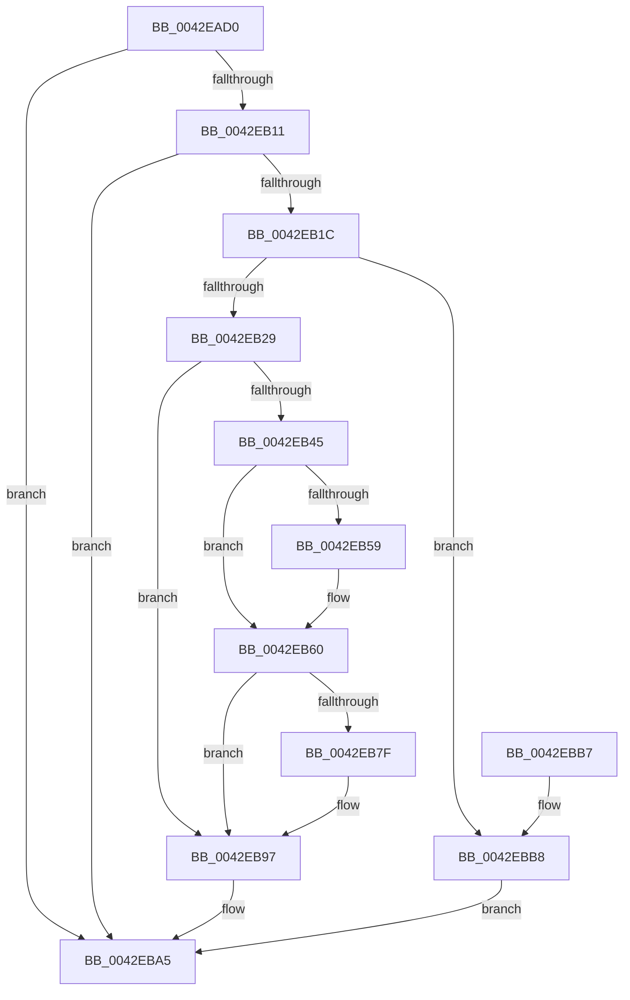

# IoIncrementKeepAliveCount

- RVA: `0x0042EAD0`–`0x0042EBE0` (길이 `272` bytes)
- VA: `0x000000014042EAD0`
- 실행 섹션: `.text`
- PDB 이름 있음: `예`; PDB Function 태그: `아니요`
- unwind 정보 RVA: `0x000A1DD4`
- 디코드: `66`개 명령, `272/272` bytes 표시
- 미해석 바이트: `0` (있으면 어셈블리에 `.byte`로 보존)

> 이 문서는 커널 이미지의 기계어와 PDB 기호를 분석해 생성했습니다. 4번과 5번은 함수 원형과 자료형을 바이너리 사용 방식에서 추정한 C 해석이며 원본 소스 복구 결과는 아닙니다.

## 1. Dependencies

- 직접 호출 지점: **6**; 고유 호출 대상: **6**
- 직접 호출자로 확인된 함수: **0**
- RIP 상대 이미지 참조: **6**

### Outgoing calls
- `0x0042EB02` → [IopAdjustFileObjectKeepAliveCount](IopAdjustFileObjectKeepAliveCount_function_0042EBE8.md) (function, `0x0042EBE8`)
- `0x0042EB30` → [KeAcquireSpinLockRaiseToDpc](../20/KeAcquireSpinLockRaiseToDpc_function_00208470.md) (function, `0x00208470`)
- `0x0042EB92` → [ExQueueWorkItem](../2F/ExQueueWorkItem_function_002F9520.md) (function, `0x002F9520`)
- `0x0042EBA0` → [KeReleaseSpinLock](../39/KeReleaseSpinLock_function_00392BA0.md) (function, `0x00392BA0`)
- `0x0042EBC0` → [ObfReferenceObjectWithTag](../21/ObfReferenceObjectWithTag_function_00210710.md) (function, `0x00210710`)
- `0x0042EBD9` → [PspAdjustKeepAliveCountProcess](../../page/A7/PspAdjustKeepAliveCountProcess_function_00A7EE04.md) (function, `0x00A7EE04`)

### Direct callers
- 이 함수 시작 RVA로 연결되는 직접 call은 확인되지 않았습니다. 간접 호출은 완전히 역산할 수 없습니다.

### Static image references
- `0x0042EB29` → RVA `0x00F8D730` (`.data`; read)
- `0x0042EB45` → RVA `0x00F8D720` (`.data`; read)
- `0x0042EB6B` → RVA `0x00F8D720` (`.data`; write)
- `0x0042EB76` → RVA `0x00F8D758` (`.data`; read)
- `0x0042EB84` → RVA `0x00F8D758` (`.data`; write)
- `0x0042EB8B` → RVA `0x00F8D700` (`.data`; read)

## 2. Other-region calls and transfers

- 다른 실행 섹션으로 향하는 call: **1**
  - `0x0042EBD9` → [PspAdjustKeepAliveCountProcess](../../page/A7/PspAdjustKeepAliveCountProcess_function_00A7EE04.md) (`.text` → `PAGE`)
- 별도 외부 분기/꼬리 이동을 확인하지 못했습니다.

## 3. Assembly (complete function range)

```asm
0042EAD0  4C 8B DC                        mov r11, rsp
0042EAD3  49 89 5B 08                     mov qword ptr [r11 + 8], rbx
0042EAD7  49 89 73 10                     mov qword ptr [r11 + 0x10], rsi
0042EADB  57                              push rdi
0042EADC  48 83 EC 30                     sub rsp, 0x30
0042EAE0  83 64 24 50 00                  and dword ptr [rsp + 0x50], 0
0042EAE5  49 8D 43 20                     lea rax, [r11 + 0x20]
0042EAE9  49 83 63 20 00                  and qword ptr [r11 + 0x20], 0
0042EAEE  4D 8D 4B 18                     lea r9, [r11 + 0x18]
0042EAF2  41 B8 01 00 00 00               mov r8d, 1
0042EAF8  49 89 43 E8                     mov qword ptr [r11 - 0x18], rax
0042EAFC  48 8B DA                        mov rbx, rdx
0042EAFF  48 8B F1                        mov rsi, rcx
0042EB02  E8 E1 00 00 00                  call 0x14042ebe8
0042EB07  8B F8                           mov edi, eax
0042EB09  85 C0                           test eax, eax
0042EB0B  0F 88 94 00 00 00               js 0x14042eba5
0042EB11  83 7C 24 50 01                  cmp dword ptr [rsp + 0x50], 1
0042EB16  0F 85 89 00 00 00               jne 0x14042eba5
0042EB1C  44 0F 20 C1                     mov rcx, cr8
0042EB20  80 F9 02                        cmp cl, 2
0042EB23  0F 85 8F 00 00 00               jne 0x14042ebb8
0042EB29  48 8D 0D 00 EC B5 00            lea rcx, [rip + 0xb5ec00]
0042EB30  E8 3B 99 DD FF                  call 0x140208470
0042EB35  48 8B 4C 24 58                  mov rcx, qword ptr [rsp + 0x58]
0042EB3A  8A D8                           mov bl, al
0042EB3C  FF 41 20                        inc dword ptr [rcx + 0x20]
0042EB3F  80 79 10 00                     cmp byte ptr [rcx + 0x10], 0
0042EB43  75 52                           jne 0x14042eb97
0042EB45  48 8B 15 D4 EB B5 00            mov rdx, qword ptr [rip + 0xb5ebd4]
0042EB4C  48 8D 05 CD EB B5 00            lea rax, [rip + 0xb5ebcd]
0042EB53  48 39 42 08                     cmp qword ptr [rdx + 8], rax
0042EB57  74 07                           je 0x14042eb60
0042EB59  B9 03 00 00 00                  mov ecx, 3
0042EB5E  CD 29                           int 0x29
0042EB60  48 89 11                        mov qword ptr [rcx], rdx
0042EB63  48 89 41 08                     mov qword ptr [rcx + 8], rax
0042EB67  48 89 4A 08                     mov qword ptr [rdx + 8], rcx
0042EB6B  48 89 0D AE EB B5 00            mov qword ptr [rip + 0xb5ebae], rcx
0042EB72  C6 41 10 01                     mov byte ptr [rcx + 0x10], 1
0042EB76  80 3D DB EB B5 00 00            cmp byte ptr [rip + 0xb5ebdb], 0
0042EB7D  75 18                           jne 0x14042eb97
0042EB7F  BA 01 00 00 00                  mov edx, 1
0042EB84  C6 05 CD EB B5 00 01            mov byte ptr [rip + 0xb5ebcd], 1
0042EB8B  48 8D 0D 6E EB B5 00            lea rcx, [rip + 0xb5eb6e]
0042EB92  E8 89 A9 EC FF                  call 0x1402f9520
0042EB97  8A D3                           mov dl, bl
0042EB99  48 8D 0D 90 EB B5 00            lea rcx, [rip + 0xb5eb90]
0042EBA0  E8 FB 3F F6 FF                  call 0x140392ba0
0042EBA5  48 8B 5C 24 40                  mov rbx, qword ptr [rsp + 0x40]
0042EBAA  8B C7                           mov eax, edi
0042EBAC  48 8B 74 24 48                  mov rsi, qword ptr [rsp + 0x48]
0042EBB1  48 83 C4 30                     add rsp, 0x30
0042EBB5  5F                              pop rdi
0042EBB6  C3                              ret
0042EBB7  CC                              int3
0042EBB8  BA 44 66 6C 74                  mov edx, 0x746c6644
0042EBBD  48 8B CB                        mov rcx, rbx
0042EBC0  E8 4B 1B DE FF                  call 0x140210710
0042EBC5  4C 8B 4C 24 58                  mov r9, qword ptr [rsp + 0x58]
0042EBCA  4C 8B C6                        mov r8, rsi
0042EBCD  BA 01 00 00 00                  mov edx, 1
0042EBD2  48 8B CB                        mov rcx, rbx
0042EBD5  45 8A 49 12                     mov r9b, byte ptr [r9 + 0x12]
0042EBD9  E8 26 02 65 00                  call 0x140a7ee04
0042EBDE  EB C5                           jmp 0x14042eba5
```

## 4. C-style interpretation (structured pseudocode)

```c
__int64 __fastcall IoIncrementKeepAliveCount(__int64 a1, __int64 a2)
{
    __int64 result;
    __int64 v_rsp;
    unsigned __int64 v_stack_p10;
    unsigned int v_stack_p18;
    unsigned __int64 v_stack_p20;
    unsigned __int64 v_stack_p58;
    unsigned __int64 v_stack_p8;

    *(unsigned __int64 *)(v_rsp + 8) = v_rbx;
    *(unsigned __int64 *)(v_rsp + 16) = v_rsi;
    v_rsp = (v_rsp) - (48);
    *(unsigned __int64 *)(v_rsp - 24) = v_rsp + 32;
    result = IopAdjustFileObjectKeepAliveCount(a1, a2, 1, v_rsp + 24);
    if (sign_flag) goto loc_0042EBA5;
    if (v_stack_p18 != 1) goto loc_0042EBA5;
    if (((unsigned __int8)(v_cr8)) != 2) goto loc_0042EBB8;
    result = KeAcquireSpinLockRaiseToDpc(v_rip + 11922432, a2, 1, v_rsp + 24);
    if ((*(unsigned __int8 *)(v_stack_p20 + 16)) != 0) goto loc_0042EB97;
    if ((*(unsigned __int64 *)(*(unsigned __int64 *)(v_rip + 11922388) + 8)) != (v_rip + 11922381)) {
        a1 = 3;
    }
    *(unsigned __int64 *)(a1) = *(unsigned __int64 *)(v_rip + 11922388);
    *(unsigned __int64 *)(a1 + 8) = v_rip + 11922381;
    *(unsigned __int64 *)(*(unsigned __int64 *)(v_rip + 11922388) + 8) = a1;
    *(unsigned __int64 *)(v_rip + 11922350) = a1;
    *(unsigned __int8 *)(a1 + 16) = 1;
    result = v_rip + 11922381;
    if ((*(unsigned __int8 *)(v_rip + 11922395)) == 0) {
        a2 = 1;
        *(unsigned __int8 *)(v_rip + 11922381) = 1;
        a1 = v_rip + 11922286;
        result = ExQueueWorkItem(a1, a2, 1, v_rsp + 24);
    }
    result = KeReleaseSpinLock(v_rip + 11922320, (unsigned __int8)((unsigned __int8)(result)), 1, v_rsp + 24);
loc_0042EBA5:
    v_rsp = (v_rsp) + (48);
    return (unsigned int)((unsigned int)((unsigned int)((unsigned int)(result))));
loc_0042EBB8:
    result = ObfReferenceObjectWithTag(v_stack_p8, (unsigned int)(0x746C6644ULL), 1, v_rsp + 24);
    result = PspAdjustKeepAliveCountProcess(v_stack_p8, 1, v_stack_p10, *(unsigned __int8 *)(v_stack_p58 + 18));
    goto loc_0042EBA5;
}
```

## 5. (Beta) C Style

```c
int64_t IoIncrementKeepAliveCount(int64_t Arg1, int64_t Arg2)
{
    int64_t result;
    int64_t local_rsp;
    uint64_t v_stack_p10;
    uint32_t v_stack_p18;
    uint64_t v_stack_p20;
    uint64_t v_stack_p58;
    uint64_t v_stack_p8;

    *(uint64_t *)(local_rsp + 0x8) = local_rbx;
    *(uint64_t *)(local_rsp + 0x10) = local_rsi;
    local_rsp = (local_rsp) - (48);
    *(uint64_t *)(local_rsp - 0x18) = local_rsp + 32;
    result = IopAdjustFileObjectKeepAliveCount(Arg1, Arg2, 1, local_rsp + 24);
    if (sign_flag) goto loc_0042EBA5;
    if (v_stack_p18 != 1) goto loc_0042EBA5;
    if (((uint8_t)(v_cr8)) != 2) goto loc_0042EBB8;
    result = KeAcquireSpinLockRaiseToDpc(v_rip + 11922432, Arg2, 1, local_rsp + 24);
    if ((*(uint8_t *)(v_stack_p20 + 0x10)) != 0) goto loc_0042EB97;
    if ((*(uint64_t *)(*(uint64_t *)(v_rip + 0xB5EBD4) + 0x8)) != (v_rip + 11922381)) {
        Arg1 = 3;
    }
    *(uint64_t *)(Arg1) = *(uint64_t *)(v_rip + 0xB5EBD4);
    *(uint64_t *)(Arg1 + 0x8) = v_rip + 11922381;
    *(uint64_t *)(*(uint64_t *)(v_rip + 0xB5EBD4) + 0x8) = Arg1;
    *(uint64_t *)(v_rip + 0xB5EBAE) = Arg1;
    *(uint8_t *)(Arg1 + 0x10) = 1;
    result = v_rip + 11922381;
    if ((*(uint8_t *)(v_rip + 0xB5EBDB)) == 0) {
        Arg2 = 1;
        *(uint8_t *)(v_rip + 0xB5EBCD) = 1;
        Arg1 = v_rip + 11922286;
        result = ExQueueWorkItem(Arg1, Arg2, 1, local_rsp + 24);
    }
    result = KeReleaseSpinLock(v_rip + 11922320, (uint8_t)((uint8_t)(result)), 1, local_rsp + 24);
loc_0042EBA5:
    local_rsp = (local_rsp) + (48);
    return (uint32_t)((uint32_t)((uint32_t)((uint32_t)(result))));
loc_0042EBB8:
    result = ObfReferenceObjectWithTag(v_stack_p8, (uint32_t)(0x746C6644ULL), 1, local_rsp + 24);
    result = PspAdjustKeepAliveCountProcess(v_stack_p8, 1, v_stack_p10, *(uint8_t *)(v_stack_p58 + 0x12));
    goto loc_0042EBA5;
}
```

## 6. Execution-region graph

[열기: 2D/3D 그래프와 함수 탐색 컨트롤 패널](../../../control-panel.html?section=text&rva=0x0042EAD0&view=graph)

- 2D 그래프는 위에서 아래로 흐르고, 3D 그래프는 빈 공간을 드래그해 회전합니다. Shift+드래그는 이동, 휠은 확대·축소, 함수 노드 선택은 대상 보고서 이동입니다.

### Static fallback


