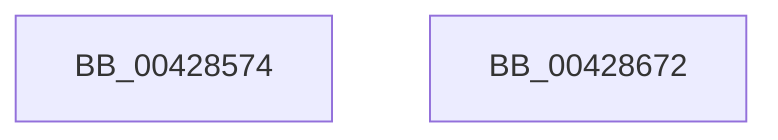

# IoStartIoRateControl

- RVA: `0x00428574`–`0x00428673` (길이 `255` bytes)
- VA: `0x0000000140428574`
- 실행 섹션: `.text`
- PDB 이름 있음: `예`; PDB Function 태그: `아니요`
- unwind 정보 RVA: `0x000A0D30`
- 디코드: `68`개 명령, `255/255` bytes 표시
- 미해석 바이트: `0` (있으면 어셈블리에 `.byte`로 보존)

> 이 문서는 커널 이미지의 기계어와 PDB 기호를 분석해 생성했습니다. 4번과 5번은 함수 원형과 자료형을 바이너리 사용 방식에서 추정한 C 해석이며 원본 소스 복구 결과는 아닙니다.

## 1. Dependencies

- 직접 호출 지점: **2**; 고유 호출 대상: **2**
- 직접 호출자로 확인된 함수: **1**
- RIP 상대 이미지 참조: **1**

### Outgoing calls
- `0x00428656` → [IopIoRateStartRateControl](IopIoRateStartRateControl_function_004286C0.md) (function, `0x004286C0`)
- `0x00428662` → [_security_check_cookie](../6A/_security_check_cookie_function_006AC640.md) (function, `0x006AC640`)

### Direct callers
- [PspIoRateEntryActivate](../../page/9F/PspIoRateEntryActivate_function_009F8398.md) at `0x009F841C`

### Static image references
- `0x00428584` → RVA `0x00E0A740` (`.data`; read)

## 2. Other-region calls and transfers

- 다른 실행 섹션으로 향하는 call: **0**
- 별도 외부 분기/꼬리 이동을 확인하지 못했습니다.

## 3. Assembly (complete function range)

```asm
00428574  40 55                           push rbp
00428576  53                              push rbx
00428577  57                              push rdi
00428578  48 8D 6C 24 C1                  lea rbp, [rsp - 0x3f]
0042857D  48 81 EC D0 00 00 00            sub rsp, 0xd0
00428584  48 8B 05 B5 21 9E 00            mov rax, qword ptr [rip + 0x9e21b5]
0042858B  48 33 C4                        xor rax, rsp
0042858E  48 89 45 2F                     mov qword ptr [rbp + 0x2f], rax
00428592  48 8B 01                        mov rax, qword ptr [rcx]
00428595  49 8B D8                        mov rbx, r8
00428598  44 8B 51 24                     mov r10d, dword ptr [rcx + 0x24]
0042859C  49 8B F9                        mov rdi, r9
0042859F  4C 8B 5D 7F                     mov r11, qword ptr [rbp + 0x7f]
004285A3  4C 8B CA                        mov r9, rdx
004285A6  48 89 45 AF                     mov qword ptr [rbp - 0x51], rax
004285AA  48 8B 41 10                     mov rax, qword ptr [rcx + 0x10]
004285AE  48 89 45 C7                     mov qword ptr [rbp - 0x39], rax
004285B2  48 8B 41 30                     mov rax, qword ptr [rcx + 0x30]
004285B6  48 89 45 DF                     mov qword ptr [rbp - 0x21], rax
004285BA  48 8B 41 60                     mov rax, qword ptr [rcx + 0x60]
004285BE  48 89 45 F7                     mov qword ptr [rbp - 9], rax
004285C2  48 8B 41 78                     mov rax, qword ptr [rcx + 0x78]
004285C6  48 89 45 0F                     mov qword ptr [rbp + 0xf], rax
004285CA  48 8B 41 08                     mov rax, qword ptr [rcx + 8]
004285CE  48 89 45 B7                     mov qword ptr [rbp - 0x49], rax
004285D2  48 8B 41 38                     mov rax, qword ptr [rcx + 0x38]
004285D6  48 89 45 CF                     mov qword ptr [rbp - 0x31], rax
004285DA  48 8B 41 40                     mov rax, qword ptr [rcx + 0x40]
004285DE  48 89 45 E7                     mov qword ptr [rbp - 0x19], rax
004285E2  48 8B 41 68                     mov rax, qword ptr [rcx + 0x68]
004285E6  48 89 45 FF                     mov qword ptr [rbp - 1], rax
004285EA  48 8B 81 80 00 00 00            mov rax, qword ptr [rcx + 0x80]
004285F1  48 89 45 17                     mov qword ptr [rbp + 0x17], rax
004285F5  48 8B 41 48                     mov rax, qword ptr [rcx + 0x48]
004285F9  48 89 45 BF                     mov qword ptr [rbp - 0x41], rax
004285FD  48 8B 41 50                     mov rax, qword ptr [rcx + 0x50]
00428601  48 89 45 D7                     mov qword ptr [rbp - 0x29], rax
00428605  48 8B 41 58                     mov rax, qword ptr [rcx + 0x58]
00428609  48 89 45 EF                     mov qword ptr [rbp - 0x11], rax
0042860D  48 8B 41 70                     mov rax, qword ptr [rcx + 0x70]
00428611  4C 89 5C 24 30                  mov qword ptr [rsp + 0x30], r11
00428616  48 89 45 07                     mov qword ptr [rbp + 7], rax
0042861A  48 8B 81 88 00 00 00            mov rax, qword ptr [rcx + 0x88]
00428621  41 8B CA                        mov ecx, r10d
00428624  D1 E9                           shr ecx, 1
00428626  83 E1 01                        and ecx, 1
00428629  48 89 7C 24 28                  mov qword ptr [rsp + 0x28], rdi
0042862E  8B D1                           mov edx, ecx
00428630  48 89 45 1F                     mov qword ptr [rbp + 0x1f], rax
00428634  83 CA 02                        or edx, 2
00428637  48 89 5C 24 20                  mov qword ptr [rsp + 0x20], rbx
0042863C  41 F6 C2 04                     test r10b, 4
00428640  0F 44 D1                        cmove edx, ecx
00428643  48 8D 4D AF                     lea rcx, [rbp - 0x51]
00428647  44 8B C2                        mov r8d, edx
0042864A  41 83 C8 04                     or r8d, 4
0042864E  41 F6 C2 08                     test r10b, 8
00428652  44 0F 44 C2                     cmove r8d, edx
00428656  E8 65 00 00 00                  call 0x1404286c0
0042865B  48 8B 4D 2F                     mov rcx, qword ptr [rbp + 0x2f]
0042865F  48 33 CC                        xor rcx, rsp
00428662  E8 D9 3F 28 00                  call 0x1406ac640
00428667  48 81 C4 D0 00 00 00            add rsp, 0xd0
0042866E  5F                              pop rdi
0042866F  5B                              pop rbx
00428670  5D                              pop rbp
00428671  C3                              ret
00428672  CC                              int3
```

## 4. C-style interpretation (structured pseudocode)

```c
__int64 __fastcall IoStartIoRateControl(__int64 a1, __int64 a2, __int64 a3, __int64 a4, __int64 a5)
{
    __int64 result;
    __int64 v_rsp;
    unsigned __int64 v_stack_m28;
    unsigned __int64 v_stack_m38;
    unsigned __int64 v_stack_m40;
    unsigned __int64 v_stack_m48;
    unsigned __int64 v_stack_m50;
    unsigned __int64 v_stack_m57;
    unsigned __int64 v_stack_m58;
    unsigned __int64 v_stack_m60;
    unsigned __int64 v_stack_m68;
    unsigned __int64 v_stack_m70;
    unsigned __int64 v_stack_m78;
    unsigned __int64 v_stack_m80;
    unsigned __int64 v_stack_m88;
    unsigned __int64 v_stack_m90;
    unsigned __int64 v_stack_m98;
    unsigned __int64 v_stack_mA0;
    unsigned __int64 v_stack_mA8;
    unsigned __int64 v_stack_mB8;
    unsigned __int64 v_stack_mC0;
    unsigned __int64 v_stack_mC8;

    v_rsp = (v_rsp) - (208);
    result = (*(unsigned __int64 *)(v_rip + 10363317)) ^ (v_rsp);
    v_stack_m28 = result;
    v_stack_mA8 = *(unsigned __int64 *)(a1);
    v_stack_m90 = *(unsigned __int64 *)(a1 + 16);
    v_stack_m78 = *(unsigned __int64 *)(a1 + 48);
    v_stack_m60 = *(unsigned __int64 *)(a1 + 96);
    v_stack_m48 = *(unsigned __int64 *)(a1 + 120);
    v_stack_mA0 = *(unsigned __int64 *)(a1 + 8);
    v_stack_m88 = *(unsigned __int64 *)(a1 + 56);
    v_stack_m70 = *(unsigned __int64 *)(a1 + 64);
    v_stack_m58 = *(unsigned __int64 *)(a1 + 104);
    v_stack_m40 = *(unsigned __int64 *)(a1 + 128);
    v_stack_m98 = *(unsigned __int64 *)(a1 + 72);
    v_stack_m80 = *(unsigned __int64 *)(a1 + 80);
    v_stack_m68 = *(unsigned __int64 *)(a1 + 88);
    v_stack_mB8 = a5;
    v_stack_m50 = *(unsigned __int64 *)(a1 + 112);
    a1 = (unsigned int)(((unsigned int)((unsigned int)((unsigned int)(*(unsigned int *)(a1 + 36))))) >> (1));
    a1 = (unsigned int)((a1) & (1));
    v_stack_mC0 = a4;
    v_stack_m38 = *(unsigned __int64 *)(a1 + 136);
    a2 = (unsigned int)(((unsigned int)((unsigned int)(a1))) | (2));
    v_stack_mC8 = a3;
    if ((((unsigned __int8)((unsigned int)(*(unsigned int *)(a1 + 36)))) & (4)) == 0) { a2 = (unsigned int)(a1); }
    a3 = (unsigned int)(((unsigned int)((unsigned int)(a2))) | (4));
    if ((((unsigned __int8)((unsigned int)(*(unsigned int *)(a1 + 36)))) & (8)) == 0) { a3 = (unsigned int)(a2); }
    result = IopIoRateStartRateControl(v_stack_mA8, a2, a3, a2);
    a1 = (v_stack_m28) ^ (v_rsp);
    result = _security_check_cookie(a1, a2, a3, a2);
    v_rsp = (v_rsp) + (208);
    return result;
}
```

## 5. (Beta) C Style

```c
int64_t IoStartIoRateControl(void *Arg1, int64_t Arg2, int64_t Arg3, int64_t Arg4, int64_t Arg5)
{
    uint8_t *arg1 = (uint8_t *)Arg1;

    int64_t result;
    int64_t local_rsp;
    uint64_t v_stack_m28;
    uint64_t v_stack_m38;
    uint64_t v_stack_m40;
    uint64_t v_stack_m48;
    uint64_t v_stack_m50;
    uint64_t v_stack_m57;
    uint64_t v_stack_m58;
    uint64_t v_stack_m60;
    uint64_t v_stack_m68;
    uint64_t v_stack_m70;
    uint64_t v_stack_m78;
    uint64_t v_stack_m80;
    uint64_t v_stack_m88;
    uint64_t v_stack_m90;
    uint64_t v_stack_m98;
    uint64_t v_stack_mA0;
    uint64_t v_stack_mA8;
    uint64_t v_stack_mB8;
    uint64_t v_stack_mC0;
    uint64_t v_stack_mC8;

    local_rsp = (local_rsp) - (208);
    result = (*(uint64_t *)(v_rip + 0x9E21B5)) ^ (local_rsp);
    v_stack_m28 = result;
    v_stack_mA8 = *(uint64_t *)(arg1);
    v_stack_m90 = *(uint64_t *)(arg1 + 0x10);
    v_stack_m78 = *(uint64_t *)(arg1 + 0x30);
    v_stack_m60 = *(uint64_t *)(arg1 + 0x60);
    v_stack_m48 = *(uint64_t *)(arg1 + 0x78);
    v_stack_mA0 = *(uint64_t *)(arg1 + 0x8);
    v_stack_m88 = *(uint64_t *)(arg1 + 0x38);
    v_stack_m70 = *(uint64_t *)(arg1 + 0x40);
    v_stack_m58 = *(uint64_t *)(arg1 + 0x68);
    v_stack_m40 = *(uint64_t *)(arg1 + 0x80);
    v_stack_m98 = *(uint64_t *)(arg1 + 0x48);
    v_stack_m80 = *(uint64_t *)(arg1 + 0x50);
    v_stack_m68 = *(uint64_t *)(arg1 + 0x58);
    v_stack_mB8 = Arg5;
    v_stack_m50 = *(uint64_t *)(arg1 + 0x70);
    Arg1 = (uint32_t)(((uint32_t)((uint32_t)((uint32_t)(*(uint32_t *)(arg1 + 0x24))))) >> (1));
    Arg1 = (uint32_t)((Arg1) & (1));
    v_stack_mC0 = Arg4;
    v_stack_m38 = *(uint64_t *)(arg1 + 0x88);
    Arg2 = (uint32_t)(((uint32_t)((uint32_t)(Arg1))) | (2));
    v_stack_mC8 = Arg3;
    if ((((uint8_t)((uint32_t)(*(uint32_t *)(arg1 + 0x24)))) & (4)) == 0) { Arg2 = (uint32_t)(Arg1); }
    Arg3 = (uint32_t)(((uint32_t)((uint32_t)(Arg2))) | (4));
    if ((((uint8_t)((uint32_t)(*(uint32_t *)(arg1 + 0x24)))) & (8)) == 0) { Arg3 = (uint32_t)(Arg2); }
    result = IopIoRateStartRateControl(v_stack_mA8, Arg2, Arg3, Arg2);
    Arg1 = (v_stack_m28) ^ (local_rsp);
    result = _security_check_cookie(Arg1, Arg2, Arg3, Arg2);
    local_rsp = (local_rsp) + (208);
    return result;
}
```

### 관측된 메모리 오프셋

구조체 형식이 확인되지 않은 접근은 인자 기준의 오프셋으로만 기록했습니다.

| 기준 인자 | 오프셋 표현 | 폭 (bit) | 접근 |
|---|---:|---:|---|
| `Arg1` | `+ 0x0` | `64` | `R` |
| `Arg1` | `+ 0x8` | `64` | `R` |
| `Arg1` | `+ 0x10` | `64` | `R` |
| `Arg1` | `+ 0x24` | `32` | `R` |
| `Arg1` | `+ 0x30` | `64` | `R` |
| `Arg1` | `+ 0x38` | `64` | `R` |
| `Arg1` | `+ 0x40` | `64` | `R` |
| `Arg1` | `+ 0x48` | `64` | `R` |
| `Arg1` | `+ 0x50` | `64` | `R` |
| `Arg1` | `+ 0x58` | `64` | `R` |
| `Arg1` | `+ 0x60` | `64` | `R` |
| `Arg1` | `+ 0x68` | `64` | `R` |
| `Arg1` | `+ 0x70` | `64` | `R` |
| `Arg1` | `+ 0x78` | `64` | `R` |
| `Arg1` | `+ 0x80` | `64` | `R` |
| `Arg1` | `+ 0x88` | `64` | `R` |

## 6. Execution-region graph

[열기: 2D/3D 그래프와 함수 탐색 컨트롤 패널](../../../control-panel.html?section=text&rva=0x00428574&view=graph)

- 2D 그래프는 위에서 아래로 흐르고, 3D 그래프는 빈 공간을 드래그해 회전합니다. Shift+드래그는 이동, 휠은 확대·축소, 함수 노드 선택은 대상 보고서 이동입니다.

### Static fallback


