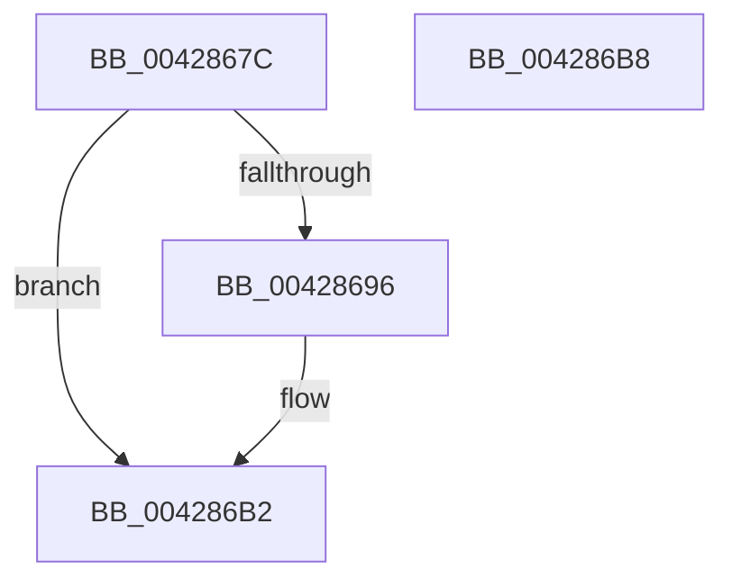

# IoStopIoRateControl

- RVA: `0x0042867C`–`0x004286B9` (길이 `61` bytes)
- VA: `0x000000014042867C`
- 실행 섹션: `.text`
- PDB 이름 있음: `예`; PDB Function 태그: `아니요`
- unwind 정보 RVA: `0x0005CF00`
- 디코드: `17`개 명령, `61/61` bytes 표시
- 미해석 바이트: `0` (있으면 어셈블리에 `.byte`로 보존)

> 이 문서는 커널 이미지의 기계어와 PDB 기호를 분석해 생성했습니다. 4번과 5번은 함수 원형과 자료형을 바이너리 사용 방식에서 추정한 C 해석이며 원본 소스 복구 결과는 아닙니다.

## 1. Dependencies

- 직접 호출 지점: **3**; 고유 호출 대상: **3**
- 직접 호출자로 확인된 함수: **2**
- RIP 상대 이미지 참조: **1**

### Outgoing calls
- `0x0042868C` → [ExGetExtensionTable](ExGetExtensionTable_function_00428814.md) (function, `0x00428814`)
- `0x0042869D` → [guard_dispatch_icall](../6B/guard_dispatch_icall_function_006BAAD0.md) (function, `0x006BAAD0`)
- `0x004286AD` → [ExReleaseRundownProtection](../34/ExReleaseRundownProtection_function_00349E80.md) (function, `0x00349E80`)

### Direct callers
- [PspIoRateEntryDeactivate](../../page/9F/PspIoRateEntryDeactivate_function_009F7BD4.md) at `0x009F7BEA`
- [PspIoRateEntryActivate](../../page/9F/PspIoRateEntryActivate_function_009F8398.md) at `0x009F84AC`

### Static image references
- `0x00428685` → RVA `0x00F8D130` (`.data`; read)

## 2. Other-region calls and transfers

- 다른 실행 섹션으로 향하는 call: **0**
- 별도 외부 분기/꼬리 이동을 확인하지 못했습니다.

## 3. Assembly (complete function range)

```asm
0042867C  40 53                           push rbx
0042867E  48 83 EC 20                     sub rsp, 0x20
00428682  48 8B D9                        mov rbx, rcx
00428685  48 8B 0D A4 4A B6 00            mov rcx, qword ptr [rip + 0xb64aa4]
0042868C  E8 83 01 00 00                  call 0x140428814
00428691  48 85 C0                        test rax, rax
00428694  74 1C                           je 0x1404286b2
00428696  48 8B 40 08                     mov rax, qword ptr [rax + 8]
0042869A  48 8B CB                        mov rcx, rbx
0042869D  E8 2E 24 29 00                  call 0x1406baad0
004286A2  48 8B 0D 87 4A B6 00            mov rcx, qword ptr [rip + 0xb64a87]
004286A9  48 83 C1 58                     add rcx, 0x58
004286AD  E8 CE 17 F2 FF                  call 0x140349e80
004286B2  48 83 C4 20                     add rsp, 0x20
004286B6  5B                              pop rbx
004286B7  C3                              ret
004286B8  CC                              int3
```

## 4. C-style interpretation (structured pseudocode)

```c
__int64 __fastcall IoStopIoRateControl(__int64 a1)
{
    __int64 result;
    __int64 v_rsp;

    v_rsp = (v_rsp) - (32);
    result = ExGetExtensionTable(*(unsigned __int64 *)(v_rip + 11946660), a2, a3, a4);
    if (result != 0) {
        result = *(unsigned __int64 *)(result + 8);
        a1 = a1;
        result = guard_dispatch_icall(a1, a2, a3, a4);
        a1 = *(unsigned __int64 *)(v_rip + 11946631);
        a1 = (a1) + (88);
        result = ExReleaseRundownProtection(a1, a2, a3, a4);
    }
    v_rsp = (v_rsp) + (32);
    return result;
}
```

## 5. (Beta) C Style

```c
int64_t IoStopIoRateControl(int64_t Arg1)
{
    int64_t result;
    int64_t local_rsp;

    local_rsp = (local_rsp) - (32);
    result = ExGetExtensionTable(*(uint64_t *)(v_rip + 0xB64AA4), a2, a3, a4);
    if (result != 0) {
        result = *(uint64_t *)(result + 0x8);
        Arg1 = Arg1;
        result = guard_dispatch_icall(Arg1, a2, a3, a4);
        Arg1 = *(uint64_t *)(v_rip + 0xB64A87);
        Arg1 = (Arg1) + (88);
        result = ExReleaseRundownProtection(Arg1, a2, a3, a4);
    }
    local_rsp = (local_rsp) + (32);
    return result;
}
```

## 6. Execution-region graph

[열기: 2D/3D 그래프와 함수 탐색 컨트롤 패널](../../../control-panel.html?section=text&rva=0x0042867C&view=graph)

- 2D 그래프는 위에서 아래로 흐르고, 3D 그래프는 빈 공간을 드래그해 회전합니다. Shift+드래그는 이동, 휠은 확대·축소, 함수 노드 선택은 대상 보고서 이동입니다.

### Static fallback


