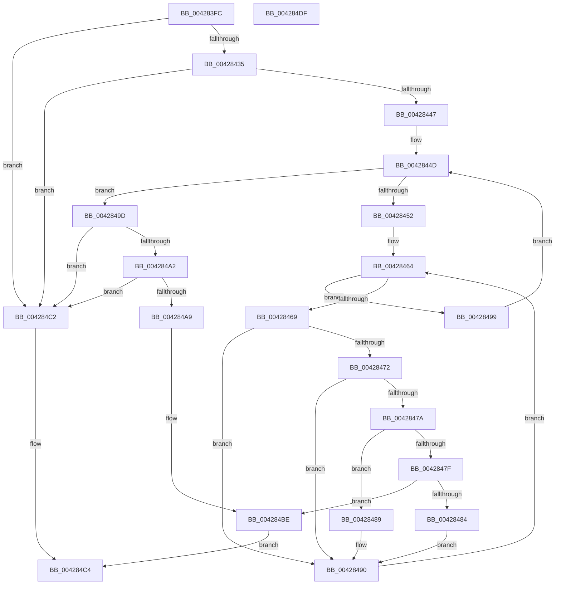

# IopAddTriageDumpDataBlock

- RVA: `0x004283FC`–`0x004284E0` (길이 `228` bytes)
- VA: `0x00000001404283FC`
- 실행 섹션: `.text`
- PDB 이름 있음: `예`; PDB Function 태그: `아니요`
- unwind 정보 RVA: `0x0005E6B4`
- 디코드: `74`개 명령, `228/228` bytes 표시
- 미해석 바이트: `0` (있으면 어셈블리에 `.byte`로 보존)

> 이 문서는 커널 이미지의 기계어와 PDB 기호를 분석해 생성했습니다. 4번과 5번은 함수 원형과 자료형을 바이너리 사용 방식에서 추정한 C 해석이며 원본 소스 복구 결과는 아닙니다.

## 1. Dependencies

- 직접 호출 지점: **1**; 고유 호출 대상: **1**
- 직접 호출자로 확인된 함수: **2**
- RIP 상대 이미지 참조: **0**

### Outgoing calls
- `0x0042843E` → [IopIsAddressRangeValid](../4B/IopIsAddressRangeValid_function_004B6CBC.md) (function, `0x004B6CBC`)

### Direct callers
- [IoAddTriageDumpDataBlock](IoAddTriageDumpDataBlock_function_00428374.md) at `0x004283BA`
- [IopAddRunTimeTriageDataBlocks](../59/IopAddRunTimeTriageDataBlocks_function_0059462C.md) at `0x0059468C`
- [IopAddRunTimeTriageDataBlocks](../59/IopAddRunTimeTriageDataBlocks_function_0059462C.md) at `0x005946CA`

### Static image references
- 디코드된 RIP-relative 메모리 참조가 없습니다.

## 2. Other-region calls and transfers

- 다른 실행 섹션으로 향하는 call: **0**
- 별도 외부 분기/꼬리 이동을 확인하지 못했습니다.

## 3. Assembly (complete function range)

```asm
004283FC  48 8B C4                        mov rax, rsp
004283FF  48 89 58 08                     mov qword ptr [rax + 8], rbx
00428403  48 89 68 10                     mov qword ptr [rax + 0x10], rbp
00428407  48 89 70 18                     mov qword ptr [rax + 0x18], rsi
0042840B  48 89 78 20                     mov qword ptr [rax + 0x20], rdi
0042840F  41 56                           push r14
00428411  48 83 EC 20                     sub rsp, 0x20
00428415  49 8B D8                        mov rbx, r8
00428418  49 8B F9                        mov rdi, r9
0042841B  44 8B 44 24 50                  mov r8d, dword ptr [rsp + 0x50]
00428420  48 8B EA                        mov rbp, rdx
00428423  44 8B F1                        mov r14d, ecx
00428426  41 8D 40 FF                     lea eax, [r8 - 1]
0042842A  3D FE FF 03 00                  cmp eax, 0x3fffe
0042842F  0F 87 8D 00 00 00               ja 0x1404284c2
00428435  41 8B D0                        mov edx, r8d
00428438  49 8B C9                        mov rcx, r9
0042843B  41 8B F0                        mov esi, r8d
0042843E  E8 79 E8 08 00                  call 0x1404b6cbc
00428443  84 C0                           test al, al
00428445  74 7B                           je 0x1404284c2
00428447  48 8D 14 3E                     lea rdx, [rsi + rdi]
0042844B  33 C9                           xor ecx, ecx
0042844D  41 3B CE                        cmp ecx, r14d
00428450  73 4B                           jae 0x14042849d
00428452  8B C1                           mov eax, ecx
00428454  48 03 C0                        add rax, rax
00428457  45 33 D2                        xor r10d, r10d
0042845A  4C 8B 44 C5 08                  mov r8, qword ptr [rbp + rax*8 + 8]
0042845F  44 8B 5C C5 00                  mov r11d, dword ptr [rbp + rax*8]
00428464  45 3B D3                        cmp r10d, r11d
00428467  73 30                           jae 0x140428499
00428469  49 8B 40 08                     mov rax, qword ptr [r8 + 8]
0042846D  48 3B F8                        cmp rdi, rax
00428470  73 1E                           jae 0x140428490
00428472  4D 8B 08                        mov r9, qword ptr [r8]
00428475  49 3B D1                        cmp rdx, r9
00428478  76 16                           jbe 0x140428490
0042847A  49 3B F9                        cmp rdi, r9
0042847D  72 0A                           jb 0x140428489
0042847F  48 3B D0                        cmp rdx, rax
00428482  76 3A                           jbe 0x1404284be
00428484  48 8B F8                        mov rdi, rax
00428487  EB 07                           jmp 0x140428490
00428489  48 3B D0                        cmp rdx, rax
0042848C  49 0F 46 D1                     cmovbe rdx, r9
00428490  41 FF C2                        inc r10d
00428493  49 83 C0 10                     add r8, 0x10
00428497  EB CB                           jmp 0x140428464
00428499  FF C1                           inc ecx
0042849B  EB B0                           jmp 0x14042844d
0042849D  48 85 DB                        test rbx, rbx
004284A0  74 20                           je 0x1404284c2
004284A2  8B 03                           mov eax, dword ptr [rbx]
004284A4  3B 43 04                        cmp eax, dword ptr [rbx + 4]
004284A7  73 19                           jae 0x1404284c2
004284A9  8B C8                           mov ecx, eax
004284AB  48 C1 E1 04                     shl rcx, 4
004284AF  48 03 4B 08                     add rcx, qword ptr [rbx + 8]
004284B3  FF C0                           inc eax
004284B5  89 03                           mov dword ptr [rbx], eax
004284B7  48 89 39                        mov qword ptr [rcx], rdi
004284BA  48 89 51 08                     mov qword ptr [rcx + 8], rdx
004284BE  B0 01                           mov al, 1
004284C0  EB 02                           jmp 0x1404284c4
004284C2  32 C0                           xor al, al
004284C4  48 8B 5C 24 30                  mov rbx, qword ptr [rsp + 0x30]
004284C9  48 8B 6C 24 38                  mov rbp, qword ptr [rsp + 0x38]
004284CE  48 8B 74 24 40                  mov rsi, qword ptr [rsp + 0x40]
004284D3  48 8B 7C 24 48                  mov rdi, qword ptr [rsp + 0x48]
004284D8  48 83 C4 20                     add rsp, 0x20
004284DC  41 5E                           pop r14
004284DE  C3                              ret
004284DF  CC                              int3
```

## 4. C-style interpretation (structured pseudocode)

```c
__int64 __fastcall IopAddTriageDumpDataBlock(int a1, __int64 a2, __int64 a3, __int64 a4, unsigned int a5)
{
    __int64 result;
    __int64 v_r10;
    __int64 v_rsp;
    unsigned __int64 v_stack_p10;
    unsigned __int64 v_stack_p18;
    unsigned __int64 v_stack_p20;
    unsigned __int64 v_stack_p8;

    *(unsigned __int64 *)(v_rsp + 8) = v_rbx;
    *(unsigned __int64 *)(v_rsp + 16) = v_rbp;
    *(unsigned __int64 *)(v_rsp + 24) = v_rsi;
    *(unsigned __int64 *)(v_rsp + 32) = v_rdi;
    v_rsp = (v_rsp) - (32);
    if (((unsigned int)((unsigned int)(a5) - 1)) > 0x3FFFEULL) goto loc_004284C2;
    result = IopIsAddressRangeValid(a4, (unsigned int)((unsigned int)((unsigned int)(a5))), (unsigned int)(a5), a4);
    if ((unsigned __int8)(result) == 0) goto loc_004284C2;
    a1 = 0;
loc_0042844D:
    if (0 >= ((unsigned int)((unsigned int)(a1)))) goto loc_0042849D;
    result = (0) + (0);
    v_r10 = 0;
loc_00428464:
    if (0 >= ((unsigned int)((unsigned int)(*(unsigned int *)(a2 + result * 8))))) goto loc_00428499;
    if (a4 >= (*(unsigned __int64 *)(*(unsigned __int64 *)(a2 + result * 8 + 8) + 8))) goto loc_00428490;
    if (((unsigned int)((unsigned int)((unsigned int)(a5))) + a4 * 1) <= (*(unsigned __int64 *)(*(unsigned __int64 *)(a2 + result * 8 + 8)))) goto loc_00428490;
    if (a4 < (*(unsigned __int64 *)(*(unsigned __int64 *)(a2 + result * 8 + 8)))) goto loc_00428489;
    if (((unsigned int)((unsigned int)((unsigned int)(a5))) + a4 * 1) <= (*(unsigned __int64 *)(*(unsigned __int64 *)(a2 + result * 8 + 8) + 8))) goto loc_004284BE;
    goto loc_00428490;
loc_00428489:
    a2 = (unsigned int)((unsigned int)((unsigned int)(a5))) + a4 * 1;
    if (((unsigned int)((unsigned int)((unsigned int)(a5))) + a4 * 1) <= (*(unsigned __int64 *)(*(unsigned __int64 *)(a2 + result * 8 + 8) + 8))) { a2 = *(unsigned __int64 *)(*(unsigned __int64 *)(a2 + result * 8 + 8)); }
loc_00428490:
    v_r10 = (unsigned int)((v_r10) + 1);
    a3 = (*(unsigned __int64 *)(a2 + result * 8 + 8)) + (16);
    goto loc_00428464;
loc_00428499:
    a1 = (unsigned int)((a1) + 1);
    goto loc_0042844D;
loc_0042849D:
    if (a3 == 0) goto loc_004284C2;
    if (((unsigned int)((unsigned int)(*(unsigned int *)(a3)))) >= (*(unsigned int *)(a3 + 4))) goto loc_004284C2;
    a1 = ((unsigned int)((unsigned int)((unsigned int)(*(unsigned int *)(a3))))) << (4);
    a1 = (a1) + (*(unsigned __int64 *)(a3 + 8));
    result = (unsigned int)(((unsigned int)(*(unsigned int *)(a3))) + 1);
    *(unsigned int *)(a3) = (unsigned int)(result);
    *(unsigned __int64 *)(a1) = *(unsigned __int64 *)(*(unsigned __int64 *)(a2 + result * 8 + 8) + 8);
    *(unsigned __int64 *)(a1 + 8) = a2;
loc_004284BE:
    goto loc_004284C4;
loc_004284C2:
    result = 0;
loc_004284C4:
    v_rsp = (v_rsp) + (32);
    return result;
}
```

## 5. (Beta) C Style

```c
int64_t IopAddTriageDumpDataBlock(int32_t Arg1, void *Arg2, int64_t Arg3, int64_t Arg4, void *Arg5)
{
    uint8_t *arg2 = (uint8_t *)Arg2;
    uint8_t *arg5 = (uint8_t *)Arg5;

    int64_t result;
    int64_t local_r10;
    int64_t local_rsp;
    uint64_t v_stack_p10;
    uint64_t v_stack_p18;
    uint64_t v_stack_p20;
    uint64_t v_stack_p8;

    *(uint64_t *)(local_rsp + 0x8) = local_rbx;
    *(uint64_t *)(local_rsp + 0x10) = local_rbp;
    *(uint64_t *)(local_rsp + 0x18) = local_rsi;
    *(uint64_t *)(local_rsp + 0x20) = local_rdi;
    local_rsp = (local_rsp) - (32);
    if (((uint32_t)((uint32_t)(Arg5) - 1)) > 0x3FFFEULL) goto loc_004284C2;
    result = IopIsAddressRangeValid(Arg4, (uint32_t)((uint32_t)((uint32_t)(Arg5))), (uint32_t)(Arg5), Arg4);
    if ((uint8_t)(result) == 0) goto loc_004284C2;
    Arg1 = 0;
loc_0042844D:
    if (0 >= ((uint32_t)((uint32_t)(Arg1)))) goto loc_0042849D;
    result = (0) + (0);
    local_r10 = 0;
loc_00428464:
    if (0 >= ((uint32_t)((uint32_t)(*(uint32_t *)(arg2 + result * 8))))) goto loc_00428499;
    if (Arg4 >= (*(uint64_t *)(*(uint64_t *)(arg2 + result * 8 + 0x8) + 0x8))) goto loc_00428490;
    if (((uint32_t)((uint32_t)((uint32_t)(Arg5))) + Arg4 * 1) <= (*(uint64_t *)(*(uint64_t *)(arg2 + result * 8 + 0x8)))) goto loc_00428490;
    if (Arg4 < (*(uint64_t *)(*(uint64_t *)(arg2 + result * 8 + 0x8)))) goto loc_00428489;
    if (((uint32_t)((uint32_t)((uint32_t)(Arg5))) + Arg4 * 1) <= (*(uint64_t *)(*(uint64_t *)(arg2 + result * 8 + 0x8) + 0x8))) goto loc_004284BE;
    goto loc_00428490;
loc_00428489:
    Arg2 = (uint32_t)((uint32_t)((uint32_t)(Arg5))) + Arg4 * 1;
    if (((uint32_t)((uint32_t)((uint32_t)(Arg5))) + Arg4 * 1) <= (*(uint64_t *)(*(uint64_t *)(arg2 + result * 8 + 0x8) + 0x8))) { Arg2 = *(uint64_t *)(*(uint64_t *)(arg2 + result * 8 + 0x8)); }
loc_00428490:
    local_r10 = (uint32_t)((local_r10) + 1);
    Arg3 = (*(uint64_t *)(arg2 + result * 8 + 0x8)) + (16);
    goto loc_00428464;
loc_00428499:
    Arg1 = (uint32_t)((Arg1) + 1);
    goto loc_0042844D;
loc_0042849D:
    if (Arg3 == 0) goto loc_004284C2;
    if (((uint32_t)((uint32_t)(*(uint32_t *)(Arg3)))) >= (*(uint32_t *)(Arg3 + 0x4))) goto loc_004284C2;
    Arg1 = ((uint32_t)((uint32_t)((uint32_t)(*(uint32_t *)(Arg3))))) << (4);
    Arg1 = (Arg1) + (*(uint64_t *)(Arg3 + 0x8));
    result = (uint32_t)(((uint32_t)(*(uint32_t *)(Arg3))) + 1);
    *(uint32_t *)(Arg3) = (uint32_t)(result);
    *(uint64_t *)(Arg1) = *(uint64_t *)(*(uint64_t *)(arg2 + result * 8 + 0x8) + 0x8);
    *(void **)(Arg1 + 0x8) = Arg2;
loc_004284BE:
    goto loc_004284C4;
loc_004284C2:
    result = 0;
loc_004284C4:
    local_rsp = (local_rsp) + (32);
    return result;
}
```

### 관측된 메모리 오프셋

구조체 형식이 확인되지 않은 접근은 인자 기준의 오프셋으로만 기록했습니다.

| 기준 인자 | 오프셋 표현 | 폭 (bit) | 접근 |
|---|---:|---:|---|
| `Arg2` | `+ 0x0 + rax*8` | `32` | `R` |
| `Arg2` | `+ 0x8 + rax*8` | `64` | `R` |
| `Arg5` | `- 0x1` | `32` | `R` |
| `Arg5` | `+ 0x0 + rdi*1` | `64` | `R` |

## 6. Execution-region graph

[열기: 2D/3D 그래프와 함수 탐색 컨트롤 패널](../../../control-panel.html?section=text&rva=0x004283FC&view=graph)

- 2D 그래프는 위에서 아래로 흐르고, 3D 그래프는 빈 공간을 드래그해 회전합니다. Shift+드래그는 이동, 휠은 확대·축소, 함수 노드 선택은 대상 보고서 이동입니다.

### Static fallback


