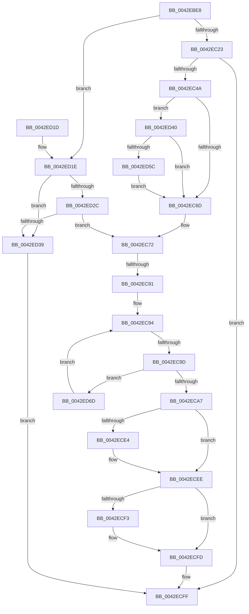

# IopAdjustFileObjectKeepAliveCount

- RVA: `0x0042EBE8`–`0x0042ED75` (길이 `397` bytes)
- VA: `0x000000014042EBE8`
- 실행 섹션: `.text`
- PDB 이름 있음: `예`; PDB Function 태그: `예`
- unwind 정보 RVA: `0x000A1DE8`
- 디코드: `112`개 명령, `397/397` bytes 표시
- 미해석 바이트: `0` (있으면 어셈블리에 `.byte`로 보존)

> 이 문서는 커널 이미지의 기계어와 PDB 기호를 분석해 생성했습니다. 4번과 5번은 함수 원형과 자료형을 바이너리 사용 방식에서 추정한 C 해석이며 원본 소스 복구 결과는 아닙니다.

## 1. Dependencies

- 직접 호출 지점: **8**; 고유 호출 대상: **5**
- 직접 호출자로 확인된 함수: **1**
- RIP 상대 이미지 참조: **0**

### Outgoing calls
- `0x0042EC3B` → [IopGetSetSpecificExtension](IopGetSetSpecificExtension_function_0042EE80.md) (function, `0x0042EE80`)
- `0x0042EC5C` → [ExAllocatePool2](../../poolcode/B8/ExAllocatePool2_function_00B820F0.md) (function, `0x00B820F0`)
- `0x0042EC7C` → [KeAcquireSpinLockRaiseToDpc](../20/KeAcquireSpinLockRaiseToDpc_function_00208470.md) (function, `0x00208470`)
- `0x0042ECDA` → [KeReleaseSpinLock](../39/KeReleaseSpinLock_function_00392BA0.md) (function, `0x00392BA0`)
- `0x0042ECE9` → [ExFreePoolWithTag](../../poolcode/B8/ExFreePoolWithTag_function_00B82870.md) (function, `0x00B82870`)
- `0x0042ECF8` → [ExFreePoolWithTag](../../poolcode/B8/ExFreePoolWithTag_function_00B82870.md) (function, `0x00B82870`)
- `0x0042ED4B` → [ExAllocatePool2](../../poolcode/B8/ExAllocatePool2_function_00B820F0.md) (function, `0x00B820F0`)
- `0x0042ED61` → [ExFreePoolWithTag](../../poolcode/B8/ExFreePoolWithTag_function_00B82870.md) (function, `0x00B82870`)

### Direct callers
- [IoIncrementKeepAliveCount](IoIncrementKeepAliveCount_function_0042EAD0.md) at `0x0042EB02`

### Static image references
- 디코드된 RIP-relative 메모리 참조가 없습니다.

## 2. Other-region calls and transfers

- 다른 실행 섹션으로 향하는 call: **5**
  - `0x0042EC5C` → [ExAllocatePool2](../../poolcode/B8/ExAllocatePool2_function_00B820F0.md) (`.text` → `POOLCODE`)
  - `0x0042ECE9` → [ExFreePoolWithTag](../../poolcode/B8/ExFreePoolWithTag_function_00B82870.md) (`.text` → `POOLCODE`)
  - `0x0042ECF8` → [ExFreePoolWithTag](../../poolcode/B8/ExFreePoolWithTag_function_00B82870.md) (`.text` → `POOLCODE`)
  - `0x0042ED4B` → [ExAllocatePool2](../../poolcode/B8/ExAllocatePool2_function_00B820F0.md) (`.text` → `POOLCODE`)
  - `0x0042ED61` → [ExFreePoolWithTag](../../poolcode/B8/ExFreePoolWithTag_function_00B82870.md) (`.text` → `POOLCODE`)
- call이 아닌 외부 분기/꼬리 이동: **2**
  - `0x0042EC8B` → [sub_006EE710](../6E/Unknown_function_006EE710.md) (`tail-transfer`)
  - `0x0042EC97` → [sub_006EE710](../6E/Unknown_function_006EE710.md) (`tail-transfer`)

## 3. Assembly (complete function range)

```asm
0042EBE8  4C 8B DC                        mov r11, rsp
0042EBEB  49 89 5B 08                     mov qword ptr [r11 + 8], rbx
0042EBEF  49 89 6B 10                     mov qword ptr [r11 + 0x10], rbp
0042EBF3  49 89 73 18                     mov qword ptr [r11 + 0x18], rsi
0042EBF7  4D 89 4B 20                     mov qword ptr [r11 + 0x20], r9
0042EBFB  57                              push rdi
0042EBFC  41 54                           push r12
0042EBFE  41 55                           push r13
0042EC00  41 56                           push r14
0042EC02  41 57                           push r15
0042EC04  48 83 EC 40                     sub rsp, 0x40
0042EC08  49 83 63 C8 00                  and qword ptr [r11 - 0x38], 0
0042EC0D  33 DB                           xor ebx, ebx
0042EC0F  33 F6                           xor esi, esi
0042EC11  45 8B F8                        mov r15d, r8d
0042EC14  4C 8B E2                        mov r12, rdx
0042EC17  48 8B E9                        mov rbp, rcx
0042EC1A  45 85 C0                        test r8d, r8d
0042EC1D  0F 84 FB 00 00 00               je 0x14042ed1e
0042EC23  49 21 5B C0                     and qword ptr [r11 - 0x40], rbx
0042EC27  49 8D 43 C8                     lea rax, [r11 - 0x38]
0042EC2B  8D 5E 20                        lea ebx, [rsi + 0x20]
0042EC2E  49 89 43 B8                     mov qword ptr [r11 - 0x48], rax
0042EC32  44 8B C3                        mov r8d, ebx
0042EC35  8D 56 01                        lea edx, [rsi + 1]
0042EC38  41 B1 01                        mov r9b, 1
0042EC3B  E8 40 02 00 00                  call 0x14042ee80
0042EC40  8B F8                           mov edi, eax
0042EC42  85 C0                           test eax, eax
0042EC44  0F 88 B5 00 00 00               js 0x14042ecff
0042EC4A  41 BE 49 6F 4B 61               mov r14d, 0x614b6f49
0042EC50  44 8D 6E 40                     lea r13d, [rsi + 0x40]
0042EC54  45 8B C6                        mov r8d, r14d
0042EC57  41 8B CD                        mov ecx, r13d
0042EC5A  8B D3                           mov edx, ebx
0042EC5C  E8 8F 34 75 00                  call 0x140b820f0
0042EC61  48 8B D8                        mov rbx, rax
0042EC64  48 85 C0                        test rax, rax
0042EC67  0F 85 D3 00 00 00               jne 0x14042ed40
0042EC6D  4C 8B 74 24 30                  mov r14, qword ptr [rsp + 0x30]
0042EC72  4C 8D AD B8 00 00 00            lea r13, [rbp + 0xb8]
0042EC79  49 8B CD                        mov rcx, r13
0042EC7C  E8 EF 97 DD FF                  call 0x140208470
0042EC81  49 8B 4E 18                     mov rcx, qword ptr [r14 + 0x18]
0042EC85  44 8A C8                        mov r9b, al
0042EC88  48 85 C9                        test rcx, rcx
0042EC8B  0F 84 7F FA 2B 00               je 0x1406ee710
0042EC91  4C 8B C1                        mov r8, rcx
0042EC94  4D 85 C0                        test r8, r8
0042EC97  0F 84 73 FA 2B 00               je 0x1406ee710
0042EC9D  4D 39 60 08                     cmp qword ptr [r8 + 8], r12
0042ECA1  0F 85 C6 00 00 00               jne 0x14042ed6d
0042ECA7  41 8B 40 10                     mov eax, dword ptr [r8 + 0x10]
0042ECAB  45 85 FF                        test r15d, r15d
0042ECAE  8D 48 FF                        lea ecx, [rax - 1]
0042ECB1  8D 50 01                        lea edx, [rax + 1]
0042ECB4  48 8B 84 24 90 00 00 00         mov rax, qword ptr [rsp + 0x90]
0042ECBC  0F 44 D1                        cmove edx, ecx
0042ECBF  41 89 50 10                     mov dword ptr [r8 + 0x10], edx
0042ECC3  49 8B 48 18                     mov rcx, qword ptr [r8 + 0x18]
0042ECC7  48 89 08                        mov qword ptr [rax], rcx
0042ECCA  48 8B 84 24 88 00 00 00         mov rax, qword ptr [rsp + 0x88]
0042ECD2  89 10                           mov dword ptr [rax], edx
0042ECD4  41 8A D1                        mov dl, r9b
0042ECD7  49 8B CD                        mov rcx, r13
0042ECDA  E8 C1 3E F6 FF                  call 0x140392ba0
0042ECDF  48 85 DB                        test rbx, rbx
0042ECE2  74 0A                           je 0x14042ecee
0042ECE4  33 D2                           xor edx, edx
0042ECE6  48 8B CB                        mov rcx, rbx
0042ECE9  E8 82 3B 75 00                  call 0x140b82870
0042ECEE  48 85 F6                        test rsi, rsi
0042ECF1  74 0A                           je 0x14042ecfd
0042ECF3  33 D2                           xor edx, edx
0042ECF5  48 8B CE                        mov rcx, rsi
0042ECF8  E8 73 3B 75 00                  call 0x140b82870
0042ECFD  8B C7                           mov eax, edi
0042ECFF  4C 8D 5C 24 40                  lea r11, [rsp + 0x40]
0042ED04  49 8B 5B 30                     mov rbx, qword ptr [r11 + 0x30]
0042ED08  49 8B 6B 38                     mov rbp, qword ptr [r11 + 0x38]
0042ED0C  49 8B 73 40                     mov rsi, qword ptr [r11 + 0x40]
0042ED10  49 8B E3                        mov rsp, r11
0042ED13  41 5F                           pop r15
0042ED15  41 5E                           pop r14
0042ED17  41 5D                           pop r13
0042ED19  41 5C                           pop r12
0042ED1B  5F                              pop rdi
0042ED1C  C3                              ret
0042ED1D  CC                              int3
0042ED1E  4C 8B B1 D0 00 00 00            mov r14, qword ptr [rcx + 0xd0]
0042ED25  33 FF                           xor edi, edi
0042ED27  4D 85 F6                        test r14, r14
0042ED2A  74 0D                           je 0x14042ed39
0042ED2C  4D 8B 76 10                     mov r14, qword ptr [r14 + 0x10]
0042ED30  4D 85 F6                        test r14, r14
0042ED33  0F 85 39 FF FF FF               jne 0x14042ec72
0042ED39  B8 0D 00 00 C0                  mov eax, 0xc000000d
0042ED3E  EB BF                           jmp 0x14042ecff
0042ED40  45 8B C6                        mov r8d, r14d
0042ED43  BA 38 00 00 00                  mov edx, 0x38
0042ED48  49 8B CD                        mov rcx, r13
0042ED4B  E8 A0 33 75 00                  call 0x140b820f0
0042ED50  48 8B F0                        mov rsi, rax
0042ED53  48 85 C0                        test rax, rax
0042ED56  0F 85 11 FF FF FF               jne 0x14042ec6d
0042ED5C  33 D2                           xor edx, edx
0042ED5E  48 8B CB                        mov rcx, rbx
0042ED61  E8 0A 3B 75 00                  call 0x140b82870
0042ED66  33 DB                           xor ebx, ebx
0042ED68  E9 00 FF FF FF                  jmp 0x14042ec6d
0042ED6D  4D 8B 00                        mov r8, qword ptr [r8]
0042ED70  E9 1F FF FF FF                  jmp 0x14042ec94
```

## 4. C-style interpretation (structured pseudocode)

```c
__int64 __fastcall IopAdjustFileObjectKeepAliveCount(__int64 a1, __int64 a2, int a3, __int64 a4, __int64 a5)
{
    __int64 result;
    __int64 v_rbx;
    __int64 v_rdi;
    __int64 v_rsi;
    __int64 v_rsp;
    unsigned __int64 v_stack_m28;
    unsigned __int64 v_stack_m38;
    unsigned __int64 v_stack_p20;

    *(unsigned __int64 *)(v_rsp + 8) = v_rbx;
    *(unsigned __int64 *)(v_rsp + 16) = v_rbp;
    *(unsigned __int64 *)(v_rsp + 24) = v_rsi;
    *(unsigned __int64 *)(v_rsp + 32) = a4;
    v_rsp = (v_rsp) - (64);
    v_rbx = 0;
    v_rsi = 0;
    if (a3 == 0) goto loc_0042ED1E;
    *(unsigned __int64 *)(v_rsp - 72) = v_rsp - 56;
    result = IopGetSetSpecificExtension(a1, v_rsi + 1, (unsigned int)((unsigned int)(v_rsi + 32)), 1);
    if (sign_flag) goto loc_0042ECFF;
    result = ExAllocatePool2((unsigned int)((unsigned int)(v_rsi + 64)), (unsigned int)((unsigned int)(v_rsi + 32)), (unsigned int)((unsigned int)((unsigned int)(0x614B6F49ULL))), 1);
    if (result != 0) goto loc_0042ED40;
loc_0042EC6D:
loc_0042EC72:
    result = KeAcquireSpinLockRaiseToDpc(a1 + 184, (unsigned int)((unsigned int)(v_rsi + 32)), (unsigned int)((unsigned int)((unsigned int)(0x614B6F49ULL))), 1);
loc_0042EC94:
    if ((*(unsigned __int64 *)(*(unsigned __int64 *)(v_stack_m38 + 24) + 8)) != a2) goto loc_0042ED6D;
    a2 = (unsigned int)(*(unsigned int *)(*(unsigned __int64 *)(v_stack_m38 + 24) + 16)) + 1;
    if ((unsigned int)((unsigned int)(a3)) == 0) { a2 = (unsigned int)((unsigned int)(*(unsigned int *)(*(unsigned __int64 *)(v_stack_m38 + 24) + 16)) - 1); }
    *(unsigned int *)(*(unsigned __int64 *)(v_stack_m38 + 24) + 16) = (unsigned int)(a2);
    *(unsigned __int64 *)(a5) = *(unsigned __int64 *)(*(unsigned __int64 *)(v_stack_m38 + 24) + 24);
    *(unsigned int *)(v_stack_p20) = (unsigned int)(a2);
    result = KeReleaseSpinLock(a1 + 184, (unsigned __int8)((unsigned __int8)(result)), *(unsigned __int64 *)(v_stack_m38 + 24), (unsigned __int8)(result));
    if (result != 0) {
        a2 = 0;
        a1 = result;
        result = ExFreePoolWithTag(a1, a2, *(unsigned __int64 *)(v_stack_m38 + 24), (unsigned __int8)(result));
    }
    if (0 != 0) {
        a2 = 0;
        a1 = 0;
        result = ExFreePoolWithTag(a1, a2, *(unsigned __int64 *)(v_stack_m38 + 24), (unsigned __int8)(result));
    }
loc_0042ECFF:
    return (unsigned int)((unsigned int)((unsigned int)((unsigned int)(result))));
loc_0042ED1E:
    v_rdi = 0;
    if (*(unsigned __int64 *)(a1 + 208) == 0) goto loc_0042ED39;
    if (*(unsigned __int64 *)(*(unsigned __int64 *)(a1 + 208) + 16) != 0) goto loc_0042EC72;
loc_0042ED39:
    goto loc_0042ECFF;
loc_0042ED40:
    result = ExAllocatePool2(a1 + 184, 56, (unsigned int)((unsigned int)(*(unsigned __int64 *)(*(unsigned __int64 *)(a1 + 208) + 16))), (unsigned __int8)(result));
    if (result != 0) goto loc_0042EC6D;
    a2 = 0;
    result = ExFreePoolWithTag(*(unsigned __int64 *)(v_stack_m28 + 48), a2, (unsigned int)((unsigned int)(*(unsigned __int64 *)(*(unsigned __int64 *)(a1 + 208) + 16))), (unsigned __int8)(result));
    v_rbx = 0;
    goto loc_0042EC6D;
loc_0042ED6D:
    goto loc_0042EC94;
}
```

## 5. (Beta) C Style

```c
int64_t IopAdjustFileObjectKeepAliveCount(void *Arg1, int64_t Arg2, int32_t Arg3, int64_t Arg4, void *Arg5)
{
    uint8_t *arg1 = (uint8_t *)Arg1;
    uint8_t *arg5 = (uint8_t *)Arg5;

    int64_t result;
    int64_t local_rbx;
    int64_t local_rdi;
    int64_t local_rsi;
    int64_t local_rsp;
    uint64_t v_stack_m28;
    uint64_t v_stack_m38;
    uint64_t v_stack_p20;

    *(uint64_t *)(local_rsp + 0x8) = local_rbx;
    *(uint64_t *)(local_rsp + 0x10) = local_rbp;
    *(uint64_t *)(local_rsp + 0x18) = local_rsi;
    *(uint64_t *)(local_rsp + 0x20) = Arg4;
    local_rsp = (local_rsp) - (64);
    local_rbx = 0;
    local_rsi = 0;
    if (Arg3 == 0) goto loc_0042ED1E;
    *(uint64_t *)(local_rsp - 0x48) = local_rsp - 56;
    result = IopGetSetSpecificExtension(Arg1, local_rsi + 1, (uint32_t)((uint32_t)(local_rsi + 32)), 1);
    if (sign_flag) goto loc_0042ECFF;
    result = ExAllocatePool2((uint32_t)((uint32_t)(local_rsi + 64)), (uint32_t)((uint32_t)(local_rsi + 32)), (uint32_t)((uint32_t)((uint32_t)(0x614B6F49ULL))), 1);
    if (result != 0) goto loc_0042ED40;
loc_0042EC6D:
loc_0042EC72:
    result = KeAcquireSpinLockRaiseToDpc(Arg1 + 184, (uint32_t)((uint32_t)(local_rsi + 32)), (uint32_t)((uint32_t)((uint32_t)(0x614B6F49ULL))), 1);
loc_0042EC94:
    if ((*(uint64_t *)(*(uint64_t *)(v_stack_m38 + 0x18) + 0x8)) != Arg2) goto loc_0042ED6D;
    Arg2 = (uint32_t)(*(uint32_t *)(*(uint64_t *)(v_stack_m38 + 0x18) + 0x10)) + 1;
    if ((uint32_t)((uint32_t)(Arg3)) == 0) { Arg2 = (uint32_t)((uint32_t)(*(uint32_t *)(*(uint64_t *)(v_stack_m38 + 0x18) + 0x10)) - 1); }
    *(uint32_t *)(*(uint64_t *)(v_stack_m38 + 0x18) + 0x10) = (uint32_t)(Arg2);
    *(uint64_t *)(arg5) = *(uint64_t *)(*(uint64_t *)(v_stack_m38 + 0x18) + 0x18);
    *(uint32_t *)(v_stack_p20) = (uint32_t)(Arg2);
    result = KeReleaseSpinLock(Arg1 + 184, (uint8_t)((uint8_t)(result)), *(uint64_t *)(v_stack_m38 + 0x18), (uint8_t)(result));
    if (result != 0) {
        Arg2 = 0;
        Arg1 = result;
        result = ExFreePoolWithTag(Arg1, Arg2, *(uint64_t *)(v_stack_m38 + 0x18), (uint8_t)(result));
    }
    if (0 != 0) {
        Arg2 = 0;
        Arg1 = 0;
        result = ExFreePoolWithTag(Arg1, Arg2, *(uint64_t *)(v_stack_m38 + 0x18), (uint8_t)(result));
    }
loc_0042ECFF:
    return (uint32_t)((uint32_t)((uint32_t)((uint32_t)(result))));
loc_0042ED1E:
    local_rdi = 0;
    if (*(uint64_t *)(arg1 + 0xD0) == 0) goto loc_0042ED39;
    if (*(uint64_t *)(*(uint64_t *)(arg1 + 0xD0) + 0x10) != 0) goto loc_0042EC72;
loc_0042ED39:
    goto loc_0042ECFF;
loc_0042ED40:
    result = ExAllocatePool2(Arg1 + 184, 56, (uint32_t)((uint32_t)(*(uint64_t *)(*(uint64_t *)(arg1 + 0xD0) + 0x10))), (uint8_t)(result));
    if (result != 0) goto loc_0042EC6D;
    Arg2 = 0;
    result = ExFreePoolWithTag(*(uint64_t *)(v_stack_m28 + 0x30), Arg2, (uint32_t)((uint32_t)(*(uint64_t *)(*(uint64_t *)(arg1 + 0xD0) + 0x10))), (uint8_t)(result));
    local_rbx = 0;
    goto loc_0042EC6D;
loc_0042ED6D:
    goto loc_0042EC94;
}
```

### 관측된 메모리 오프셋

구조체 형식이 확인되지 않은 접근은 인자 기준의 오프셋으로만 기록했습니다.

| 기준 인자 | 오프셋 표현 | 폭 (bit) | 접근 |
|---|---:|---:|---|
| `Arg1` | `+ 0xB8` | `64` | `R` |
| `Arg1` | `+ 0xD0` | `64` | `R` |
| `Arg5` | `+ 0x0` | `64` | `W` |

## 6. Execution-region graph

[열기: 2D/3D 그래프와 함수 탐색 컨트롤 패널](../../../control-panel.html?section=text&rva=0x0042EBE8&view=graph)

- 2D 그래프는 위에서 아래로 흐르고, 3D 그래프는 빈 공간을 드래그해 회전합니다. Shift+드래그는 이동, 휠은 확대·축소, 함수 노드 선택은 대상 보고서 이동입니다.

### Static fallback


