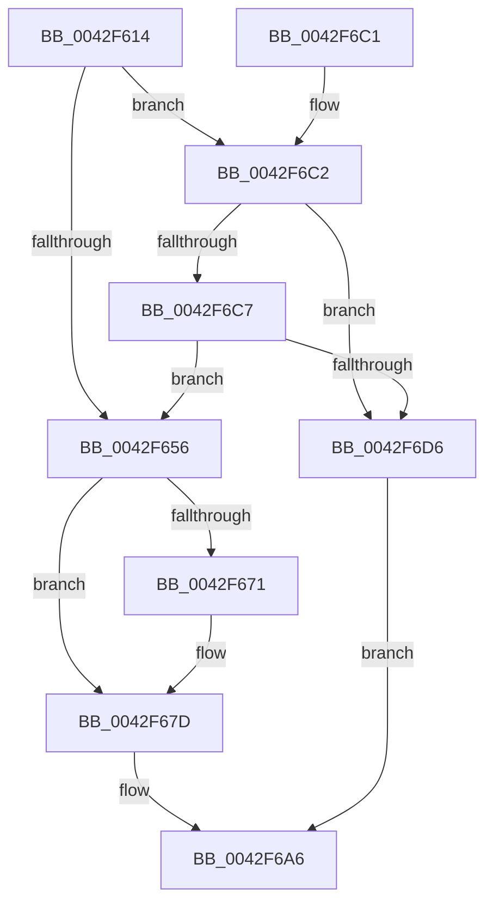

# IopCancelWaitCompletionPacket

- RVA: `0x0042F614`–`0x0042F6DA` (길이 `198` bytes)
- VA: `0x000000014042F614`
- 실행 섹션: `.text`
- PDB 이름 있음: `예`; PDB Function 태그: `아니요`
- unwind 정보 RVA: `0x00071698`
- 디코드: `57`개 명령, `198/198` bytes 표시
- 미해석 바이트: `0` (있으면 어셈블리에 `.byte`로 보존)

> 이 문서는 커널 이미지의 기계어와 PDB 기호를 분석해 생성했습니다. 4번과 5번은 함수 원형과 자료형을 바이너리 사용 방식에서 추정한 C 해석이며 원본 소스 복구 결과는 아닙니다.

## 1. Dependencies

- 직접 호출 지점: **8**; 고유 호출 대상: **6**
- 직접 호출자로 확인된 함수: **2**
- RIP 상대 이미지 참조: **1**

### Outgoing calls
- `0x0042F63E` → [ObGetAssociatedWaitObject](ObGetAssociatedWaitObject_function_0042F6E0.md) (function, `0x0042F6E0`)
- `0x0042F649` → [KiDeregisterObjectWaitBlock](../39/KiDeregisterObjectWaitBlock_function_00394F3C.md) (function, `0x00394F3C`)
- `0x0042F663` → [KxReleaseSpinLock](../20/KxReleaseSpinLock_function_00206670.md) (function, `0x00206670`)
- `0x0042F678` → [KiLowerIrqlProcessIrqlFlags](../4F/KiLowerIrqlProcessIrqlFlags_function_004F5698.md) (function, `0x004F5698`)
- `0x0042F68B` → [ObfDereferenceObjectWithTag](../2F/ObfDereferenceObjectWithTag_function_002F78E0.md) (function, `0x002F78E0`)
- `0x0042F695` → [ObfDereferenceObjectWithTag](../2F/ObfDereferenceObjectWithTag_function_002F78E0.md) (function, `0x002F78E0`)
- `0x0042F69F` → [ObfDereferenceObjectWithTag](../2F/ObfDereferenceObjectWithTag_function_002F78E0.md) (function, `0x002F78E0`)
- `0x0042F6CD` → [KeRemoveQueueEntry](KeRemoveQueueEntry_function_0042F770.md) (function, `0x0042F770`)

### Direct callers
- [NtCancelWaitCompletionPacket](NtCancelWaitCompletionPacket_function_0042F100.md) at `0x0042F1DA`
- [IopCloseWaitCompletionPacket](IopCloseWaitCompletionPacket_function_0042F520.md) at `0x0042F5DE`

### Static image references
- `0x0042F668` → RVA `0x00FC6D20` (`ALMOSTRO`; read)

## 2. Other-region calls and transfers

- 다른 실행 섹션으로 향하는 call: **0**
- 별도 외부 분기/꼬리 이동을 확인하지 못했습니다.

## 3. Assembly (complete function range)

```asm
0042F614  48 8B C4                        mov rax, rsp
0042F617  48 89 58 08                     mov qword ptr [rax + 8], rbx
0042F61B  48 89 68 10                     mov qword ptr [rax + 0x10], rbp
0042F61F  48 89 70 18                     mov qword ptr [rax + 0x18], rsi
0042F623  48 89 78 20                     mov qword ptr [rax + 0x20], rdi
0042F627  41 56                           push r14
0042F629  48 83 EC 20                     sub rsp, 0x20
0042F62D  4C 8B 71 50                     mov r14, qword ptr [rcx + 0x50]
0042F631  48 8B D9                        mov rbx, rcx
0042F634  49 8B CE                        mov rcx, r14
0042F637  41 0F B6 F8                     movzx edi, r8b
0042F63B  40 8A EA                        mov bpl, dl
0042F63E  E8 9D 00 00 00                  call 0x14042f6e0
0042F643  48 8B D3                        mov rdx, rbx
0042F646  48 8B C8                        mov rcx, rax
0042F649  E8 EE 58 F6 FF                  call 0x140394f3c
0042F64E  48 8B 73 58                     mov rsi, qword ptr [rbx + 0x58]
0042F652  84 C0                           test al, al
0042F654  74 6C                           je 0x14042f6c2
0042F656  48 83 63 58 00                  and qword ptr [rbx + 0x58], 0
0042F65B  48 8D 4B 60                     lea rcx, [rbx + 0x60]
0042F65F  C6 43 68 00                     mov byte ptr [rbx + 0x68], 0
0042F663  E8 08 70 DD FF                  call 0x140206670
0042F668  83 3D B1 76 B9 00 00            cmp dword ptr [rip + 0xb976b1], 0
0042F66F  74 0C                           je 0x14042f67d
0042F671  44 0F 20 C1                     mov rcx, cr8
0042F675  40 8A D7                        mov dl, dil
0042F678  E8 1B 60 0C 00                  call 0x1404f5698
0042F67D  44 0F 22 C7                     mov cr8, rdi
0042F681  BF 44 66 6C 74                  mov edi, 0x746c6644
0042F686  49 8B CE                        mov rcx, r14
0042F689  8B D7                           mov edx, edi
0042F68B  E8 50 82 EC FF                  call 0x1402f78e0
0042F690  8B D7                           mov edx, edi
0042F692  48 8B CE                        mov rcx, rsi
0042F695  E8 46 82 EC FF                  call 0x1402f78e0
0042F69A  8B D7                           mov edx, edi
0042F69C  48 8B CB                        mov rcx, rbx
0042F69F  E8 3C 82 EC FF                  call 0x1402f78e0
0042F6A4  B0 01                           mov al, 1
0042F6A6  48 8B 5C 24 30                  mov rbx, qword ptr [rsp + 0x30]
0042F6AB  48 8B 6C 24 38                  mov rbp, qword ptr [rsp + 0x38]
0042F6B0  48 8B 74 24 40                  mov rsi, qword ptr [rsp + 0x40]
0042F6B5  48 8B 7C 24 48                  mov rdi, qword ptr [rsp + 0x48]
0042F6BA  48 83 C4 20                     add rsp, 0x20
0042F6BE  41 5E                           pop r14
0042F6C0  C3                              ret
0042F6C1  CC                              int3
0042F6C2  40 84 ED                        test bpl, bpl
0042F6C5  74 0F                           je 0x14042f6d6
0042F6C7  48 8B D3                        mov rdx, rbx
0042F6CA  48 8B CE                        mov rcx, rsi
0042F6CD  E8 9E 00 00 00                  call 0x14042f770
0042F6D2  84 C0                           test al, al
0042F6D4  75 80                           jne 0x14042f656
0042F6D6  32 C0                           xor al, al
0042F6D8  EB CC                           jmp 0x14042f6a6
```

## 4. C-style interpretation (structured pseudocode)

```c
__int64 __fastcall IopCancelWaitCompletionPacket(__int64 a1, unsigned __int8 a2, unsigned __int8 a3)
{
    __int64 result;
    __int64 v_rsp;
    unsigned __int64 v_stack_p10;
    unsigned __int64 v_stack_p18;
    unsigned __int64 v_stack_p20;
    unsigned __int64 v_stack_p8;

    *(unsigned __int64 *)(v_rsp + 8) = v_rbx;
    *(unsigned __int64 *)(v_rsp + 16) = v_rbp;
    *(unsigned __int64 *)(v_rsp + 24) = v_rsi;
    *(unsigned __int64 *)(v_rsp + 32) = v_rdi;
    v_rsp = (v_rsp) - (32);
    result = ObGetAssociatedWaitObject(*(unsigned __int64 *)(a1 + 80), a2, a3, a4);
    result = KiDeregisterObjectWaitBlock(result, a1, a3, a4);
    if ((unsigned __int8)(result) == 0) goto loc_0042F6C2;
loc_0042F656:
    *(unsigned __int8 *)(a1 + 104) = 0;
    result = KxReleaseSpinLock(a1 + 96, a1, a3, a4);
    if ((*(unsigned int *)(v_rip + 12154545)) != 0) {
        a1 = v_cr8;
        a2 = a3;
        result = KiLowerIrqlProcessIrqlFlags(a1, a2, a3, a4);
    }
    result = ObfDereferenceObjectWithTag(*(unsigned __int64 *)(a1 + 80), (unsigned int)((unsigned int)((unsigned int)(0x746C6644ULL))), a3, a4);
    result = ObfDereferenceObjectWithTag(*(unsigned __int64 *)(a1 + 88), (unsigned int)((unsigned int)((unsigned int)(0x746C6644ULL))), a3, a4);
    result = ObfDereferenceObjectWithTag(a1, (unsigned int)((unsigned int)((unsigned int)(0x746C6644ULL))), a3, a4);
loc_0042F6A6:
    v_rsp = (v_rsp) + (32);
    return 1;
loc_0042F6C2:
    if ((unsigned __int8)(v_stack_p10) == 0) goto loc_0042F6D6;
    result = KeRemoveQueueEntry(v_stack_p18, v_stack_p8, a3, a4);
    if ((unsigned __int8)(result) != 0) goto loc_0042F656;
loc_0042F6D6:
    result = 0;
    goto loc_0042F6A6;
}
```

## 5. (Beta) C Style

```c
int64_t IopCancelWaitCompletionPacket(void *Arg1, uint8_t Arg2, uint8_t Arg3)
{
    uint8_t *arg1 = (uint8_t *)Arg1;

    int64_t result;
    int64_t local_rsp;
    uint64_t v_stack_p10;
    uint64_t v_stack_p18;
    uint64_t v_stack_p20;
    uint64_t v_stack_p8;

    *(uint64_t *)(local_rsp + 0x8) = local_rbx;
    *(uint64_t *)(local_rsp + 0x10) = local_rbp;
    *(uint64_t *)(local_rsp + 0x18) = local_rsi;
    *(uint64_t *)(local_rsp + 0x20) = local_rdi;
    local_rsp = (local_rsp) - (32);
    result = ObGetAssociatedWaitObject(*(uint64_t *)(arg1 + 0x50), Arg2, Arg3, a4);
    result = KiDeregisterObjectWaitBlock(result, Arg1, Arg3, a4);
    if ((uint8_t)(result) == 0) goto loc_0042F6C2;
loc_0042F656:
    *(uint8_t *)(arg1 + 0x68) = 0;
    result = KxReleaseSpinLock(Arg1 + 96, Arg1, Arg3, a4);
    if ((*(uint32_t *)(v_rip + 0xB976B1)) != 0) {
        Arg1 = v_cr8;
        Arg2 = Arg3;
        result = KiLowerIrqlProcessIrqlFlags(Arg1, Arg2, Arg3, a4);
    }
    result = ObfDereferenceObjectWithTag(*(uint64_t *)(arg1 + 0x50), (uint32_t)((uint32_t)((uint32_t)(0x746C6644ULL))), Arg3, a4);
    result = ObfDereferenceObjectWithTag(*(uint64_t *)(arg1 + 0x58), (uint32_t)((uint32_t)((uint32_t)(0x746C6644ULL))), Arg3, a4);
    result = ObfDereferenceObjectWithTag(Arg1, (uint32_t)((uint32_t)((uint32_t)(0x746C6644ULL))), Arg3, a4);
loc_0042F6A6:
    local_rsp = (local_rsp) + (32);
    return 1;
loc_0042F6C2:
    if ((uint8_t)(v_stack_p10) == 0) goto loc_0042F6D6;
    result = KeRemoveQueueEntry(v_stack_p18, v_stack_p8, Arg3, a4);
    if ((uint8_t)(result) != 0) goto loc_0042F656;
loc_0042F6D6:
    result = 0;
    goto loc_0042F6A6;
}
```

### 관측된 메모리 오프셋

구조체 형식이 확인되지 않은 접근은 인자 기준의 오프셋으로만 기록했습니다.

| 기준 인자 | 오프셋 표현 | 폭 (bit) | 접근 |
|---|---:|---:|---|
| `Arg1` | `+ 0x50` | `64` | `R` |
| `Arg1` | `+ 0x58` | `64` | `R` |
| `Arg1` | `+ 0x58` | `64` | `R/W` |
| `Arg1` | `+ 0x60` | `64` | `R` |
| `Arg1` | `+ 0x68` | `8` | `W` |

## 6. Execution-region graph

[열기: 2D/3D 그래프와 함수 탐색 컨트롤 패널](../../../control-panel.html?section=text&rva=0x0042F614&view=graph)

- 2D 그래프는 위에서 아래로 흐르고, 3D 그래프는 빈 공간을 드래그해 회전합니다. Shift+드래그는 이동, 휠은 확대·축소, 함수 노드 선택은 대상 보고서 이동입니다.

### Static fallback


