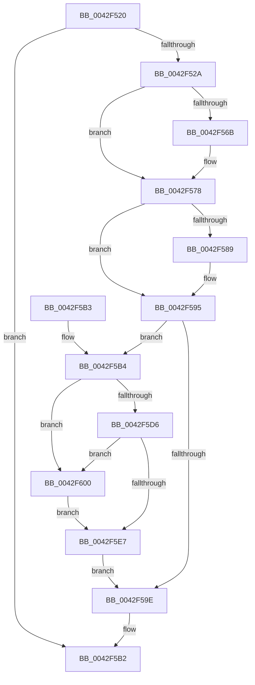

# IopCloseWaitCompletionPacket

- RVA: `0x0042F520`–`0x0042F60D` (길이 `237` bytes)
- VA: `0x000000014042F520`
- 실행 섹션: `.text`
- PDB 이름 있음: `예`; PDB Function 태그: `아니요`
- unwind 정보 RVA: `0x000A1EDC`
- 디코드: `66`개 명령, `237/237` bytes 표시
- 미해석 바이트: `0` (있으면 어셈블리에 `.byte`로 보존)

> 이 문서는 커널 이미지의 기계어와 PDB 기호를 분석해 생성했습니다. 4번과 5번은 함수 원형과 자료형을 바이너리 사용 방식에서 추정한 C 해석이며 원본 소스 복구 결과는 아닙니다.

## 1. Dependencies

- 직접 호출 지점: **10**; 고유 호출 대상: **9**
- 직접 호출자로 확인된 함수: **0**
- RIP 상대 이미지 참조: **1**

### Outgoing calls
- `0x0042F556` → [KeAcquireSpinLockRaiseToDpc](../20/KeAcquireSpinLockRaiseToDpc_function_00208470.md) (function, `0x00208470`)
- `0x0042F573` → [ObfReferenceObjectWithTag](../21/ObfReferenceObjectWithTag_function_00210710.md) (function, `0x00210710`)
- `0x0042F57B` → [KxReleaseSpinLock](../20/KxReleaseSpinLock_function_00206670.md) (function, `0x00206670`)
- `0x0042F590` → [KiLowerIrqlProcessIrqlFlags](../4F/KiLowerIrqlProcessIrqlFlags_function_004F5698.md) (function, `0x004F5698`)
- `0x0042F5BD` → [KeAcquireInStackQueuedSpinLock](../27/KeAcquireInStackQueuedSpinLock_function_002757A0.md) (function, `0x002757A0`)
- `0x0042F5C5` → [KeAcquireSpinLockRaiseToDpc](../20/KeAcquireSpinLockRaiseToDpc_function_00208470.md) (function, `0x00208470`)
- `0x0042F5DE` → [IopCancelWaitCompletionPacket](IopCancelWaitCompletionPacket_function_0042F614.md) (function, `0x0042F614`)
- `0x0042F5EC` → [KeReleaseInStackQueuedSpinLock](../34/KeReleaseInStackQueuedSpinLock_function_00342CE0.md) (function, `0x00342CE0`)
- `0x0042F5F9` → [ObfDereferenceObjectWithTag](../2F/ObfDereferenceObjectWithTag_function_002F78E0.md) (function, `0x002F78E0`)
- `0x0042F606` → [KeReleaseSpinLock](../39/KeReleaseSpinLock_function_00392BA0.md) (function, `0x00392BA0`)

### Direct callers
- 이 함수 시작 RVA로 연결되는 직접 call은 확인되지 않았습니다. 간접 호출은 완전히 역산할 수 없습니다.

### Static image references
- `0x0042F580` → RVA `0x00FC6D20` (`ALMOSTRO`; read)

## 2. Other-region calls and transfers

- 다른 실행 섹션으로 향하는 call: **0**
- 별도 외부 분기/꼬리 이동을 확인하지 못했습니다.

## 3. Assembly (complete function range)

```asm
0042F520  49 83 F9 01                     cmp r9, 1
0042F524  0F 85 88 00 00 00               jne 0x14042f5b2
0042F52A  4C 8B DC                        mov r11, rsp
0042F52D  49 89 5B 08                     mov qword ptr [r11 + 8], rbx
0042F531  49 89 6B 10                     mov qword ptr [r11 + 0x10], rbp
0042F535  49 89 73 18                     mov qword ptr [r11 + 0x18], rsi
0042F539  57                              push rdi
0042F53A  48 83 EC 40                     sub rsp, 0x40
0042F53E  0F 57 C0                        xorps xmm0, xmm0
0042F541  48 8D 72 60                     lea rsi, [rdx + 0x60]
0042F545  33 C0                           xor eax, eax
0042F547  48 8B CE                        mov rcx, rsi
0042F54A  0F 11 44 24 20                  movups xmmword ptr [rsp + 0x20], xmm0
0042F54F  49 89 43 E8                     mov qword ptr [r11 - 0x18], rax
0042F553  48 8B FA                        mov rdi, rdx
0042F556  E8 15 8F DD FF                  call 0x140208470
0042F55B  48 8B 5F 58                     mov rbx, qword ptr [rdi + 0x58]
0042F55F  0F B6 E8                        movzx ebp, al
0042F562  C6 47 69 01                     mov byte ptr [rdi + 0x69], 1
0042F566  48 85 DB                        test rbx, rbx
0042F569  74 0D                           je 0x14042f578
0042F56B  BA 44 66 6C 74                  mov edx, 0x746c6644
0042F570  48 8B CB                        mov rcx, rbx
0042F573  E8 98 11 DE FF                  call 0x140210710
0042F578  48 8B CE                        mov rcx, rsi
0042F57B  E8 F0 70 DD FF                  call 0x140206670
0042F580  83 3D 99 77 B9 00 00            cmp dword ptr [rip + 0xb97799], 0
0042F587  74 0C                           je 0x14042f595
0042F589  44 0F 20 C1                     mov rcx, cr8
0042F58D  40 8A D5                        mov dl, bpl
0042F590  E8 03 61 0C 00                  call 0x1404f5698
0042F595  44 0F 22 C5                     mov cr8, rbp
0042F599  48 85 DB                        test rbx, rbx
0042F59C  75 16                           jne 0x14042f5b4
0042F59E  48 8B 5C 24 50                  mov rbx, qword ptr [rsp + 0x50]
0042F5A3  48 8B 6C 24 58                  mov rbp, qword ptr [rsp + 0x58]
0042F5A8  48 8B 74 24 60                  mov rsi, qword ptr [rsp + 0x60]
0042F5AD  48 83 C4 40                     add rsp, 0x40
0042F5B1  5F                              pop rdi
0042F5B2  C3                              ret
0042F5B3  CC                              int3
0042F5B4  48 8D 4B 40                     lea rcx, [rbx + 0x40]
0042F5B8  48 8D 54 24 20                  lea rdx, [rsp + 0x20]
0042F5BD  E8 DE 61 E4 FF                  call 0x1402757a0
0042F5C2  48 8B CE                        mov rcx, rsi
0042F5C5  E8 A6 8E DD FF                  call 0x140208470
0042F5CA  44 8A 47 68                     mov r8b, byte ptr [rdi + 0x68]
0042F5CE  40 8A E8                        mov bpl, al
0042F5D1  45 84 C0                        test r8b, r8b
0042F5D4  74 2A                           je 0x14042f600
0042F5D6  44 8A C0                        mov r8b, al
0042F5D9  B2 01                           mov dl, 1
0042F5DB  48 8B CF                        mov rcx, rdi
0042F5DE  E8 31 00 00 00                  call 0x14042f614
0042F5E3  84 C0                           test al, al
0042F5E5  74 19                           je 0x14042f600
0042F5E7  48 8D 4C 24 20                  lea rcx, [rsp + 0x20]
0042F5EC  E8 EF 36 F1 FF                  call 0x140342ce0
0042F5F1  BA 44 66 6C 74                  mov edx, 0x746c6644
0042F5F6  48 8B CB                        mov rcx, rbx
0042F5F9  E8 E2 82 EC FF                  call 0x1402f78e0
0042F5FE  EB 9E                           jmp 0x14042f59e
0042F600  40 8A D5                        mov dl, bpl
0042F603  48 8B CE                        mov rcx, rsi
0042F606  E8 95 35 F6 FF                  call 0x140392ba0
0042F60B  EB DA                           jmp 0x14042f5e7
```

## 4. C-style interpretation (structured pseudocode)

```c
__int64 __fastcall IopCloseWaitCompletionPacket(__int64 a1, __int64 a2, __int64 a3, __int64 a4)
{
    __int64 result;
    __int64 v_rsp;
    unsigned __int64 v_stack_m28;
    unsigned __int64 v_stack_p10;
    unsigned __int64 v_stack_p18;
    unsigned __int64 v_stack_p20;
    unsigned __int64 v_stack_p8;

    if (a4 != 1) goto loc_0042F5B2;
    *(unsigned __int64 *)(v_rsp + 8) = v_rbx;
    *(unsigned __int64 *)(v_rsp + 16) = v_rbp;
    *(unsigned __int64 *)(v_rsp + 24) = v_rsi;
    v_rsp = (v_rsp) - (64);
    result = 0;
    v_stack_m28 = v_xmm0;
    *(unsigned __int64 *)(v_rsp - 24) = 0;
    result = KeAcquireSpinLockRaiseToDpc(a2 + 96, a2, a3, a4);
    *(unsigned __int8 *)(a2 + 105) = 1;
    if (*(unsigned __int64 *)(a2 + 88) != 0) {
        a2 = 0x746C6644ULL;
        a1 = *(unsigned __int64 *)(a2 + 88);
        result = ObfReferenceObjectWithTag(a1, a2, a3, a4);
    }
    result = KxReleaseSpinLock(a2 + 96, a2, a3, a4);
    if ((*(unsigned int *)(v_rip + 12154777)) != 0) {
        a1 = v_cr8;
        a2 = (unsigned __int8)((unsigned __int8)(result));
        result = KiLowerIrqlProcessIrqlFlags(a1, a2, a3, a4);
    }
    if (*(unsigned __int64 *)(a2 + 88) != 0) goto loc_0042F5B4;
loc_0042F59E:
    v_rsp = (v_rsp) + (64);
loc_0042F5B2:
    return result;
loc_0042F5B4:
    result = KeAcquireInStackQueuedSpinLock(v_stack_p8 + 64, v_stack_p20, a3, a4);
    result = KeAcquireSpinLockRaiseToDpc(v_stack_p18, v_stack_p20, a3, a4);
    if ((unsigned __int8)(*(unsigned __int8 *)(a2 + 104)) == 0) goto loc_0042F600;
    result = IopCancelWaitCompletionPacket(a2, 1, (unsigned __int8)(result), a4);
    if ((unsigned __int8)(result) == 0) goto loc_0042F600;
loc_0042F5E7:
    result = KeReleaseInStackQueuedSpinLock(v_stack_p20, 1, (unsigned __int8)(result), a4);
    result = ObfDereferenceObjectWithTag(v_stack_p8, (unsigned int)(0x746C6644ULL), (unsigned __int8)(result), a4);
    goto loc_0042F59E;
loc_0042F600:
    result = KeReleaseSpinLock(v_stack_p18, (unsigned __int8)((unsigned __int8)(result)), (unsigned __int8)(result), a4);
    goto loc_0042F5E7;
}
```

## 5. (Beta) C Style

```c
int64_t IopCloseWaitCompletionPacket(int64_t Arg1, void *Arg2, int64_t Arg3, int64_t Arg4)
{
    uint8_t *arg2 = (uint8_t *)Arg2;

    int64_t result;
    int64_t local_rsp;
    uint64_t v_stack_m28;
    uint64_t v_stack_p10;
    uint64_t v_stack_p18;
    uint64_t v_stack_p20;
    uint64_t v_stack_p8;

    if (Arg4 != 1) goto loc_0042F5B2;
    *(uint64_t *)(local_rsp + 0x8) = local_rbx;
    *(uint64_t *)(local_rsp + 0x10) = local_rbp;
    *(uint64_t *)(local_rsp + 0x18) = local_rsi;
    local_rsp = (local_rsp) - (64);
    result = 0;
    v_stack_m28 = v_xmm0;
    *(uint64_t *)(local_rsp - 0x18) = 0;
    result = KeAcquireSpinLockRaiseToDpc(Arg2 + 96, Arg2, Arg3, Arg4);
    *(uint8_t *)(arg2 + 0x69) = 1;
    if (*(uint64_t *)(arg2 + 0x58) != 0) {
        Arg2 = 0x746C6644ULL;
        Arg1 = *(uint64_t *)(arg2 + 0x58);
        result = ObfReferenceObjectWithTag(Arg1, Arg2, Arg3, Arg4);
    }
    result = KxReleaseSpinLock(Arg2 + 96, Arg2, Arg3, Arg4);
    if ((*(uint32_t *)(v_rip + 0xB97799)) != 0) {
        Arg1 = v_cr8;
        Arg2 = (uint8_t)((uint8_t)(result));
        result = KiLowerIrqlProcessIrqlFlags(Arg1, Arg2, Arg3, Arg4);
    }
    if (*(uint64_t *)(arg2 + 0x58) != 0) goto loc_0042F5B4;
loc_0042F59E:
    local_rsp = (local_rsp) + (64);
loc_0042F5B2:
    return result;
loc_0042F5B4:
    result = KeAcquireInStackQueuedSpinLock(v_stack_p8 + 64, v_stack_p20, Arg3, Arg4);
    result = KeAcquireSpinLockRaiseToDpc(v_stack_p18, v_stack_p20, Arg3, Arg4);
    if ((uint8_t)(*(uint8_t *)(arg2 + 0x68)) == 0) goto loc_0042F600;
    result = IopCancelWaitCompletionPacket(Arg2, 1, (uint8_t)(result), Arg4);
    if ((uint8_t)(result) == 0) goto loc_0042F600;
loc_0042F5E7:
    result = KeReleaseInStackQueuedSpinLock(v_stack_p20, 1, (uint8_t)(result), Arg4);
    result = ObfDereferenceObjectWithTag(v_stack_p8, (uint32_t)(0x746C6644ULL), (uint8_t)(result), Arg4);
    goto loc_0042F59E;
loc_0042F600:
    result = KeReleaseSpinLock(v_stack_p18, (uint8_t)((uint8_t)(result)), (uint8_t)(result), Arg4);
    goto loc_0042F5E7;
}
```

### 관측된 메모리 오프셋

구조체 형식이 확인되지 않은 접근은 인자 기준의 오프셋으로만 기록했습니다.

| 기준 인자 | 오프셋 표현 | 폭 (bit) | 접근 |
|---|---:|---:|---|
| `Arg2` | `+ 0x58` | `64` | `R` |
| `Arg2` | `+ 0x60` | `64` | `R` |
| `Arg2` | `+ 0x68` | `8` | `R` |
| `Arg2` | `+ 0x69` | `8` | `W` |

## 6. Execution-region graph

[열기: 2D/3D 그래프와 함수 탐색 컨트롤 패널](../../../control-panel.html?section=text&rva=0x0042F520&view=graph)

- 2D 그래프는 위에서 아래로 흐르고, 3D 그래프는 빈 공간을 드래그해 회전합니다. Shift+드래그는 이동, 휠은 확대·축소, 함수 노드 선택은 대상 보고서 이동입니다.

### Static fallback


