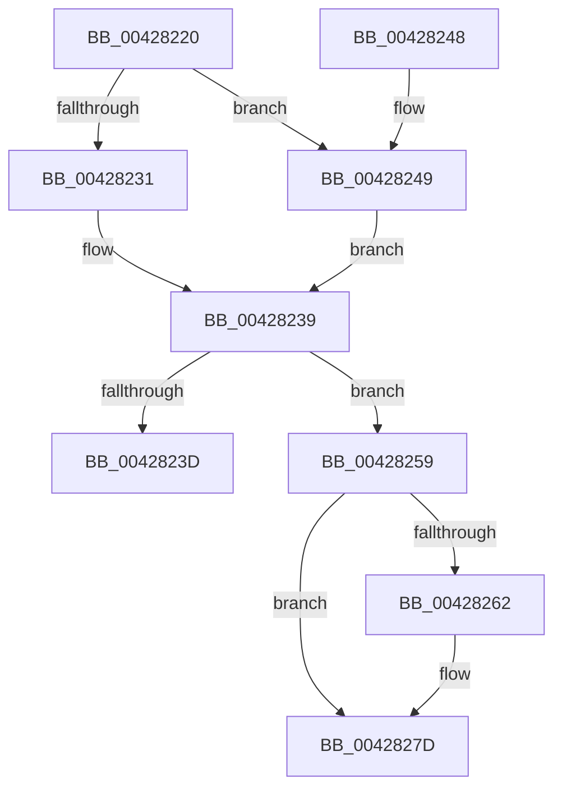

# IopDecrementDeviceObjectRefCount

- RVA: `0x00428220`–`0x0042829A` (길이 `122` bytes)
- VA: `0x0000000140428220`
- 실행 섹션: `.text`
- PDB 이름 있음: `예`; PDB Function 태그: `아니요`
- unwind 정보 RVA: `0x000A0CCC`
- 디코드: `37`개 명령, `122/122` bytes 표시
- 미해석 바이트: `0` (있으면 어셈블리에 `.byte`로 보존)

> 이 문서는 커널 이미지의 기계어와 PDB 기호를 분석해 생성했습니다. 4번과 5번은 함수 원형과 자료형을 바이너리 사용 방식에서 추정한 C 해석이며 원본 소스 복구 결과는 아닙니다.

## 1. Dependencies

- 직접 호출 지점: **4**; 고유 호출 대상: **3**
- 직접 호출자로 확인된 함수: **3**
- RIP 상대 이미지 참조: **0**

### Outgoing calls
- `0x00428252` → [IopInterlockedDecrementUlong](IopInterlockedDecrementUlong_function_004282A0.md) (function, `0x004282A0`)
- `0x00428267` → [IoAddTriageDumpDataBlock](IoAddTriageDumpDataBlock_function_00428374.md) (function, `0x00428374`)
- `0x00428278` → [IoAddTriageDumpDataBlock](IoAddTriageDumpDataBlock_function_00428374.md) (function, `0x00428374`)
- `0x00428294` → [KeBugCheckEx](../4F/KeBugCheckEx_function_004FD660.md) (function, `0x004FD660`)

### Direct callers
- [IopCompleteUnloadOrDelete](../27/IopCompleteUnloadOrDelete_function_00270BC8.md) at `0x00270D21`
- [IoUnregisterFileSystem](../../page/71/IoUnregisterFileSystem_function_0071E110.md) at `0x0071E1AC`
- [sub_0086408B](../../page/86/Unknown_function_0086408B.md) at `0x0086408D`

### Static image references
- 디코드된 RIP-relative 메모리 참조가 없습니다.

## 2. Other-region calls and transfers

- 다른 실행 섹션으로 향하는 call: **0**
- 별도 외부 분기/꼬리 이동을 확인하지 못했습니다.

## 3. Assembly (complete function range)

```asm
00428220  48 89 5C 24 08                  mov qword ptr [rsp + 8], rbx
00428225  57                              push rdi
00428226  48 83 EC 30                     sub rsp, 0x30
0042822A  48 8B F9                        mov rdi, rcx
0042822D  84 D2                           test dl, dl
0042822F  75 18                           jne 0x140428249
00428231  8B 41 04                        mov eax, dword ptr [rcx + 4]
00428234  FF C8                           dec eax
00428236  89 41 04                        mov dword ptr [rcx + 4], eax
00428239  85 C0                           test eax, eax
0042823B  78 1C                           js 0x140428259
0042823D  48 8B 5C 24 40                  mov rbx, qword ptr [rsp + 0x40]
00428242  48 83 C4 30                     add rsp, 0x30
00428246  5F                              pop rdi
00428247  C3                              ret
00428248  CC                              int3
00428249  48 8D 51 04                     lea rdx, [rcx + 4]
0042824D  B9 0A 00 00 00                  mov ecx, 0xa
00428252  E8 49 00 00 00                  call 0x1404282a0
00428257  EB E0                           jmp 0x140428239
00428259  48 8B 4F 08                     mov rcx, qword ptr [rdi + 8]
0042825D  48 85 C9                        test rcx, rcx
00428260  74 1B                           je 0x14042827d
00428262  BA 50 01 00 00                  mov edx, 0x150
00428267  E8 08 01 00 00                  call 0x140428374
0042826C  48 8B 4F 08                     mov rcx, qword ptr [rdi + 8]
00428270  0F B7 51 38                     movzx edx, word ptr [rcx + 0x38]
00428274  48 8B 49 40                     mov rcx, qword ptr [rcx + 0x40]
00428278  E8 F7 00 00 00                  call 0x140428374
0042827D  48 63 47 04                     movsxd rax, dword ptr [rdi + 4]
00428281  33 D2                           xor edx, edx
00428283  41 B9 06 00 00 00               mov r9d, 6
00428289  48 89 44 24 20                  mov qword ptr [rsp + 0x20], rax
0042828E  4C 8B C7                        mov r8, rdi
00428291  8D 4A 18                        lea ecx, [rdx + 0x18]
00428294  E8 C7 53 0D 00                  call 0x1404fd660
00428299  CC                              int3
```

## 4. C-style interpretation (structured pseudocode)

```c
__int64 __fastcall IopDecrementDeviceObjectRefCount(__int64 a1, unsigned __int8 a2)
{
    __int64 result;
    __int64 v_rsp;
    unsigned __int64 v_stack_p20;
    unsigned __int64 v_stack_p8;

    v_stack_p8 = v_rbx;
    v_rsp = (v_rsp) - (48);
    if (a2 != 0) goto loc_00428249;
    result = (unsigned int)(((unsigned int)(*(unsigned int *)(a1 + 4))) - 1);
    *(unsigned int *)(a1 + 4) = (unsigned int)(result);
loc_00428239:
    if (sign_flag) goto loc_00428259;
    v_rsp = (v_rsp) + (48);
    return result;
loc_00428249:
    result = IopInterlockedDecrementUlong(10, a1 + 4, a3, a4);
    goto loc_00428239;
loc_00428259:
    if (*(unsigned __int64 *)(a1 + 8) != 0) {
        a2 = 336;
        result = IoAddTriageDumpDataBlock(*(unsigned __int64 *)(a1 + 8), a2, a3, a4);
        a1 = *(unsigned __int64 *)(a1 + 8);
        a2 = *(unsigned __int16 *)(a1 + 56);
        a1 = *(unsigned __int64 *)(a1 + 64);
        result = IoAddTriageDumpDataBlock(a1, a2, a3, a4);
    }
    a2 = 0;
    v_stack_p20 = (int)(*(unsigned int *)(a1 + 4));
    result = KeBugCheckEx(a2 + 24, a2, a1, 6);
    return result;
}
```

## 5. (Beta) C Style

```c
int64_t IopDecrementDeviceObjectRefCount(void *Arg1, uint8_t Arg2)
{
    uint8_t *arg1 = (uint8_t *)Arg1;

    int64_t result;
    int64_t local_rsp;
    uint64_t v_stack_p20;
    uint64_t v_stack_p8;

    v_stack_p8 = local_rbx;
    local_rsp = (local_rsp) - (48);
    if (Arg2 != 0) goto loc_00428249;
    result = (uint32_t)(((uint32_t)(*(uint32_t *)(arg1 + 0x4))) - 1);
    *(uint32_t *)(arg1 + 0x4) = (uint32_t)(result);
loc_00428239:
    if (sign_flag) goto loc_00428259;
    local_rsp = (local_rsp) + (48);
    return result;
loc_00428249:
    result = IopInterlockedDecrementUlong(10, Arg1 + 4, a3, a4);
    goto loc_00428239;
loc_00428259:
    if (*(uint64_t *)(arg1 + 0x8) != 0) {
        Arg2 = 336;
        result = IoAddTriageDumpDataBlock(*(uint64_t *)(arg1 + 0x8), Arg2, a3, a4);
        Arg1 = *(uint64_t *)(arg1 + 0x8);
        Arg2 = *(uint16_t *)(arg1 + 0x38);
        Arg1 = *(uint64_t *)(arg1 + 0x40);
        result = IoAddTriageDumpDataBlock(Arg1, Arg2, a3, a4);
    }
    Arg2 = 0;
    v_stack_p20 = (int32_t)(*(uint32_t *)(arg1 + 0x4));
    result = KeBugCheckEx(Arg2 + 24, Arg2, Arg1, 6);
    return result;
}
```

### 관측된 메모리 오프셋

구조체 형식이 확인되지 않은 접근은 인자 기준의 오프셋으로만 기록했습니다.

| 기준 인자 | 오프셋 표현 | 폭 (bit) | 접근 |
|---|---:|---:|---|
| `Arg1` | `+ 0x4` | `32` | `R` |
| `Arg1` | `+ 0x4` | `32` | `W` |
| `Arg1` | `+ 0x4` | `64` | `R` |
| `Arg1` | `+ 0x8` | `64` | `R` |

## 6. Execution-region graph

[열기: 2D/3D 그래프와 함수 탐색 컨트롤 패널](../../../control-panel.html?section=text&rva=0x00428220&view=graph)

- 2D 그래프는 위에서 아래로 흐르고, 3D 그래프는 빈 공간을 드래그해 회전합니다. Shift+드래그는 이동, 휠은 확대·축소, 함수 노드 선택은 대상 보고서 이동입니다.

### Static fallback


