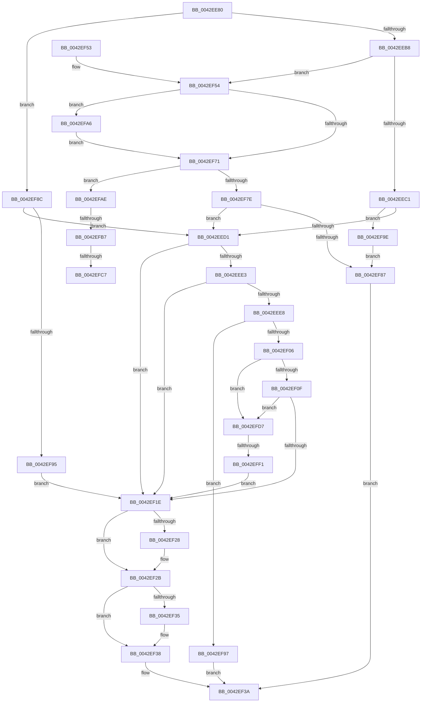

# IopGetSetSpecificExtension

- RVA: `0x0042EE80`–`0x0042EFFB` (길이 `379` bytes)
- VA: `0x000000014042EE80`
- 실행 섹션: `.text`
- PDB 이름 있음: `예`; PDB Function 태그: `예`
- unwind 정보 RVA: `0x000A1E48`
- 디코드: `98`개 명령, `379/379` bytes 표시
- 미해석 바이트: `0` (있으면 어셈블리에 `.byte`로 보존)

> 이 문서는 커널 이미지의 기계어와 PDB 기호를 분석해 생성했습니다. 4번과 5번은 함수 원형과 자료형을 바이너리 사용 방식에서 추정한 C 해석이며 원본 소스 복구 결과는 아닙니다.

## 1. Dependencies

- 직접 호출 지점: **4**; 고유 호출 대상: **2**
- 직접 호출자로 확인된 함수: **9**
- RIP 상대 이미지 참조: **1**

### Outgoing calls
- `0x0042EEF5` → [ExAllocatePool2](../../poolcode/B8/ExAllocatePool2_function_00B820F0.md) (function, `0x00B820F0`)
- `0x0042EF64` → [ExAllocatePool2](../../poolcode/B8/ExAllocatePool2_function_00B820F0.md) (function, `0x00B820F0`)
- `0x0042EFCC` → [ExFreePoolWithTag](../../poolcode/B8/ExFreePoolWithTag_function_00B82870.md) (function, `0x00B82870`)
- `0x0042EFDC` → [ExFreePoolWithTag](../../poolcode/B8/ExFreePoolWithTag_function_00B82870.md) (function, `0x00B82870`)

### Direct callers
- [IopAdjustFileObjectKeepAliveCount](IopAdjustFileObjectKeepAliveCount_function_0042EBE8.md) at `0x0042EC3B`
- [IopGetSetStreamIdentifier](IopGetSetStreamIdentifier_function_0042ED7C.md) at `0x0042EDCD`
- [IopCheckInitiatorHint](../45/IopCheckInitiatorHint_function_00457134.md) at `0x00457213`
- [IoCopyDeviceObjectHint](../../page/71/IoCopyDeviceObjectHint_function_0071D0E0.md) at `0x0071D145`
- [IopAllocRealFileObject](../../page/89/IopAllocRealFileObject_function_00899720.md) at `0x00899BCA`
- [IopAllocRealFileObject](../../page/89/IopAllocRealFileObject_function_00899720.md) at `0x00899C72`
- [IopParseDevice](../../page/89/IopParseDevice_function_0089E510.md) at `0x0089F798`
- [sub_009A5BCF](../../page/9A/Unknown_function_009A5BCF.md) at `0x009A5C10`
- [sub_00B19ABC](../../page/B1/Unknown_function_00B19ABC.md) at `0x00B19B1F`
- [sub_00B374D0](../../page/B3/Unknown_function_00B374D0.md) at `0x00B3753C`

### Static image references
- `0x0042EEC1` → RVA `0x00014730` (`.rdata`; read)

## 2. Other-region calls and transfers

- 다른 실행 섹션으로 향하는 call: **4**
  - `0x0042EEF5` → [ExAllocatePool2](../../poolcode/B8/ExAllocatePool2_function_00B820F0.md) (`.text` → `POOLCODE`)
  - `0x0042EF64` → [ExAllocatePool2](../../poolcode/B8/ExAllocatePool2_function_00B820F0.md) (`.text` → `POOLCODE`)
  - `0x0042EFCC` → [ExFreePoolWithTag](../../poolcode/B8/ExFreePoolWithTag_function_00B82870.md) (`.text` → `POOLCODE`)
  - `0x0042EFDC` → [ExFreePoolWithTag](../../poolcode/B8/ExFreePoolWithTag_function_00B82870.md) (`.text` → `POOLCODE`)
- call이 아닌 외부 분기/꼬리 이동: **4**
  - `0x0042EFB1` → [sub_006EE7FE](../6E/Unknown_function_006EE7FE.md) (`tail-transfer`)
  - `0x0042EFC1` → [sub_006EE7FE](../6E/Unknown_function_006EE7FE.md) (`tail-transfer`)
  - `0x0042EFD2` → [sub_006EE7FE](../6E/Unknown_function_006EE7FE.md) (`tail-transfer`)
  - `0x0042EFEB` → [sub_006EE7FE + 0xC](../6E/Unknown_function_006EE7FE.md) (`tail-transfer`)

## 3. Assembly (complete function range)

```asm
0042EE80  48 89 5C 24 08                  mov qword ptr [rsp + 8], rbx
0042EE85  48 89 6C 24 10                  mov qword ptr [rsp + 0x10], rbp
0042EE8A  48 89 74 24 18                  mov qword ptr [rsp + 0x18], rsi
0042EE8F  57                              push rdi
0042EE90  41 56                           push r14
0042EE92  41 57                           push r15
0042EE94  48 83 EC 20                     sub rsp, 0x20
0042EE98  48 8B 99 D0 00 00 00            mov rbx, qword ptr [rcx + 0xd0]
0042EE9F  45 33 D2                        xor r10d, r10d
0042EEA2  45 8B F8                        mov r15d, r8d
0042EEA5  41 0F B6 F9                     movzx edi, r9b
0042EEA9  48 63 EA                        movsxd rbp, edx
0042EEAC  48 8B F1                        mov rsi, rcx
0042EEAF  45 84 C9                        test r9b, r9b
0042EEB2  0F 84 D4 00 00 00               je 0x14042ef8c
0042EEB8  48 85 DB                        test rbx, rbx
0042EEBB  0F 84 93 00 00 00               je 0x14042ef54
0042EEC1  48 8D 05 68 58 BE FF            lea rax, [rip - 0x41a798]
0042EEC8  48 3B D8                        cmp rbx, rax
0042EECB  0F 84 CD 00 00 00               je 0x14042ef9e
0042EED1  4C 8D 34 ED 00 00 00 00         lea r14, [rbp*8]
0042EED9  4D 8B 54 1E 08                  mov r10, qword ptr [r14 + rbx + 8]
0042EEDE  4D 85 D2                        test r10, r10
0042EEE1  75 3B                           jne 0x14042ef1e
0042EEE3  40 84 FF                        test dil, dil
0042EEE6  74 36                           je 0x14042ef1e
0042EEE8  49 8B D7                        mov rdx, r15
0042EEEB  41 8D 4A 40                     lea ecx, [r10 + 0x40]
0042EEEF  41 B8 49 6F 46 45               mov r8d, 0x45466f49
0042EEF5  E8 F6 31 75 00                  call 0x140b820f0
0042EEFA  4C 8B D0                        mov r10, rax
0042EEFD  48 85 C0                        test rax, rax
0042EF00  0F 84 91 00 00 00               je 0x14042ef97
0042EF06  83 FD 09                        cmp ebp, 9
0042EF09  0F 87 C8 00 00 00               ja 0x14042efd7
0042EF0F  33 C0                           xor eax, eax
0042EF11  F0 4D 0F B1 54 1E 08            lock cmpxchg qword ptr [r14 + rbx + 8], r10
0042EF18  0F 85 B9 00 00 00               jne 0x14042efd7
0042EF1E  48 8B 44 24 60                  mov rax, qword ptr [rsp + 0x60]
0042EF23  48 85 C0                        test rax, rax
0042EF26  74 03                           je 0x14042ef2b
0042EF28  4C 89 10                        mov qword ptr [rax], r10
0042EF2B  48 8B 44 24 68                  mov rax, qword ptr [rsp + 0x68]
0042EF30  48 85 C0                        test rax, rax
0042EF33  74 03                           je 0x14042ef38
0042EF35  48 89 18                        mov qword ptr [rax], rbx
0042EF38  33 C0                           xor eax, eax
0042EF3A  48 8B 5C 24 40                  mov rbx, qword ptr [rsp + 0x40]
0042EF3F  48 8B 6C 24 48                  mov rbp, qword ptr [rsp + 0x48]
0042EF44  48 8B 74 24 50                  mov rsi, qword ptr [rsp + 0x50]
0042EF49  48 83 C4 20                     add rsp, 0x20
0042EF4D  41 5F                           pop r15
0042EF4F  41 5E                           pop r14
0042EF51  5F                              pop rdi
0042EF52  C3                              ret
0042EF53  CC                              int3
0042EF54  45 33 F6                        xor r14d, r14d
0042EF57  41 B8 49 6F 46 45               mov r8d, 0x45466f49
0042EF5D  41 8D 56 60                     lea edx, [r14 + 0x60]
0042EF61  8D 4A E0                        lea ecx, [rdx - 0x20]
0042EF64  E8 87 31 75 00                  call 0x140b820f0
0042EF69  48 8B D8                        mov rbx, rax
0042EF6C  48 85 C0                        test rax, rax
0042EF6F  74 35                           je 0x14042efa6
0042EF71  33 C0                           xor eax, eax
0042EF73  F0 48 0F B1 9E D0 00 00 00      lock cmpxchg qword ptr [rsi + 0xd0], rbx
0042EF7C  75 30                           jne 0x14042efae
0042EF7E  45 85 F6                        test r14d, r14d
0042EF81  0F 89 4A FF FF FF               jns 0x14042eed1
0042EF87  41 8B C6                        mov eax, r14d
0042EF8A  EB AE                           jmp 0x14042ef3a
0042EF8C  48 85 DB                        test rbx, rbx
0042EF8F  0F 85 3C FF FF FF               jne 0x14042eed1
0042EF95  EB 87                           jmp 0x14042ef1e
0042EF97  B8 9A 00 00 C0                  mov eax, 0xc000009a
0042EF9C  EB 9C                           jmp 0x14042ef3a
0042EF9E  41 BE 9A 00 00 C0               mov r14d, 0xc000009a
0042EFA4  EB E1                           jmp 0x14042ef87
0042EFA6  41 BE 9A 00 00 C0               mov r14d, 0xc000009a
0042EFAC  EB C3                           jmp 0x14042ef71
0042EFAE  48 85 DB                        test rbx, rbx
0042EFB1  0F 84 47 F8 2B 00               je 0x1406ee7fe
0042EFB7  48 8D 05 72 57 BE FF            lea rax, [rip - 0x41a88e]
0042EFBE  48 3B D8                        cmp rbx, rax
0042EFC1  0F 84 37 F8 2B 00               je 0x1406ee7fe
0042EFC7  33 D2                           xor edx, edx
0042EFC9  48 8B CB                        mov rcx, rbx
0042EFCC  E8 9F 38 75 00                  call 0x140b82870
0042EFD1  90                              nop
0042EFD2  E9 27 F8 2B 00                  jmp 0x1406ee7fe
0042EFD7  33 D2                           xor edx, edx
0042EFD9  49 8B CA                        mov rcx, r10
0042EFDC  E8 8F 38 75 00                  call 0x140b82870
0042EFE1  4C 8B 96 D0 00 00 00            mov r10, qword ptr [rsi + 0xd0]
0042EFE8  4D 85 D2                        test r10, r10
0042EFEB  0F 84 19 F8 2B 00               je 0x1406ee80a
0042EFF1  4F 8B 54 16 08                  mov r10, qword ptr [r14 + r10 + 8]
0042EFF6  E9 23 FF FF FF                  jmp 0x14042ef1e
```

## 4. C-style interpretation (structured pseudocode)

```c
__int64 __fastcall IopGetSetSpecificExtension(__int64 a1, int a2, int a3, unsigned __int8 a4, __int64 a5, __int64 a6)
{
    __int64 result;
    __int64 v_r10;
    __int64 v_r14;
    __int64 v_rsp;
    unsigned __int64 v_stack_p10;
    unsigned __int64 v_stack_p18;
    unsigned __int64 v_stack_p8;

    v_stack_p8 = v_rbx;
    v_stack_p10 = v_rbp;
    v_stack_p18 = v_rsi;
    v_rsp = (v_rsp) - (32);
    v_r10 = 0;
    if (a4 == 0) goto loc_0042EF8C;
    if (*(unsigned __int64 *)(a1 + 208) == 0) goto loc_0042EF54;
    if ((*(unsigned __int64 *)(a1 + 208)) == (v_rip - 4302744)) goto loc_0042EF9E;
loc_0042EED1:
    if (*(unsigned __int64 *)((int)(a2) * 8 + *(unsigned __int64 *)(a1 + 208) * 1 + 8) != 0) goto loc_0042EF1E;
    if (a4 == 0) goto loc_0042EF1E;
    result = ExAllocatePool2(*(unsigned __int64 *)((int)(a2) * 8 + *(unsigned __int64 *)(a1 + 208) * 1 + 8) + 64, (unsigned int)(a3), (unsigned int)(0x45466F49ULL), a4);
    if (result == 0) goto loc_0042EF97;
    if (((unsigned int)((int)(a2))) > 9) goto loc_0042EFD7;
    result = 0;
    if (condition_is_not_equal) goto loc_0042EFD7;
loc_0042EF1E:
    if (a5 != 0) {
        *(unsigned __int64 *)(a5) = 0;
    }
    if (a6 != 0) {
        *(unsigned __int64 *)(a6) = *(unsigned __int64 *)(a1 + 208);
    }
    result = 0;
loc_0042EF3A:
    v_rsp = (v_rsp) + (32);
    return result;
loc_0042EF54:
    v_r14 = 0;
    result = ExAllocatePool2(v_r14 + 96 - 32, v_r14 + 96, (unsigned int)(0x45466F49ULL), a4);
    if (result == 0) goto loc_0042EFA6;
loc_0042EF71:
    result = 0;
    if (condition_is_not_equal) goto loc_0042EFAE;
    if (!sign_flag) goto loc_0042EED1;
loc_0042EF87:
    goto loc_0042EF3A;
loc_0042EF8C:
    if (0 != 0) goto loc_0042EED1;
    goto loc_0042EF1E;
loc_0042EF97:
    goto loc_0042EF3A;
loc_0042EF9E:
    goto loc_0042EF87;
loc_0042EFA6:
    goto loc_0042EF71;
loc_0042EFAE:
    a2 = 0;
    result = ExFreePoolWithTag(0, a2, (unsigned int)(0x45466F49ULL), a4);
loc_0042EFD7:
    a2 = 0;
    result = ExFreePoolWithTag(result, a2, (unsigned int)(0x45466F49ULL), a4);
    goto loc_0042EF1E;
}
```

## 5. (Beta) C Style

```c
int64_t IopGetSetSpecificExtension(void *Arg1, int32_t Arg2, int32_t Arg3, uint8_t Arg4, int64_t Arg5, int64_t Arg6)
{
    uint8_t *arg1 = (uint8_t *)Arg1;

    int64_t result;
    int64_t local_r10;
    int64_t local_r14;
    int64_t local_rsp;
    uint64_t v_stack_p10;
    uint64_t v_stack_p18;
    uint64_t v_stack_p8;

    v_stack_p8 = local_rbx;
    v_stack_p10 = local_rbp;
    v_stack_p18 = local_rsi;
    local_rsp = (local_rsp) - (32);
    local_r10 = 0;
    if (Arg4 == 0) goto loc_0042EF8C;
    if (*(uint64_t *)(arg1 + 0xD0) == 0) goto loc_0042EF54;
    if ((*(uint64_t *)(arg1 + 0xD0)) == (v_rip - 4302744)) goto loc_0042EF9E;
loc_0042EED1:
    if (*(uint64_t *)((int32_t)(Arg2) * 8 + *(uint64_t *)(arg1 + 0xD0) * 1 + 0x8) != 0) goto loc_0042EF1E;
    if (Arg4 == 0) goto loc_0042EF1E;
    result = ExAllocatePool2(*(uint64_t *)((int32_t)(Arg2) * 8 + *(uint64_t *)(arg1 + 0xD0) * 1 + 0x8) + 64, (uint32_t)(Arg3), (uint32_t)(0x45466F49ULL), Arg4);
    if (result == 0) goto loc_0042EF97;
    if (((uint32_t)((int32_t)(Arg2))) > 9) goto loc_0042EFD7;
    result = 0;
    if (condition_is_not_equal) goto loc_0042EFD7;
loc_0042EF1E:
    if (Arg5 != 0) {
        *(uint64_t *)(Arg5) = 0;
    }
    if (Arg6 != 0) {
        *(uint64_t *)(Arg6) = *(uint64_t *)(arg1 + 0xD0);
    }
    result = 0;
loc_0042EF3A:
    local_rsp = (local_rsp) + (32);
    return result;
loc_0042EF54:
    local_r14 = 0;
    result = ExAllocatePool2(local_r14 + 96 - 32, local_r14 + 96, (uint32_t)(0x45466F49ULL), Arg4);
    if (result == 0) goto loc_0042EFA6;
loc_0042EF71:
    result = 0;
    if (condition_is_not_equal) goto loc_0042EFAE;
    if (!sign_flag) goto loc_0042EED1;
loc_0042EF87:
    goto loc_0042EF3A;
loc_0042EF8C:
    if (0 != 0) goto loc_0042EED1;
    goto loc_0042EF1E;
loc_0042EF97:
    goto loc_0042EF3A;
loc_0042EF9E:
    goto loc_0042EF87;
loc_0042EFA6:
    goto loc_0042EF71;
loc_0042EFAE:
    Arg2 = 0;
    result = ExFreePoolWithTag(0, Arg2, (uint32_t)(0x45466F49ULL), Arg4);
loc_0042EFD7:
    Arg2 = 0;
    result = ExFreePoolWithTag(result, Arg2, (uint32_t)(0x45466F49ULL), Arg4);
    goto loc_0042EF1E;
}
```

### 관측된 메모리 오프셋

구조체 형식이 확인되지 않은 접근은 인자 기준의 오프셋으로만 기록했습니다.

| 기준 인자 | 오프셋 표현 | 폭 (bit) | 접근 |
|---|---:|---:|---|
| `Arg1` | `+ 0xD0` | `64` | `R` |

## 6. Execution-region graph

[열기: 2D/3D 그래프와 함수 탐색 컨트롤 패널](../../../control-panel.html?section=text&rva=0x0042EE80&view=graph)

- 2D 그래프는 위에서 아래로 흐르고, 3D 그래프는 빈 공간을 드래그해 회전합니다. Shift+드래그는 이동, 휠은 확대·축소, 함수 노드 선택은 대상 보고서 이동입니다.

### Static fallback


