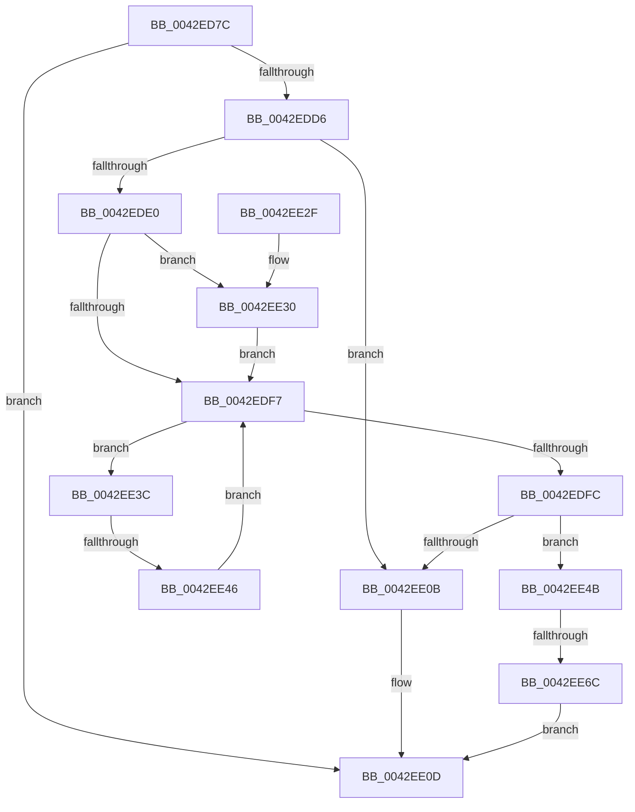

# IopGetSetStreamIdentifier

- RVA: `0x0042ED7C`–`0x0042EE73` (길이 `247` bytes)
- VA: `0x000000014042ED7C`
- 실행 섹션: `.text`
- PDB 이름 있음: `예`; PDB Function 태그: `예`
- unwind 정보 RVA: `0x000A1E18`
- 디코드: `71`개 명령, `247/247` bytes 표시
- 미해석 바이트: `0` (있으면 어셈블리에 `.byte`로 보존)

> 이 문서는 커널 이미지의 기계어와 PDB 기호를 분석해 생성했습니다. 4번과 5번은 함수 원형과 자료형을 바이너리 사용 방식에서 추정한 C 해석이며 원본 소스 복구 결과는 아닙니다.

## 1. Dependencies

- 직접 호출 지점: **4**; 고유 호출 대상: **4**
- 직접 호출자로 확인된 함수: **1**
- RIP 상대 이미지 참조: **0**

### Outgoing calls
- `0x0042EDCD` → [IopGetSetSpecificExtension](IopGetSetSpecificExtension_function_0042EE80.md) (function, `0x0042EE80`)
- `0x0042EDEA` → [KeAcquireSpinLockRaiseToDpc](../20/KeAcquireSpinLockRaiseToDpc_function_00208470.md) (function, `0x00208470`)
- `0x0042EE01` → [KeReleaseSpinLock](../39/KeReleaseSpinLock_function_00392BA0.md) (function, `0x00392BA0`)
- `0x0042EE5B` → [ExAllocatePool2](../../poolcode/B8/ExAllocatePool2_function_00B820F0.md) (function, `0x00B820F0`)

### Direct callers
- [IoAllocateSfioStreamIdentifier](../59/IoAllocateSfioStreamIdentifier_function_00597930.md) at `0x00597959`

### Static image references
- 디코드된 RIP-relative 메모리 참조가 없습니다.

## 2. Other-region calls and transfers

- 다른 실행 섹션으로 향하는 call: **1**
  - `0x0042EE5B` → [ExAllocatePool2](../../poolcode/B8/ExAllocatePool2_function_00B820F0.md) (`.text` → `POOLCODE`)
- call이 아닌 외부 분기/꼬리 이동: **2**
  - `0x0042EE40` → [sub_006EE790](../6E/Unknown_function_006EE790.md) (`tail-transfer`)
  - `0x0042EE66` → [sub_006EE790 + 0x27](../6E/Unknown_function_006EE790.md) (`tail-transfer`)

## 3. Assembly (complete function range)

```asm
0042ED7C  4C 8B DC                        mov r11, rsp
0042ED7F  49 89 5B 08                     mov qword ptr [r11 + 8], rbx
0042ED83  49 89 6B 10                     mov qword ptr [r11 + 0x10], rbp
0042ED87  49 89 73 18                     mov qword ptr [r11 + 0x18], rsi
0042ED8B  49 89 7B 20                     mov qword ptr [r11 + 0x20], rdi
0042ED8F  41 54                           push r12
0042ED91  41 56                           push r14
0042ED93  41 57                           push r15
0042ED95  48 83 EC 40                     sub rsp, 0x40
0042ED99  40 8A B4 24 80 00 00 00         mov sil, byte ptr [rsp + 0x80]
0042EDA1  49 8D 43 E0                     lea rax, [r11 - 0x20]
0042EDA5  33 DB                           xor ebx, ebx
0042EDA7  49 89 43 D0                     mov qword ptr [r11 - 0x30], rax
0042EDAB  4D 8B F1                        mov r14, r9
0042EDAE  44 8B E2                        mov r12d, edx
0042EDB1  4D 8B F8                        mov r15, r8
0042EDB4  49 89 5B D8                     mov qword ptr [r11 - 0x28], rbx
0042EDB8  49 8D 43 D8                     lea rax, [r11 - 0x28]
0042EDBC  44 8A CE                        mov r9b, sil
0042EDBF  8D 53 04                        lea edx, [rbx + 4]
0042EDC2  49 89 43 C8                     mov qword ptr [r11 - 0x38], rax
0042EDC6  44 8D 43 10                     lea r8d, [rbx + 0x10]
0042EDCA  48 8B E9                        mov rbp, rcx
0042EDCD  E8 AE 00 00 00                  call 0x14042ee80
0042EDD2  85 C0                           test eax, eax
0042EDD4  78 37                           js 0x14042ee0d
0042EDD6  48 8B 7C 24 30                  mov rdi, qword ptr [rsp + 0x30]
0042EDDB  48 85 FF                        test rdi, rdi
0042EDDE  74 2B                           je 0x14042ee0b
0042EDE0  48 81 C5 B8 00 00 00            add rbp, 0xb8
0042EDE7  48 8B CD                        mov rcx, rbp
0042EDEA  E8 81 96 DD FF                  call 0x140208470
0042EDEF  48 8B 17                        mov rdx, qword ptr [rdi]
0042EDF2  48 85 D2                        test rdx, rdx
0042EDF5  74 39                           je 0x14042ee30
0042EDF7  48 3B D7                        cmp rdx, rdi
0042EDFA  75 40                           jne 0x14042ee3c
0042EDFC  8A D0                           mov dl, al
0042EDFE  48 8B CD                        mov rcx, rbp
0042EE01  E8 9A 3D F6 FF                  call 0x140392ba0
0042EE06  40 84 F6                        test sil, sil
0042EE09  75 40                           jne 0x14042ee4b
0042EE0B  33 C0                           xor eax, eax
0042EE0D  49 89 1E                        mov qword ptr [r14], rbx
0042EE10  48 8B 5C 24 60                  mov rbx, qword ptr [rsp + 0x60]
0042EE15  48 8B 6C 24 68                  mov rbp, qword ptr [rsp + 0x68]
0042EE1A  48 8B 74 24 70                  mov rsi, qword ptr [rsp + 0x70]
0042EE1F  48 8B 7C 24 78                  mov rdi, qword ptr [rsp + 0x78]
0042EE24  48 83 C4 40                     add rsp, 0x40
0042EE28  41 5F                           pop r15
0042EE2A  41 5E                           pop r14
0042EE2C  41 5C                           pop r12
0042EE2E  C3                              ret
0042EE2F  CC                              int3
0042EE30  48 89 7F 08                     mov qword ptr [rdi + 8], rdi
0042EE34  48 8B D7                        mov rdx, rdi
0042EE37  48 89 3F                        mov qword ptr [rdi], rdi
0042EE3A  EB BB                           jmp 0x14042edf7
0042EE3C  4C 39 7A 18                     cmp qword ptr [rdx + 0x18], r15
0042EE40  0F 84 4A F9 2B 00               je 0x1406ee790
0042EE46  48 8B 12                        mov rdx, qword ptr [rdx]
0042EE49  EB AC                           jmp 0x14042edf7
0042EE4B  49 8D 54 24 20                  lea rdx, [r12 + 0x20]
0042EE50  B9 40 00 00 00                  mov ecx, 0x40
0042EE55  41 B8 49 6F 53 74               mov r8d, 0x74536f49
0042EE5B  E8 90 32 75 00                  call 0x140b820f0
0042EE60  48 8B F0                        mov rsi, rax
0042EE63  48 85 C0                        test rax, rax
0042EE66  0F 85 4B F9 2B 00               jne 0x1406ee7b7
0042EE6C  B8 9A 00 00 C0                  mov eax, 0xc000009a
0042EE71  EB 9A                           jmp 0x14042ee0d
```

## 4. C-style interpretation (structured pseudocode)

```c
__int64 __fastcall IopGetSetStreamIdentifier(__int64 a1, int a2, __int64 a3, __int64 a4, unsigned __int8 a5)
{
    __int64 result;
    __int64 v_rbp;
    __int64 v_rbx;
    __int64 v_rsp;
    unsigned __int64 v_stack_m28;
    unsigned __int64 v_stack_p10;
    unsigned __int64 v_stack_p18;
    unsigned __int64 v_stack_p20;
    unsigned __int64 v_stack_p8;

    *(unsigned __int64 *)(v_rsp + 8) = v_rbx;
    *(unsigned __int64 *)(v_rsp + 16) = v_rbp;
    *(unsigned __int64 *)(v_rsp + 24) = v_rsi;
    *(unsigned __int64 *)(v_rsp + 32) = v_rdi;
    v_rsp = (v_rsp) - (64);
    v_rbx = 0;
    *(unsigned __int64 *)(v_rsp - 48) = v_rsp - 32;
    *(unsigned __int64 *)(v_rsp - 40) = 0;
    *(unsigned __int64 *)(v_rsp - 56) = v_rsp - 40;
    result = IopGetSetSpecificExtension(a1, v_rbx + 4, v_rbx + 16, a5);
    if (sign_flag) goto loc_0042EE0D;
    if (v_stack_m28 == 0) goto loc_0042EE0B;
    v_rbp = (a1) + (184);
    result = KeAcquireSpinLockRaiseToDpc(v_rbp, v_rbx + 4, v_rbx + 16, a5);
    if (*(unsigned __int64 *)(v_stack_m28) == 0) goto loc_0042EE30;
loc_0042EDF7:
    if ((*(unsigned __int64 *)(v_stack_m28)) != v_stack_m28) goto loc_0042EE3C;
    result = KeReleaseSpinLock(v_rbp, (unsigned __int8)(result), v_rbx + 16, a5);
    if (a5 != 0) goto loc_0042EE4B;
loc_0042EE0B:
    result = 0;
loc_0042EE0D:
    *(unsigned __int64 *)(a4) = 0;
    v_rsp = (v_rsp) + (64);
    return result;
loc_0042EE30:
    *(unsigned __int64 *)(v_stack_p20 + 8) = v_stack_p20;
    *(unsigned __int64 *)(v_stack_p20) = v_stack_p20;
    goto loc_0042EDF7;
loc_0042EE3C:
    goto loc_0042EDF7;
loc_0042EE4B:
    result = ExAllocatePool2(64, (unsigned int)(a2) + 32, (unsigned int)(0x74536F49ULL), a5);
    goto loc_0042EE0D;
}
```

## 5. (Beta) C Style

```c
int64_t IopGetSetStreamIdentifier(int64_t Arg1, void *Arg2, int64_t Arg3, void *Arg4, uint8_t Arg5)
{
    uint8_t *arg2 = (uint8_t *)Arg2;
    uint8_t *arg4 = (uint8_t *)Arg4;

    int64_t result;
    int64_t local_rbp;
    int64_t local_rbx;
    int64_t local_rsp;
    uint64_t v_stack_m28;
    uint64_t v_stack_p10;
    uint64_t v_stack_p18;
    uint64_t v_stack_p20;
    uint64_t v_stack_p8;

    *(uint64_t *)(local_rsp + 0x8) = local_rbx;
    *(uint64_t *)(local_rsp + 0x10) = local_rbp;
    *(uint64_t *)(local_rsp + 0x18) = local_rsi;
    *(uint64_t *)(local_rsp + 0x20) = local_rdi;
    local_rsp = (local_rsp) - (64);
    local_rbx = 0;
    *(uint64_t *)(local_rsp - 0x30) = local_rsp - 32;
    *(uint64_t *)(local_rsp - 0x28) = 0;
    *(uint64_t *)(local_rsp - 0x38) = local_rsp - 40;
    result = IopGetSetSpecificExtension(Arg1, local_rbx + 4, local_rbx + 16, Arg5);
    if (sign_flag) goto loc_0042EE0D;
    if (v_stack_m28 == 0) goto loc_0042EE0B;
    local_rbp = (Arg1) + (184);
    result = KeAcquireSpinLockRaiseToDpc(local_rbp, local_rbx + 4, local_rbx + 16, Arg5);
    if (*(uint64_t *)(v_stack_m28) == 0) goto loc_0042EE30;
loc_0042EDF7:
    if ((*(uint64_t *)(v_stack_m28)) != v_stack_m28) goto loc_0042EE3C;
    result = KeReleaseSpinLock(local_rbp, (uint8_t)(result), local_rbx + 16, Arg5);
    if (Arg5 != 0) goto loc_0042EE4B;
loc_0042EE0B:
    result = 0;
loc_0042EE0D:
    *(uint64_t *)(arg4) = 0;
    local_rsp = (local_rsp) + (64);
    return result;
loc_0042EE30:
    *(uint64_t *)(v_stack_p20 + 0x8) = v_stack_p20;
    *(uint64_t *)(v_stack_p20) = v_stack_p20;
    goto loc_0042EDF7;
loc_0042EE3C:
    goto loc_0042EDF7;
loc_0042EE4B:
    result = ExAllocatePool2(64, (uint32_t)(Arg2) + 32, (uint32_t)(0x74536F49ULL), Arg5);
    goto loc_0042EE0D;
}
```

### 관측된 메모리 오프셋

구조체 형식이 확인되지 않은 접근은 인자 기준의 오프셋으로만 기록했습니다.

| 기준 인자 | 오프셋 표현 | 폭 (bit) | 접근 |
|---|---:|---:|---|
| `Arg2` | `+ 0x20` | `64` | `R` |
| `Arg4` | `+ 0x0` | `64` | `W` |

## 6. Execution-region graph

[열기: 2D/3D 그래프와 함수 탐색 컨트롤 패널](../../../control-panel.html?section=text&rva=0x0042ED7C&view=graph)

- 2D 그래프는 위에서 아래로 흐르고, 3D 그래프는 빈 공간을 드래그해 회전합니다. Shift+드래그는 이동, 휠은 확대·축소, 함수 노드 선택은 대상 보고서 이동입니다.

### Static fallback


