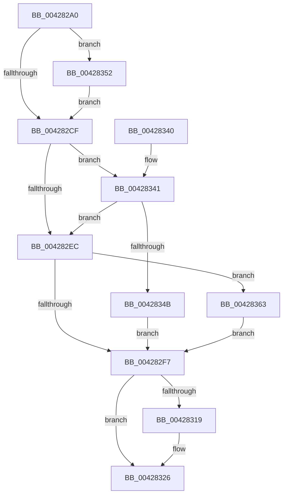

# IopInterlockedDecrementUlong

- RVA: `0x004282A0`–`0x0042836D` (길이 `205` bytes)
- VA: `0x00000001404282A0`
- 실행 섹션: `.text`
- PDB 이름 있음: `예`; PDB Function 태그: `아니요`
- unwind 정보 RVA: `0x00084A08`
- 디코드: `54`개 명령, `205/205` bytes 표시
- 미해석 바이트: `0` (있으면 어셈블리에 `.byte`로 보존)

> 이 문서는 커널 이미지의 기계어와 PDB 기호를 분석해 생성했습니다. 4번과 5번은 함수 원형과 자료형을 바이너리 사용 방식에서 추정한 C 해석이며 원본 소스 복구 결과는 아닙니다.

## 1. Dependencies

- 직접 호출 지점: **5**; 고유 호출 대상: **5**
- 직접 호출자로 확인된 함수: **1**
- RIP 상대 이미지 참조: **3**

### Outgoing calls
- `0x0042830B` → [KeReleaseInStackQueuedSpinLockFromDpcLevel](../21/KeReleaseInStackQueuedSpinLockFromDpcLevel_function_002171B0.md) (function, `0x002171B0`)
- `0x00428321` → [KiLowerIrqlProcessIrqlFlags](../4F/KiLowerIrqlProcessIrqlFlags_function_004F5698.md) (function, `0x004F5698`)
- `0x0042834B` → [KiAcquireQueuedSpinLockInstrumented](../27/KiAcquireQueuedSpinLockInstrumented_function_00275850.md) (function, `0x00275850`)
- `0x00428359` → [KiRaiseIrqlProcessIrqlFlags](../4F/KiRaiseIrqlProcessIrqlFlags_function_004F56FC.md) (function, `0x004F56FC`)
- `0x00428366` → [KxWaitForLockOwnerShip](../25/KxWaitForLockOwnerShip_function_00257EB0.md) (function, `0x00257EB0`)

### Direct callers
- [IopDecrementDeviceObjectRefCount](IopDecrementDeviceObjectRefCount_function_00428220.md) at `0x00428252`

### Static image references
- `0x004282C2` → RVA `0x00FC6D20` (`ALMOSTRO`; read)
- `0x004282E3` → RVA `0x00FC6B06` (`ALMOSTRO`; read)
- `0x00428341` → RVA `0x00F0DE58` (`.data`; read)

## 2. Other-region calls and transfers

- 다른 실행 섹션으로 향하는 call: **0**
- 별도 외부 분기/꼬리 이동을 확인하지 못했습니다.

## 3. Assembly (complete function range)

```asm
004282A0  48 89 5C 24 08                  mov qword ptr [rsp + 8], rbx
004282A5  48 89 74 24 10                  mov qword ptr [rsp + 0x10], rsi
004282AA  57                              push rdi
004282AB  48 83 EC 20                     sub rsp, 0x20
004282AF  48 8B DA                        mov rbx, rdx
004282B2  48 8B F9                        mov rdi, rcx
004282B5  44 0F 20 C6                     mov rsi, cr8
004282B9  B8 02 00 00 00                  mov eax, 2
004282BE  44 0F 22 C0                     mov cr8, rax
004282C2  83 3D 57 EA B9 00 00            cmp dword ptr [rip + 0xb9ea57], 0
004282C9  0F 85 83 00 00 00               jne 0x140428352
004282CF  65 48 8B 0C 25 28 00 00 00      mov rcx, qword ptr gs:[0x28]
004282D8  48 C1 E7 04                     shl rdi, 4
004282DC  48 03 CF                        add rcx, rdi
004282DF  48 8B 51 08                     mov rdx, qword ptr [rcx + 8]
004282E3  F6 05 1C E8 B9 00 21            test byte ptr [rip + 0xb9e81c], 0x21
004282EA  75 55                           jne 0x140428341
004282EC  48 8B C1                        mov rax, rcx
004282EF  48 87 02                        xchg qword ptr [rdx], rax
004282F2  48 85 C0                        test rax, rax
004282F5  75 6C                           jne 0x140428363
004282F7  8B 03                           mov eax, dword ptr [rbx]
004282F9  FF C8                           dec eax
004282FB  89 03                           mov dword ptr [rbx], eax
004282FD  8B 1B                           mov ebx, dword ptr [rbx]
004282FF  65 48 8B 0C 25 28 00 00 00      mov rcx, qword ptr gs:[0x28]
00428308  48 03 CF                        add rcx, rdi
0042830B  E8 A0 EE DE FF                  call 0x1402171b0
00428310  83 3D 09 EA B9 00 00            cmp dword ptr [rip + 0xb9ea09], 0
00428317  74 0D                           je 0x140428326
00428319  44 0F 20 C1                     mov rcx, cr8
0042831D  40 0F B6 D6                     movzx edx, sil
00428321  E8 72 D3 0C 00                  call 0x1404f5698
00428326  40 0F B6 CE                     movzx ecx, sil
0042832A  44 0F 22 C1                     mov cr8, rcx
0042832E  48 8B 74 24 38                  mov rsi, qword ptr [rsp + 0x38]
00428333  8B C3                           mov eax, ebx
00428335  48 8B 5C 24 30                  mov rbx, qword ptr [rsp + 0x30]
0042833A  48 83 C4 20                     add rsp, 0x20
0042833E  5F                              pop rdi
0042833F  C3                              ret
00428340  CC                              int3
00428341  8B 05 11 5B AE 00               mov eax, dword ptr [rip + 0xae5b11]
00428347  85 C0                           test eax, eax
00428349  75 A1                           jne 0x1404282ec
0042834B  E8 00 D5 E4 FF                  call 0x140275850
00428350  EB A5                           jmp 0x1404282f7
00428352  0F B6 D0                        movzx edx, al
00428355  40 0F B6 CE                     movzx ecx, sil
00428359  E8 9E D3 0C 00                  call 0x1404f56fc
0042835E  E9 6C FF FF FF                  jmp 0x1404282cf
00428363  48 8B D0                        mov rdx, rax
00428366  E8 45 FB E2 FF                  call 0x140257eb0
0042836B  EB 8A                           jmp 0x1404282f7
```

## 4. C-style interpretation (structured pseudocode)

```c
__int64 __fastcall IopInterlockedDecrementUlong(__int64 a1, __int64 a2)
{
    __int64 result;
    __int64 v_rdi;
    __int64 v_rsp;
    unsigned __int64 v_stack_p10;
    unsigned __int64 v_stack_p8;

    v_stack_p8 = v_rbx;
    v_stack_p10 = v_rsi;
    v_rsp = (v_rsp) - (32);
    if ((*(unsigned int *)(v_rip + 12184151)) != 0) goto loc_00428352;
loc_004282CF:
    v_rdi = (a1) << (4);
    a1 = (*(unsigned __int64 *)(gs_base + (0 + 40))) + (v_rdi);
    if (((*(unsigned __int8 *)(v_rip + 12183580)) & (33)) != 0) goto loc_00428341;
loc_004282EC:
    if (a1 != 0) goto loc_00428363;
loc_004282F7:
    result = (unsigned int)(((unsigned int)(*(unsigned int *)(a2))) - 1);
    *(unsigned int *)(a2) = (unsigned int)(result);
    a1 = (*(unsigned __int64 *)(gs_base + (0 + 40))) + (v_rdi);
    result = KeReleaseInStackQueuedSpinLockFromDpcLevel(a1, *(unsigned __int64 *)(a1 + 8), a3, a4);
    if ((*(unsigned int *)(v_rip + 12184073)) != 0) {
        a1 = 2;
        a2 = (unsigned __int8)(v_cr8);
        result = KiLowerIrqlProcessIrqlFlags(a1, a2, a3, a4);
    }
    v_rsp = (v_rsp) + (32);
    return (unsigned int)((unsigned int)((unsigned int)(*(unsigned int *)(a2))));
loc_00428341:
    if ((unsigned int)((unsigned int)(*(unsigned int *)(v_rip + 11426577))) != 0) goto loc_004282EC;
    result = KiAcquireQueuedSpinLockInstrumented((unsigned __int8)(v_cr8), a2, a3, a4);
    goto loc_004282F7;
loc_00428352:
    result = KiRaiseIrqlProcessIrqlFlags((unsigned __int8)(v_stack_p10), (unsigned __int8)(result), a3, a4);
    goto loc_004282CF;
loc_00428363:
    result = KxWaitForLockOwnerShip((unsigned __int8)(v_stack_p10), result, a3, a4);
    goto loc_004282F7;
}
```

## 5. (Beta) C Style

```c
int64_t IopInterlockedDecrementUlong(int64_t Arg1, void *Arg2)
{
    uint8_t *arg2 = (uint8_t *)Arg2;

    int64_t result;
    int64_t local_rdi;
    int64_t local_rsp;
    uint64_t v_stack_p10;
    uint64_t v_stack_p8;

    v_stack_p8 = local_rbx;
    v_stack_p10 = local_rsi;
    local_rsp = (local_rsp) - (32);
    if ((*(uint32_t *)(v_rip + 0xB9EA57)) != 0) goto loc_00428352;
loc_004282CF:
    local_rdi = (Arg1) << (4);
    Arg1 = (*(uint64_t *)(gs_base + (0 + 0x28))) + (local_rdi);
    if (((*(uint8_t *)(v_rip + 0xB9E81C)) & (33)) != 0) goto loc_00428341;
loc_004282EC:
    if (Arg1 != 0) goto loc_00428363;
loc_004282F7:
    result = (uint32_t)(((uint32_t)(*(uint32_t *)(arg2))) - 1);
    *(uint32_t *)(arg2) = (uint32_t)(result);
    Arg1 = (*(uint64_t *)(gs_base + (0 + 0x28))) + (local_rdi);
    result = KeReleaseInStackQueuedSpinLockFromDpcLevel(Arg1, *(uint64_t *)(Arg1 + 0x8), a3, a4);
    if ((*(uint32_t *)(v_rip + 0xB9EA09)) != 0) {
        Arg1 = 2;
        Arg2 = (uint8_t)(v_cr8);
        result = KiLowerIrqlProcessIrqlFlags(Arg1, Arg2, a3, a4);
    }
    local_rsp = (local_rsp) + (32);
    return (uint32_t)((uint32_t)((uint32_t)(*(uint32_t *)(arg2))));
loc_00428341:
    if ((uint32_t)((uint32_t)(*(uint32_t *)(v_rip + 0xAE5B11))) != 0) goto loc_004282EC;
    result = KiAcquireQueuedSpinLockInstrumented((uint8_t)(v_cr8), Arg2, a3, a4);
    goto loc_004282F7;
loc_00428352:
    result = KiRaiseIrqlProcessIrqlFlags((uint8_t)(v_stack_p10), (uint8_t)(result), a3, a4);
    goto loc_004282CF;
loc_00428363:
    result = KxWaitForLockOwnerShip((uint8_t)(v_stack_p10), result, a3, a4);
    goto loc_004282F7;
}
```

### 관측된 메모리 오프셋

구조체 형식이 확인되지 않은 접근은 인자 기준의 오프셋으로만 기록했습니다.

| 기준 인자 | 오프셋 표현 | 폭 (bit) | 접근 |
|---|---:|---:|---|
| `Arg2` | `+ 0x0` | `32` | `R` |
| `Arg2` | `+ 0x0` | `32` | `W` |

## 6. Execution-region graph

[열기: 2D/3D 그래프와 함수 탐색 컨트롤 패널](../../../control-panel.html?section=text&rva=0x004282A0&view=graph)

- 2D 그래프는 위에서 아래로 흐르고, 3D 그래프는 빈 공간을 드래그해 회전합니다. Shift+드래그는 이동, 휠은 확대·축소, 함수 노드 선택은 대상 보고서 이동입니다.

### Static fallback


