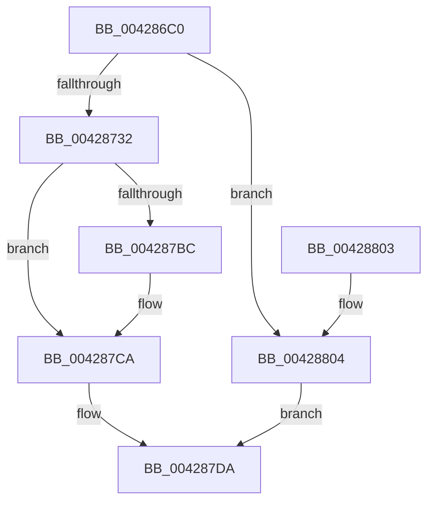

# IopIoRateStartRateControl

- RVA: `0x004286C0`–`0x0042880B` (길이 `331` bytes)
- VA: `0x00000001404286C0`
- 실행 섹션: `.text`
- PDB 이름 있음: `예`; PDB Function 태그: `아니요`
- unwind 정보 RVA: `0x000A0D4C`
- 디코드: `90`개 명령, `331/331` bytes 표시
- 미해석 바이트: `0` (있으면 어셈블리에 `.byte`로 보존)

> 이 문서는 커널 이미지의 기계어와 PDB 기호를 분석해 생성했습니다. 4번과 5번은 함수 원형과 자료형을 바이너리 사용 방식에서 추정한 C 해석이며 원본 소스 복구 결과는 아닙니다.

## 1. Dependencies

- 직접 호출 지점: **5**; 고유 호출 대상: **5**
- 직접 호출자로 확인된 함수: **1**
- RIP 상대 이미지 참조: **2**

### Outgoing calls
- `0x00428721` → [ExGetExtensionTable](ExGetExtensionTable_function_00428814.md) (function, `0x00428814`)
- `0x0042873D` → [IoDiskIoAttributionQuery](../37/IoDiskIoAttributionQuery_function_00379D38.md) (function, `0x00379D38`)
- `0x004287B1` → [guard_dispatch_icall](../6B/guard_dispatch_icall_function_006BAAD0.md) (function, `0x006BAAD0`)
- `0x004287D5` → [ExReleaseRundownProtection](../34/ExReleaseRundownProtection_function_00349E80.md) (function, `0x00349E80`)
- `0x004287E3` → [_security_check_cookie](../6A/_security_check_cookie_function_006AC640.md) (function, `0x006AC640`)

### Direct callers
- [IoStartIoRateControl](IoStartIoRateControl_function_00428574.md) at `0x00428656`

### Static image references
- `0x004286DC` → RVA `0x00E0A740` (`.data`; read)
- `0x004286FF` → RVA `0x00F8D130` (`.data`; read)

## 2. Other-region calls and transfers

- 다른 실행 섹션으로 향하는 call: **0**
- 별도 외부 분기/꼬리 이동을 확인하지 못했습니다.

## 3. Assembly (complete function range)

```asm
004286C0  48 89 5C 24 10                  mov qword ptr [rsp + 0x10], rbx
004286C5  55                              push rbp
004286C6  56                              push rsi
004286C7  57                              push rdi
004286C8  41 54                           push r12
004286CA  41 55                           push r13
004286CC  41 56                           push r14
004286CE  41 57                           push r15
004286D0  48 8D 6C 24 F1                  lea rbp, [rsp - 0xf]
004286D5  48 81 EC C0 00 00 00            sub rsp, 0xc0
004286DC  48 8B 05 5D 20 9E 00            mov rax, qword ptr [rip + 0x9e205d]
004286E3  48 33 C4                        xor rax, rsp
004286E6  48 89 45 07                     mov qword ptr [rbp + 7], rax
004286EA  48 8B 75 6F                     mov rsi, qword ptr [rbp + 0x6f]
004286EE  0F 57 C0                        xorps xmm0, xmm0
004286F1  48 8B 7D 77                     mov rdi, qword ptr [rbp + 0x77]
004286F5  0F 57 C9                        xorps xmm1, xmm1
004286F8  4C 8B 6D 7F                     mov r13, qword ptr [rbp + 0x7f]
004286FC  4C 8B F1                        mov r14, rcx
004286FF  48 8B 0D 2A 4A B6 00            mov rcx, qword ptr [rip + 0xb64a2a]
00428706  4D 8B E1                        mov r12, r9
00428709  48 83 65 9F 00                  and qword ptr [rbp - 0x61], 0
0042870E  45 8B F8                        mov r15d, r8d
00428711  0F 11 45 C7                     movups xmmword ptr [rbp - 0x39], xmm0
00428715  0F 11 45 D7                     movups xmmword ptr [rbp - 0x29], xmm0
00428719  0F 11 4D A7                     movups xmmword ptr [rbp - 0x59], xmm1
0042871D  0F 11 4D B7                     movups xmmword ptr [rbp - 0x49], xmm1
00428721  E8 EE 00 00 00                  call 0x140428814
00428726  48 8B D8                        mov rbx, rax
00428729  48 85 C0                        test rax, rax
0042872C  0F 84 D2 00 00 00               je 0x140428804
00428732  4C 8D 45 A7                     lea r8, [rbp - 0x59]
00428736  48 8B CE                        mov rcx, rsi
00428739  48 8D 55 C7                     lea rdx, [rbp - 0x39]
0042873D  E8 F6 15 F5 FF                  call 0x140379d38
00428742  0F 10 45 D7                     movups xmm0, xmmword ptr [rbp - 0x29]
00428746  48 8B 4D BF                     mov rcx, qword ptr [rbp - 0x41]
0042874A  4D 8B CC                        mov r9, r12
0042874D  0F 10 4D C7                     movups xmm1, xmmword ptr [rbp - 0x39]
00428751  48 8B 56 18                     mov rdx, qword ptr [rsi + 0x18]
00428755  45 8B C7                        mov r8d, r15d
00428758  0F 11 45 F7                     movups xmmword ptr [rbp - 9], xmm0
0042875C  48 01 4D F7                     add qword ptr [rbp - 9], rcx
00428760  0F 11 4D E7                     movups xmmword ptr [rbp - 0x19], xmm1
00428764  4C 89 6C 24 38                  mov qword ptr [rsp + 0x38], r13
00428769  66 0F 73 D8 08                  psrldq xmm0, 8
0042876E  66 48 0F 7E C0                  movq rax, xmm0
00428773  48 03 C1                        add rax, rcx
00428776  48 8D 4D 9F                     lea rcx, [rbp - 0x61]
0042877A  48 89 45 FF                     mov qword ptr [rbp - 1], rax
0042877E  66 48 0F 7E C8                  movq rax, xmm1
00428783  48 03 45 A7                     add rax, qword ptr [rbp - 0x59]
00428787  48 89 4C 24 30                  mov qword ptr [rsp + 0x30], rcx
0042878C  48 8D 4D E7                     lea rcx, [rbp - 0x19]
00428790  48 89 45 E7                     mov qword ptr [rbp - 0x19], rax
00428794  48 8B 45 AF                     mov rax, qword ptr [rbp - 0x51]
00428798  48 01 45 EF                     add qword ptr [rbp - 0x11], rax
0042879C  48 8B 03                        mov rax, qword ptr [rbx]
0042879F  48 89 54 24 28                  mov qword ptr [rsp + 0x28], rdx
004287A4  BA 0F 00 00 00                  mov edx, 0xf
004287A9  48 89 4C 24 20                  mov qword ptr [rsp + 0x20], rcx
004287AE  49 8B CE                        mov rcx, r14
004287B1  E8 1A 23 29 00                  call 0x1406baad0
004287B6  8B D8                           mov ebx, eax
004287B8  85 C0                           test eax, eax
004287BA  78 0E                           js 0x1404287ca
004287BC  48 8B 45 9F                     mov rax, qword ptr [rbp - 0x61]
004287C0  48 83 65 9F 00                  and qword ptr [rbp - 0x61], 0
004287C5  33 DB                           xor ebx, ebx
004287C7  48 89 07                        mov qword ptr [rdi], rax
004287CA  48 8B 0D 5F 49 B6 00            mov rcx, qword ptr [rip + 0xb6495f]
004287D1  48 83 C1 58                     add rcx, 0x58
004287D5  E8 A6 16 F2 FF                  call 0x140349e80
004287DA  8B C3                           mov eax, ebx
004287DC  48 8B 4D 07                     mov rcx, qword ptr [rbp + 7]
004287E0  48 33 CC                        xor rcx, rsp
004287E3  E8 58 3E 28 00                  call 0x1406ac640
004287E8  48 8B 9C 24 08 01 00 00         mov rbx, qword ptr [rsp + 0x108]
004287F0  48 81 C4 C0 00 00 00            add rsp, 0xc0
004287F7  41 5F                           pop r15
004287F9  41 5E                           pop r14
004287FB  41 5D                           pop r13
004287FD  41 5C                           pop r12
004287FF  5F                              pop rdi
00428800  5E                              pop rsi
00428801  5D                              pop rbp
00428802  C3                              ret
00428803  CC                              int3
00428804  BB 02 00 00 C0                  mov ebx, 0xc0000002
00428809  EB CF                           jmp 0x1404287da
```

## 4. C-style interpretation (structured pseudocode)

```c
__int64 __fastcall IopIoRateStartRateControl(__int64 a1, __int64 a2, int a3, __int64 a4, __int64 a5, __int64 a6, __int64 a7)
{
    __int64 result;
    __int64 v_rbx;
    __int64 v_rsp;
    unsigned __int64 v_stack_m40;
    unsigned __int64 v_stack_m47;
    unsigned __int64 v_stack_m48;
    unsigned __int64 v_stack_m50;
    unsigned __int64 v_stack_m58;
    unsigned __int64 v_stack_m60;
    unsigned __int64 v_stack_m70;
    unsigned __int64 v_stack_m80;
    unsigned __int64 v_stack_m88;
    unsigned __int64 v_stack_m90;
    unsigned __int64 v_stack_m98;
    unsigned __int64 v_stack_mA0;
    unsigned __int64 v_stack_mA8;
    unsigned __int64 v_stack_mC0;
    unsigned __int64 v_stack_mC8;
    unsigned __int64 v_stack_mD0;
    unsigned __int64 v_stack_mD8;
    unsigned __int64 v_stack_p10;

    v_stack_p10 = v_rbx;
    v_rsp = (v_rsp) - (192);
    result = (*(unsigned __int64 *)(v_rip + 10362973)) ^ (v_rsp);
    v_stack_m40 = result;
    v_stack_m80 = v_xmm0;
    v_stack_m70 = v_xmm0;
    v_stack_mA0 = v_xmm1;
    v_stack_m90 = v_xmm1;
    result = ExGetExtensionTable(*(unsigned __int64 *)(v_rip + 11946538), a2, a3, a4);
    if (result == 0) goto loc_00428804;
    result = IoDiskIoAttributionQuery(a5, v_stack_m80, v_stack_mA0, a4);
    v_stack_m50 = v_xmm0;
    v_stack_m60 = v_xmm1;
    v_stack_mC0 = a7;
    result = (result) + (v_stack_m88);
    v_stack_m48 = result;
    result = (result) + (v_stack_mA0);
    v_stack_mC8 = v_stack_mA8;
    v_stack_m60 = result;
    v_stack_mD0 = *(unsigned __int64 *)(a5 + 24);
    v_stack_mD8 = v_stack_m60;
    result = guard_dispatch_icall(a1, 15, (unsigned int)((unsigned int)((unsigned int)(a3))), a4);
    v_rbx = (unsigned int)((unsigned int)(result));
    if (!(sign_flag)) {
        result = v_stack_mA8;
        v_rbx = 0;
        *(unsigned __int64 *)(a6) = result;
    }
    a1 = (*(unsigned __int64 *)(v_rip + 11946335)) + (88);
    result = ExReleaseRundownProtection(a1, 15, (unsigned int)((unsigned int)((unsigned int)(a3))), a4);
loc_004287DA:
    a1 = (v_stack_m40) ^ (v_rsp);
    result = _security_check_cookie(a1, 15, (unsigned int)((unsigned int)((unsigned int)(a3))), a4);
    v_rsp = (v_rsp) + (192);
    return result;
loc_00428804:
    goto loc_004287DA;
}
```

## 5. (Beta) C Style

```c
int64_t IopIoRateStartRateControl(int64_t Arg1, int64_t Arg2, int32_t Arg3, int64_t Arg4, void *Arg5, void *Arg6, int64_t Arg7)
{
    uint8_t *arg5 = (uint8_t *)Arg5;
    uint8_t *arg6 = (uint8_t *)Arg6;

    int64_t result;
    int64_t local_rbx;
    int64_t local_rsp;
    uint64_t v_stack_m40;
    uint64_t v_stack_m47;
    uint64_t v_stack_m48;
    uint64_t v_stack_m50;
    uint64_t v_stack_m58;
    uint64_t v_stack_m60;
    uint64_t v_stack_m70;
    uint64_t v_stack_m80;
    uint64_t v_stack_m88;
    uint64_t v_stack_m90;
    uint64_t v_stack_m98;
    uint64_t v_stack_mA0;
    uint64_t v_stack_mA8;
    uint64_t v_stack_mC0;
    uint64_t v_stack_mC8;
    uint64_t v_stack_mD0;
    uint64_t v_stack_mD8;
    uint64_t v_stack_p10;

    v_stack_p10 = local_rbx;
    local_rsp = (local_rsp) - (192);
    result = (*(uint64_t *)(v_rip + 0x9E205D)) ^ (local_rsp);
    v_stack_m40 = result;
    v_stack_m80 = v_xmm0;
    v_stack_m70 = v_xmm0;
    v_stack_mA0 = v_xmm1;
    v_stack_m90 = v_xmm1;
    result = ExGetExtensionTable(*(uint64_t *)(v_rip + 0xB64A2A), Arg2, Arg3, Arg4);
    if (result == 0) goto loc_00428804;
    result = IoDiskIoAttributionQuery(Arg5, v_stack_m80, v_stack_mA0, Arg4);
    v_stack_m50 = v_xmm0;
    v_stack_m60 = v_xmm1;
    v_stack_mC0 = Arg7;
    result = (result) + (v_stack_m88);
    v_stack_m48 = result;
    result = (result) + (v_stack_mA0);
    v_stack_mC8 = v_stack_mA8;
    v_stack_m60 = result;
    v_stack_mD0 = *(uint64_t *)(arg5 + 0x18);
    v_stack_mD8 = v_stack_m60;
    result = guard_dispatch_icall(Arg1, 15, (uint32_t)((uint32_t)((uint32_t)(Arg3))), Arg4);
    local_rbx = (uint32_t)((uint32_t)(result));
    if (!(sign_flag)) {
        result = v_stack_mA8;
        local_rbx = 0;
        *(uint64_t *)(arg6) = result;
    }
    Arg1 = (*(uint64_t *)(v_rip + 0xB6495F)) + (88);
    result = ExReleaseRundownProtection(Arg1, 15, (uint32_t)((uint32_t)((uint32_t)(Arg3))), Arg4);
loc_004287DA:
    Arg1 = (v_stack_m40) ^ (local_rsp);
    result = _security_check_cookie(Arg1, 15, (uint32_t)((uint32_t)((uint32_t)(Arg3))), Arg4);
    local_rsp = (local_rsp) + (192);
    return result;
loc_00428804:
    goto loc_004287DA;
}
```

### 관측된 메모리 오프셋

구조체 형식이 확인되지 않은 접근은 인자 기준의 오프셋으로만 기록했습니다.

| 기준 인자 | 오프셋 표현 | 폭 (bit) | 접근 |
|---|---:|---:|---|
| `Arg5` | `+ 0x18` | `64` | `R` |
| `Arg6` | `+ 0x0` | `64` | `W` |

## 6. Execution-region graph

[열기: 2D/3D 그래프와 함수 탐색 컨트롤 패널](../../../control-panel.html?section=text&rva=0x004286C0&view=graph)

- 2D 그래프는 위에서 아래로 흐르고, 3D 그래프는 빈 공간을 드래그해 회전합니다. Shift+드래그는 이동, 휠은 확대·축소, 함수 노드 선택은 대상 보고서 이동입니다.

### Static fallback


