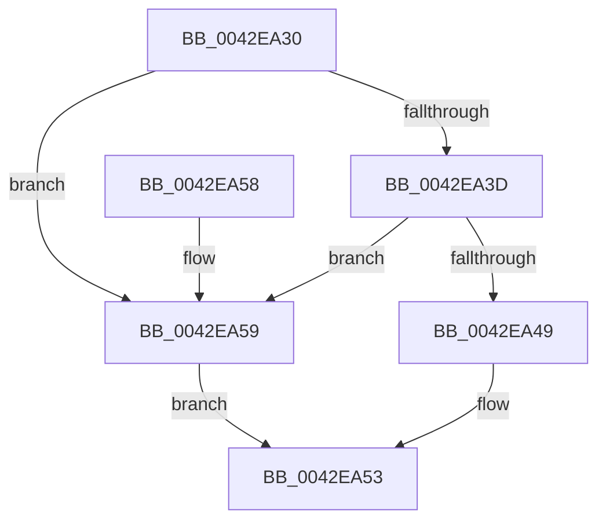

# KCBIsVirtualizable

- RVA: `0x0042EA30`–`0x0042EA5D` (길이 `45` bytes)
- VA: `0x000000014042EA30`
- 실행 섹션: `.text`
- PDB 이름 있음: `예`; PDB Function 태그: `예`
- unwind 정보 RVA: `0x00069B1C`
- 디코드: `13`개 명령, `45/45` bytes 표시
- 미해석 바이트: `0` (있으면 어셈블리에 `.byte`로 보존)

> 이 문서는 커널 이미지의 기계어와 PDB 기호를 분석해 생성했습니다. 4번과 5번은 함수 원형과 자료형을 바이너리 사용 방식에서 추정한 C 해석이며 원본 소스 복구 결과는 아닙니다.

## 1. Dependencies

- 직접 호출 지점: **1**; 고유 호출 대상: **1**
- 직접 호출자로 확인된 함수: **1**
- RIP 상대 이미지 참조: **1**

### Outgoing calls
- `0x0042EA49` → [CmpIsKcbInsideVirtualizedHive](../../page/8B/CmpIsKcbInsideVirtualizedHive_function_008B4E70.md) (function, `0x008B4E70`)

### Direct callers
- [KCBNeedsVirtualImage](KCBNeedsVirtualImage_function_0042E9FC.md) at `0x0042EA00`

### Static image references
- `0x0042EA34` → RVA `0x00E0ECA0` (`.data`; read)

## 2. Other-region calls and transfers

- 다른 실행 섹션으로 향하는 call: **1**
  - `0x0042EA49` → [CmpIsKcbInsideVirtualizedHive](../../page/8B/CmpIsKcbInsideVirtualizedHive_function_008B4E70.md) (`.text` → `PAGE`)
- 별도 외부 분기/꼬리 이동을 확인하지 못했습니다.

## 3. Assembly (complete function range)

```asm
0042EA30  48 83 EC 28                     sub rsp, 0x28
0042EA34  80 3D 65 02 9E 00 00            cmp byte ptr [rip + 0x9e0265], 0
0042EA3B  74 1C                           je 0x14042ea59
0042EA3D  F7 81 B8 00 00 00 00 00 00 02   test dword ptr [rcx + 0xb8], 0x2000000
0042EA47  75 10                           jne 0x14042ea59
0042EA49  E8 22 64 48 00                  call 0x1408b4e70
0042EA4E  84 C0                           test al, al
0042EA50  0F 95 C0                        setne al
0042EA53  48 83 C4 28                     add rsp, 0x28
0042EA57  C3                              ret
0042EA58  CC                              int3
0042EA59  32 C0                           xor al, al
0042EA5B  EB F6                           jmp 0x14042ea53
```

## 4. C-style interpretation (structured pseudocode)

```c
__int64 __fastcall KCBIsVirtualizable(__int64 a1)
{
    __int64 result;
    __int64 v_rsp;

    v_rsp = (v_rsp) - (40);
    if ((*(unsigned __int8 *)(v_rip + 10355301)) == 0) goto loc_0042EA59;
    if (((*(unsigned int *)(a1 + 184)) & (0x2000000ULL)) != 0) goto loc_0042EA59;
    result = CmpIsKcbInsideVirtualizedHive(a1, a2, a3, a4);
    result = ((unsigned __int8)(result) != 0) ? 1 : 0;
loc_0042EA53:
    v_rsp = (v_rsp) + (40);
    return result;
loc_0042EA59:
    result = 0;
    goto loc_0042EA53;
}
```

## 5. (Beta) C Style

```c
int64_t KCBIsVirtualizable(void *Arg1)
{
    uint8_t *arg1 = (uint8_t *)Arg1;

    int64_t result;
    int64_t local_rsp;

    local_rsp = (local_rsp) - (40);
    if ((*(uint8_t *)(v_rip + 0x9E0265)) == 0) goto loc_0042EA59;
    if (((*(uint32_t *)(arg1 + 0xB8)) & (0x2000000ULL)) != 0) goto loc_0042EA59;
    result = CmpIsKcbInsideVirtualizedHive(Arg1, a2, a3, a4);
    result = ((uint8_t)(result) != 0) ? 1 : 0;
loc_0042EA53:
    local_rsp = (local_rsp) + (40);
    return result;
loc_0042EA59:
    result = 0;
    goto loc_0042EA53;
}
```

### 관측된 메모리 오프셋

구조체 형식이 확인되지 않은 접근은 인자 기준의 오프셋으로만 기록했습니다.

| 기준 인자 | 오프셋 표현 | 폭 (bit) | 접근 |
|---|---:|---:|---|
| `Arg1` | `+ 0xB8` | `32` | `R` |

## 6. Execution-region graph

[열기: 2D/3D 그래프와 함수 탐색 컨트롤 패널](../../../control-panel.html?section=text&rva=0x0042EA30&view=graph)

- 2D 그래프는 위에서 아래로 흐르고, 3D 그래프는 빈 공간을 드래그해 회전합니다. Shift+드래그는 이동, 휠은 확대·축소, 함수 노드 선택은 대상 보고서 이동입니다.

### Static fallback


