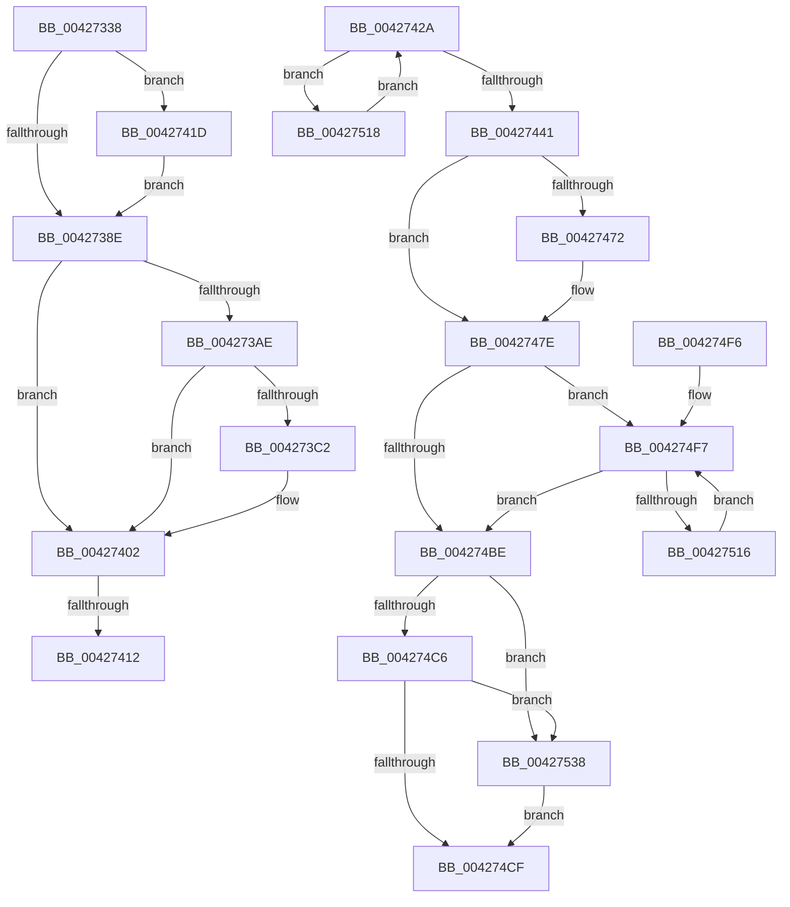

# KeConfigureHeteroProcessors

- RVA: `0x00427338`–`0x0042753D` (길이 `517` bytes)
- VA: `0x0000000140427338`
- 실행 섹션: `.text`
- PDB 이름 있음: `예`; PDB Function 태그: `예`
- unwind 정보 RVA: `0x000A0648`
- 디코드: `130`개 명령, `517/517` bytes 표시
- 미해석 바이트: `0` (있으면 어셈블리에 `.byte`로 보존)

> 이 문서는 커널 이미지의 기계어와 PDB 기호를 분석해 생성했습니다. 4번과 5번은 함수 원형과 자료형을 바이너리 사용 방식에서 추정한 C 해석이며 원본 소스 복구 결과는 아닙니다.

## 1. Dependencies

- 직접 호출 지점: **13**; 고유 호출 대상: **13**
- 직접 호출자로 확인된 함수: **1**
- RIP 상대 이미지 참조: **16**

### Outgoing calls
- `0x00427372` → [KiComputeHeteroConfig](KiComputeHeteroConfig_function_00427544.md) (function, `0x00427544`)
- `0x0042738E` → [KiUpdateProcessorClasses](KiUpdateProcessorClasses_function_00427A30.md) (function, `0x00427A30`)
- `0x00427393` → [KiUpdateHgsScores](KiUpdateHgsScores_function_00427D08.md) (function, `0x00427D08`)
- `0x00427398` → [KiGetNumberOfActiveSubNodes](KiGetNumberOfActiveSubNodes_function_00427920.md) (function, `0x00427920`)
- `0x004273E9` → [wil_details_FeatureReporting_ReportUsageToService](../53/wil_details_FeatureReporting_ReportUsageToService_function_0053E6E4.md) (function, `0x0053E6E4`)
- `0x004273FD` → [wil_details_FeatureStateCache_TryEnableDeviceUsageFastPath](../53/wil_details_FeatureStateCache_TryEnableDeviceUsageFastPath_function_0053E774.md) (function, `0x0053E774`)
- `0x00427420` → [KiRaiseIrqlProcessIrqlFlags](../4F/KiRaiseIrqlProcessIrqlFlags_function_004F56FC.md) (function, `0x004F56FC`)
- `0x00427434` → [KiEnumerateNextSchedulerSubNodeInSystem](../25/KiEnumerateNextSchedulerSubNodeInSystem_function_002569C0.md) (function, `0x002569C0`)
- `0x00427479` → [KiLowerIrqlProcessIrqlFlags](../4F/KiLowerIrqlProcessIrqlFlags_function_004F5698.md) (function, `0x004F5698`)
- `0x0042748D` → [KiTraceLogHeteroRundown](KiTraceLogHeteroRundown_function_004269B4.md) (function, `0x004269B4`)
- `0x004274D9` → [_security_check_cookie](../6A/_security_check_cookie_function_006AC640.md) (function, `0x006AC640`)
- `0x00427504` → [KiConfigureCpuSetSchedulingInformation](../2D/KiConfigureCpuSetSchedulingInformation_function_002D2E1C.md) (function, `0x002D2E1C`)
- `0x0042752E` → [KiInstallSubNodeHeteroSets](../4B/KiInstallSubNodeHeteroSets_function_004B71D4.md) (function, `0x004B71D4`)

### Direct callers
- [PopInitializeHeteroProcessors](../../page/A5/PopInitializeHeteroProcessors_function_00A53570.md) at `0x00A537D6`

### Static image references
- `0x0042734C` → RVA `0x00E0A740` (`.data`; read)
- `0x00427382` → RVA `0x00FC6D20` (`ALMOSTRO`; read)
- `0x004273AE` → RVA `0x00FC4910` (`.data`; read)
- `0x004273DF` → RVA `0x000DE190` (`.rdata`; read)
- `0x00427402` → RVA `0x00F234D8` (`.data`; read)
- `0x0042744E` → RVA `0x00FC6B78` (`ALMOSTRO`; read)
- `0x00427455` → RVA `0x00FC6B78` (`ALMOSTRO`; write)
- `0x0042745B` → RVA `0x00FC6D04` (`ALMOSTRO`; write)
- `0x00427461` → RVA `0x00FC6C6C` (`ALMOSTRO`; write)
- `0x0042746A` → RVA `0x00FC6D60` (`ALMOSTRO`; write)
- `0x00427486` → RVA `0x00E070A0` (`.data`; read)
- `0x0042749A` → RVA `0x00FC51A4` (`ALMOSTRO`; read)
- `0x004274A8` → RVA `0x00FC51AC` (`ALMOSTRO`; read)
- `0x004274AE` → RVA `0x00FC51A4` (`ALMOSTRO`; write)
- `0x004274B4` → RVA `0x00FC6A80` (`ALMOSTRO`; read)
- `0x004274F7` → RVA `0x00FC8C40` (`ALMOSTRO`; read)

## 2. Other-region calls and transfers

- 다른 실행 섹션으로 향하는 call: **0**
- call이 아닌 외부 분기/꼬리 이동: **2**
  - `0x0042740C` → [sub_006EDD32](../6E/Unknown_function_006EDD32.md) (`tail-transfer`)
  - `0x00427418` → [sub_006EDD32 + 0x8](../6E/Unknown_function_006EDD32.md) (`tail-transfer`)

## 3. Assembly (complete function range)

```asm
00427338  48 89 5C 24 10                  mov qword ptr [rsp + 0x10], rbx
0042733D  55                              push rbp
0042733E  56                              push rsi
0042733F  57                              push rdi
00427340  41 54                           push r12
00427342  41 55                           push r13
00427344  41 56                           push r14
00427346  41 57                           push r15
00427348  48 83 EC 60                     sub rsp, 0x60
0042734C  48 8B 05 ED 33 9E 00            mov rax, qword ptr [rip + 0x9e33ed]
00427353  48 33 C4                        xor rax, rsp
00427356  48 89 44 24 50                  mov qword ptr [rsp + 0x50], rax
0042735B  0F 57 C0                        xorps xmm0, xmm0
0042735E  33 DB                           xor ebx, ebx
00427360  48 89 5C 24 28                  mov qword ptr [rsp + 0x28], rbx
00427365  4D 8B E0                        mov r12, r8
00427368  0F 11 44 24 30                  movups xmmword ptr [rsp + 0x30], xmm0
0042736D  0F 11 44 24 40                  movups xmmword ptr [rsp + 0x40], xmm0
00427372  E8 CD 01 00 00                  call 0x140427544
00427377  45 0F 20 C6                     mov r14, cr8
0042737B  8D 53 02                        lea edx, [rbx + 2]
0042737E  44 0F 22 C2                     mov cr8, rdx
00427382  39 1D 98 F9 B9 00               cmp dword ptr [rip + 0xb9f998], ebx
00427388  0F 85 8F 00 00 00               jne 0x14042741d
0042738E  E8 9D 06 00 00                  call 0x140427a30
00427393  E8 70 09 00 00                  call 0x140427d08
00427398  E8 83 05 00 00                  call 0x140427920
0042739D  41 BD 01 00 00 00               mov r13d, 1
004273A3  8B FB                           mov edi, ebx
004273A5  8B F3                           mov esi, ebx
004273A7  8B EB                           mov ebp, ebx
004273A9  41 3B C5                        cmp eax, r13d
004273AC  76 54                           jbe 0x140427402
004273AE  8B 0D 5C D5 B9 00               mov ecx, dword ptr [rip + 0xb9d55c]
004273B4  48 89 5C 24 20                  mov qword ptr [rsp + 0x20], rbx
004273B9  89 4C 24 20                     mov dword ptr [rsp + 0x20], ecx
004273BD  F6 C1 10                        test cl, 0x10
004273C0  75 40                           jne 0x140427402
004273C2  48 8B 44 24 20                  mov rax, qword ptr [rsp + 0x20]
004273C7  45 8D 7D 02                     lea r15d, [r13 + 2]
004273CB  41 0B CD                        or ecx, r13d
004273CE  48 89 44 24 20                  mov qword ptr [rsp + 0x20], rax
004273D3  89 4C 24 20                     mov dword ptr [rsp + 0x20], ecx
004273D7  45 8B CD                        mov r9d, r13d
004273DA  48 8B 54 24 20                  mov rdx, qword ptr [rsp + 0x20]
004273DF  48 8D 0D AA 6D CB FF            lea rcx, [rip - 0x349256]
004273E6  45 8B C7                        mov r8d, r15d
004273E9  E8 F6 72 11 00                  call 0x14053e6e4
004273EE  48 8B 4C 24 20                  mov rcx, qword ptr [rsp + 0x20]
004273F3  4C 8D 05 96 6D CB FF            lea r8, [rip - 0x34926a]
004273FA  41 8B D7                        mov edx, r15d
004273FD  E8 72 73 11 00                  call 0x14053e774
00427402  48 8B 05 CF C0 AF 00            mov rax, qword ptr [rip + 0xafc0cf]
00427409  39 58 0C                        cmp dword ptr [rax + 0xc], ebx
0042740C  0F 84 20 69 2C 00               je 0x1406edd32
00427412  41 8B F5                        mov esi, r13d
00427415  41 8B ED                        mov ebp, r13d
00427418  E9 1D 69 2C 00                  jmp 0x1406edd3a
0042741D  41 8A CE                        mov cl, r14b
00427420  E8 D7 E2 0C 00                  call 0x1404f56fc
00427425  E9 64 FF FF FF                  jmp 0x14042738e
0042742A  48 8D 54 24 28                  lea rdx, [rsp + 0x28]
0042742F  48 8D 4C 24 30                  lea rcx, [rsp + 0x30]
00427434  E8 87 F5 E2 FF                  call 0x1402569c0
00427439  85 C0                           test eax, eax
0042743B  0F 84 D7 00 00 00               je 0x140427518
00427441  39 1D D9 F8 B9 00               cmp dword ptr [rip + 0xb9f8d9], ebx
00427447  48 8B 05 8A C0 AF 00            mov rax, qword ptr [rip + 0xafc08a]
0042744E  44 8B 3D 23 F7 B9 00            mov r15d, dword ptr [rip + 0xb9f723]
00427455  89 3D 1D F7 B9 00               mov dword ptr [rip + 0xb9f71d], edi
0042745B  89 35 A3 F8 B9 00               mov dword ptr [rip + 0xb9f8a3], esi
00427461  89 2D 05 F8 B9 00               mov dword ptr [rip + 0xb9f805], ebp
00427467  8B 48 14                        mov ecx, dword ptr [rax + 0x14]
0042746A  89 0D F0 F8 B9 00               mov dword ptr [rip + 0xb9f8f0], ecx
00427470  74 0C                           je 0x14042747e
00427472  44 0F 20 C1                     mov rcx, cr8
00427476  41 8A D6                        mov dl, r14b
00427479  E8 1A E2 0C 00                  call 0x1404f5698
0042747E  41 0F B6 C6                     movzx eax, r14b
00427482  44 0F 22 C0                     mov cr8, rax
00427486  48 8D 0D 13 FC 9D 00            lea rcx, [rip + 0x9dfc13]
0042748D  E8 22 F5 FF FF                  call 0x1404269b4
00427492  8B 05 E0 F6 B9 00               mov eax, dword ptr [rip + 0xb9f6e0]
00427498  8B FB                           mov edi, ebx
0042749A  8B 35 04 DD B9 00               mov esi, dword ptr [rip + 0xb9dd04]
004274A0  41 89 04 24                     mov dword ptr [r12], eax
004274A4  F7 D8                           neg eax
004274A6  1B C0                           sbb eax, eax
004274A8  23 05 FE DC B9 00               and eax, dword ptr [rip + 0xb9dcfe]
004274AE  89 05 F0 DC B9 00               mov dword ptr [rip + 0xb9dcf0], eax
004274B4  8B 05 C6 F5 B9 00               mov eax, dword ptr [rip + 0xb9f5c6]
004274BA  85 C0                           test eax, eax
004274BC  75 39                           jne 0x1404274f7
004274BE  3B 35 E0 DC B9 00               cmp esi, dword ptr [rip + 0xb9dce0]
004274C4  75 72                           jne 0x140427538
004274C6  44 3B 3D AB F6 B9 00            cmp r15d, dword ptr [rip + 0xb9f6ab]
004274CD  75 69                           jne 0x140427538
004274CF  8B C3                           mov eax, ebx
004274D1  48 8B 4C 24 50                  mov rcx, qword ptr [rsp + 0x50]
004274D6  48 33 CC                        xor rcx, rsp
004274D9  E8 62 51 28 00                  call 0x1406ac640
004274DE  48 8B 9C 24 A8 00 00 00         mov rbx, qword ptr [rsp + 0xa8]
004274E6  48 83 C4 60                     add rsp, 0x60
004274EA  41 5F                           pop r15
004274EC  41 5E                           pop r14
004274EE  41 5D                           pop r13
004274F0  41 5C                           pop r12
004274F2  5F                              pop rdi
004274F3  5E                              pop rsi
004274F4  5D                              pop rbp
004274F5  C3                              ret
004274F6  CC                              int3
004274F7  48 8D 05 42 17 BA 00            lea rax, [rip + 0xba1742]
004274FE  8B CF                           mov ecx, edi
00427500  48 8B 0C C8                     mov rcx, qword ptr [rax + rcx*8]
00427504  E8 13 B9 EA FF                  call 0x1402d2e1c
00427509  8B 05 71 F5 B9 00               mov eax, dword ptr [rip + 0xb9f571]
0042750F  41 03 FD                        add edi, r13d
00427512  3B F8                           cmp edi, eax
00427514  73 A8                           jae 0x1404274be
00427516  EB DF                           jmp 0x1404274f7
00427518  4C 8B 0D B9 BF AF 00            mov r9, qword ptr [rip + 0xafbfb9]
0042751F  8B D7                           mov edx, edi
00427521  48 8B 4C 24 28                  mov rcx, qword ptr [rsp + 0x28]
00427526  4D 8D 41 20                     lea r8, [r9 + 0x20]
0042752A  45 8B 49 18                     mov r9d, dword ptr [r9 + 0x18]
0042752E  E8 A1 FC 08 00                  call 0x1404b71d4
00427533  E9 F2 FE FF FF                  jmp 0x14042742a
00427538  41 8B DD                        mov ebx, r13d
0042753B  EB 92                           jmp 0x1404274cf
```

## 4. C-style interpretation (structured pseudocode)

```c
__int64 __fastcall KeConfigureHeteroProcessors(__int64 a1, __int64 a2, __int64 a3)
{
    __int64 result;
    __int64 v_r15;
    __int64 v_rbx;
    __int64 v_rsp;
    unsigned __int64 v_stack_m48;
    unsigned __int64 v_stack_m58;
    unsigned __int64 v_stack_m68;
    unsigned __int64 v_stack_m70;
    unsigned __int64 v_stack_m78;
    unsigned __int64 v_stack_p10;
    unsigned __int64 v_stack_p28;

    v_stack_p10 = v_rbx;
    v_rsp = (v_rsp) - (96);
    result = (*(unsigned __int64 *)(v_rip + 10367981)) ^ (v_rsp);
    v_stack_m48 = result;
    v_rbx = 0;
    v_stack_m70 = 0;
    v_stack_m68 = v_xmm0;
    v_stack_m58 = v_xmm0;
    result = KiComputeHeteroConfig(a1, a2, a3, a4);
    if ((*(unsigned int *)(v_rip + 12188056)) != 0) goto loc_0042741D;
loc_0042738E:
    result = KiUpdateProcessorClasses(a1, v_rbx + 2, a3, a4);
    result = KiUpdateHgsScores(a1, v_rbx + 2, a3, a4);
    result = KiGetNumberOfActiveSubNodes(a1, v_rbx + 2, a3, a4);
    if (((unsigned int)(result)) <= 1) goto loc_00427402;
    v_stack_m78 = 0;
    v_stack_m78 = (unsigned int)((unsigned int)(*(unsigned int *)(v_rip + 12178780)));
    if ((((unsigned __int8)((unsigned int)(*(unsigned int *)(v_rip + 12178780)))) & (16)) == 0) {
        result = v_stack_m78;
        v_r15 = 1 + 2;
        a1 = (unsigned int)(((unsigned int)(*(unsigned int *)(v_rip + 12178780))) | (1));
        v_stack_m78 = result;
        v_stack_m78 = (unsigned int)(a1);
        a4 = 1;
        a2 = v_stack_m78;
        a1 = v_rip - 3445334;
        a3 = (unsigned int)(v_r15);
        result = wil_details_FeatureReporting_ReportUsageToService(a1, a2, a3, a4);
        a1 = v_stack_m78;
        a3 = v_rip - 3445354;
        a2 = (unsigned int)(v_r15);
        result = wil_details_FeatureStateCache_TryEnableDeviceUsageFastPath(a1, a2, a3, a4);
    }
loc_0042741D:
    result = KiRaiseIrqlProcessIrqlFlags((unsigned __int8)(v_cr8), a2, a3, a4);
    goto loc_0042738E;
}
```

## 5. (Beta) C Style

```c
int64_t KeConfigureHeteroProcessors(int64_t Arg1, int64_t Arg2, int64_t Arg3)
{
    int64_t result;
    int64_t local_r15;
    int64_t local_rbx;
    int64_t local_rsp;
    uint64_t v_stack_m48;
    uint64_t v_stack_m58;
    uint64_t v_stack_m68;
    uint64_t v_stack_m70;
    uint64_t v_stack_m78;
    uint64_t v_stack_p10;
    uint64_t v_stack_p28;

    v_stack_p10 = local_rbx;
    local_rsp = (local_rsp) - (96);
    result = (*(uint64_t *)(v_rip + 0x9E33ED)) ^ (local_rsp);
    v_stack_m48 = result;
    local_rbx = 0;
    v_stack_m70 = 0;
    v_stack_m68 = v_xmm0;
    v_stack_m58 = v_xmm0;
    result = KiComputeHeteroConfig(Arg1, Arg2, Arg3, a4);
    if ((*(uint32_t *)(v_rip + 0xB9F998)) != 0) goto loc_0042741D;
loc_0042738E:
    result = KiUpdateProcessorClasses(Arg1, local_rbx + 2, Arg3, a4);
    result = KiUpdateHgsScores(Arg1, local_rbx + 2, Arg3, a4);
    result = KiGetNumberOfActiveSubNodes(Arg1, local_rbx + 2, Arg3, a4);
    if (((uint32_t)(result)) <= 1) goto loc_00427402;
    v_stack_m78 = 0;
    v_stack_m78 = (uint32_t)((uint32_t)(*(uint32_t *)(v_rip + 0xB9D55C)));
    if ((((uint8_t)((uint32_t)(*(uint32_t *)(v_rip + 0xB9D55C)))) & (16)) == 0) {
        result = v_stack_m78;
        local_r15 = 1 + 2;
        Arg1 = (uint32_t)(((uint32_t)(*(uint32_t *)(v_rip + 0xB9D55C))) | (1));
        v_stack_m78 = result;
        v_stack_m78 = (uint32_t)(Arg1);
        a4 = 1;
        Arg2 = v_stack_m78;
        Arg1 = v_rip - 3445334;
        Arg3 = (uint32_t)(local_r15);
        result = wil_details_FeatureReporting_ReportUsageToService(Arg1, Arg2, Arg3, a4);
        Arg1 = v_stack_m78;
        Arg3 = v_rip - 3445354;
        Arg2 = (uint32_t)(local_r15);
        result = wil_details_FeatureStateCache_TryEnableDeviceUsageFastPath(Arg1, Arg2, Arg3, a4);
    }
loc_0042741D:
    result = KiRaiseIrqlProcessIrqlFlags((uint8_t)(v_cr8), Arg2, Arg3, a4);
    goto loc_0042738E;
}
```

## 6. Execution-region graph

[열기: 2D/3D 그래프와 함수 탐색 컨트롤 패널](../../../control-panel.html?section=text&rva=0x00427338&view=graph)

- 2D 그래프는 위에서 아래로 흐르고, 3D 그래프는 빈 공간을 드래그해 회전합니다. Shift+드래그는 이동, 휠은 확대·축소, 함수 노드 선택은 대상 보고서 이동입니다.

### Static fallback


