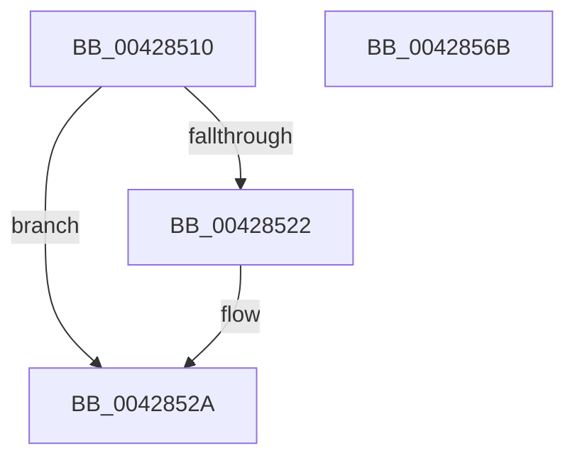

# KeInitializeApc

- RVA: `0x00428510`–`0x0042856C` (길이 `92` bytes)
- VA: `0x0000000140428510`
- 실행 섹션: `.text`
- PDB 이름 있음: `예`; PDB Function 태그: `아니요`
- unwind 정보 RVA: `0x000DB714`
- 디코드: `24`개 명령, `92/92` bytes 표시
- 미해석 바이트: `0` (있으면 어셈블리에 `.byte`로 보존)

> 이 문서는 커널 이미지의 기계어와 PDB 기호를 분석해 생성했습니다. 4번과 5번은 함수 원형과 자료형을 바이너리 사용 방식에서 추정한 C 해석이며 원본 소스 복구 결과는 아닙니다.

## 1. Dependencies

- 직접 호출 지점: **0**; 고유 호출 대상: **0**
- 직접 호출자로 확인된 함수: **18**
- RIP 상대 이미지 참조: **0**

### Outgoing calls
- 직접 디코드된 call 명령이 없습니다.

### Direct callers
- [IopfCompleteRequest](../29/IopfCompleteRequest_function_0029B5F8.md) at `0x0029B9CD`
- [IopfCompleteRequest](../29/IopfCompleteRequest_function_0029B5F8.md) at `0x0029BC59`
- [IopfCompleteRequest](../29/IopfCompleteRequest_function_0029B5F8.md) at `0x0029BCEA`
- [IopCopyCompleteReadIrp](../4E/IopCopyCompleteReadIrp_function_004E83F0.md) at `0x004E857F`
- [IopCopyCompleteReadIrp](../4E/IopCopyCompleteReadIrp_function_004E83F0.md) at `0x004E8630`
- [EtwpCovSampCaptureQueueApc](../65/EtwpCovSampCaptureQueueApc_function_00653CF0.md) at `0x00653E1A`
- [sub_006D6A04](../6D/Unknown_function_006D6A04.md) at `0x006D6A57`
- [DbgkpLkmdLaunchSnapApc](../../page/71/DbgkpLkmdLaunchSnapApc_function_00711844.md) at `0x007118D8`
- [PsUpdateSvmProcessPasidAllThreads](../../page/78/PsUpdateSvmProcessPasidAllThreads_function_00781404.md) at `0x0078153F`
- [PspEnableProcessOptionalXStateFeatures](../../page/78/PspEnableProcessOptionalXStateFeatures_function_00781EF0.md) at `0x00782202`
- [IopCancelIrpsInThreadList](../../page/8C/IopCancelIrpsInThreadList_function_008C9E18.md) at `0x008C9E8C`
- [IopCancelIrpsInThreadList](../../page/8C/IopCancelIrpsInThreadList_function_008C9E18.md) at `0x008C9F0E`
- [PspSetContextThreadInternal](../../page/8D/PspSetContextThreadInternal_function_008D4420.md) at `0x008D46C9`
- [PspGetContextThreadInternal](../../page/8D/PspGetContextThreadInternal_function_008D4770.md) at `0x008D4944`
- [NtNotifyChangeMultipleKeys](../../page/9D/NtNotifyChangeMultipleKeys_function_009DC6B0.md) at `0x009DCB5B`
- [NtQueueApcThreadEx2](../../page/9F/NtQueueApcThreadEx2_function_009FE980.md) at `0x009FEAB2`
- [PerfLogImageUnload](../../page/A2/PerfLogImageUnload_function_00A2216C.md) at `0x00A222FA`
- [ExSwapinWorkerThreads](../../page/A6/ExSwapinWorkerThreads_function_00A68C40.md) at `0x00A68D4C`
- [KeSpecialUserApcKernelRoutine](../../page/AA/KeSpecialUserApcKernelRoutine_function_00AADF90.md) at `0x00AADFE9`
- [sub_00B39158](../../page/B3/Unknown_function_00B39158.md) at `0x00B391F0`
- [sub_00B3E0C2](../../page/B3/Unknown_function_00B3E0C2.md) at `0x00B3E0F8`
- [KeInitThread](../../pagelk/B7/KeInitThread_function_00B78450.md) at `0x00B785A2`
- [KeInitThread](../../pagelk/B7/KeInitThread_function_00B78450.md) at `0x00B787B8`

### Static image references
- 디코드된 RIP-relative 메모리 참조가 없습니다.

## 2. Other-region calls and transfers

- 다른 실행 섹션으로 향하는 call: **0**
- 별도 외부 분기/꼬리 이동을 확인하지 못했습니다.

## 3. Assembly (complete function range)

```asm
00428510  4C 8B 54 24 40                  mov r10, qword ptr [rsp + 0x40]
00428515  C6 01 12                        mov byte ptr [rcx], 0x12
00428518  C6 41 02 58                     mov byte ptr [rcx + 2], 0x58
0042851C  41 83 F8 02                     cmp r8d, 2
00428520  75 08                           jne 0x14042852a
00428522  44 0F B6 82 4A 02 00 00         movzx r8d, byte ptr [rdx + 0x24a]
0042852A  48 8B 44 24 28                  mov rax, qword ptr [rsp + 0x28]
0042852F  44 88 41 50                     mov byte ptr [rcx + 0x50], r8b
00428533  45 33 C0                        xor r8d, r8d
00428536  48 89 41 28                     mov qword ptr [rcx + 0x28], rax
0042853A  0F B6 44 24 38                  movzx eax, byte ptr [rsp + 0x38]
0042853F  48 89 51 08                     mov qword ptr [rcx + 8], rdx
00428543  48 8B 54 24 30                  mov rdx, qword ptr [rsp + 0x30]
00428548  48 85 D2                        test rdx, rdx
0042854B  4C 89 49 20                     mov qword ptr [rcx + 0x20], r9
0042854F  48 89 51 30                     mov qword ptr [rcx + 0x30], rdx
00428553  41 0F 44 C0                     cmove eax, r8d
00428557  4D 0F 44 D0                     cmove r10, r8
0042855B  88 41 51                        mov byte ptr [rcx + 0x51], al
0042855E  4C 89 51 38                     mov qword ptr [rcx + 0x38], r10
00428562  44 88 41 52                     mov byte ptr [rcx + 0x52], r8b
00428566  44 88 41 01                     mov byte ptr [rcx + 1], r8b
0042856A  C3                              ret
0042856B  CC                              int3
```

## 4. C-style interpretation (structured pseudocode)

```c
__int64 __fastcall KeInitializeApc(__int64 a1, __int64 a2, int a3, __int64 a4, __int64 a5, __int64 a6, unsigned __int8 a7, __int64 a8)
{
    *(unsigned __int8 *)(a1) = 18;
    *(unsigned __int8 *)(a1 + 2) = 88;
    if (a3 == 2) {
        a3 = *(unsigned __int8 *)(a2 + 586);
    }
    *(unsigned __int8 *)(a1 + 80) = (unsigned __int8)(a3);
    a3 = 0;
    *(unsigned __int64 *)(a1 + 40) = a5;
    *(unsigned __int64 *)(a1 + 8) = a2;
    *(unsigned __int64 *)(a1 + 32) = a4;
    *(unsigned __int64 *)(a1 + 48) = a6;
    if (a6 == 0) {
        a7 = 0;
        a8 = 0;
    }
    *(unsigned __int8 *)(a1 + 81) = a7;
    *(unsigned __int64 *)(a1 + 56) = a8;
    *(unsigned __int8 *)(a1 + 82) = 0;
    *(unsigned __int8 *)(a1 + 1) = 0;
    return a7;
}
```

## 5. (Beta) C Style

```c
int64_t KeInitializeApc(
    void *Apc,
    void *Thread,
    int Environment,
    void *KernelRoutine,
    void *RundownRoutine,
    void *NormalRoutine,
    uint8_t ApcMode,
    void *NormalContext
)
{
    uint8_t *apc = (uint8_t *)Apc;
    uint8_t *thread = (uint8_t *)Thread;

    // KAPC Header
    *(uint8_t *)(apc + 0x00) = 18; // Type
    *(uint8_t *)(apc + 0x02) = 88; // Size

    // APC Environment
    if (Environment == 2) {
        Environment = *(uint8_t *)(thread + 0x24A);
    }
    *(uint8_t *)(apc + 0x50) = (uint8_t)Environment;

    // APC Routine Configuration
    *(void **)(apc + 0x28) = RundownRoutine;
    *(void **)(apc + 0x08) = Thread;
    *(void **)(apc + 0x20) = KernelRoutine;
    *(void **)(apc + 0x30) = NormalRoutine;

    // Kernel APC
    if (NormalRoutine == NULL) {
        ApcMode = 0;
        NormalContext = NULL;
    }
    *(uint8_t *)(apc + 0x51) = ApcMode;
    *(void **)(apc + 0x38) = NormalContext;

    // Initialize Flags
    *(uint8_t *)(apc + 0x52) = 0; // Inserted
    *(uint8_t *)(apc + 0x01) = 0; // SpareByte0

    return (int64_t)ApcMode;
}
```

### KAPC 구조체와 오프셋 대응

| 오프셋 | KAPC 필드 | 동작 |
|---:|---|---|
| `0x00` | `Type` | `18` 설정 |
| `0x01` | `SpareByte0` | `0` 초기화 |
| `0x02` | `Size` | `88` 설정 |
| `0x08` | `Thread` | KTHREAD 포인터 저장 |
| `0x20` | `KernelRoutine` | 커널 루틴 저장 |
| `0x28` | `RundownRoutine` | 정리 루틴 저장 |
| `0x30` | `NormalRoutine` | 일반 APC 루틴 저장 |
| `0x38` | `NormalContext` | APC 컨텍스트 저장 |
| `0x50` | `ApcStateIndex` | APC 환경 저장 |
| `0x51` | `ApcMode` | 커널/유저 APC 모드 저장 |
| `0x52` | `Inserted` | `FALSE` 초기화 |

`Thread + 0x24A`는 선택된 APC 환경을 읽는 KTHREAD 내 접근입니다.

## 6. Execution-region graph

[열기: 2D/3D 그래프와 함수 탐색 컨트롤 패널](../../../control-panel.html?section=text&rva=0x00428510&view=graph)

- 2D 그래프는 위에서 아래로 흐르고, 3D 그래프는 빈 공간을 드래그해 회전합니다. Shift+드래그는 이동, 휠은 확대·축소, 함수 노드 선택은 대상 보고서 이동입니다.

### Static fallback


