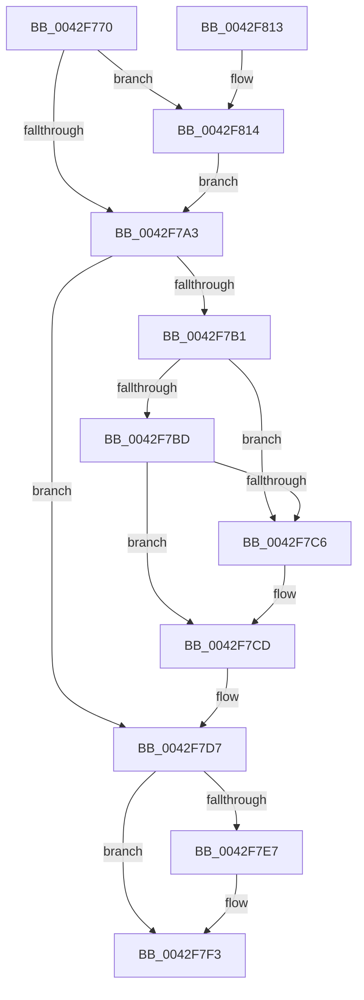

# KeRemoveQueueEntry

- RVA: `0x0042F770`–`0x0042F81E` (길이 `174` bytes)
- VA: `0x000000014042F770`
- 실행 섹션: `.text`
- PDB 이름 있음: `예`; PDB Function 태그: `아니요`
- unwind 정보 RVA: `0x00073808`
- 디코드: `48`개 명령, `174/174` bytes 표시
- 미해석 바이트: `0` (있으면 어셈블리에 `.byte`로 보존)

> 이 문서는 커널 이미지의 기계어와 PDB 기호를 분석해 생성했습니다. 4번과 5번은 함수 원형과 자료형을 바이너리 사용 방식에서 추정한 C 해석이며 원본 소스 복구 결과는 아닙니다.

## 1. Dependencies

- 직접 호출 지점: **3**; 고유 호출 대상: **3**
- 직접 호출자로 확인된 함수: **2**
- RIP 상대 이미지 참조: **1**

### Outgoing calls
- `0x0042F7A6` → [KiAcquireKobjectLockSafe](../25/KiAcquireKobjectLockSafe_function_00251C90.md) (function, `0x00251C90`)
- `0x0042F7EE` → [KiLowerIrqlProcessIrqlFlags](../4F/KiLowerIrqlProcessIrqlFlags_function_004F5698.md) (function, `0x004F5698`)
- `0x0042F817` → [KiRaiseIrqlProcessIrqlFlags](../4F/KiRaiseIrqlProcessIrqlFlags_function_004F56FC.md) (function, `0x004F56FC`)

### Direct callers
- [IopCancelWaitCompletionPacket](IopCancelWaitCompletionPacket_function_0042F614.md) at `0x0042F6CD`
- [IoCancelMiniCompletionPacket](../59/IoCancelMiniCompletionPacket_function_00598150.md) at `0x00598183`

### Static image references
- `0x0042F79A` → RVA `0x00FC6D20` (`ALMOSTRO`; read)

## 2. Other-region calls and transfers

- 다른 실행 섹션으로 향하는 call: **0**
- 별도 외부 분기/꼬리 이동을 확인하지 못했습니다.

## 3. Assembly (complete function range)

```asm
0042F770  48 89 5C 24 08                  mov qword ptr [rsp + 8], rbx
0042F775  48 89 6C 24 10                  mov qword ptr [rsp + 0x10], rbp
0042F77A  48 89 74 24 18                  mov qword ptr [rsp + 0x18], rsi
0042F77F  57                              push rdi
0042F780  48 83 EC 20                     sub rsp, 0x20
0042F784  48 8B FA                        mov rdi, rdx
0042F787  48 8B D9                        mov rbx, rcx
0042F78A  40 32 ED                        xor bpl, bpl
0042F78D  44 0F 20 C6                     mov rsi, cr8
0042F791  BA 02 00 00 00                  mov edx, 2
0042F796  44 0F 22 C2                     mov cr8, rdx
0042F79A  83 3D 7F 75 B9 00 00            cmp dword ptr [rip + 0xb9757f], 0
0042F7A1  75 71                           jne 0x14042f814
0042F7A3  48 8B CB                        mov rcx, rbx
0042F7A6  E8 E5 24 E2 FF                  call 0x140251c90
0042F7AB  48 83 3F 00                     cmp qword ptr [rdi], 0
0042F7AF  74 26                           je 0x14042f7d7
0042F7B1  FF 4B 04                        dec dword ptr [rbx + 4]
0042F7B4  48 8B 0F                        mov rcx, qword ptr [rdi]
0042F7B7  48 39 79 08                     cmp qword ptr [rcx + 8], rdi
0042F7BB  75 09                           jne 0x14042f7c6
0042F7BD  48 8B 47 08                     mov rax, qword ptr [rdi + 8]
0042F7C1  48 39 38                        cmp qword ptr [rax], rdi
0042F7C4  74 07                           je 0x14042f7cd
0042F7C6  B9 03 00 00 00                  mov ecx, 3
0042F7CB  CD 29                           int 0x29
0042F7CD  48 89 08                        mov qword ptr [rax], rcx
0042F7D0  40 B5 01                        mov bpl, 1
0042F7D3  48 89 41 08                     mov qword ptr [rcx + 8], rax
0042F7D7  F0 81 23 7F FF FF FF            lock and dword ptr [rbx], 0xffffff7f
0042F7DE  83 3D 3B 75 B9 00 00            cmp dword ptr [rip + 0xb9753b], 0
0042F7E5  74 0C                           je 0x14042f7f3
0042F7E7  44 0F 20 C1                     mov rcx, cr8
0042F7EB  40 8A D6                        mov dl, sil
0042F7EE  E8 A5 5E 0C 00                  call 0x1404f5698
0042F7F3  40 0F B6 CE                     movzx ecx, sil
0042F7F7  44 0F 22 C1                     mov cr8, rcx
0042F7FB  48 8B 5C 24 30                  mov rbx, qword ptr [rsp + 0x30]
0042F800  40 8A C5                        mov al, bpl
0042F803  48 8B 6C 24 38                  mov rbp, qword ptr [rsp + 0x38]
0042F808  48 8B 74 24 40                  mov rsi, qword ptr [rsp + 0x40]
0042F80D  48 83 C4 20                     add rsp, 0x20
0042F811  5F                              pop rdi
0042F812  C3                              ret
0042F813  CC                              int3
0042F814  40 8A CE                        mov cl, sil
0042F817  E8 E0 5E 0C 00                  call 0x1404f56fc
0042F81C  EB 85                           jmp 0x14042f7a3
```

## 4. C-style interpretation (structured pseudocode)

```c
__int64 __fastcall KeRemoveQueueEntry(__int64 a1, __int64 a2)
{
    __int64 result;
    __int64 v_rbp;
    __int64 v_rsp;
    unsigned __int64 v_stack_p10;
    unsigned __int64 v_stack_p18;
    unsigned __int64 v_stack_p8;

    v_stack_p8 = v_rbx;
    v_stack_p10 = v_rbp;
    v_stack_p18 = v_rsi;
    v_rsp = (v_rsp) - (32);
    v_rbp = 0;
    if ((*(unsigned int *)(v_rip + 12154239)) != 0) goto loc_0042F814;
loc_0042F7A3:
    result = KiAcquireKobjectLockSafe(a1, 2, a3, a4);
    if ((*(unsigned __int64 *)(a2)) == 0) goto loc_0042F7D7;
    if ((*(unsigned __int64 *)(*(unsigned __int64 *)(a2) + 8)) != a2) goto loc_0042F7C6;
    if ((*(unsigned __int64 *)(*(unsigned __int64 *)(a2 + 8))) != a2) {
        a1 = 3;
    }
    *(unsigned __int64 *)(*(unsigned __int64 *)(a2 + 8)) = a1;
    *(unsigned __int64 *)(a1 + 8) = *(unsigned __int64 *)(a2 + 8);
loc_0042F7D7:
    result = *(unsigned __int64 *)(a2 + 8);
    if ((*(unsigned int *)(v_rip + 12154171)) != 0) {
        a1 = 2;
        a2 = (unsigned __int8)(v_cr8);
        result = KiLowerIrqlProcessIrqlFlags(a1, a2, a3, a4);
    }
    v_rsp = (v_rsp) + (32);
    return 1;
loc_0042F814:
    result = KiRaiseIrqlProcessIrqlFlags((unsigned __int8)(v_stack_p18), a2, a3, a4);
    goto loc_0042F7A3;
}
```

## 5. (Beta) C Style

```c
int64_t KeRemoveQueueEntry(void *Arg1, void *Arg2)
{
    uint8_t *arg1 = (uint8_t *)Arg1;
    uint8_t *arg2 = (uint8_t *)Arg2;

    int64_t result;
    int64_t local_rbp;
    int64_t local_rsp;
    uint64_t v_stack_p10;
    uint64_t v_stack_p18;
    uint64_t v_stack_p8;

    v_stack_p8 = local_rbx;
    v_stack_p10 = local_rbp;
    v_stack_p18 = local_rsi;
    local_rsp = (local_rsp) - (32);
    local_rbp = 0;
    if ((*(uint32_t *)(v_rip + 0xB9757F)) != 0) goto loc_0042F814;
loc_0042F7A3:
    result = KiAcquireKobjectLockSafe(Arg1, 2, a3, a4);
    if ((*(uint64_t *)(arg2)) == 0) goto loc_0042F7D7;
    if ((*(uint64_t *)(*(uint64_t *)(arg2) + 0x8)) != Arg2) goto loc_0042F7C6;
    if ((*(uint64_t *)(*(uint64_t *)(arg2 + 0x8))) != Arg2) {
        Arg1 = 3;
    }
    *(void **)(*(uint64_t *)(arg2 + 0x8)) = Arg1;
    *(uint64_t *)(arg1 + 0x8) = *(uint64_t *)(arg2 + 0x8);
loc_0042F7D7:
    result = *(uint64_t *)(arg2 + 0x8);
    if ((*(uint32_t *)(v_rip + 0xB9753B)) != 0) {
        Arg1 = 2;
        Arg2 = (uint8_t)(v_cr8);
        result = KiLowerIrqlProcessIrqlFlags(Arg1, Arg2, a3, a4);
    }
    local_rsp = (local_rsp) + (32);
    return 1;
loc_0042F814:
    result = KiRaiseIrqlProcessIrqlFlags((uint8_t)(v_stack_p18), Arg2, a3, a4);
    goto loc_0042F7A3;
}
```

### 관측된 메모리 오프셋

구조체 형식이 확인되지 않은 접근은 인자 기준의 오프셋으로만 기록했습니다.

| 기준 인자 | 오프셋 표현 | 폭 (bit) | 접근 |
|---|---:|---:|---|
| `Arg1` | `+ 0x0` | `32` | `R/W` |
| `Arg1` | `+ 0x4` | `32` | `R/W` |
| `Arg2` | `+ 0x0` | `64` | `R` |
| `Arg2` | `+ 0x8` | `64` | `R` |

## 6. Execution-region graph

[열기: 2D/3D 그래프와 함수 탐색 컨트롤 패널](../../../control-panel.html?section=text&rva=0x0042F770&view=graph)

- 2D 그래프는 위에서 아래로 흐르고, 3D 그래프는 빈 공간을 드래그해 회전합니다. Shift+드래그는 이동, 휠은 확대·축소, 함수 노드 선택은 대상 보고서 이동입니다.

### Static fallback


