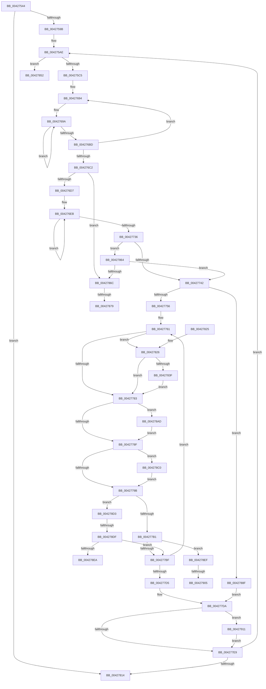

# KiComputeHeteroConfig

- RVA: `0x00427544`–`0x0042791A` (길이 `982` bytes)
- VA: `0x0000000140427544`
- 실행 섹션: `.text`
- PDB 이름 있음: `예`; PDB Function 태그: `예`
- unwind 정보 RVA: `0x000A067C`
- 디코드: `217`개 명령, `982/982` bytes 표시
- 미해석 바이트: `0` (있으면 어셈블리에 `.byte`로 보존)

> 이 문서는 커널 이미지의 기계어와 PDB 기호를 분석해 생성했습니다. 4번과 5번은 함수 원형과 자료형을 바이너리 사용 방식에서 추정한 C 해석이며 원본 소스 복구 결과는 아닙니다.

## 1. Dependencies

- 직접 호출 지점: **13**; 고유 호출 대상: **3**
- 직접 호출자로 확인된 함수: **1**
- RIP 상대 이미지 참조: **3**

### Outgoing calls
- `0x004275DA` → [memset](../6C/memset_function_006C6C40.md) (function, `0x006C6C40`)
- `0x004275FC` → [memset](../6C/memset_function_006C6C40.md) (function, `0x006C6C40`)
- `0x00427617` → [memset](../6C/memset_function_006C6C40.md) (function, `0x006C6C40`)
- `0x00427636` → [memset](../6C/memset_function_006C6C40.md) (function, `0x006C6C40`)
- `0x00427658` → [memset](../6C/memset_function_006C6C40.md) (function, `0x006C6C40`)
- `0x0042767A` → [memset](../6C/memset_function_006C6C40.md) (function, `0x006C6C40`)
- `0x004276A8` → [memset](../6C/memset_function_006C6C40.md) (function, `0x006C6C40`)
- `0x0042782F` → [KeAddProcessorAffinityEx](../25/KeAddProcessorAffinityEx_function_0025B6F0.md) (function, `0x0025B6F0`)
- `0x00427848` → [KeAddProcessorAffinityEx](../25/KeAddProcessorAffinityEx_function_0025B6F0.md) (function, `0x0025B6F0`)
- `0x004278A3` → [KiConfigureHeteroMultiCoreProcessors](../../page/AA/KiConfigureHeteroMultiCoreProcessors_function_00AA7938.md) (function, `0x00AA7938`)
- `0x004278B6` → [KeAddProcessorAffinityEx](../25/KeAddProcessorAffinityEx_function_0025B6F0.md) (function, `0x0025B6F0`)
- `0x004278C9` → [KeAddProcessorAffinityEx](../25/KeAddProcessorAffinityEx_function_0025B6F0.md) (function, `0x0025B6F0`)
- `0x004278F5` → [KeAddProcessorAffinityEx](../25/KeAddProcessorAffinityEx_function_0025B6F0.md) (function, `0x0025B6F0`)

### Direct callers
- [KeConfigureHeteroProcessors](KeConfigureHeteroProcessors_function_00427338.md) at `0x00427372`

### Static image references
- `0x00427563` → RVA `0x00F234D8` (`.data`; read)
- `0x004275AE` → RVA `0x00FC6A80` (`ALMOSTRO`; read)
- `0x004275B8` → RVA `0x00FC6C34` (`ALMOSTRO`; read)

## 2. Other-region calls and transfers

- 다른 실행 섹션으로 향하는 call: **1**
  - `0x004278A3` → [KiConfigureHeteroMultiCoreProcessors](../../page/AA/KiConfigureHeteroMultiCoreProcessors_function_00AA7938.md) (`.text` → `PAGE`)
- call이 아닌 외부 분기/꼬리 이동: **7**
  - `0x0042785F` → [sub_006EDD50](../6E/Unknown_function_006EDD50.md) (`tail-transfer`)
  - `0x00427873` → [sub_006EDD50 + 0x12C](../6E/Unknown_function_006EDD50.md) (`tail-transfer`)
  - `0x0042788A` → [sub_006EDD50 + 0xB7](../6E/Unknown_function_006EDD50.md) (`tail-transfer`)
  - `0x004278D9` → [sub_006EDD50 + 0x78](../6E/Unknown_function_006EDD50.md) (`tail-transfer`)
  - `0x004278EA` → [sub_006EDD50 + 0x78](../6E/Unknown_function_006EDD50.md) (`tail-transfer`)
  - `0x004278FF` → [sub_006EDD50 + 0xAD](../6E/Unknown_function_006EDD50.md) (`tail-transfer`)
  - `0x0042790C` → [sub_006EDD50 + 0xA6](../6E/Unknown_function_006EDD50.md) (`tail-transfer`)

## 3. Assembly (complete function range)

```asm
00427544  4C 89 44 24 18                  mov qword ptr [rsp + 0x18], r8
00427549  89 54 24 10                     mov dword ptr [rsp + 0x10], edx
0042754D  53                              push rbx
0042754E  55                              push rbp
0042754F  56                              push rsi
00427550  57                              push rdi
00427551  41 54                           push r12
00427553  41 55                           push r13
00427555  41 56                           push r14
00427557  41 57                           push r15
00427559  48 83 EC 48                     sub rsp, 0x48
0042755D  8B 41 04                        mov eax, dword ptr [rcx + 4]
00427560  48 8B E9                        mov rbp, rcx
00427563  48 8B 35 6E BF AF 00            mov rsi, qword ptr [rip + 0xafbf6e]
0042756A  83 A4 24 90 00 00 00 00         and dword ptr [rsp + 0x90], 0
00427572  48 89 74 24 30                  mov qword ptr [rsp + 0x30], rsi
00427577  89 84 24 A8 00 00 00            mov dword ptr [rsp + 0xa8], eax
0042757E  83 66 0C 00                     and dword ptr [rsi + 0xc], 0
00427582  83 66 10 00                     and dword ptr [rsi + 0x10], 0
00427586  83 66 14 00                     and dword ptr [rsi + 0x14], 0
0042758A  89 46 18                        mov dword ptr [rsi + 0x18], eax
0042758D  48 89 0E                        mov qword ptr [rsi], rcx
00427590  89 56 08                        mov dword ptr [rsi + 8], edx
00427593  85 C0                           test eax, eax
00427595  0F 84 79 02 00 00               je 0x140427814
0042759B  48 83 64 24 28 00               and qword ptr [rsp + 0x28], 0
004275A1  48 8D BE 38 02 00 00            lea rdi, [rsi + 0x238]
004275A8  41 BD 01 00 00 00               mov r13d, 1
004275AE  8B 05 CC F4 B9 00               mov eax, dword ptr [rip + 0xb9f4cc]
004275B4  89 44 24 20                     mov dword ptr [rsp + 0x20], eax
004275B8  83 3D 75 F6 B9 00 00            cmp dword ptr [rip + 0xb9f675], 0
004275BF  0F 85 8D 02 00 00               jne 0x140427852
004275C5  44 0F B7 87 E8 FD FF FF         movzx r8d, word ptr [rdi - 0x218]
004275CD  48 8D 8F F0 FD FF FF            lea rcx, [rdi - 0x210]
004275D4  49 C1 E0 03                     shl r8, 3
004275D8  33 D2                           xor edx, edx
004275DA  E8 61 F6 29 00                  call 0x1406c6c40
004275DF  66 44 89 AF E8 FD FF FF         mov word ptr [rdi - 0x218], r13w
004275E7  48 8D 8F F8 FE FF FF            lea rcx, [rdi - 0x108]
004275EE  44 0F B7 87 F0 FE FF FF         movzx r8d, word ptr [rdi - 0x110]
004275F6  33 D2                           xor edx, edx
004275F8  49 C1 E0 03                     shl r8, 3
004275FC  E8 3F F6 29 00                  call 0x1406c6c40
00427601  66 44 89 AF F0 FE FF FF         mov word ptr [rdi - 0x110], r13w
00427609  33 D2                           xor edx, edx
0042760B  44 0F B7 47 F8                  movzx r8d, word ptr [rdi - 8]
00427610  48 8B CF                        mov rcx, rdi
00427613  49 C1 E0 03                     shl r8, 3
00427617  E8 24 F6 29 00                  call 0x1406c6c40
0042761C  66 44 89 6F F8                  mov word ptr [rdi - 8], r13w
00427621  48 8D 8F 08 01 00 00            lea rcx, [rdi + 0x108]
00427628  44 0F B7 87 00 01 00 00         movzx r8d, word ptr [rdi + 0x100]
00427630  33 D2                           xor edx, edx
00427632  49 C1 E0 03                     shl r8, 3
00427636  E8 05 F6 29 00                  call 0x1406c6c40
0042763B  66 44 89 AF 00 01 00 00         mov word ptr [rdi + 0x100], r13w
00427643  48 8D 8F 10 02 00 00            lea rcx, [rdi + 0x210]
0042764A  44 0F B7 87 08 02 00 00         movzx r8d, word ptr [rdi + 0x208]
00427652  33 D2                           xor edx, edx
00427654  49 C1 E0 03                     shl r8, 3
00427658  E8 E3 F5 29 00                  call 0x1406c6c40
0042765D  66 44 89 AF 08 02 00 00         mov word ptr [rdi + 0x208], r13w
00427665  48 8D 8F 18 03 00 00            lea rcx, [rdi + 0x318]
0042766C  44 0F B7 87 10 03 00 00         movzx r8d, word ptr [rdi + 0x310]
00427674  33 D2                           xor edx, edx
00427676  49 C1 E0 03                     shl r8, 3
0042767A  E8 C1 F5 29 00                  call 0x1406c6c40
0042767F  66 44 89 AF 10 03 00 00         mov word ptr [rdi + 0x310], r13w
00427687  48 8D 9F 68 2F 00 00            lea rbx, [rdi + 0x2f68]
0042768E  41 BE 07 00 00 00               mov r14d, 7
00427694  41 BF 02 00 00 00               mov r15d, 2
0042769A  44 0F B7 03                     movzx r8d, word ptr [rbx]
0042769E  48 8D 4B 08                     lea rcx, [rbx + 8]
004276A2  49 C1 E0 03                     shl r8, 3
004276A6  33 D2                           xor edx, edx
004276A8  E8 93 F5 29 00                  call 0x1406c6c40
004276AD  66 44 89 2B                     mov word ptr [rbx], r13w
004276B1  48 81 C3 08 01 00 00            add rbx, 0x108
004276B8  4D 2B FD                        sub r15, r13
004276BB  75 DD                           jne 0x14042769a
004276BD  4D 2B F5                        sub r14, r13
004276C0  75 D2                           jne 0x140427694
004276C2  8B 5C 24 20                     mov ebx, dword ptr [rsp + 0x20]
004276C6  45 32 ED                        xor r13b, r13b
004276C9  45 32 E4                        xor r12b, r12b
004276CC  45 33 C9                        xor r9d, r9d
004276CF  85 DB                           test ebx, ebx
004276D1  0F 84 95 01 00 00               je 0x14042786c
004276D7  4C 8B 5D 08                     mov r11, qword ptr [rbp + 8]
004276DB  44 8B 94 24 90 00 00 00         mov r10d, dword ptr [rsp + 0x90]
004276E3  44 8B BC 24 A8 00 00 00         mov r15d, dword ptr [rsp + 0xa8]
004276EB  41 8B C1                        mov eax, r9d
004276EE  45 0F B6 C5                     movzx r8d, r13b
004276F2  41 0F AF C7                     imul eax, r15d
004276F6  41 03 C2                        add eax, r10d
004276F9  8B D0                           mov edx, eax
004276FB  0F B6 4C 85 19                  movzx ecx, byte ptr [rbp + rax*4 + 0x19]
00427700  44 0F B6 6C 95 18               movzx r13d, byte ptr [rbp + rdx*4 + 0x18]
00427706  41 3A CC                        cmp cl, r12b
00427709  41 0F B6 C4                     movzx eax, r12b
0042770D  0F 46 C8                        cmovbe ecx, eax
00427710  45 3A E8                        cmp r13b, r8b
00427713  41 0F B6 C6                     movzx eax, r14b
00427717  44 8A E1                        mov r12b, cl
0042771A  41 0F B6 0B                     movzx ecx, byte ptr [r11]
0042771E  45 0F 46 E8                     cmovbe r13d, r8d
00427722  41 3A CE                        cmp cl, r14b
00427725  0F 47 C1                        cmova eax, ecx
00427728  41 FF C1                        inc r9d
0042772B  49 FF C3                        inc r11
0042772E  44 8A F0                        mov r14b, al
00427731  44 3B CB                        cmp r9d, ebx
00427734  72 B5                           jb 0x1404276eb
00427736  41 8A C5                        mov al, r13b
00427739  45 84 E4                        test r12b, r12b
0042773C  0F 84 22 01 00 00               je 0x140427864
00427742  C7 46 10 01 00 00 00            mov dword ptr [rsi + 0x10], 1
00427749  83 3D E4 F4 B9 00 00            cmp dword ptr [rip + 0xb9f4e4], 0
00427750  0F 85 39 01 00 00               jne 0x14042788f
00427756  48 8B 4C 24 28                  mov rcx, qword ptr [rsp + 0x28]
0042775B  33 DB                           xor ebx, ebx
0042775D  8B 74 24 20                     mov esi, dword ptr [rsp + 0x20]
00427761  48 8B 45 10                     mov rax, qword ptr [rbp + 0x10]
00427765  44 0F AF FB                     imul r15d, ebx
00427769  48 89 84 24 A0 00 00 00         mov qword ptr [rsp + 0xa0], rax
00427771  8A 44 01 01                     mov al, byte ptr [rcx + rax + 1]
00427775  45 03 FA                        add r15d, r10d
00427778  42 38 44 BD 19                  cmp byte ptr [rbp + r15*4 + 0x19], al
0042777D  0F 83 A3 00 00 00               jae 0x140427826
00427783  42 80 7C BD 1B 00               cmp byte ptr [rbp + r15*4 + 0x1b], 0
00427789  0F 84 1E 01 00 00               je 0x1404278ad
0042778F  42 80 7C BD 1A 00               cmp byte ptr [rbp + r15*4 + 0x1a], 0
00427795  0F 84 25 01 00 00               je 0x1404278c0
0042779B  48 8B 84 24 A0 00 00 00         mov rax, qword ptr [rsp + 0xa0]
004277A3  48 8B 4C 24 28                  mov rcx, qword ptr [rsp + 0x28]
004277A8  45 84 F6                        test r14b, r14b
004277AB  0F 84 22 01 00 00               je 0x1404278d3
004277B1  8A 04 01                        mov al, byte ptr [rcx + rax]
004277B4  42 38 44 BD 18                  cmp byte ptr [rbp + r15*4 + 0x18], al
004277B9  0F 83 30 01 00 00               jae 0x1404278ef
004277BF  44 8B 94 24 90 00 00 00         mov r10d, dword ptr [rsp + 0x90]
004277C7  FF C3                           inc ebx
004277C9  44 8B BC 24 A8 00 00 00         mov r15d, dword ptr [rsp + 0xa8]
004277D1  3B DE                           cmp ebx, esi
004277D3  72 8C                           jb 0x140427761
004277D5  48 8B 74 24 30                  mov rsi, qword ptr [rsp + 0x30]
004277DA  41 BD 01 00 00 00               mov r13d, 1
004277E0  45 84 F6                        test r14b, r14b
004277E3  0F 85 28 01 00 00               jne 0x140427911
004277E9  8B 84 24 90 00 00 00            mov eax, dword ptr [rsp + 0x90]
004277F0  48 81 C7 F0 3F 00 00            add rdi, 0x3ff0
004277F7  48 83 44 24 28 02               add qword ptr [rsp + 0x28], 2
004277FD  41 03 C5                        add eax, r13d
00427800  89 84 24 90 00 00 00            mov dword ptr [rsp + 0x90], eax
00427807  3B 84 24 A8 00 00 00            cmp eax, dword ptr [rsp + 0xa8]
0042780E  0F 82 9A FD FF FF               jb 0x1404275ae
00427814  48 83 C4 48                     add rsp, 0x48
00427818  41 5F                           pop r15
0042781A  41 5E                           pop r14
0042781C  41 5D                           pop r13
0042781E  41 5C                           pop r12
00427820  5F                              pop rdi
00427821  5E                              pop rsi
00427822  5D                              pop rbp
00427823  5B                              pop rbx
00427824  C3                              ret
00427825  CC                              int3
00427826  48 8D 8F E8 FD FF FF            lea rcx, [rdi - 0x218]
0042782D  8B D3                           mov edx, ebx
0042782F  E8 BC 3E E3 FF                  call 0x14025b6f0
00427834  46 38 64 BD 19                  cmp byte ptr [rbp + r15*4 + 0x19], r12b
00427839  0F 85 44 FF FF FF               jne 0x140427783
0042783F  48 8D 8F F0 FE FF FF            lea rcx, [rdi - 0x110]
00427846  8B D3                           mov edx, ebx
00427848  E8 A3 3E E3 FF                  call 0x14025b6f0
0042784D  E9 31 FF FF FF                  jmp 0x140427783
00427852  48 8D 9F 90 12 00 00            lea rbx, [rdi + 0x1290]
00427859  41 BE 07 00 00 00               mov r14d, 7
0042785F  E9 EC 64 2C 00                  jmp 0x1406edd50
00427864  84 C0                           test al, al
00427866  0F 85 D6 FE FF FF               jne 0x140427742
0042786C  83 3D C1 F3 B9 00 00            cmp dword ptr [rip + 0xb9f3c1], 0
00427873  0F 84 03 66 2C 00               je 0x1406ede7c
00427879  41 BF 07 00 00 00               mov r15d, 7
0042787F  48 8D 9F FA 20 00 00            lea rbx, [rdi + 0x20fa]
00427886  45 8D 6F FA                     lea r13d, [r15 - 6]
0042788A  E9 78 65 2C 00                  jmp 0x1406ede07
0042788F  45 84 F6                        test r14b, r14b
00427892  48 8D 8F E8 FD FF FF            lea rcx, [rdi - 0x218]
00427899  45 8B C2                        mov r8d, r10d
0042789C  48 8B D5                        mov rdx, rbp
0042789F  41 0F 95 C1                     setne r9b
004278A3  E8 90 00 68 00                  call 0x140aa7938
004278A8  E9 2D FF FF FF                  jmp 0x1404277da
004278AD  48 8D 8F 10 03 00 00            lea rcx, [rdi + 0x310]
004278B4  8B D3                           mov edx, ebx
004278B6  E8 35 3E E3 FF                  call 0x14025b6f0
004278BB  E9 CF FE FF FF                  jmp 0x14042778f
004278C0  48 8D 8F 08 02 00 00            lea rcx, [rdi + 0x208]
004278C7  8B D3                           mov edx, ebx
004278C9  E8 22 3E E3 FF                  call 0x14025b6f0
004278CE  E9 C8 FE FF FF                  jmp 0x14042779b
004278D3  8A 44 01 01                     mov al, byte ptr [rcx + rax + 1]
004278D7  84 C0                           test al, al
004278D9  0F 84 E9 64 2C 00               je 0x1406eddc8
004278DF  42 38 44 BD 19                  cmp byte ptr [rbp + r15*4 + 0x19], al
004278E4  0F 83 D5 FE FF FF               jae 0x1404277bf
004278EA  E9 D9 64 2C 00                  jmp 0x1406eddc8
004278EF  48 8D 4F F8                     lea rcx, [rdi - 8]
004278F3  8B D3                           mov edx, ebx
004278F5  E8 F6 3D E3 FF                  call 0x14025b6f0
004278FA  46 38 6C BD 18                  cmp byte ptr [rbp + r15*4 + 0x18], r13b
004278FF  0F 85 F8 64 2C 00               jne 0x1406eddfd
00427905  48 8D 8F 00 01 00 00            lea rcx, [rdi + 0x100]
0042790C  E9 E5 64 2C 00                  jmp 0x1406eddf6
00427911  44 89 6E 14                     mov dword ptr [rsi + 0x14], r13d
00427915  E9 CF FE FF FF                  jmp 0x1404277e9
```

## 4. C-style interpretation (structured pseudocode)

```c
__int64 __fastcall KiComputeHeteroConfig(__int64 a1, int a2, __int64 a3, int a4)
{
    __int64 result;
    __int64 v_r11;
    __int64 v_r12;
    __int64 v_r13;
    __int64 v_r14;
    __int64 v_r15;
    __int64 v_rbx;
    __int64 v_rdi;
    __int64 v_rsp;
    unsigned __int64 v_stack_m58;
    unsigned __int64 v_stack_m60;
    unsigned int v_stack_m68;
    unsigned int v_stack_p10;
    unsigned __int64 v_stack_p18;
    unsigned int v_stack_p20;
    unsigned int v_stack_p8;

    v_stack_p18 = a3;
    v_stack_p10 = a2;
    v_rsp = (v_rsp) - (72);
    v_stack_m58 = *(unsigned __int64 *)(v_rip + 11517806);
    v_stack_p20 = (unsigned int)((unsigned int)(*(unsigned int *)(a1 + 4)));
    *(unsigned int *)(*(unsigned __int64 *)(v_rip + 11517806) + 24) = (unsigned int)((unsigned int)(*(unsigned int *)(a1 + 4)));
    *(unsigned __int64 *)(*(unsigned __int64 *)(v_rip + 11517806)) = a1;
    *(unsigned int *)(*(unsigned __int64 *)(v_rip + 11517806) + 8) = a2;
    if ((unsigned int)((unsigned int)(*(unsigned int *)(a1 + 4))) == 0) goto loc_00427814;
loc_004275AE:
    v_stack_m68 = (unsigned int)((unsigned int)(*(unsigned int *)(v_rip + 12186828)));
    if ((*(unsigned int *)(v_rip + 12187253)) != 0) goto loc_00427852;
    a3 = (*(unsigned __int16 *)(*(unsigned __int64 *)(v_rip + 11517806) + 568 - 536)) << (3);
    a2 = 0;
    result = memset(*(unsigned __int64 *)(v_rip + 11517806) + 568 - 528, a2, a3, a4);
    *(unsigned __int16 *)(*(unsigned __int64 *)(v_rip + 11517806) + 568 - 536) = 1;
    a2 = 0;
    a3 = (*(unsigned __int16 *)(*(unsigned __int64 *)(v_rip + 11517806) + 568 - 272)) << (3);
    result = memset(*(unsigned __int64 *)(v_rip + 11517806) + 568 - 264, a2, a3, a4);
    *(unsigned __int16 *)(*(unsigned __int64 *)(v_rip + 11517806) + 568 - 272) = 1;
    a2 = 0;
    a3 = (*(unsigned __int16 *)(*(unsigned __int64 *)(v_rip + 11517806) + 568 - 8)) << (3);
    result = memset(*(unsigned __int64 *)(v_rip + 11517806) + 568, a2, a3, a4);
    *(unsigned __int16 *)(*(unsigned __int64 *)(v_rip + 11517806) + 568 - 8) = 1;
    a2 = 0;
    a3 = (*(unsigned __int16 *)(*(unsigned __int64 *)(v_rip + 11517806) + 568 + 256)) << (3);
    result = memset(*(unsigned __int64 *)(v_rip + 11517806) + 568 + 264, a2, a3, a4);
    *(unsigned __int16 *)(*(unsigned __int64 *)(v_rip + 11517806) + 568 + 256) = 1;
    a2 = 0;
    a3 = (*(unsigned __int16 *)(*(unsigned __int64 *)(v_rip + 11517806) + 568 + 520)) << (3);
    result = memset(*(unsigned __int64 *)(v_rip + 11517806) + 568 + 528, a2, a3, a4);
    *(unsigned __int16 *)(*(unsigned __int64 *)(v_rip + 11517806) + 568 + 520) = 1;
    a2 = 0;
    a3 = (*(unsigned __int16 *)(*(unsigned __int64 *)(v_rip + 11517806) + 568 + 784)) << (3);
    result = memset(*(unsigned __int64 *)(v_rip + 11517806) + 568 + 792, a2, a3, a4);
    *(unsigned __int16 *)(*(unsigned __int64 *)(v_rip + 11517806) + 568 + 784) = 1;
loc_00427694:
loc_0042769A:
    a3 = (*(unsigned __int16 *)(*(unsigned __int64 *)(v_rip + 11517806) + 568 + 12136)) << (3);
    a2 = 0;
    result = memset(*(unsigned __int64 *)(v_rip + 11517806) + 568 + 12136 + 8, a2, a3, a4);
    *(unsigned __int16 *)(*(unsigned __int64 *)(v_rip + 11517806) + 568 + 12136) = 1;
    v_rbx = (*(unsigned __int64 *)(v_rip + 11517806) + 568 + 12136) + (264);
    v_r15 = (2) - (1);
    if (condition_is_not_equal) goto loc_0042769A;
    v_r14 = (7) - (1);
    if (condition_is_not_equal) goto loc_00427694;
    v_r13 = 0;
    v_r12 = 0;
    a4 = 0;
    if ((unsigned int)((unsigned int)(v_stack_m68)) == 0) goto loc_0042786C;
loc_004276EB:
    result = (unsigned int)((0) * ((unsigned int)((unsigned int)(v_stack_p20))));
    result = (unsigned int)((result) + ((unsigned int)((unsigned int)(v_stack_p8))));
    a1 = *(unsigned __int8 *)(a1 + result * 4 + 25);
    if (((unsigned __int8)(*(unsigned __int8 *)(a1 + result * 4 + 25))) <= 0) { a1 = 0; }
    v_r13 = *(unsigned __int8 *)(a1 + (unsigned int)((unsigned int)(result)) * 4 + 24);
    if (((unsigned __int8)(*(unsigned __int8 *)(a1 + (unsigned int)((unsigned int)(result)) * 4 + 24))) <= 0) { v_r13 = 0; }
    result = (unsigned __int8)(v_r14);
    if (((unsigned __int8)(*(unsigned __int8 *)(*(unsigned __int64 *)(a1 + 8)))) > ((unsigned __int8)(v_r14))) { result = (unsigned int)(*(unsigned __int8 *)(*(unsigned __int64 *)(a1 + 8))); }
    a4 = (unsigned int)((a4) + 1);
    v_r11 = (*(unsigned __int64 *)(a1 + 8)) + 1;
    if (a4 < ((unsigned int)((unsigned int)(v_stack_m68)))) goto loc_004276EB;
    if ((unsigned __int8)((unsigned __int8)(a1)) == 0) goto loc_00427864;
loc_00427742:
    *(unsigned int *)(*(unsigned __int64 *)(v_rip + 11517806) + 16) = 1;
    if ((*(unsigned int *)(v_rip + 12186852)) != 0) goto loc_0042788F;
    v_rbx = 0;
loc_00427761:
    v_r15 = (unsigned int)(((unsigned int)(v_stack_p20)) * (0));
    v_stack_p18 = *(unsigned __int64 *)(a1 + 16);
    v_r15 = (unsigned int)((v_r15) + ((unsigned int)((unsigned int)(v_stack_p8))));
    if ((*(unsigned __int8 *)(a1 + v_r15 * 4 + 25)) >= ((unsigned __int8)(*(unsigned __int8 *)(v_stack_m60 + *(unsigned __int64 *)(a1 + 16) * 1 + 1)))) goto loc_00427826;
loc_00427783:
    if ((*(unsigned __int8 *)(a1 + v_r15 * 4 + 27)) == 0) goto loc_004278AD;
loc_0042778F:
    if ((*(unsigned __int8 *)(a1 + v_r15 * 4 + 26)) == 0) goto loc_004278C0;
loc_0042779B:
    if ((unsigned __int8)((unsigned __int8)(result)) == 0) goto loc_004278D3;
    if ((*(unsigned __int8 *)(a1 + v_r15 * 4 + 24)) >= ((unsigned __int8)(*(unsigned __int8 *)(v_stack_m60 + v_stack_p18 * 1)))) goto loc_004278EF;
loc_004277BF:
    v_rbx = (unsigned int)((v_rbx) + 1);
    if (((unsigned int)(v_rbx)) < ((unsigned int)((unsigned int)(v_stack_m68)))) goto loc_00427761;
loc_004277DA:
    if ((unsigned __int8)((unsigned __int8)(result)) != 0) goto loc_00427911;
loc_004277E9:
    v_rdi = (*(unsigned __int64 *)(v_rip + 11517806) + 568) + (0x3FF0ULL);
    result = (unsigned int)(((unsigned int)(v_stack_p8)) + (1));
    v_stack_p8 = (unsigned int)(result);
    if (((unsigned int)(result)) < v_stack_p20) goto loc_004275AE;
loc_00427814:
    v_rsp = (v_rsp) + (72);
    return result;
loc_00427826:
    result = KeAddProcessorAffinityEx(v_rdi - 536, (unsigned int)((unsigned int)(v_rbx)), 0, a4);
    if ((*(unsigned __int8 *)(a1 + (unsigned int)(v_stack_p20) * 4 + 25)) != ((unsigned __int8)((unsigned __int8)(a1)))) goto loc_00427783;
    result = KeAddProcessorAffinityEx(v_rdi - 272, (unsigned int)((unsigned int)(v_rbx)), 0, a4);
    goto loc_00427783;
loc_00427852:
loc_00427864:
    if ((unsigned __int8)(result) != 0) goto loc_00427742;
loc_0042786C:
loc_0042788F:
    a4 = (7 != 0) ? 1 : 0;
    result = KiConfigureHeteroMultiCoreProcessors(v_rdi - 536, a1, (unsigned int)((unsigned int)((unsigned int)(v_stack_p8))), a4);
    goto loc_004277DA;
loc_004278AD:
    result = KeAddProcessorAffinityEx(v_rdi + 784, (unsigned int)((unsigned int)(v_rdi + 8442)), (unsigned int)((unsigned int)((unsigned int)(v_stack_p8))), a4);
    goto loc_0042778F;
loc_004278C0:
    result = KeAddProcessorAffinityEx(v_rdi + 520, (unsigned int)((unsigned int)(v_rdi + 8442)), (unsigned int)((unsigned int)((unsigned int)(v_stack_p8))), a4);
    goto loc_0042779B;
loc_004278D3:
    if ((*(unsigned __int8 *)(a1 + 7 * 4 + 25)) >= ((unsigned __int8)(*(unsigned __int8 *)(v_rdi + 520 + result * 1 + 1)))) goto loc_004277BF;
loc_004278EF:
    result = KeAddProcessorAffinityEx(v_rdi - 8, (unsigned int)((unsigned int)(v_rdi + 8442)), (unsigned int)((unsigned int)((unsigned int)(v_stack_p8))), a4);
loc_00427911:
    *(unsigned int *)(v_stack_m58 + 20) = (unsigned int)(7 - 6);
    goto loc_004277E9;
}
```

## 5. (Beta) C Style

```c
int64_t KiComputeHeteroConfig(void *Arg1, int32_t Arg2, int64_t Arg3, int32_t Arg4)
{
    uint8_t *arg1 = (uint8_t *)Arg1;

    int64_t result;
    int64_t local_r11;
    int64_t local_r12;
    int64_t local_r13;
    int64_t local_r14;
    int64_t local_r15;
    int64_t local_rbx;
    int64_t local_rdi;
    int64_t local_rsp;
    uint64_t v_stack_m58;
    uint64_t v_stack_m60;
    uint32_t v_stack_m68;
    uint32_t v_stack_p10;
    uint64_t v_stack_p18;
    uint32_t v_stack_p20;
    uint32_t v_stack_p8;

    v_stack_p18 = Arg3;
    v_stack_p10 = Arg2;
    local_rsp = (local_rsp) - (72);
    v_stack_m58 = *(uint64_t *)(v_rip + 0xAFBF6E);
    v_stack_p20 = (uint32_t)((uint32_t)(*(uint32_t *)(arg1 + 0x4)));
    *(uint32_t *)(*(uint64_t *)(v_rip + 0xAFBF6E) + 0x18) = (uint32_t)((uint32_t)(*(uint32_t *)(arg1 + 0x4)));
    *(void **)(*(uint64_t *)(v_rip + 0xAFBF6E)) = Arg1;
    *(uint32_t *)(*(uint64_t *)(v_rip + 0xAFBF6E) + 0x8) = Arg2;
    if ((uint32_t)((uint32_t)(*(uint32_t *)(arg1 + 0x4))) == 0) goto loc_00427814;
loc_004275AE:
    v_stack_m68 = (uint32_t)((uint32_t)(*(uint32_t *)(v_rip + 0xB9F4CC)));
    if ((*(uint32_t *)(v_rip + 0xB9F675)) != 0) goto loc_00427852;
    Arg3 = (*(uint16_t *)(*(uint64_t *)(v_rip + 0xAFBF6E) + 0x238 - 0x218)) << (3);
    Arg2 = 0;
    result = memset(*(uint64_t *)(v_rip + 0xAFBF6E) + 568 - 528, Arg2, Arg3, Arg4);
    *(uint16_t *)(*(uint64_t *)(v_rip + 0xAFBF6E) + 0x238 - 0x218) = 1;
    Arg2 = 0;
    Arg3 = (*(uint16_t *)(*(uint64_t *)(v_rip + 0xAFBF6E) + 0x238 - 0x110)) << (3);
    result = memset(*(uint64_t *)(v_rip + 0xAFBF6E) + 568 - 264, Arg2, Arg3, Arg4);
    *(uint16_t *)(*(uint64_t *)(v_rip + 0xAFBF6E) + 0x238 - 0x110) = 1;
    Arg2 = 0;
    Arg3 = (*(uint16_t *)(*(uint64_t *)(v_rip + 0xAFBF6E) + 0x238 - 0x8)) << (3);
    result = memset(*(uint64_t *)(v_rip + 0xAFBF6E) + 568, Arg2, Arg3, Arg4);
    *(uint16_t *)(*(uint64_t *)(v_rip + 0xAFBF6E) + 0x238 - 0x8) = 1;
    Arg2 = 0;
    Arg3 = (*(uint16_t *)(*(uint64_t *)(v_rip + 0xAFBF6E) + 0x238 + 0x100)) << (3);
    result = memset(*(uint64_t *)(v_rip + 0xAFBF6E) + 568 + 264, Arg2, Arg3, Arg4);
    *(uint16_t *)(*(uint64_t *)(v_rip + 0xAFBF6E) + 0x238 + 0x100) = 1;
    Arg2 = 0;
    Arg3 = (*(uint16_t *)(*(uint64_t *)(v_rip + 0xAFBF6E) + 0x238 + 0x208)) << (3);
    result = memset(*(uint64_t *)(v_rip + 0xAFBF6E) + 568 + 528, Arg2, Arg3, Arg4);
    *(uint16_t *)(*(uint64_t *)(v_rip + 0xAFBF6E) + 0x238 + 0x208) = 1;
    Arg2 = 0;
    Arg3 = (*(uint16_t *)(*(uint64_t *)(v_rip + 0xAFBF6E) + 0x238 + 0x310)) << (3);
    result = memset(*(uint64_t *)(v_rip + 0xAFBF6E) + 568 + 792, Arg2, Arg3, Arg4);
    *(uint16_t *)(*(uint64_t *)(v_rip + 0xAFBF6E) + 0x238 + 0x310) = 1;
loc_00427694:
loc_0042769A:
    Arg3 = (*(uint16_t *)(*(uint64_t *)(v_rip + 0xAFBF6E) + 0x238 + 0x2F68)) << (3);
    Arg2 = 0;
    result = memset(*(uint64_t *)(v_rip + 0xAFBF6E) + 568 + 12136 + 8, Arg2, Arg3, Arg4);
    *(uint16_t *)(*(uint64_t *)(v_rip + 0xAFBF6E) + 0x238 + 0x2F68) = 1;
    local_rbx = (*(uint64_t *)(v_rip + 0xAFBF6E) + 568 + 12136) + (264);
    local_r15 = (2) - (1);
    if (condition_is_not_equal) goto loc_0042769A;
    local_r14 = (7) - (1);
    if (condition_is_not_equal) goto loc_00427694;
    local_r13 = 0;
    local_r12 = 0;
    Arg4 = 0;
    if ((uint32_t)((uint32_t)(v_stack_m68)) == 0) goto loc_0042786C;
loc_004276EB:
    result = (uint32_t)((0) * ((uint32_t)((uint32_t)(v_stack_p20))));
    result = (uint32_t)((result) + ((uint32_t)((uint32_t)(v_stack_p8))));
    Arg1 = *(uint8_t *)(arg1 + result * 4 + 0x19);
    if (((uint8_t)(*(uint8_t *)(arg1 + result * 4 + 0x19))) <= 0) { Arg1 = 0; }
    local_r13 = *(uint8_t *)(arg1 + (uint32_t)((uint32_t)(result)) * 4 + 0x18);
    if (((uint8_t)(*(uint8_t *)(arg1 + (uint32_t)((uint32_t)(result)) * 4 + 0x18))) <= 0) { local_r13 = 0; }
    result = (uint8_t)(local_r14);
    if (((uint8_t)(*(uint8_t *)(*(uint64_t *)(arg1 + 0x8)))) > ((uint8_t)(local_r14))) { result = (uint32_t)(*(uint8_t *)(*(uint64_t *)(arg1 + 0x8))); }
    Arg4 = (uint32_t)((Arg4) + 1);
    local_r11 = (*(uint64_t *)(arg1 + 0x8)) + 1;
    if (Arg4 < ((uint32_t)((uint32_t)(v_stack_m68)))) goto loc_004276EB;
    if ((uint8_t)((uint8_t)(Arg1)) == 0) goto loc_00427864;
loc_00427742:
    *(uint32_t *)(*(uint64_t *)(v_rip + 0xAFBF6E) + 0x10) = 1;
    if ((*(uint32_t *)(v_rip + 0xB9F4E4)) != 0) goto loc_0042788F;
    local_rbx = 0;
loc_00427761:
    local_r15 = (uint32_t)(((uint32_t)(v_stack_p20)) * (0));
    v_stack_p18 = *(uint64_t *)(arg1 + 0x10);
    local_r15 = (uint32_t)((local_r15) + ((uint32_t)((uint32_t)(v_stack_p8))));
    if ((*(uint8_t *)(arg1 + local_r15 * 4 + 0x19)) >= ((uint8_t)(*(uint8_t *)(v_stack_m60 + *(uint64_t *)(arg1 + 0x10) * 1 + 0x1)))) goto loc_00427826;
loc_00427783:
    if ((*(uint8_t *)(arg1 + local_r15 * 4 + 0x1B)) == 0) goto loc_004278AD;
loc_0042778F:
    if ((*(uint8_t *)(arg1 + local_r15 * 4 + 0x1A)) == 0) goto loc_004278C0;
loc_0042779B:
    if ((uint8_t)((uint8_t)(result)) == 0) goto loc_004278D3;
    if ((*(uint8_t *)(arg1 + local_r15 * 4 + 0x18)) >= ((uint8_t)(*(uint8_t *)(v_stack_m60 + v_stack_p18 * 1)))) goto loc_004278EF;
loc_004277BF:
    local_rbx = (uint32_t)((local_rbx) + 1);
    if (((uint32_t)(local_rbx)) < ((uint32_t)((uint32_t)(v_stack_m68)))) goto loc_00427761;
loc_004277DA:
    if ((uint8_t)((uint8_t)(result)) != 0) goto loc_00427911;
loc_004277E9:
    local_rdi = (*(uint64_t *)(v_rip + 0xAFBF6E) + 568) + (0x3FF0ULL);
    result = (uint32_t)(((uint32_t)(v_stack_p8)) + (1));
    v_stack_p8 = (uint32_t)(result);
    if (((uint32_t)(result)) < v_stack_p20) goto loc_004275AE;
loc_00427814:
    local_rsp = (local_rsp) + (72);
    return result;
loc_00427826:
    result = KeAddProcessorAffinityEx(local_rdi - 536, (uint32_t)((uint32_t)(local_rbx)), 0, Arg4);
    if ((*(uint8_t *)(arg1 + (uint32_t)(v_stack_p20) * 4 + 0x19)) != ((uint8_t)((uint8_t)(Arg1)))) goto loc_00427783;
    result = KeAddProcessorAffinityEx(local_rdi - 272, (uint32_t)((uint32_t)(local_rbx)), 0, Arg4);
    goto loc_00427783;
loc_00427852:
loc_00427864:
    if ((uint8_t)(result) != 0) goto loc_00427742;
loc_0042786C:
loc_0042788F:
    Arg4 = (7 != 0) ? 1 : 0;
    result = KiConfigureHeteroMultiCoreProcessors(local_rdi - 536, Arg1, (uint32_t)((uint32_t)((uint32_t)(v_stack_p8))), Arg4);
    goto loc_004277DA;
loc_004278AD:
    result = KeAddProcessorAffinityEx(local_rdi + 784, (uint32_t)((uint32_t)(local_rdi + 8442)), (uint32_t)((uint32_t)((uint32_t)(v_stack_p8))), Arg4);
    goto loc_0042778F;
loc_004278C0:
    result = KeAddProcessorAffinityEx(local_rdi + 520, (uint32_t)((uint32_t)(local_rdi + 8442)), (uint32_t)((uint32_t)((uint32_t)(v_stack_p8))), Arg4);
    goto loc_0042779B;
loc_004278D3:
    if ((*(uint8_t *)(arg1 + 0x7 * 4 + 0x19)) >= ((uint8_t)(*(uint8_t *)(local_rdi + 0x208 + result * 1 + 0x1)))) goto loc_004277BF;
loc_004278EF:
    result = KeAddProcessorAffinityEx(local_rdi - 8, (uint32_t)((uint32_t)(local_rdi + 8442)), (uint32_t)((uint32_t)((uint32_t)(v_stack_p8))), Arg4);
loc_00427911:
    *(uint32_t *)(v_stack_m58 + 0x14) = (uint32_t)(7 - 6);
    goto loc_004277E9;
}
```

### 관측된 메모리 오프셋

구조체 형식이 확인되지 않은 접근은 인자 기준의 오프셋으로만 기록했습니다.

| 기준 인자 | 오프셋 표현 | 폭 (bit) | 접근 |
|---|---:|---:|---|
| `Arg1` | `+ 0x4` | `32` | `R` |
| `Arg1` | `+ 0x8` | `64` | `R` |
| `Arg1` | `+ 0x10` | `64` | `R` |
| `Arg1` | `+ 0x18 + r15*4` | `8` | `R` |
| `Arg1` | `+ 0x18 + rdx*4` | `8` | `R` |
| `Arg1` | `+ 0x19 + r15*4` | `8` | `R` |
| `Arg1` | `+ 0x19 + rax*4` | `8` | `R` |
| `Arg1` | `+ 0x1A + r15*4` | `8` | `R` |
| `Arg1` | `+ 0x1B + r15*4` | `8` | `R` |

## 6. Execution-region graph

[열기: 2D/3D 그래프와 함수 탐색 컨트롤 패널](../../../control-panel.html?section=text&rva=0x00427544&view=graph)

- 2D 그래프는 위에서 아래로 흐르고, 3D 그래프는 빈 공간을 드래그해 회전합니다. Shift+드래그는 이동, 휠은 확대·축소, 함수 노드 선택은 대상 보고서 이동입니다.

### Static fallback


