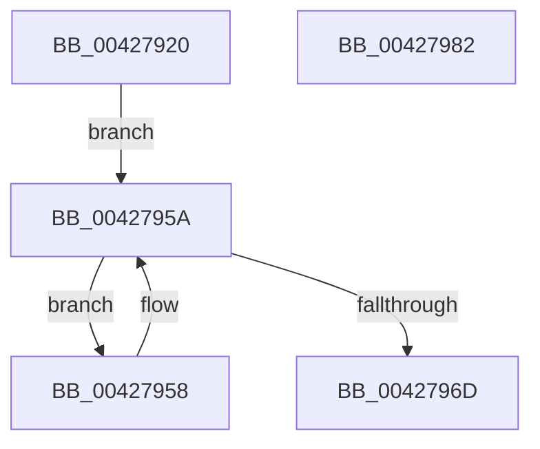

# KiGetNumberOfActiveSubNodes

- RVA: `0x00427920`–`0x00427983` (길이 `99` bytes)
- VA: `0x0000000140427920`
- 실행 섹션: `.text`
- PDB 이름 있음: `예`; PDB Function 태그: `아니요`
- unwind 정보 RVA: `0x000A06A8`
- 디코드: `28`개 명령, `99/99` bytes 표시
- 미해석 바이트: `0` (있으면 어셈블리에 `.byte`로 보존)

> 이 문서는 커널 이미지의 기계어와 PDB 기호를 분석해 생성했습니다. 4번과 5번은 함수 원형과 자료형을 바이너리 사용 방식에서 추정한 C 해석이며 원본 소스 복구 결과는 아닙니다.

## 1. Dependencies

- 직접 호출 지점: **3**; 고유 호출 대상: **3**
- 직접 호출자로 확인된 함수: **2**
- RIP 상대 이미지 참조: **1**

### Outgoing calls
- `0x00427951` → [KiInitializeSystemSubNodeEnumerationContext](KiInitializeSystemSubNodeEnumerationContext_function_0042798C.md) (function, `0x0042798C`)
- `0x00427964` → [KiEnumerateNextSchedulerSubNodeInSystem](../25/KiEnumerateNextSchedulerSubNodeInSystem_function_002569C0.md) (function, `0x002569C0`)
- `0x00427977` → [_security_check_cookie](../6A/_security_check_cookie_function_006AC640.md) (function, `0x006AC640`)

### Direct callers
- [KeConfigureHeteroProcessors](KeConfigureHeteroProcessors_function_00427338.md) at `0x00427398`
- [KeUpdateProcessorRestrictions](../5B/KeUpdateProcessorRestrictions_function_005B6208.md) at `0x005B622F`

### Static image references
- `0x00427926` → RVA `0x00E0A740` (`.data`; read)

## 2. Other-region calls and transfers

- 다른 실행 섹션으로 향하는 call: **0**
- 별도 외부 분기/꼬리 이동을 확인하지 못했습니다.

## 3. Assembly (complete function range)

```asm
00427920  40 53                           push rbx
00427922  48 83 EC 50                     sub rsp, 0x50
00427926  48 8B 05 13 2E 9E 00            mov rax, qword ptr [rip + 0x9e2e13]
0042792D  48 33 C4                        xor rax, rsp
00427930  48 89 44 24 48                  mov qword ptr [rsp + 0x48], rax
00427935  48 83 64 24 20 00               and qword ptr [rsp + 0x20], 0
0042793B  48 8D 4C 24 28                  lea rcx, [rsp + 0x28]
00427940  0F 57 C0                        xorps xmm0, xmm0
00427943  33 DB                           xor ebx, ebx
00427945  33 D2                           xor edx, edx
00427947  0F 11 44 24 28                  movups xmmword ptr [rsp + 0x28], xmm0
0042794C  0F 11 44 24 38                  movups xmmword ptr [rsp + 0x38], xmm0
00427951  E8 36 00 00 00                  call 0x14042798c
00427956  EB 02                           jmp 0x14042795a
00427958  FF C3                           inc ebx
0042795A  48 8D 54 24 20                  lea rdx, [rsp + 0x20]
0042795F  48 8D 4C 24 28                  lea rcx, [rsp + 0x28]
00427964  E8 57 F0 E2 FF                  call 0x1402569c0
00427969  85 C0                           test eax, eax
0042796B  74 EB                           je 0x140427958
0042796D  8B C3                           mov eax, ebx
0042796F  48 8B 4C 24 48                  mov rcx, qword ptr [rsp + 0x48]
00427974  48 33 CC                        xor rcx, rsp
00427977  E8 C4 4C 28 00                  call 0x1406ac640
0042797C  48 83 C4 50                     add rsp, 0x50
00427980  5B                              pop rbx
00427981  C3                              ret
00427982  CC                              int3
```

## 4. C-style interpretation (structured pseudocode)

```c
__int64 __fastcall KiGetNumberOfActiveSubNodes(__int64 a1, int a2)
{
    __int64 result;
    __int64 v_rbx;
    __int64 v_rsp;
    unsigned __int64 v_stack_m10;
    unsigned __int64 v_stack_m20;
    unsigned __int64 v_stack_m30;
    unsigned __int64 v_stack_m38;

    v_rsp = (v_rsp) - (80);
    result = (*(unsigned __int64 *)(v_rip + 10366483)) ^ (v_rsp);
    v_stack_m10 = result;
    v_rbx = 0;
    a2 = 0;
    v_stack_m30 = v_xmm0;
    v_stack_m20 = v_xmm0;
    result = KiInitializeSystemSubNodeEnumerationContext(v_stack_m30, a2, a3, a4);
    goto loc_0042795A;
loc_00427958:
    v_rbx = (unsigned int)((v_rbx) + 1);
loc_0042795A:
    result = KiEnumerateNextSchedulerSubNodeInSystem(v_stack_m30, v_stack_m38, a3, a4);
    if ((unsigned int)(result) == 0) goto loc_00427958;
    a1 = (v_stack_m10) ^ (v_rsp);
    result = _security_check_cookie(a1, v_stack_m38, a3, a4);
    v_rsp = (v_rsp) + (80);
    return result;
}
```

## 5. (Beta) C Style

```c
int64_t KiGetNumberOfActiveSubNodes(int64_t Arg1, int32_t Arg2)
{
    int64_t result;
    int64_t local_rbx;
    int64_t local_rsp;
    uint64_t v_stack_m10;
    uint64_t v_stack_m20;
    uint64_t v_stack_m30;
    uint64_t v_stack_m38;

    local_rsp = (local_rsp) - (80);
    result = (*(uint64_t *)(v_rip + 0x9E2E13)) ^ (local_rsp);
    v_stack_m10 = result;
    local_rbx = 0;
    Arg2 = 0;
    v_stack_m30 = v_xmm0;
    v_stack_m20 = v_xmm0;
    result = KiInitializeSystemSubNodeEnumerationContext(v_stack_m30, Arg2, a3, a4);
    goto loc_0042795A;
loc_00427958:
    local_rbx = (uint32_t)((local_rbx) + 1);
loc_0042795A:
    result = KiEnumerateNextSchedulerSubNodeInSystem(v_stack_m30, v_stack_m38, a3, a4);
    if ((uint32_t)(result) == 0) goto loc_00427958;
    Arg1 = (v_stack_m10) ^ (local_rsp);
    result = _security_check_cookie(Arg1, v_stack_m38, a3, a4);
    local_rsp = (local_rsp) + (80);
    return result;
}
```

## 6. Execution-region graph

[열기: 2D/3D 그래프와 함수 탐색 컨트롤 패널](../../../control-panel.html?section=text&rva=0x00427920&view=graph)

- 2D 그래프는 위에서 아래로 흐르고, 3D 그래프는 빈 공간을 드래그해 회전합니다. Shift+드래그는 이동, 휠은 확대·축소, 함수 노드 선택은 대상 보고서 이동입니다.

### Static fallback


