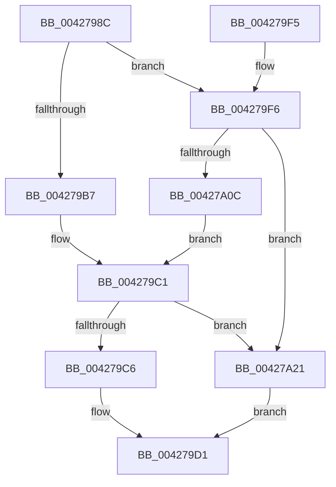

# KiInitializeSystemSubNodeEnumerationContext

- RVA: `0x0042798C`–`0x00427A29` (길이 `157` bytes)
- VA: `0x000000014042798C`
- 실행 섹션: `.text`
- PDB 이름 있음: `예`; PDB Function 태그: `아니요`
- unwind 정보 RVA: `0x0006D4A0`
- 디코드: `42`개 명령, `157/157` bytes 표시
- 미해석 바이트: `0` (있으면 어셈블리에 `.byte`로 보존)

> 이 문서는 커널 이미지의 기계어와 PDB 기호를 분석해 생성했습니다. 4번과 5번은 함수 원형과 자료형을 바이너리 사용 방식에서 추정한 C 해석이며 원본 소스 복구 결과는 아닙니다.

## 1. Dependencies

- 직접 호출 지점: **1**; 고유 호출 대상: **1**
- 직접 호출자로 확인된 함수: **6**
- RIP 상대 이미지 참조: **3**

### Outgoing calls
- `0x004279EB` → [RtlCopyVolatileMemory](../6B/RtlCopyVolatileMemory_function_006BC9D0.md) (function, `0x006BC9D0`)

### Direct callers
- [KiGetNumberOfActiveSubNodes](KiGetNumberOfActiveSubNodes_function_00427920.md) at `0x00427951`
- [KiRemoveForceParkedProcessorsFromAffinity](KiRemoveForceParkedProcessorsFromAffinity_function_00427F70.md) at `0x00427FB7`
- [KiConfigureCooperativeIdleSearchContextTargets](../5B/KiConfigureCooperativeIdleSearchContextTargets_function_005B78D8.md) at `0x005B7979`
- [KiGetNextClockOwner](../5B/KiGetNextClockOwner_function_005BB5D4.md) at `0x005BB6D3`
- [sub_006D831E](../6D/Unknown_function_006D831E.md) at `0x006D8B6B`
- [sub_006EDD32](../6E/Unknown_function_006EDD32.md) at `0x006EDD44`

### Static image references
- `0x004279C6` → RVA `0x00FCF6C0` (`CACHEALI`; read)
- `0x004279F6` → RVA `0x00FC5000` (`ALMOSTRO`; read)
- `0x00427A15` → RVA `0x00E2DBD0` (`.data`; read)

## 2. Other-region calls and transfers

- 다른 실행 섹션으로 향하는 call: **0**
- 별도 외부 분기/꼬리 이동을 확인하지 못했습니다.

## 3. Assembly (complete function range)

```asm
0042798C  48 83 EC 28                     sub rsp, 0x28
00427990  45 33 D2                        xor r10d, r10d
00427993  4C 8B C1                        mov r8, rcx
00427996  4C 89 51 08                     mov qword ptr [rcx + 8], r10
0042799A  8B C2                           mov eax, edx
0042799C  4C 89 51 10                     mov qword ptr [rcx + 0x10], r10
004279A0  41 8B D2                        mov edx, r10d
004279A3  4C 89 51 18                     mov qword ptr [rcx + 0x18], r10
004279A7  33 C9                           xor ecx, ecx
004279A9  49 89 08                        mov qword ptr [r8], rcx
004279AC  66 41 89 00                     mov word ptr [r8], ax
004279B0  66 45 39 50 02                  cmp word ptr [r8 + 2], r10w
004279B5  75 3F                           jne 0x1404279f6
004279B7  0F B7 C0                        movzx eax, ax
004279BA  66 41 C7 40 02 01 00            mov word ptr [r8 + 2], 1
004279C1  83 F8 FF                        cmp eax, -1
004279C4  74 5B                           je 0x140427a21
004279C6  48 8D 15 F3 7C BA 00            lea rdx, [rip + 0xba7cf3]
004279CD  48 8B 14 C2                     mov rdx, qword ptr [rdx + rax*8]
004279D1  4D 89 50 10                     mov qword ptr [r8 + 0x10], r10
004279D5  49 8D 48 10                     lea rcx, [r8 + 0x10]
004279D9  4D 89 50 18                     mov qword ptr [r8 + 0x18], r10
004279DD  49 89 50 08                     mov qword ptr [r8 + 8], rdx
004279E1  48 83 C2 10                     add rdx, 0x10
004279E5  41 B8 10 00 00 00               mov r8d, 0x10
004279EB  E8 E0 4F 29 00                  call 0x1406bc9d0
004279F0  48 83 C4 28                     add rsp, 0x28
004279F4  C3                              ret
004279F5  CC                              int3
004279F6  44 0F B7 0D 02 D6 B9 00         movzx r9d, word ptr [rip + 0xb9d602]
004279FE  B9 01 00 00 00                  mov ecx, 1
00427A03  41 89 48 04                     mov dword ptr [r8 + 4], ecx
00427A07  44 3B C9                        cmp r9d, ecx
00427A0A  74 15                           je 0x140427a21
00427A0C  0F B7 C0                        movzx eax, ax
00427A0F  41 0F AF C1                     imul eax, r9d
00427A13  03 C8                           add ecx, eax
00427A15  48 8B 05 B4 61 A0 00            mov rax, qword ptr [rip + 0xa061b4]
00427A1C  8B 04 88                        mov eax, dword ptr [rax + rcx*4]
00427A1F  EB A0                           jmp 0x1404279c1
00427A21  66 41 81 08 FF FF               or word ptr [r8], 0xffff
00427A27  EB A8                           jmp 0x1404279d1
```

## 4. C-style interpretation (structured pseudocode)

```c
__int64 __fastcall KiInitializeSystemSubNodeEnumerationContext(__int64 a1, int a2)
{
    __int64 result;
    __int64 v_r10;
    __int64 v_rsp;

    v_rsp = (v_rsp) - (40);
    v_r10 = 0;
    *(unsigned __int64 *)(a1 + 8) = 0;
    *(unsigned __int64 *)(a1 + 16) = 0;
    *(unsigned __int64 *)(a1 + 24) = 0;
    a1 = 0;
    *(unsigned __int64 *)(a1) = 0;
    *(unsigned __int16 *)(a1) = (unsigned __int16)((unsigned int)(a2));
    if ((*(unsigned __int16 *)(a1 + 2)) != 0) goto loc_004279F6;
    *(unsigned __int16 *)(a1 + 2) = 1;
loc_004279C1:
    if (((unsigned int)((unsigned __int16)((unsigned int)(a2)))) == -1) goto loc_00427A21;
loc_004279D1:
    *(unsigned __int64 *)(a1 + 16) = 0;
    *(unsigned __int64 *)(a1 + 24) = 0;
    *(unsigned __int64 *)(a1 + 8) = *(unsigned __int64 *)(v_rip + 12221683 + (unsigned __int16)((unsigned int)(a2)) * 8);
    a2 = (*(unsigned __int64 *)(v_rip + 12221683 + (unsigned __int16)((unsigned int)(a2)) * 8)) + (16);
    result = RtlCopyVolatileMemory(a1 + 16, a2, 16, a4);
    v_rsp = (v_rsp) + (40);
    return result;
loc_004279F6:
    *(unsigned int *)(16 + 4) = 1;
    if (((unsigned int)(*(unsigned __int16 *)(v_rip + 12178946))) == 1) goto loc_00427A21;
    result = (unsigned int)(((unsigned __int16)(result)) * ((unsigned int)(*(unsigned __int16 *)(v_rip + 12178946))));
    a1 = (unsigned int)((1) + ((unsigned int)(result)));
    goto loc_004279C1;
loc_00427A21:
    goto loc_004279D1;
}
```

## 5. (Beta) C Style

```c
int64_t KiInitializeSystemSubNodeEnumerationContext(void *Arg1, int32_t Arg2)
{
    uint8_t *arg1 = (uint8_t *)Arg1;

    int64_t result;
    int64_t local_r10;
    int64_t local_rsp;

    local_rsp = (local_rsp) - (40);
    local_r10 = 0;
    *(uint64_t *)(arg1 + 0x8) = 0;
    *(uint64_t *)(arg1 + 0x10) = 0;
    *(uint64_t *)(arg1 + 0x18) = 0;
    Arg1 = 0;
    *(uint64_t *)(arg1) = 0;
    *(uint16_t *)(arg1) = (uint16_t)((uint32_t)(Arg2));
    if ((*(uint16_t *)(arg1 + 0x2)) != 0) goto loc_004279F6;
    *(uint16_t *)(arg1 + 0x2) = 1;
loc_004279C1:
    if (((uint32_t)((uint16_t)((uint32_t)(Arg2)))) == -1) goto loc_00427A21;
loc_004279D1:
    *(uint64_t *)(arg1 + 0x10) = 0;
    *(uint64_t *)(arg1 + 0x18) = 0;
    *(uint64_t *)(arg1 + 0x8) = *(uint64_t *)(v_rip + 0xBA7CF3 + (uint16_t)((uint32_t)(Arg2)) * 8);
    Arg2 = (*(uint64_t *)(v_rip + 0xBA7CF3 + (uint16_t)((uint32_t)(Arg2)) * 8)) + (16);
    result = RtlCopyVolatileMemory(Arg1 + 16, Arg2, 16, a4);
    local_rsp = (local_rsp) + (40);
    return result;
loc_004279F6:
    *(uint32_t *)(16 + 0x4) = 1;
    if (((uint32_t)(*(uint16_t *)(v_rip + 0xB9D602))) == 1) goto loc_00427A21;
    result = (uint32_t)(((uint16_t)(result)) * ((uint32_t)(*(uint16_t *)(v_rip + 0xB9D602))));
    Arg1 = (uint32_t)((1) + ((uint32_t)(result)));
    goto loc_004279C1;
loc_00427A21:
    goto loc_004279D1;
}
```

### 관측된 메모리 오프셋

구조체 형식이 확인되지 않은 접근은 인자 기준의 오프셋으로만 기록했습니다.

| 기준 인자 | 오프셋 표현 | 폭 (bit) | 접근 |
|---|---:|---:|---|
| `Arg1` | `+ 0x0` | `16` | `R/W` |
| `Arg1` | `+ 0x0` | `16` | `W` |
| `Arg1` | `+ 0x0` | `64` | `W` |
| `Arg1` | `+ 0x2` | `16` | `R` |
| `Arg1` | `+ 0x2` | `16` | `W` |
| `Arg1` | `+ 0x4` | `32` | `W` |
| `Arg1` | `+ 0x8` | `64` | `W` |
| `Arg1` | `+ 0x10` | `64` | `R` |
| `Arg1` | `+ 0x10` | `64` | `W` |
| `Arg1` | `+ 0x18` | `64` | `W` |

## 6. Execution-region graph

[열기: 2D/3D 그래프와 함수 탐색 컨트롤 패널](../../../control-panel.html?section=text&rva=0x0042798C&view=graph)

- 2D 그래프는 위에서 아래로 흐르고, 3D 그래프는 빈 공간을 드래그해 회전합니다. Shift+드래그는 이동, 휠은 확대·축소, 함수 노드 선택은 대상 보고서 이동입니다.

### Static fallback


