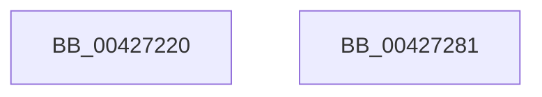

# KiQueryHeteroSetFromSubNode

- RVA: `0x00427220`–`0x00427282` (길이 `98` bytes)
- VA: `0x0000000140427220`
- 실행 섹션: `.text`
- PDB 이름 있음: `예`; PDB Function 태그: `아니요`
- unwind 정보 RVA: `0x0005C788`
- 디코드: `24`개 명령, `98/98` bytes 표시
- 미해석 바이트: `0` (있으면 어셈블리에 `.byte`로 보존)

> 이 문서는 커널 이미지의 기계어와 PDB 기호를 분석해 생성했습니다. 4번과 5번은 함수 원형과 자료형을 바이너리 사용 방식에서 추정한 C 해석이며 원본 소스 복구 결과는 아닙니다.

## 1. Dependencies

- 직접 호출 지점: **0**; 고유 호출 대상: **0**
- 직접 호출자로 확인된 함수: **2**
- RIP 상대 이미지 참조: **0**

### Outgoing calls
- 직접 디코드된 call 명령이 없습니다.

### Direct callers
- [KiTraceLogHeteroRundown](KiTraceLogHeteroRundown_function_004269B4.md) at `0x00426BF8`
- [PpmEventTraceHeteroSets](PpmEventTraceHeteroSets_function_00426DB4.md) at `0x0042701D`

### Static image references
- 디코드된 RIP-relative 메모리 참조가 없습니다.

## 2. Other-region calls and transfers

- 다른 실행 섹션으로 향하는 call: **0**
- 별도 외부 분기/꼬리 이동을 확인하지 못했습니다.

## 3. Assembly (complete function range)

```asm
00427220  48 83 EC 28                     sub rsp, 0x28
00427224  0F B6 81 B9 00 00 00            movzx eax, byte ptr [rcx + 0xb9]
0042722B  45 8D 14 50                     lea r10d, [r8 + rdx*2]
0042722F  44 0F AF D0                     imul r10d, eax
00427233  48 8B 81 C0 00 00 00            mov rax, qword ptr [rcx + 0xc0]
0042723A  45 03 D1                        add r10d, r9d
0042723D  4B 8D 14 52                     lea rdx, [r10 + r10*2]
00427241  4C 8D 04 D0                     lea r8, [rax + rdx*8]
00427245  48 8B 44 D0 10                  mov rax, qword ptr [rax + rdx*8 + 0x10]
0042724A  49 8B 48 08                     mov rcx, qword ptr [r8 + 8]
0042724E  48 23 C8                        and rcx, rax
00427251  48 89 44 24 10                  mov qword ptr [rsp + 0x10], rax
00427256  49 8B 00                        mov rax, qword ptr [r8]
00427259  F2 0F 10 4C 24 10               movsd xmm1, qword ptr [rsp + 0x10]
0042725F  48 23 C1                        and rax, rcx
00427262  48 89 04 24                     mov qword ptr [rsp], rax
00427266  48 8B 44 24 50                  mov rax, qword ptr [rsp + 0x50]
0042726B  48 89 4C 24 08                  mov qword ptr [rsp + 8], rcx
00427270  0F 10 04 24                     movups xmm0, xmmword ptr [rsp]
00427274  0F 11 00                        movups xmmword ptr [rax], xmm0
00427277  F2 0F 11 48 10                  movsd qword ptr [rax + 0x10], xmm1
0042727C  48 83 C4 28                     add rsp, 0x28
00427280  C3                              ret
00427281  CC                              int3
```

## 4. C-style interpretation (structured pseudocode)

```c
__int64 __fastcall KiQueryHeteroSetFromSubNode(__int64 a1, __int64 a2, __int64 a3, int a4, __int64 a5)
{
    __int64 result;
    __int64 v_r10;
    __int64 v_rsp;
    unsigned __int64 v_stack_m18;
    unsigned __int64 v_stack_m20;
    unsigned __int64 v_stack_m28;

    v_rsp = (v_rsp) - (40);
    v_r10 = (unsigned int)((a3 + a2 * 2) * ((unsigned int)(*(unsigned __int8 *)(a1 + 185))));
    v_r10 = (unsigned int)((v_r10) + (a4));
    a1 = (*(unsigned __int64 *)(*(unsigned __int64 *)(a1 + 192) + v_r10 + v_r10 * 2 * 8 + 8)) & (*(unsigned __int64 *)(*(unsigned __int64 *)(a1 + 192) + v_r10 + v_r10 * 2 * 8 + 16));
    v_stack_m18 = *(unsigned __int64 *)(*(unsigned __int64 *)(a1 + 192) + v_r10 + v_r10 * 2 * 8 + 16);
    result = (*(unsigned __int64 *)(*(unsigned __int64 *)(a1 + 192) + v_r10 + v_r10 * 2 * 8)) & (a1);
    v_stack_m28 = result;
    v_stack_m20 = a1;
    *(unsigned __int64 *)(a5) = v_xmm0;
    *(unsigned __int64 *)(a5 + 16) = v_xmm1;
    v_rsp = (v_rsp) + (40);
    return a5;
}
```

## 5. (Beta) C Style

```c
void *KiQueryHeteroSetFromSubNode(void *Arg1, int64_t Arg2, void *Arg3, int32_t Arg4, void *Arg5)
{
    uint8_t *arg1 = (uint8_t *)Arg1;
    uint8_t *arg3 = (uint8_t *)Arg3;
    uint8_t *arg5 = (uint8_t *)Arg5;

    int64_t result;
    int64_t local_r10;
    int64_t local_rsp;
    uint64_t v_stack_m18;
    uint64_t v_stack_m20;
    uint64_t v_stack_m28;

    local_rsp = (local_rsp) - (40);
    local_r10 = (uint32_t)((Arg3 + Arg2 * 2) * ((uint32_t)(*(uint8_t *)(arg1 + 0xB9))));
    local_r10 = (uint32_t)((local_r10) + (Arg4));
    Arg1 = (*(uint64_t *)(*(uint64_t *)(arg1 + 0xC0) + local_r10 + local_r10 * 2 * 8 + 0x8)) & (*(uint64_t *)(*(uint64_t *)(arg1 + 0xC0) + local_r10 + local_r10 * 2 * 8 + 0x10));
    v_stack_m18 = *(uint64_t *)(*(uint64_t *)(arg1 + 0xC0) + local_r10 + local_r10 * 2 * 8 + 0x10);
    result = (*(uint64_t *)(*(uint64_t *)(arg1 + 0xC0) + local_r10 + local_r10 * 2 * 8)) & (Arg1);
    v_stack_m28 = result;
    v_stack_m20 = Arg1;
    *(uint64_t *)(arg5) = v_xmm0;
    *(uint64_t *)(arg5 + 0x10) = v_xmm1;
    local_rsp = (local_rsp) + (40);
    return Arg5;
}
```

### 관측된 메모리 오프셋

구조체 형식이 확인되지 않은 접근은 인자 기준의 오프셋으로만 기록했습니다.

| 기준 인자 | 오프셋 표현 | 폭 (bit) | 접근 |
|---|---:|---:|---|
| `Arg1` | `+ 0xB9` | `8` | `R` |
| `Arg1` | `+ 0xC0` | `64` | `R` |
| `Arg3` | `+ 0x0 + r10*2` | `64` | `R` |
| `Arg3` | `+ 0x0 + rdx*2` | `32` | `R` |
| `Arg5` | `+ 0x0` | `128` | `R` |
| `Arg5` | `+ 0x10` | `64` | `W` |

## 6. Execution-region graph

[열기: 2D/3D 그래프와 함수 탐색 컨트롤 패널](../../../control-panel.html?section=text&rva=0x00427220&view=graph)

- 2D 그래프는 위에서 아래로 흐르고, 3D 그래프는 빈 공간을 드래그해 회전합니다. Shift+드래그는 이동, 휠은 확대·축소, 함수 노드 선택은 대상 보고서 이동입니다.

### Static fallback


