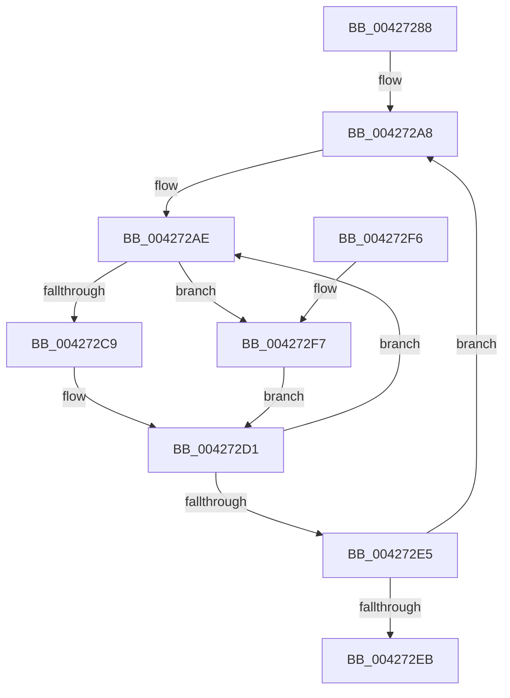

# KiQueryRestrictionAffinity

- RVA: `0x00427288`–`0x004272FB` (길이 `115` bytes)
- VA: `0x0000000140427288`
- 실행 섹션: `.text`
- PDB 이름 있음: `예`; PDB Function 태그: `아니요`
- unwind 정보 RVA: `0x0005FC94`
- 디코드: `28`개 명령, `115/115` bytes 표시
- 미해석 바이트: `0` (있으면 어셈블리에 `.byte`로 보존)

> 이 문서는 커널 이미지의 기계어와 PDB 기호를 분석해 생성했습니다. 4번과 5번은 함수 원형과 자료형을 바이너리 사용 방식에서 추정한 C 해석이며 원본 소스 복구 결과는 아닙니다.

## 1. Dependencies

- 직접 호출 지점: **0**; 고유 호출 대상: **0**
- 직접 호출자로 확인된 함수: **1**
- RIP 상대 이미지 참조: **1**

### Outgoing calls
- 직접 디코드된 call 명령이 없습니다.

### Direct callers
- [PpmEventTraceHeteroSets](PpmEventTraceHeteroSets_function_00426DB4.md) at `0x00426FFF`

### Static image references
- `0x004272AE` → RVA `0x00F234D8` (`.data`; read)

## 2. Other-region calls and transfers

- 다른 실행 섹션으로 향하는 call: **0**
- 별도 외부 분기/꼬리 이동을 확인하지 못했습니다.

## 3. Assembly (complete function range)

```asm
00427288  48 89 5C 24 08                  mov qword ptr [rsp + 8], rbx
0042728D  48 89 7C 24 10                  mov qword ptr [rsp + 0x10], rdi
00427292  45 33 D2                        xor r10d, r10d
00427295  8B C2                           mov eax, edx
00427297  49 8B D8                        mov rbx, r8
0042729A  48 8B F9                        mov rdi, rcx
0042729D  48 69 D0 F0 3F 00 00            imul rdx, rax, 0x3ff0
004272A4  45 8D 5A 07                     lea r11d, [r10 + 7]
004272A8  41 B8 02 00 00 00               mov r8d, 2
004272AE  4C 8B 0D 23 C2 AF 00            mov r9, qword ptr [rip + 0xafc223]
004272B5  0F B7 8F 88 00 00 00            movzx ecx, word ptr [rdi + 0x88]
004272BC  4C 03 CA                        add r9, rdx
004272BF  66 41 3B 89 A0 31 00 00         cmp cx, word ptr [r9 + 0x31a0]
004272C7  73 2E                           jae 0x1404272f7
004272C9  49 8B 8C C9 A8 31 00 00         mov rcx, qword ptr [r9 + rcx*8 + 0x31a8]
004272D1  4A 89 0C D3                     mov qword ptr [rbx + r10*8], rcx
004272D5  48 81 C2 08 01 00 00            add rdx, 0x108
004272DC  41 FF C2                        inc r10d
004272DF  49 83 E8 01                     sub r8, 1
004272E3  75 C9                           jne 0x1404272ae
004272E5  49 83 EB 01                     sub r11, 1
004272E9  75 BD                           jne 0x1404272a8
004272EB  48 8B 5C 24 08                  mov rbx, qword ptr [rsp + 8]
004272F0  48 8B 7C 24 10                  mov rdi, qword ptr [rsp + 0x10]
004272F5  C3                              ret
004272F6  CC                              int3
004272F7  33 C9                           xor ecx, ecx
004272F9  EB D6                           jmp 0x1404272d1
```

## 4. C-style interpretation (structured pseudocode)

```c
__int64 __fastcall KiQueryRestrictionAffinity(__int64 a1, int a2, __int64 a3)
{
    __int64 v_r10;
    __int64 v_r11;
    unsigned __int64 v_stack_p10;
    unsigned __int64 v_stack_p8;

    v_stack_p8 = v_rbx;
    v_stack_p10 = v_rdi;
    v_r10 = 0;
    a2 = (a2) * ((unsigned int)(a2));
loc_004272A8:
loc_004272AE:
    a4 = (*(unsigned __int64 *)(v_rip + 11518499)) + (a2);
    if (((unsigned __int16)(*(unsigned __int16 *)(a1 + 136))) >= (*(unsigned __int16 *)(a4 + 12704))) goto loc_004272F7;
loc_004272D1:
    *(unsigned __int64 *)(a3 + v_r10 * 8) = *(unsigned __int64 *)(a4 + *(unsigned __int16 *)(a1 + 136) * 8 + 12712);
    a2 = (a2) + (264);
    v_r10 = (unsigned int)((v_r10) + 1);
    a3 = (2) - (1);
    if (condition_is_not_equal) goto loc_004272AE;
    v_r11 = (v_r10 + 7) - (1);
    if (condition_is_not_equal) goto loc_004272A8;
    return (unsigned int)(a2);
loc_004272F7:
    a1 = 0;
    goto loc_004272D1;
}
```

## 5. (Beta) C Style

```c
int64_t KiQueryRestrictionAffinity(void *Arg1, int32_t Arg2, void *Arg3)
{
    uint8_t *arg1 = (uint8_t *)Arg1;
    uint8_t *arg3 = (uint8_t *)Arg3;

    int64_t local_r10;
    int64_t local_r11;
    uint64_t v_stack_p10;
    uint64_t v_stack_p8;

    v_stack_p8 = local_rbx;
    v_stack_p10 = local_rdi;
    local_r10 = 0;
    Arg2 = (Arg2) * ((uint32_t)(Arg2));
loc_004272A8:
loc_004272AE:
    a4 = (*(uint64_t *)(v_rip + 0xAFC223)) + (Arg2);
    if (((uint16_t)(*(uint16_t *)(arg1 + 0x88))) >= (*(uint16_t *)(a4 + 0x31A0))) goto loc_004272F7;
loc_004272D1:
    *(uint64_t *)(arg3 + local_r10 * 8) = *(uint64_t *)(a4 + *(uint16_t *)(arg1 + 0x88) * 8 + 0x31A8);
    Arg2 = (Arg2) + (264);
    local_r10 = (uint32_t)((local_r10) + 1);
    Arg3 = (2) - (1);
    if (condition_is_not_equal) goto loc_004272AE;
    local_r11 = (local_r10 + 7) - (1);
    if (condition_is_not_equal) goto loc_004272A8;
    return (uint32_t)(Arg2);
loc_004272F7:
    Arg1 = 0;
    goto loc_004272D1;
}
```

### 관측된 메모리 오프셋

구조체 형식이 확인되지 않은 접근은 인자 기준의 오프셋으로만 기록했습니다.

| 기준 인자 | 오프셋 표현 | 폭 (bit) | 접근 |
|---|---:|---:|---|
| `Arg1` | `+ 0x88` | `16` | `R` |
| `Arg3` | `+ 0x0 + r10*8` | `64` | `W` |

## 6. Execution-region graph

[열기: 2D/3D 그래프와 함수 탐색 컨트롤 패널](../../../control-panel.html?section=text&rva=0x00427288&view=graph)

- 2D 그래프는 위에서 아래로 흐르고, 3D 그래프는 빈 공간을 드래그해 회전합니다. Shift+드래그는 이동, 휠은 확대·축소, 함수 노드 선택은 대상 보고서 이동입니다.

### Static fallback


