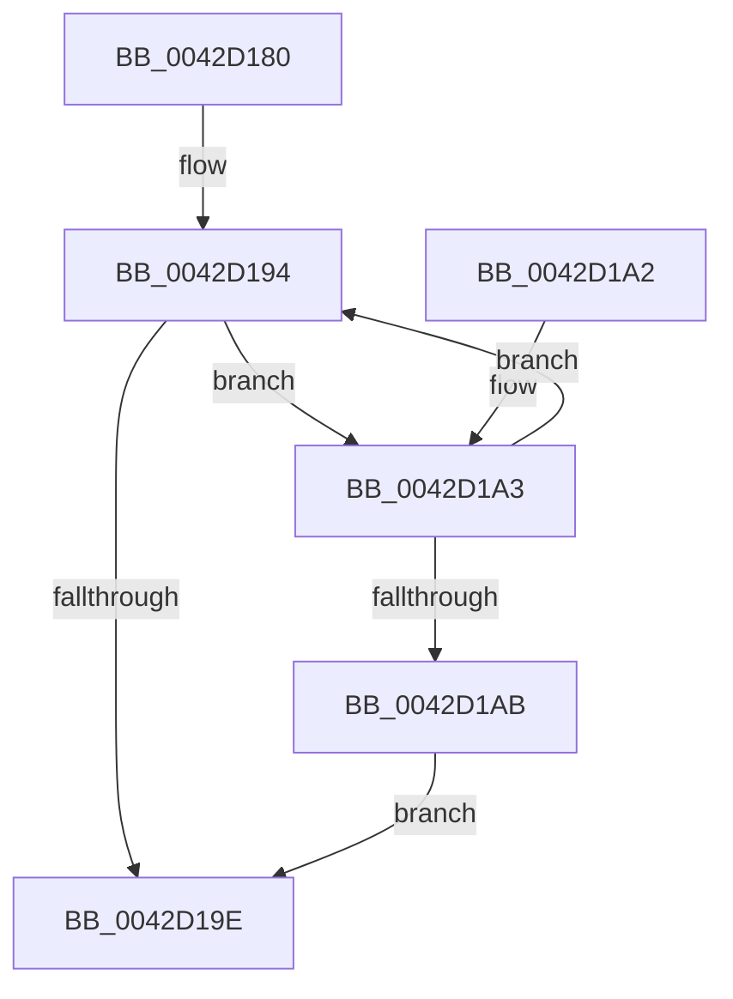

# KiQueryUnbiasedInterruptTime

- RVA: `0x0042D180`–`0x0042D1AD` (길이 `45` bytes)
- VA: `0x000000014042D180`
- 실행 섹션: `.text`
- PDB 이름 있음: `예`; PDB Function 태그: `아니요`
- unwind 정보 RVA: `0x000DB714`
- 디코드: `13`개 명령, `45/45` bytes 표시
- 미해석 바이트: `0` (있으면 어셈블리에 `.byte`로 보존)

> 이 문서는 커널 이미지의 기계어와 PDB 기호를 분석해 생성했습니다. 4번과 5번은 함수 원형과 자료형을 바이너리 사용 방식에서 추정한 C 해석이며 원본 소스 복구 결과는 아닙니다.

## 1. Dependencies

- 직접 호출 지점: **0**; 고유 호출 대상: **0**
- 직접 호출자로 확인된 함수: **27**
- RIP 상대 이미지 참조: **0**

### Outgoing calls
- 직접 디코드된 call 명령이 없습니다.

### Direct callers
- [SMKM_STORE&lt;SM_TRAITS&gt;::SmStDirectReadIssue](../20/SMKM_STORE_SM_TRAITS_SmStDirectReadIssue_function_00203444.md) at `0x002034D5`
- [MiAdjustModifiedPageLoad](../2D/MiAdjustModifiedPageLoad_function_002DC07C.md) at `0x002DC2D4`
- [PopRecordPoIrpBlackboxInformation](../4C/PopRecordPoIrpBlackboxInformation_function_004CE14C.md) at `0x004CE2F5`
- [ST_STORE&lt;SM_TRAITS&gt;::StCompactionPerformEmergency](../4E/ST_STORE_SM_TRAITS_StCompactionPerformEmergency_function_004EB170.md) at `0x004EB1B5`
- [ST_STORE&lt;SM_TRAITS&gt;::StCompactionPerformEmergency](../4E/ST_STORE_SM_TRAITS_StCompactionPerformEmergency_function_004EB170.md) at `0x004EB227`
- [ST_STORE&lt;SM_TRAITS&gt;::StMapAndLockRegion](../4E/ST_STORE_SM_TRAITS_StMapAndLockRegion_function_004EC090.md) at `0x004EC219`
- [ST_STORE&lt;SM_TRAITS&gt;::StDmDeviceError](../60/ST_STORE_SM_TRAITS_StDmDeviceError_function_0060D2C4.md) at `0x0060D384`
- [MiNoPagesLastChance](../68/MiNoPagesLastChance_function_0068B22C.md) at `0x0068B389`
- [sub_006F4DB8](../6F/Unknown_function_006F4DB8.md) at `0x006F4E33`
- [FsRtlpOplockPerfPrepareToSendData](../../page/71/FsRtlpOplockPerfPrepareToSendData_function_0071532C.md) at `0x00715338`
- [FsRtlpOplockPerfSummarizeData](../../page/71/FsRtlpOplockPerfSummarizeData_function_007153DC.md) at `0x007154B1`
- [PopEtEnergyTrackerCreate](../../page/76/PopEtEnergyTrackerCreate_function_00769EE0.md) at `0x0076A08E`
- [sub_007C7FB0](../../page/7C/Unknown_function_007C7FB0.md) at `0x007C82C4`
- [CmpInitializeDelayedCloseTable](../../page/7E/CmpInitializeDelayedCloseTable_function_007EDA34.md) at `0x007EDBF5`
- [MiGenerateSecureCookie](../../page/7F/MiGenerateSecureCookie_function_007FE754.md) at `0x007FE774`
- [HvMarkBaseBlockDirty](../../page/87/HvMarkBaseBlockDirty_function_0087BD04.md) at `0x0087BD1E`
- [PspAllocateProcess](../../page/A1/PspAllocateProcess_function_00A13B3C.md) at `0x00A16346`
- [PopBlackBoxDirectAccess](../../page/AC/PopBlackBoxDirectAccess_function_00ACD824.md) at `0x00ACD90B`
- [PopBatteryWorker](../../page/AE/PopBatteryWorker_function_00AE1650.md) at `0x00AE1DCD`
- [sub_00B2FA58](../../page/B2/Unknown_function_00B2FA58.md) at `0x00B2FA7C`
- [PopBroadcastBlameBugcheckCallback](../../pagelk/B7/PopBroadcastBlameBugcheckCallback_function_00B70B40.md) at `0x00B70BB0`
- [MmVerifierTrimMemory](../../pagevrfy/BB/MmVerifierTrimMemory_function_00BB47E8.md) at `0x00BB482C`
- [MmVerifierTrimMemory](../../pagevrfy/BB/MmVerifierTrimMemory_function_00BB47E8.md) at `0x00BB48A6`
- [FsRtlInitializeOplockPerf](../../init/C2/FsRtlInitializeOplockPerf_function_00C29458.md) at `0x00C29529`
- [PopDiagInitialize](../../init/C3/PopDiagInitialize_function_00C3F2C0.md) at `0x00C3F47B`
- [PspInitPhase2](../../init/C4/PspInitPhase2_function_00C45460.md) at `0x00C454A4`
- [ExpWorkerInitialization](../../init/C5/ExpWorkerInitialization_function_00C539A4.md) at `0x00C53D00`
- [CmpInitializeTransactions](../../init/C5/CmpInitializeTransactions_function_00C5B18C.md) at `0x00C5B330`
- [MiInitializeNonPagedPool](../../init/C6/MiInitializeNonPagedPool_function_00C64A24.md) at `0x00C64A6D`

### Static image references
- 디코드된 RIP-relative 메모리 참조가 없습니다.

## 2. Other-region calls and transfers

- 다른 실행 섹션으로 향하는 call: **0**
- 별도 외부 분기/꼬리 이동을 확인하지 못했습니다.

## 3. Assembly (complete function range)

```asm
0042D180  49 B9 B0 03 00 00 80 F7 FF FF   movabs r9, 0xfffff780000003b0
0042D18A  49 BA 08 00 00 00 80 F7 FF FF   movabs r10, 0xfffff78000000008
0042D194  4D 8B 01                        mov r8, qword ptr [r9]
0042D197  49 8B 02                        mov rax, qword ptr [r10]
0042D19A  84 C9                           test cl, cl
0042D19C  75 05                           jne 0x14042d1a3
0042D19E  49 2B C0                        sub rax, r8
0042D1A1  C3                              ret
0042D1A2  CC                              int3
0042D1A3  49 8B 11                        mov rdx, qword ptr [r9]
0042D1A6  4C 3B C2                        cmp r8, rdx
0042D1A9  75 E9                           jne 0x14042d194
0042D1AB  EB F1                           jmp 0x14042d19e
```

## 4. C-style interpretation (structured pseudocode)

```c
__int64 __fastcall KiQueryUnbiasedInterruptTime(unsigned __int8 a1)
{
    __int64 result;

loc_0042D194:
    if (a1 != 0) goto loc_0042D1A3;
loc_0042D19E:
    result = (*(unsigned __int64 *)(v_r10)) - (*(unsigned __int64 *)(a4));
    return result;
loc_0042D1A3:
    if ((*(unsigned __int64 *)(a4)) != (*(unsigned __int64 *)(a4))) goto loc_0042D194;
    goto loc_0042D19E;
}
```

## 5. (Beta) C Style

```c
int64_t KiQueryUnbiasedInterruptTime(uint8_t Arg1)
{
    int64_t result;

loc_0042D194:
    if (Arg1 != 0) goto loc_0042D1A3;
loc_0042D19E:
    result = (*(uint64_t *)(local_r10)) - (*(uint64_t *)(a4));
    return result;
loc_0042D1A3:
    if ((*(uint64_t *)(a4)) != (*(uint64_t *)(a4))) goto loc_0042D194;
    goto loc_0042D19E;
}
```

## 6. Execution-region graph

[열기: 2D/3D 그래프와 함수 탐색 컨트롤 패널](../../../control-panel.html?section=text&rva=0x0042D180&view=graph)

- 2D 그래프는 위에서 아래로 흐르고, 3D 그래프는 빈 공간을 드래그해 회전합니다. Shift+드래그는 이동, 휠은 확대·축소, 함수 노드 선택은 대상 보고서 이동입니다.

### Static fallback


