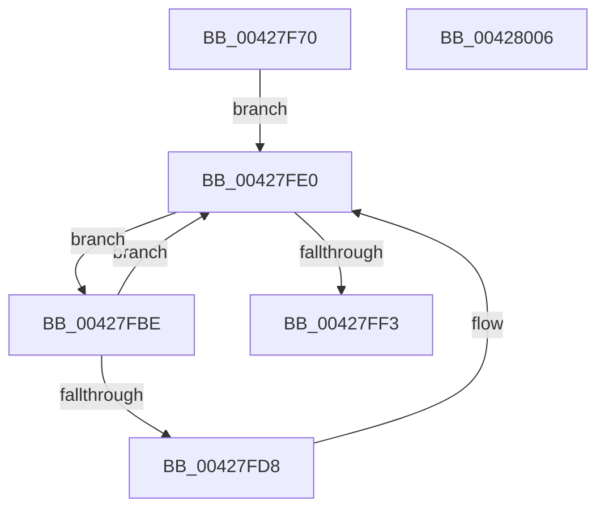

# KiRemoveForceParkedProcessorsFromAffinity

- RVA: `0x00427F70`–`0x00428007` (길이 `151` bytes)
- VA: `0x0000000140427F70`
- 실행 섹션: `.text`
- PDB 이름 있음: `예`; PDB Function 태그: `아니요`
- unwind 정보 RVA: `0x000A06A8`
- 디코드: `36`개 명령, `151/151` bytes 표시
- 미해석 바이트: `0` (있으면 어셈블리에 `.byte`로 보존)

> 이 문서는 커널 이미지의 기계어와 PDB 기호를 분석해 생성했습니다. 4번과 5번은 함수 원형과 자료형을 바이너리 사용 방식에서 추정한 C 해석이며 원본 소스 복구 결과는 아닙니다.

## 1. Dependencies

- 직접 호출 지점: **3**; 고유 호출 대상: **3**
- 직접 호출자로 확인된 함수: **2**
- RIP 상대 이미지 참조: **1**

### Outgoing calls
- `0x00427FB7` → [KiInitializeSystemSubNodeEnumerationContext](KiInitializeSystemSubNodeEnumerationContext_function_0042798C.md) (function, `0x0042798C`)
- `0x00427FEA` → [KiEnumerateNextSchedulerSubNodeInSystem](../25/KiEnumerateNextSchedulerSubNodeInSystem_function_002569C0.md) (function, `0x002569C0`)
- `0x00427FFB` → [_security_check_cookie](../6A/_security_check_cookie_function_006AC640.md) (function, `0x006AC640`)

### Direct callers
- [KiUpdateProcessAvailableCpuState](../3C/KiUpdateProcessAvailableCpuState_function_003C00B4.md) at `0x003C0193`
- [KiUpdateSystemAvailableCpuState](../5B/KiUpdateSystemAvailableCpuState_function_005B9B04.md) at `0x005B9B4F`

### Static image references
- `0x00427F76` → RVA `0x00E0A740` (`.data`; read)

## 2. Other-region calls and transfers

- 다른 실행 섹션으로 향하는 call: **0**
- 별도 외부 분기/꼬리 이동을 확인하지 못했습니다.

## 3. Assembly (complete function range)

```asm
00427F70  40 53                           push rbx
00427F72  48 83 EC 50                     sub rsp, 0x50
00427F76  48 8B 05 C3 27 9E 00            mov rax, qword ptr [rip + 0x9e27c3]
00427F7D  48 33 C4                        xor rax, rsp
00427F80  48 89 44 24 48                  mov qword ptr [rsp + 0x48], rax
00427F85  48 83 64 24 20 00               and qword ptr [rsp + 0x20], 0
00427F8B  0F 57 C0                        xorps xmm0, xmm0
00427F8E  0F 11 44 24 28                  movups xmmword ptr [rsp + 0x28], xmm0
00427F93  48 8B D9                        mov rbx, rcx
00427F96  48 8D 4C 24 28                  lea rcx, [rsp + 0x28]
00427F9B  0F 11 44 24 38                  movups xmmword ptr [rsp + 0x38], xmm0
00427FA0  65 48 8B 04 25 20 00 00 00      mov rax, qword ptr gs:[0x20]
00427FA9  48 8B 90 C0 00 00 00            mov rdx, qword ptr [rax + 0xc0]
00427FB0  0F B7 92 8A 00 00 00            movzx edx, word ptr [rdx + 0x8a]
00427FB7  E8 D0 F9 FF FF                  call 0x14042798c
00427FBC  EB 22                           jmp 0x140427fe0
00427FBE  48 8B 44 24 20                  mov rax, qword ptr [rsp + 0x20]
00427FC3  48 8B 48 68                     mov rcx, qword ptr [rax + 0x68]
00427FC7  48 8B 44 24 20                  mov rax, qword ptr [rsp + 0x20]
00427FCC  0F B7 90 88 00 00 00            movzx edx, word ptr [rax + 0x88]
00427FD3  66 39 13                        cmp word ptr [rbx], dx
00427FD6  76 08                           jbe 0x140427fe0
00427FD8  48 F7 D1                        not rcx
00427FDB  48 21 4C D3 08                  and qword ptr [rbx + rdx*8 + 8], rcx
00427FE0  48 8D 54 24 20                  lea rdx, [rsp + 0x20]
00427FE5  48 8D 4C 24 28                  lea rcx, [rsp + 0x28]
00427FEA  E8 D1 E9 E2 FF                  call 0x1402569c0
00427FEF  85 C0                           test eax, eax
00427FF1  74 CB                           je 0x140427fbe
00427FF3  48 8B 4C 24 48                  mov rcx, qword ptr [rsp + 0x48]
00427FF8  48 33 CC                        xor rcx, rsp
00427FFB  E8 40 46 28 00                  call 0x1406ac640
00428000  48 83 C4 50                     add rsp, 0x50
00428004  5B                              pop rbx
00428005  C3                              ret
00428006  CC                              int3
```

## 4. C-style interpretation (structured pseudocode)

```c
__int64 __fastcall KiRemoveForceParkedProcessorsFromAffinity(__int64 a1)
{
    __int64 result;
    __int64 v_rsp;
    unsigned __int64 v_stack_m10;
    unsigned __int64 v_stack_m20;
    unsigned __int64 v_stack_m30;
    unsigned __int64 v_stack_m38;

    v_rsp = (v_rsp) - (80);
    result = (*(unsigned __int64 *)(v_rip + 10364867)) ^ (v_rsp);
    v_stack_m10 = result;
    v_stack_m30 = v_xmm0;
    v_stack_m20 = v_xmm0;
    result = KiInitializeSystemSubNodeEnumerationContext(v_stack_m30, *(unsigned __int16 *)(*(unsigned __int64 *)(*(unsigned __int64 *)(gs_base + (0 + 32)) + 192) + 138), a3, a4);
    goto loc_00427FE0;
loc_00427FBE:
    if ((*(unsigned __int16 *)(a1)) >= = ((unsigned __int16)(*(unsigned __int16 *)(v_stack_m38 + 136)))) {
        a1 = ~(*(unsigned __int64 *)(v_stack_m38 + 104));
    }
    result = KiEnumerateNextSchedulerSubNodeInSystem(v_stack_m30, v_stack_m38, a3, a4);
    if ((unsigned int)(result) == 0) goto loc_00427FBE;
    a1 = (v_stack_m10) ^ (v_rsp);
    result = _security_check_cookie(a1, v_stack_m38, a3, a4);
    v_rsp = (v_rsp) + (80);
    return result;
}
```

## 5. (Beta) C Style

```c
int64_t KiRemoveForceParkedProcessorsFromAffinity(void *Arg1)
{
    uint8_t *arg1 = (uint8_t *)Arg1;

    int64_t result;
    int64_t local_rsp;
    uint64_t v_stack_m10;
    uint64_t v_stack_m20;
    uint64_t v_stack_m30;
    uint64_t v_stack_m38;

    local_rsp = (local_rsp) - (80);
    result = (*(uint64_t *)(v_rip + 0x9E27C3)) ^ (local_rsp);
    v_stack_m10 = result;
    v_stack_m30 = v_xmm0;
    v_stack_m20 = v_xmm0;
    result = KiInitializeSystemSubNodeEnumerationContext(v_stack_m30, *(uint16_t *)(*(uint64_t *)(*(uint64_t *)(gs_base + (0 + 0x20)) + 0xC0) + 0x8A), a3, a4);
    goto loc_00427FE0;
loc_00427FBE:
    if ((*(uint16_t *)(arg1)) >= = ((uint16_t)(*(uint16_t *)(v_stack_m38 + 0x88)))) {
        Arg1 = ~(*(uint64_t *)(v_stack_m38 + 0x68));
    }
    result = KiEnumerateNextSchedulerSubNodeInSystem(v_stack_m30, v_stack_m38, a3, a4);
    if ((uint32_t)(result) == 0) goto loc_00427FBE;
    Arg1 = (v_stack_m10) ^ (local_rsp);
    result = _security_check_cookie(Arg1, v_stack_m38, a3, a4);
    local_rsp = (local_rsp) + (80);
    return result;
}
```

### 관측된 메모리 오프셋

구조체 형식이 확인되지 않은 접근은 인자 기준의 오프셋으로만 기록했습니다.

| 기준 인자 | 오프셋 표현 | 폭 (bit) | 접근 |
|---|---:|---:|---|
| `Arg1` | `+ 0x0` | `16` | `R` |
| `Arg1` | `+ 0x8 + rdx*8` | `64` | `R/W` |

## 6. Execution-region graph

[열기: 2D/3D 그래프와 함수 탐색 컨트롤 패널](../../../control-panel.html?section=text&rva=0x00427F70&view=graph)

- 2D 그래프는 위에서 아래로 흐르고, 3D 그래프는 빈 공간을 드래그해 회전합니다. Shift+드래그는 이동, 휠은 확대·축소, 함수 노드 선택은 대상 보고서 이동입니다.

### Static fallback


