# KiSelectProcessorToPreempt

- RVA: `0x0042F9E0`–`0x0042FC34` (길이 `596` bytes)
- VA: `0x000000014042F9E0`
- 실행 섹션: `.text`
- PDB 이름 있음: `예`; PDB Function 태그: `아니요`
- unwind 정보 RVA: `0x000A1FB4`
- 디코드: `161`개 명령, `596/596` bytes 표시
- 미해석 바이트: `0` (있으면 어셈블리에 `.byte`로 보존)

> 이 문서는 커널 이미지의 기계어와 PDB 기호를 분석해 생성했습니다. 4번과 5번은 함수 원형과 자료형을 바이너리 사용 방식에서 추정한 C 해석이며 원본 소스 복구 결과는 아닙니다.

## 1. Dependencies

- 직접 호출 지점: **2**; 고유 호출 대상: **2**
- 직접 호출자로 확인된 함수: **1**
- RIP 상대 이미지 참조: **6**

### Outgoing calls
- `0x0042FA5B` → [memcpy](../6C/memcpy_function_006C6840.md) (function, `0x006C6840`)
- `0x0042FADA` → [_security_check_cookie](../6A/_security_check_cookie_function_006AC640.md) (function, `0x006AC640`)

### Direct callers
- [KiChooseTargetProcessor](../25/KiChooseTargetProcessor_function_002556D8.md) at `0x00255A43`

### Static image references
- `0x0042F9FF` → RVA `0x00E0A740` (`.data`; read)
- `0x0042FA60` → RVA `0x00FC6D14` (`ALMOSTRO`; read)
- `0x0042FA98` → RVA `0x00FC6C6C` (`ALMOSTRO`; read)
- `0x0042FAB7` → RVA `0x00F231B8` (`.data`; read)
- `0x0042FAC7` → RVA `0x00FC8C40` (`ALMOSTRO`; read)
- `0x0042FC20` → RVA `0x00FC6D10` (`ALMOSTRO`; read)

## 2. Other-region calls and transfers

- 다른 실행 섹션으로 향하는 call: **0**
- 별도 외부 분기/꼬리 이동을 확인하지 못했습니다.

## 3. Assembly (complete function range)

```asm
0042F9E0  48 89 5C 24 08                  mov qword ptr [rsp + 8], rbx
0042F9E5  48 89 6C 24 18                  mov qword ptr [rsp + 0x18], rbp
0042F9EA  48 89 74 24 20                  mov qword ptr [rsp + 0x20], rsi
0042F9EF  57                              push rdi
0042F9F0  41 54                           push r12
0042F9F2  41 55                           push r13
0042F9F4  41 56                           push r14
0042F9F6  41 57                           push r15
0042F9F8  48 81 EC 80 00 00 00            sub rsp, 0x80
0042F9FF  48 8B 05 3A AD 9D 00            mov rax, qword ptr [rip + 0x9dad3a]
0042FA06  48 33 C4                        xor rax, rsp
0042FA09  48 89 44 24 70                  mov qword ptr [rsp + 0x70], rax
0042FA0E  49 8B E8                        mov rbp, r8
0042FA11  4D 8B F9                        mov r15, r9
0042FA14  48 23 AA 40 8E 00 00            and rbp, qword ptr [rdx + 0x8e40]
0042FA1B  4C 8B EA                        mov r13, rdx
0042FA1E  4C 8B F1                        mov r14, rcx
0042FA21  48 8D 45 FF                     lea rax, [rbp - 1]
0042FA25  48 85 C5                        test rbp, rax
0042FA28  0F 84 2D 01 00 00               je 0x14042fb5b
0042FA2E  48 8B 92 48 8E 00 00            mov rdx, qword ptr [rdx + 0x8e48]
0042FA35  48 8D 74 24 30                  lea rsi, [rsp + 0x30]
0042FA3A  0F B6 BA C1 02 00 00            movzx edi, byte ptr [rdx + 0x2c1]
0042FA41  0F B6 9A C0 02 00 00            movzx ebx, byte ptr [rdx + 0x2c0]
0042FA48  48 03 F7                        add rsi, rdi
0042FA4B  48 8B CE                        mov rcx, rsi
0042FA4E  44 8B C3                        mov r8d, ebx
0042FA51  48 81 C2 40 02 00 00            add rdx, 0x240
0042FA58  44 8B E7                        mov r12d, edi
0042FA5B  E8 E0 6D 29 00                  call 0x1406c6840
0042FA60  8B 0D AE 72 B9 00               mov ecx, dword ptr [rip + 0xb972ae]
0042FA66  44 8D 1C 1F                     lea r11d, [rdi + rbx]
0042FA6A  45 0F B6 86 C3 00 00 00         movzx r8d, byte ptr [r14 + 0xc3]
0042FA72  41 BA FF FF FF FF               mov r10d, 0xffffffff
0042FA78  41 8D 42 02                     lea eax, [r10 + 2]
0042FA7C  F6 C1 02                        test cl, 2
0042FA7F  0F 85 9B 01 00 00               jne 0x14042fc20
0042FA85  41 0F B6 96 04 02 00 00         movzx edx, byte ptr [r14 + 0x204]
0042FA8D  8D 4A FB                        lea ecx, [rdx - 5]
0042FA90  3B C8                           cmp ecx, eax
0042FA92  0F 87 72 01 00 00               ja 0x14042fc0a
0042FA98  83 3D CD 71 B9 00 00            cmp dword ptr [rip + 0xb971cd], 0
0042FA9F  75 60                           jne 0x14042fb01
0042FAA1  4D 85 FF                        test r15, r15
0042FAA4  0F 85 10 01 00 00               jne 0x14042fbba
0042FAAA  45 85 D2                        test r10d, r10d
0042FAAD  78 6A                           js 0x14042fb19
0042FAAF  41 0F B6 8D D0 00 00 00         movzx ecx, byte ptr [r13 + 0xd0]
0042FAB7  48 8B 05 FA 36 AF 00            mov rax, qword ptr [rip + 0xaf36fa]
0042FABE  C1 E1 06                        shl ecx, 6
0042FAC1  41 03 CA                        add ecx, r10d
0042FAC4  8B 04 88                        mov eax, dword ptr [rax + rcx*4]
0042FAC7  48 8D 0D 72 91 B9 00            lea rcx, [rip + 0xb99172]
0042FACE  48 8B 04 C1                     mov rax, qword ptr [rcx + rax*8]
0042FAD2  48 8B 4C 24 70                  mov rcx, qword ptr [rsp + 0x70]
0042FAD7  48 33 CC                        xor rcx, rsp
0042FADA  E8 61 CB 27 00                  call 0x1406ac640
0042FADF  4C 8D 9C 24 80 00 00 00         lea r11, [rsp + 0x80]
0042FAE7  49 8B 5B 30                     mov rbx, qword ptr [r11 + 0x30]
0042FAEB  49 8B 6B 40                     mov rbp, qword ptr [r11 + 0x40]
0042FAEF  49 8B 73 48                     mov rsi, qword ptr [r11 + 0x48]
0042FAF3  49 8B E3                        mov rsp, r11
0042FAF6  41 5F                           pop r15
0042FAF8  41 5E                           pop r14
0042FAFA  41 5D                           pop r13
0042FAFC  41 5C                           pop r12
0042FAFE  5F                              pop rdi
0042FAFF  C3                              ret
0042FB00  CC                              int3
0042FB01  49 8B 8D C0 00 00 00            mov rcx, qword ptr [r13 + 0xc0]
0042FB08  4C 8B A1 48 01 00 00            mov r12, qword ptr [rcx + 0x148]
0042FB0F  4C 85 E5                        test rbp, r12
0042FB12  75 4F                           jne 0x14042fb63
0042FB14  4C 8B E7                        mov r12, rdi
0042FB17  EB 88                           jmp 0x14042faa1
0042FB19  41 3B FB                        cmp edi, r11d
0042FB1C  73 3D                           jae 0x14042fb5b
0042FB1E  49 8B CC                        mov rcx, r12
0042FB21  48 D3 C0                        rol rax, cl
0042FB24  48 85 C5                        test rbp, rax
0042FB27  74 1A                           je 0x14042fb43
0042FB29  44 0F B6 0E                     movzx r9d, byte ptr [rsi]
0042FB2D  41 8B D1                        mov edx, r9d
0042FB30  83 E2 7F                        and edx, 0x7f
0042FB33  41 3A D0                        cmp dl, r8b
0042FB36  7D 0B                           jge 0x14042fb43
0042FB38  45 0F B6 C1                     movzx r8d, r9b
0042FB3C  44 8B D7                        mov r10d, edi
0042FB3F  41 80 E0 7F                     and r8b, 0x7f
0042FB43  FF C7                           inc edi
0042FB45  48 D1 C0                        rol rax, 1
0042FB48  48 FF C6                        inc rsi
0042FB4B  41 8B CA                        mov ecx, r10d
0042FB4E  41 3B FB                        cmp edi, r11d
0042FB51  72 D1                           jb 0x14042fb24
0042FB53  85 C9                           test ecx, ecx
0042FB55  0F 89 54 FF FF FF               jns 0x14042faaf
0042FB5B  49 8B C5                        mov rax, r13
0042FB5E  E9 6F FF FF FF                  jmp 0x14042fad2
0042FB63  8B DF                           mov ebx, edi
0042FB65  41 3B FB                        cmp edi, r11d
0042FB68  73 AA                           jae 0x14042fb14
0042FB6A  48 8B CF                        mov rcx, rdi
0042FB6D  4C 8B C8                        mov r9, rax
0042FB70  49 D3 C1                        rol r9, cl
0042FB73  4C 8B F6                        mov r14, rsi
0042FB76  66 66 0F 1F 84 00 00 00 00 00   nop word ptr [rax + rax]
0042FB80  49 8B C9                        mov rcx, r9
0042FB83  49 23 CC                        and rcx, r12
0042FB86  48 85 CD                        test rbp, rcx
0042FB89  74 1D                           je 0x14042fba8
0042FB8B  41 0F B6 0E                     movzx ecx, byte ptr [r14]
0042FB8F  8B D1                           mov edx, ecx
0042FB91  89 4C 24 20                     mov dword ptr [rsp + 0x20], ecx
0042FB95  83 E2 7F                        and edx, 0x7f
0042FB98  41 3A D0                        cmp dl, r8b
0042FB9B  7D 0B                           jge 0x14042fba8
0042FB9D  44 0F B6 C1                     movzx r8d, cl
0042FBA1  44 8B D3                        mov r10d, ebx
0042FBA4  41 80 E0 7F                     and r8b, 0x7f
0042FBA8  FF C3                           inc ebx
0042FBAA  49 D1 C1                        rol r9, 1
0042FBAD  49 FF C6                        inc r14
0042FBB0  41 3B DB                        cmp ebx, r11d
0042FBB3  72 CB                           jb 0x14042fb80
0042FBB5  E9 5A FF FF FF                  jmp 0x14042fb14
0042FBBA  45 85 D2                        test r10d, r10d
0042FBBD  0F 89 EC FE FF FF               jns 0x14042faaf
0042FBC3  8B DF                           mov ebx, edi
0042FBC5  41 3B FB                        cmp edi, r11d
0042FBC8  73 91                           jae 0x14042fb5b
0042FBCA  49 8B CC                        mov rcx, r12
0042FBCD  4C 8B C8                        mov r9, rax
0042FBD0  49 D3 C1                        rol r9, cl
0042FBD3  4C 8B F6                        mov r14, rsi
0042FBD6  4D 85 CF                        test r15, r9
0042FBD9  74 1A                           je 0x14042fbf5
0042FBDB  45 0F B6 26                     movzx r12d, byte ptr [r14]
0042FBDF  41 8B D4                        mov edx, r12d
0042FBE2  83 E2 7F                        and edx, 0x7f
0042FBE5  41 3A D0                        cmp dl, r8b
0042FBE8  7D 0B                           jge 0x14042fbf5
0042FBEA  45 0F B6 C4                     movzx r8d, r12b
0042FBEE  44 8B D3                        mov r10d, ebx
0042FBF1  41 80 E0 7F                     and r8b, 0x7f
0042FBF5  FF C3                           inc ebx
0042FBF7  49 D1 C1                        rol r9, 1
0042FBFA  49 FF C6                        inc r14
0042FBFD  41 3B DB                        cmp ebx, r11d
0042FC00  72 D4                           jb 0x14042fbd6
0042FC02  4C 8B E7                        mov r12, rdi
0042FC05  E9 A0 FE FF FF                  jmp 0x14042faaa
0042FC0A  83 FA 02                        cmp edx, 2
0042FC0D  0F 84 85 FE FF FF               je 0x14042fa98
0042FC13  3A D0                           cmp dl, al
0042FC15  0F 85 86 FE FF FF               jne 0x14042faa1
0042FC1B  E9 78 FE FF FF                  jmp 0x14042fa98
0042FC20  8B 0D EA 70 B9 00               mov ecx, dword ptr [rip + 0xb970ea]
0042FC26  F6 C1 02                        test cl, 2
0042FC29  0F 84 72 FE FF FF               je 0x14042faa1
0042FC2F  E9 51 FE FF FF                  jmp 0x14042fa85
```

## 4. C-style interpretation (structured pseudocode)

```c
__int64 __fastcall KiSelectProcessorToPreempt(__int64 a1, __int64 a2, __int64 a3, __int64 a4)
{
    __int64 result;
    __int64 v_r10;
    __int64 v_r14;
    __int64 v_rbp;
    __int64 v_rbx;
    __int64 v_rdi;
    __int64 v_rsi;
    __int64 v_rsp;
    unsigned __int64 v_stack_m28;
    unsigned __int64 v_stack_m38;
    unsigned int v_stack_m60;
    unsigned __int64 v_stack_m78;
    unsigned __int64 v_stack_p18;
    unsigned __int64 v_stack_p20;
    unsigned __int64 v_stack_p8;

    v_stack_p8 = v_rbx;
    v_stack_p18 = v_rbp;
    v_stack_p20 = v_rsi;
    v_rsp = (v_rsp) - (128);
    result = (*(unsigned __int64 *)(v_rip + 10333498)) ^ (v_rsp);
    v_stack_m38 = result;
    v_rbp = (a3) & (*(unsigned __int64 *)(a2 + 36416));
    if (((v_rbp) & (v_rbp - 1)) == 0) goto loc_0042FB5B;
    v_rsi = (v_stack_m78) + (*(unsigned __int8 *)(*(unsigned __int64 *)(a2 + 36424) + 705));
    a2 = (*(unsigned __int64 *)(a2 + 36424)) + (576);
    result = memcpy(v_rsi, a2, (unsigned int)((unsigned int)(*(unsigned __int8 *)(*(unsigned __int64 *)(a2 + 36424) + 704))), a4);
    if ((((unsigned __int8)((unsigned int)(*(unsigned int *)(v_rip + 12153518)))) & (2)) != 0) goto loc_0042FC20;
loc_0042FA85:
    if (((unsigned int)(*(unsigned __int8 *)(a1 + 516) - 5)) > ((unsigned int)((unsigned int)(0xFFFFFFFFULL) + 2))) goto loc_0042FC0A;
loc_0042FA98:
    if ((*(unsigned int *)(v_rip + 12153293)) != 0) goto loc_0042FB01;
loc_0042FAA1:
    if (a4 != 0) goto loc_0042FBBA;
loc_0042FAAA:
    if (sign_flag) goto loc_0042FB19;
loc_0042FAAF:
    a1 = (unsigned int)((*(unsigned __int8 *)(a2 + 208)) << (6));
    a1 = (unsigned int)((a1) + ((unsigned int)((unsigned int)(0xFFFFFFFFULL))));
loc_0042FAD2:
    a1 = (v_stack_m38) ^ (v_rsp);
    result = _security_check_cookie(a1, *(unsigned __int8 *)(a1 + 516), *(unsigned __int8 *)(a1 + 195), a4);
    return result;
loc_0042FB01:
    if (((*(unsigned __int64 *)(v_stack_m28 + 64)) & (*(unsigned __int64 *)(*(unsigned __int64 *)(a2 + 192) + 328))) != 0) goto loc_0042FB63;
loc_0042FB14:
    goto loc_0042FAA1;
loc_0042FB19:
    if (((unsigned int)(*(unsigned __int8 *)(*(unsigned __int64 *)(a2 + 36424) + 705))) >= ((unsigned int)(v_stack_m28))) goto loc_0042FB5B;
loc_0042FB24:
    if (((*(unsigned __int64 *)(v_stack_m28 + 64)) & (result)) == 0) goto loc_0042FB43;
    a2 = (unsigned int)(((unsigned int)((unsigned int)(*(unsigned __int8 *)(*(unsigned __int64 *)(v_stack_m28 + 72))))) & (127));
    v_r10 = (unsigned int)(0xFFFFFFFFULL);
    if (((unsigned __int8)(a2)) < ((unsigned __int8)(*(unsigned __int8 *)(a1 + 195)))) {
        a3 = (unsigned __int8)(*(unsigned __int8 *)(*(unsigned __int64 *)(v_stack_m28 + 72)));
        v_r10 = (unsigned int)(*(unsigned __int8 *)(*(unsigned __int64 *)(a2 + 36424) + 705));
        a3 = (unsigned __int8)((a3) & (127));
    }
    v_rdi = (unsigned int)((*(unsigned __int8 *)(*(unsigned __int64 *)(a2 + 36424) + 705)) + 1);
    v_rsi = (*(unsigned __int64 *)(v_stack_m28 + 72)) + 1;
    if (((unsigned int)(v_rdi)) < ((unsigned int)(v_stack_m28))) goto loc_0042FB24;
    if (!sign_flag) goto loc_0042FAAF;
loc_0042FB5B:
    goto loc_0042FAD2;
loc_0042FB63:
    if (((unsigned int)(v_rdi)) >= ((unsigned int)(v_stack_m28))) goto loc_0042FB14;
loc_0042FB80:
    a1 = (a2) & (*(unsigned __int8 *)(*(unsigned __int64 *)(a2 + 36424) + 705));
    if (((*(unsigned __int64 *)(v_stack_m28 + 64)) & (a1)) == 0) goto loc_0042FBA8;
    v_stack_m60 = (unsigned int)(*(unsigned __int8 *)(v_rsi));
    a2 = (unsigned int)(((unsigned int)((unsigned int)(*(unsigned __int8 *)(v_rsi)))) & (127));
    if (((unsigned __int8)(a2)) < ((unsigned __int8)(a3))) {
        a3 = (unsigned __int8)(*(unsigned __int8 *)(v_rsi));
        v_r10 = (unsigned int)((unsigned int)((unsigned int)(v_rdi)));
        a3 = (unsigned __int8)((a3) & (127));
    }
    v_rbx = (unsigned int)(((unsigned int)((unsigned int)(v_rdi))) + 1);
    v_r14 = (v_rsi) + 1;
    if (((unsigned int)(v_rbx)) < ((unsigned int)(v_stack_m28))) goto loc_0042FB80;
    goto loc_0042FB14;
loc_0042FBBA:
    if (!sign_flag) goto loc_0042FAAF;
    if (((unsigned int)(v_rdi)) >= ((unsigned int)(v_stack_m28))) goto loc_0042FB5B;
loc_0042FBD6:
    if (((a4) & (a2)) == 0) goto loc_0042FBF5;
    a2 = (unsigned int)(((unsigned int)((unsigned int)(*(unsigned __int8 *)(v_rsi)))) & (127));
    if (((unsigned __int8)(a2)) < ((unsigned __int8)(a3))) {
        a3 = (unsigned __int8)(*(unsigned __int8 *)(v_rsi));
        v_r10 = (unsigned int)((unsigned int)((unsigned int)(v_rdi)));
        a3 = (unsigned __int8)((a3) & (127));
    }
    v_rbx = (unsigned int)(((unsigned int)((unsigned int)(v_rdi))) + 1);
    v_r14 = (v_rsi) + 1;
    if (((unsigned int)(v_rbx)) < ((unsigned int)(v_stack_m28))) goto loc_0042FBD6;
    goto loc_0042FAAA;
loc_0042FC0A:
    if (((unsigned int)(a2)) == 2) goto loc_0042FA98;
    if (((unsigned __int8)(a2)) != ((unsigned __int8)(a2))) goto loc_0042FAA1;
    goto loc_0042FA98;
loc_0042FC20:
    if ((((unsigned __int8)((unsigned int)(*(unsigned int *)(v_rip + 12153066)))) & (2)) == 0) goto loc_0042FAA1;
    goto loc_0042FA85;
}
```

## 5. (Beta) C Style

```c
int64_t KiSelectProcessorToPreempt(void *Arg1, void *Arg2, void *Arg3, int64_t Arg4)
{
    uint8_t *arg1 = (uint8_t *)Arg1;
    uint8_t *arg2 = (uint8_t *)Arg2;
    uint8_t *arg3 = (uint8_t *)Arg3;

    int64_t result;
    int64_t local_r10;
    int64_t local_r14;
    int64_t local_rbp;
    int64_t local_rbx;
    int64_t local_rdi;
    int64_t local_rsi;
    int64_t local_rsp;
    uint64_t v_stack_m28;
    uint64_t v_stack_m38;
    uint32_t v_stack_m60;
    uint64_t v_stack_m78;
    uint64_t v_stack_p18;
    uint64_t v_stack_p20;
    uint64_t v_stack_p8;

    v_stack_p8 = local_rbx;
    v_stack_p18 = local_rbp;
    v_stack_p20 = local_rsi;
    local_rsp = (local_rsp) - (128);
    result = (*(uint64_t *)(v_rip + 0x9DAD3A)) ^ (local_rsp);
    v_stack_m38 = result;
    local_rbp = (Arg3) & (*(uint64_t *)(arg2 + 0x8E40));
    if (((local_rbp) & (local_rbp - 1)) == 0) goto loc_0042FB5B;
    local_rsi = (v_stack_m78) + (*(uint8_t *)(*(uint64_t *)(arg2 + 0x8E48) + 0x2C1));
    Arg2 = (*(uint64_t *)(arg2 + 0x8E48)) + (576);
    result = memcpy(local_rsi, Arg2, (uint32_t)((uint32_t)(*(uint8_t *)(*(uint64_t *)(arg2 + 0x8E48) + 0x2C0))), Arg4);
    if ((((uint8_t)((uint32_t)(*(uint32_t *)(v_rip + 0xB972AE)))) & (2)) != 0) goto loc_0042FC20;
loc_0042FA85:
    if (((uint32_t)(*(uint8_t *)(arg1 + 0x204) - 5)) > ((uint32_t)((uint32_t)(0xFFFFFFFFULL) + 2))) goto loc_0042FC0A;
loc_0042FA98:
    if ((*(uint32_t *)(v_rip + 0xB971CD)) != 0) goto loc_0042FB01;
loc_0042FAA1:
    if (Arg4 != 0) goto loc_0042FBBA;
loc_0042FAAA:
    if (sign_flag) goto loc_0042FB19;
loc_0042FAAF:
    Arg1 = (uint32_t)((*(uint8_t *)(arg2 + 0xD0)) << (6));
    Arg1 = (uint32_t)((Arg1) + ((uint32_t)((uint32_t)(0xFFFFFFFFULL))));
loc_0042FAD2:
    Arg1 = (v_stack_m38) ^ (local_rsp);
    result = _security_check_cookie(Arg1, *(uint8_t *)(arg1 + 0x204), *(uint8_t *)(arg1 + 0xC3), Arg4);
    return result;
loc_0042FB01:
    if (((*(uint64_t *)(v_stack_m28 + 0x40)) & (*(uint64_t *)(*(uint64_t *)(arg2 + 0xC0) + 0x148))) != 0) goto loc_0042FB63;
loc_0042FB14:
    goto loc_0042FAA1;
loc_0042FB19:
    if (((uint32_t)(*(uint8_t *)(*(uint64_t *)(arg2 + 0x8E48) + 0x2C1))) >= ((uint32_t)(v_stack_m28))) goto loc_0042FB5B;
loc_0042FB24:
    if (((*(uint64_t *)(v_stack_m28 + 0x40)) & (result)) == 0) goto loc_0042FB43;
    Arg2 = (uint32_t)(((uint32_t)((uint32_t)(*(uint8_t *)(*(uint64_t *)(v_stack_m28 + 0x48))))) & (127));
    local_r10 = (uint32_t)(0xFFFFFFFFULL);
    if (((uint8_t)(Arg2)) < ((uint8_t)(*(uint8_t *)(arg1 + 0xC3)))) {
        Arg3 = (uint8_t)(*(uint8_t *)(*(uint64_t *)(v_stack_m28 + 0x48)));
        local_r10 = (uint32_t)(*(uint8_t *)(*(uint64_t *)(arg2 + 0x8E48) + 0x2C1));
        Arg3 = (uint8_t)((Arg3) & (127));
    }
    local_rdi = (uint32_t)((*(uint8_t *)(*(uint64_t *)(arg2 + 0x8E48) + 0x2C1)) + 1);
    local_rsi = (*(uint64_t *)(v_stack_m28 + 0x48)) + 1;
    if (((uint32_t)(local_rdi)) < ((uint32_t)(v_stack_m28))) goto loc_0042FB24;
    if (!sign_flag) goto loc_0042FAAF;
loc_0042FB5B:
    goto loc_0042FAD2;
loc_0042FB63:
    if (((uint32_t)(local_rdi)) >= ((uint32_t)(v_stack_m28))) goto loc_0042FB14;
loc_0042FB80:
    Arg1 = (Arg2) & (*(uint8_t *)(*(uint64_t *)(arg2 + 0x8E48) + 0x2C1));
    if (((*(uint64_t *)(v_stack_m28 + 0x40)) & (Arg1)) == 0) goto loc_0042FBA8;
    v_stack_m60 = (uint32_t)(*(uint8_t *)(local_rsi));
    Arg2 = (uint32_t)(((uint32_t)((uint32_t)(*(uint8_t *)(local_rsi)))) & (127));
    if (((uint8_t)(Arg2)) < ((uint8_t)(Arg3))) {
        Arg3 = (uint8_t)(*(uint8_t *)(local_rsi));
        local_r10 = (uint32_t)((uint32_t)((uint32_t)(local_rdi)));
        Arg3 = (uint8_t)((Arg3) & (127));
    }
    local_rbx = (uint32_t)(((uint32_t)((uint32_t)(local_rdi))) + 1);
    local_r14 = (local_rsi) + 1;
    if (((uint32_t)(local_rbx)) < ((uint32_t)(v_stack_m28))) goto loc_0042FB80;
    goto loc_0042FB14;
loc_0042FBBA:
    if (!sign_flag) goto loc_0042FAAF;
    if (((uint32_t)(local_rdi)) >= ((uint32_t)(v_stack_m28))) goto loc_0042FB5B;
loc_0042FBD6:
    if (((Arg4) & (Arg2)) == 0) goto loc_0042FBF5;
    Arg2 = (uint32_t)(((uint32_t)((uint32_t)(*(uint8_t *)(local_rsi)))) & (127));
    if (((uint8_t)(Arg2)) < ((uint8_t)(Arg3))) {
        Arg3 = (uint8_t)(*(uint8_t *)(local_rsi));
        local_r10 = (uint32_t)((uint32_t)((uint32_t)(local_rdi)));
        Arg3 = (uint8_t)((Arg3) & (127));
    }
    local_rbx = (uint32_t)(((uint32_t)((uint32_t)(local_rdi))) + 1);
    local_r14 = (local_rsi) + 1;
    if (((uint32_t)(local_rbx)) < ((uint32_t)(v_stack_m28))) goto loc_0042FBD6;
    goto loc_0042FAAA;
loc_0042FC0A:
    if (((uint32_t)(Arg2)) == 2) goto loc_0042FA98;
    if (((uint8_t)(Arg2)) != ((uint8_t)(Arg2))) goto loc_0042FAA1;
    goto loc_0042FA98;
loc_0042FC20:
    if ((((uint8_t)((uint32_t)(*(uint32_t *)(v_rip + 0xB970EA)))) & (2)) == 0) goto loc_0042FAA1;
    goto loc_0042FA85;
}
```

### 관측된 메모리 오프셋

구조체 형식이 확인되지 않은 접근은 인자 기준의 오프셋으로만 기록했습니다.

| 기준 인자 | 오프셋 표현 | 폭 (bit) | 접근 |
|---|---:|---:|---|
| `Arg1` | `+ 0xC3` | `8` | `R` |
| `Arg1` | `+ 0x204` | `8` | `R` |
| `Arg2` | `+ 0xC0` | `64` | `R` |
| `Arg2` | `+ 0xD0` | `8` | `R` |
| `Arg2` | `+ 0x8E40` | `64` | `R` |
| `Arg2` | `+ 0x8E48` | `64` | `R` |
| `Arg3` | `- 0x1` | `64` | `R` |

## 6. Execution-region graph

[열기: 2D/3D 그래프와 함수 탐색 컨트롤 패널](../../../control-panel.html?section=text&rva=0x0042F9E0&view=graph)

- 2D 그래프는 위에서 아래로 흐르고, 3D 그래프는 빈 공간을 드래그해 회전합니다. Shift+드래그는 이동, 휠은 확대·축소, 함수 노드 선택은 대상 보고서 이동입니다.

### Static fallback

```mermaid
flowchart TD
  bb_0042F9E0[BB_0042F9E0]
  bb_0042FA2E[BB_0042FA2E]
  bb_0042FA85[BB_0042FA85]
  bb_0042FA98[BB_0042FA98]
  bb_0042FAA1[BB_0042FAA1]
  bb_0042FAAA[BB_0042FAAA]
  bb_0042FAAF[BB_0042FAAF]
  bb_0042FAD2[BB_0042FAD2]
  bb_0042FB00[BB_0042FB00]
  bb_0042FB01[BB_0042FB01]
  bb_0042FB14[BB_0042FB14]
  bb_0042FB19[BB_0042FB19]
  bb_0042FB1E[BB_0042FB1E]
  bb_0042FB24[BB_0042FB24]
  bb_0042FB29[BB_0042FB29]
  bb_0042FB38[BB_0042FB38]
  bb_0042FB43[BB_0042FB43]
  bb_0042FB53[BB_0042FB53]
  bb_0042FB5B[BB_0042FB5B]
  bb_0042FB63[BB_0042FB63]
  bb_0042FB6A[BB_0042FB6A]
  bb_0042FB80[BB_0042FB80]
  bb_0042FB8B[BB_0042FB8B]
  bb_0042FB9D[BB_0042FB9D]
  bb_0042FBA8[BB_0042FBA8]
  bb_0042FBB5[BB_0042FBB5]
  bb_0042FBBA[BB_0042FBBA]
  bb_0042FBC3[BB_0042FBC3]
  bb_0042FBCA[BB_0042FBCA]
  bb_0042FBD6[BB_0042FBD6]
  bb_0042FBDB[BB_0042FBDB]
  bb_0042FBEA[BB_0042FBEA]
  bb_0042FBF5[BB_0042FBF5]
  bb_0042FC02[BB_0042FC02]
  bb_0042FC0A[BB_0042FC0A]
  bb_0042FC13[BB_0042FC13]
  bb_0042FC1B[BB_0042FC1B]
  bb_0042FC20[BB_0042FC20]
  bb_0042FC2F[BB_0042FC2F]
  bb_0042F9E0 -->|branch| bb_0042FB5B
  bb_0042F9E0 -->|fallthrough| bb_0042FA2E
  bb_0042FA2E -->|branch| bb_0042FC20
  bb_0042FA2E -->|fallthrough| bb_0042FA85
  bb_0042FA85 -->|branch| bb_0042FC0A
  bb_0042FA85 -->|fallthrough| bb_0042FA98
  bb_0042FA98 -->|branch| bb_0042FB01
  bb_0042FA98 -->|fallthrough| bb_0042FAA1
  bb_0042FAA1 -->|branch| bb_0042FBBA
  bb_0042FAA1 -->|fallthrough| bb_0042FAAA
  bb_0042FAAA -->|branch| bb_0042FB19
  bb_0042FAAA -->|fallthrough| bb_0042FAAF
  bb_0042FAAF -->|flow| bb_0042FAD2
  bb_0042FB00 -->|flow| bb_0042FB01
  bb_0042FB01 -->|branch| bb_0042FB63
  bb_0042FB01 -->|fallthrough| bb_0042FB14
  bb_0042FB14 -->|branch| bb_0042FAA1
  bb_0042FB19 -->|branch| bb_0042FB5B
  bb_0042FB19 -->|fallthrough| bb_0042FB1E
  bb_0042FB1E -->|flow| bb_0042FB24
  bb_0042FB24 -->|branch| bb_0042FB43
  bb_0042FB24 -->|fallthrough| bb_0042FB29
  bb_0042FB29 -->|branch| bb_0042FB43
  bb_0042FB29 -->|fallthrough| bb_0042FB38
  bb_0042FB38 -->|flow| bb_0042FB43
  bb_0042FB43 -->|branch| bb_0042FB24
  bb_0042FB43 -->|fallthrough| bb_0042FB53
  bb_0042FB53 -->|branch| bb_0042FAAF
  bb_0042FB53 -->|fallthrough| bb_0042FB5B
  bb_0042FB5B -->|branch| bb_0042FAD2
  bb_0042FB63 -->|branch| bb_0042FB14
  bb_0042FB63 -->|fallthrough| bb_0042FB6A
  bb_0042FB6A -->|flow| bb_0042FB80
  bb_0042FB80 -->|branch| bb_0042FBA8
  bb_0042FB80 -->|fallthrough| bb_0042FB8B
  bb_0042FB8B -->|branch| bb_0042FBA8
  bb_0042FB8B -->|fallthrough| bb_0042FB9D
  bb_0042FB9D -->|flow| bb_0042FBA8
  bb_0042FBA8 -->|branch| bb_0042FB80
  bb_0042FBA8 -->|fallthrough| bb_0042FBB5
  bb_0042FBB5 -->|branch| bb_0042FB14
  bb_0042FBBA -->|branch| bb_0042FAAF
  bb_0042FBBA -->|fallthrough| bb_0042FBC3
  bb_0042FBC3 -->|branch| bb_0042FB5B
  bb_0042FBC3 -->|fallthrough| bb_0042FBCA
  bb_0042FBCA -->|flow| bb_0042FBD6
  bb_0042FBD6 -->|branch| bb_0042FBF5
  bb_0042FBD6 -->|fallthrough| bb_0042FBDB
  bb_0042FBDB -->|branch| bb_0042FBF5
  bb_0042FBDB -->|fallthrough| bb_0042FBEA
  bb_0042FBEA -->|flow| bb_0042FBF5
  bb_0042FBF5 -->|branch| bb_0042FBD6
  bb_0042FBF5 -->|fallthrough| bb_0042FC02
  bb_0042FC02 -->|branch| bb_0042FAAA
  bb_0042FC0A -->|branch| bb_0042FA98
  bb_0042FC0A -->|fallthrough| bb_0042FC13
  bb_0042FC13 -->|branch| bb_0042FAA1
  bb_0042FC13 -->|fallthrough| bb_0042FC1B
  bb_0042FC1B -->|branch| bb_0042FA98
  bb_0042FC20 -->|branch| bb_0042FAA1
  bb_0042FC20 -->|fallthrough| bb_0042FC2F
  bb_0042FC2F -->|branch| bb_0042FA85
```


