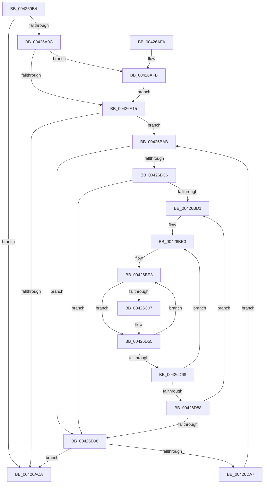

# KiTraceLogHeteroRundown

- RVA: `0x004269B4`–`0x00426DAC` (길이 `1,016` bytes)
- VA: `0x00000001404269B4`
- 실행 섹션: `.text`
- PDB 이름 있음: `예`; PDB Function 태그: `아니요`
- unwind 정보 RVA: `0x000A05F0`
- 디코드: `205`개 명령, `1,016/1,016` bytes 표시
- 미해석 바이트: `0` (있으면 어셈블리에 `.byte`로 보존)

> 이 문서는 커널 이미지의 기계어와 PDB 기호를 분석해 생성했습니다. 4번과 5번은 함수 원형과 자료형을 바이너리 사용 방식에서 추정한 C 해석이며 원본 소스 복구 결과는 아닙니다.

## 1. Dependencies

- 직접 호출 지점: **7**; 고유 호출 대상: **4**
- 직접 호출자로 확인된 함수: **2**
- RIP 상대 이미지 참조: **26**

### Outgoing calls
- `0x00426AD4` → [_security_check_cookie](../6A/_security_check_cookie_function_006AC640.md) (function, `0x006AC640`)
- `0x00426BA1` → [tlgWriteTransfer_EtwWriteTransfer](tlgWriteTransfer_EtwWriteTransfer_function_004260E0.md) (function, `0x004260E0`)
- `0x00426BF8` → [KiQueryHeteroSetFromSubNode](KiQueryHeteroSetFromSubNode_function_00427220.md) (function, `0x00427220`)
- `0x00426C2C` → [tlgCreate1Sz_char](tlgCreate1Sz_char_function_00427304.md) (function, `0x00427304`)
- `0x00426C3D` → [tlgCreate1Sz_char](tlgCreate1Sz_char_function_00427304.md) (function, `0x00427304`)
- `0x00426C61` → [tlgCreate1Sz_char](tlgCreate1Sz_char_function_00427304.md) (function, `0x00427304`)
- `0x00426D4B` → [tlgWriteTransfer_EtwWriteTransfer](tlgWriteTransfer_EtwWriteTransfer_function_004260E0.md) (function, `0x004260E0`)

### Direct callers
- [KeConfigureHeteroProcessors](KeConfigureHeteroProcessors_function_00427338.md) at `0x0042748D`
- [KiTraceLogControlCallback](../../page/6F/KiTraceLogControlCallback_function_006FF9C0.md) at `0x006FFA0A`

### Static image references
- `0x004269DA` → RVA `0x00E0A740` (`.data`; read)
- `0x004269F7` → RVA `0x00FC6B78` (`ALMOSTRO`; read)
- `0x00426A15` → RVA `0x00F21AC8` (`.data`; read)
- `0x00426A1D` → RVA `0x006CBBA0` (` ?? ::FNODOBFM::`string'`; read)
- `0x00426A24` → RVA `0x00FC53E0` (`ALMOSTRO`; read)
- `0x00426A31` → RVA `0x006CBB80` (` ?? ::FNODOBFM::`string'`; read)
- `0x00426A3C` → RVA `0x006CBBE0` (` ?? ::FNODOBFM::`string'`; read)
- `0x00426A47` → RVA `0x006CBBC0` (` ?? ::FNODOBFM::`string'`; read)
- `0x00426A52` → RVA `0x006CBCA0` (` ?? ::FNODOBFM::`string'`; read)
- `0x00426A5D` → RVA `0x006CBC80` (` ?? ::FNODOBFM::`string'`; read)
- `0x00426A68` → RVA `0x006CBCE0` (` ?? ::FNODOBFM::`string'`; read)
- `0x00426A73` → RVA `0x006CBCC0` (` ?? ::FNODOBFM::`string'`; read)
- `0x00426A7E` → RVA `0x006CBC20` (` ?? ::FNODOBFM::`string'`; read)
- `0x00426A89` → RVA `0x006CBC00` (` ?? ::FNODOBFM::`string'`; read)
- `0x00426A94` → RVA `0x006CBC60` (` ?? ::FNODOBFM::`string'`; read)
- `0x00426A9F` → RVA `0x006CBC40` (` ?? ::FNODOBFM::`string'`; read)
- `0x00426AAA` → RVA `0x006CBD20` (` ?? ::FNODOBFM::`string'`; read)
- `0x00426AB5` → RVA `0x006CBD00` (` ?? ::FNODOBFM::`string'`; read)
- `0x00426B08` → RVA `0x00FC6D04` (`ALMOSTRO`; read)
- `0x00426B1B` → RVA `0x00FC6C6C` (`ALMOSTRO`; read)
- `0x00426B2E` → RVA `0x00FC6D60` (`ALMOSTRO`; read)
- `0x00426B61` → RVA `0x00FC6C34` (`ALMOSTRO`; read)
- `0x00426B68` → RVA `0x000486A5` (`.rdata`; read)
- `0x00426BAB` → RVA `0x00F21AD0` (`.data`; read)
- `0x00426C46` → RVA `0x00000000` (`image boundary/outside`; read)
- `0x00426C76` → RVA `0x0004873C` (`.rdata`; read)

## 2. Other-region calls and transfers

- 다른 실행 섹션으로 향하는 call: **0**
- 별도 외부 분기/꼬리 이동을 확인하지 못했습니다.

## 3. Assembly (complete function range)

```asm
004269B4  48 8B C4                        mov rax, rsp
004269B7  48 89 58 10                     mov qword ptr [rax + 0x10], rbx
004269BB  48 89 70 18                     mov qword ptr [rax + 0x18], rsi
004269BF  48 89 78 20                     mov qword ptr [rax + 0x20], rdi
004269C3  55                              push rbp
004269C4  41 54                           push r12
004269C6  41 55                           push r13
004269C8  41 56                           push r14
004269CA  41 57                           push r15
004269CC  48 8D A8 88 FE FF FF            lea rbp, [rax - 0x178]
004269D3  48 81 EC 50 02 00 00            sub rsp, 0x250
004269DA  48 8B 05 5F 3D 9E 00            mov rax, qword ptr [rip + 0x9e3d5f]
004269E1  48 33 C4                        xor rax, rsp
004269E4  48 89 85 40 01 00 00            mov qword ptr [rbp + 0x140], rax
004269EB  33 C0                           xor eax, eax
004269ED  45 33 E4                        xor r12d, r12d
004269F0  48 89 45 90                     mov qword ptr [rbp - 0x70], rax
004269F4  0F 57 C0                        xorps xmm0, xmm0
004269F7  8B 05 7B 01 BA 00               mov eax, dword ptr [rip + 0xba017b]
004269FD  4C 8B F9                        mov r15, rcx
00426A00  0F 11 45 80                     movups xmmword ptr [rbp - 0x80], xmm0
00426A04  85 C0                           test eax, eax
00426A06  0F 84 BE 00 00 00               je 0x140426aca
00426A0C  83 39 05                        cmp dword ptr [rcx], 5
00426A0F  0F 87 E6 00 00 00               ja 0x140426afb
00426A15  66 44 3B 25 AB B0 AF 00         cmp r12w, word ptr [rip + 0xafb0ab]
00426A1D  48 8D 05 7C 51 2A 00            lea rax, [rip + 0x2a517c]
00426A24  8B 15 B6 E9 B9 00               mov edx, dword ptr [rip + 0xb9e9b6]
00426A2A  41 8B FC                        mov edi, r12d
00426A2D  48 89 45 A8                     mov qword ptr [rbp - 0x58], rax
00426A31  48 8D 05 48 51 2A 00            lea rax, [rip + 0x2a5148]
00426A38  48 89 45 B0                     mov qword ptr [rbp - 0x50], rax
00426A3C  48 8D 05 9D 51 2A 00            lea rax, [rip + 0x2a519d]
00426A43  48 89 45 B8                     mov qword ptr [rbp - 0x48], rax
00426A47  48 8D 05 72 51 2A 00            lea rax, [rip + 0x2a5172]
00426A4E  48 89 45 C0                     mov qword ptr [rbp - 0x40], rax
00426A52  48 8D 05 47 52 2A 00            lea rax, [rip + 0x2a5247]
00426A59  48 89 45 C8                     mov qword ptr [rbp - 0x38], rax
00426A5D  48 8D 05 1C 52 2A 00            lea rax, [rip + 0x2a521c]
00426A64  48 89 45 98                     mov qword ptr [rbp - 0x68], rax
00426A68  48 8D 05 71 52 2A 00            lea rax, [rip + 0x2a5271]
00426A6F  48 89 45 A0                     mov qword ptr [rbp - 0x60], rax
00426A73  48 8D 05 46 52 2A 00            lea rax, [rip + 0x2a5246]
00426A7A  48 89 45 D0                     mov qword ptr [rbp - 0x30], rax
00426A7E  48 8D 05 9B 51 2A 00            lea rax, [rip + 0x2a519b]
00426A85  48 89 45 D8                     mov qword ptr [rbp - 0x28], rax
00426A89  48 8D 05 70 51 2A 00            lea rax, [rip + 0x2a5170]
00426A90  48 89 45 E0                     mov qword ptr [rbp - 0x20], rax
00426A94  48 8D 05 C5 51 2A 00            lea rax, [rip + 0x2a51c5]
00426A9B  48 89 45 E8                     mov qword ptr [rbp - 0x18], rax
00426A9F  48 8D 05 9A 51 2A 00            lea rax, [rip + 0x2a519a]
00426AA6  48 89 45 F0                     mov qword ptr [rbp - 0x10], rax
00426AAA  48 8D 05 6F 52 2A 00            lea rax, [rip + 0x2a526f]
00426AB1  48 89 45 F8                     mov qword ptr [rbp - 8], rax
00426AB5  48 8D 05 44 52 2A 00            lea rax, [rip + 0x2a5244]
00426ABC  48 89 45 00                     mov qword ptr [rbp], rax
00426AC0  89 54 24 50                     mov dword ptr [rsp + 0x50], edx
00426AC4  0F 82 E1 00 00 00               jb 0x140426bab
00426ACA  48 8B 8D 40 01 00 00            mov rcx, qword ptr [rbp + 0x140]
00426AD1  48 33 CC                        xor rcx, rsp
00426AD4  E8 67 5B 28 00                  call 0x1406ac640
00426AD9  4C 8D 9C 24 50 02 00 00         lea r11, [rsp + 0x250]
00426AE1  49 8B 5B 38                     mov rbx, qword ptr [r11 + 0x38]
00426AE5  49 8B 73 40                     mov rsi, qword ptr [r11 + 0x40]
00426AE9  49 8B 7B 48                     mov rdi, qword ptr [r11 + 0x48]
00426AED  49 8B E3                        mov rsp, r11
00426AF0  41 5F                           pop r15
00426AF2  41 5E                           pop r14
00426AF4  41 5D                           pop r13
00426AF6  41 5C                           pop r12
00426AF8  5D                              pop rbp
00426AF9  C3                              ret
00426AFA  CC                              int3
00426AFB  89 44 24 34                     mov dword ptr [rsp + 0x34], eax
00426AFF  48 8D 44 24 34                  lea rax, [rsp + 0x34]
00426B04  48 89 45 30                     mov qword ptr [rbp + 0x30], rax
00426B08  8B 05 F6 01 BA 00               mov eax, dword ptr [rip + 0xba01f6]
00426B0E  89 44 24 38                     mov dword ptr [rsp + 0x38], eax
00426B12  48 8D 44 24 38                  lea rax, [rsp + 0x38]
00426B17  48 89 45 40                     mov qword ptr [rbp + 0x40], rax
00426B1B  8B 05 4B 01 BA 00               mov eax, dword ptr [rip + 0xba014b]
00426B21  89 44 24 3C                     mov dword ptr [rsp + 0x3c], eax
00426B25  48 8D 44 24 3C                  lea rax, [rsp + 0x3c]
00426B2A  48 89 45 50                     mov qword ptr [rbp + 0x50], rax
00426B2E  8B 05 2C 02 BA 00               mov eax, dword ptr [rip + 0xba022c]
00426B34  89 44 24 40                     mov dword ptr [rsp + 0x40], eax
00426B38  48 8D 44 24 40                  lea rax, [rsp + 0x40]
00426B3D  48 89 45 60                     mov qword ptr [rbp + 0x60], rax
00426B41  48 C7 45 38 04 00 00 00         mov qword ptr [rbp + 0x38], 4
00426B49  48 C7 45 48 04 00 00 00         mov qword ptr [rbp + 0x48], 4
00426B51  48 C7 45 58 04 00 00 00         mov qword ptr [rbp + 0x58], 4
00426B59  48 C7 45 68 04 00 00 00         mov qword ptr [rbp + 0x68], 4
00426B61  44 39 25 CC 00 BA 00            cmp dword ptr [rip + 0xba00cc], r12d
00426B68  48 8D 15 36 1B C2 FF            lea rdx, [rip - 0x3de4ca]
00426B6F  41 8B C4                        mov eax, r12d
00426B72  48 C7 45 78 04 00 00 00         mov qword ptr [rbp + 0x78], 4
00426B7A  0F 95 C0                        setne al
00426B7D  45 33 C9                        xor r9d, r9d
00426B80  89 44 24 44                     mov dword ptr [rsp + 0x44], eax
00426B84  45 33 C0                        xor r8d, r8d
00426B87  48 8D 44 24 44                  lea rax, [rsp + 0x44]
00426B8C  48 89 45 70                     mov qword ptr [rbp + 0x70], rax
00426B90  48 8D 45 10                     lea rax, [rbp + 0x10]
00426B94  48 89 44 24 28                  mov qword ptr [rsp + 0x28], rax
00426B99  C7 44 24 20 07 00 00 00         mov dword ptr [rsp + 0x20], 7
00426BA1  E8 3A F5 FF FF                  call 0x1404260e0
00426BA6  E9 6A FE FF FF                  jmp 0x140426a15
00426BAB  48 8B 05 1E AF AF 00            mov rax, qword ptr [rip + 0xafaf1e]
00426BB2  8B CF                           mov ecx, edi
00426BB4  48 8B 04 C8                     mov rax, qword ptr [rax + rcx*8]
00426BB8  48 89 44 24 58                  mov qword ptr [rsp + 0x58], rax
00426BBD  48 85 C0                        test rax, rax
00426BC0  0F 84 D0 01 00 00               je 0x140426d96
00426BC6  41 8B DC                        mov ebx, r12d
00426BC9  85 D2                           test edx, edx
00426BCB  0F 84 C5 01 00 00               je 0x140426d96
00426BD1  4C 8D 5D D0                     lea r11, [rbp - 0x30]
00426BD5  45 8B F4                        mov r14d, r12d
00426BD8  4C 89 5C 24 60                  mov qword ptr [rsp + 0x60], r11
00426BDD  4D 8B EC                        mov r13, r12
00426BE0  41 8B F4                        mov esi, r12d
00426BE3  48 8D 4D 80                     lea rcx, [rbp - 0x80]
00426BE7  44 8B CB                        mov r9d, ebx
00426BEA  48 89 4C 24 20                  mov qword ptr [rsp + 0x20], rcx
00426BEF  44 8B C6                        mov r8d, esi
00426BF2  48 8B C8                        mov rcx, rax
00426BF5  41 8B D6                        mov edx, r14d
00426BF8  E8 23 06 00 00                  call 0x140427220
00426BFD  41 83 3F 05                     cmp dword ptr [r15], 5
00426C01  0F 86 4E 01 00 00               jbe 0x140426d55
00426C07  49 8B 13                        mov rdx, qword ptr [r11]
00426C0A  48 8D 44 24 48                  lea rax, [rsp + 0x48]
00426C0F  48 8D 8D B0 00 00 00            lea rcx, [rbp + 0xb0]
00426C16  48 89 85 A0 00 00 00            mov qword ptr [rbp + 0xa0], rax
00426C1D  89 7C 24 48                     mov dword ptr [rsp + 0x48], edi
00426C21  48 C7 85 A8 00 00 00 04 00 00 00  mov qword ptr [rbp + 0xa8], 4
00426C2C  E8 D3 06 00 00                  call 0x140427304
00426C31  4A 8B 54 E5 98                  mov rdx, qword ptr [rbp + r12*8 - 0x68]
00426C36  48 8D 8D C0 00 00 00            lea rcx, [rbp + 0xc0]
00426C3D  E8 C2 06 00 00                  call 0x140427304
00426C42  4F 8D 04 2C                     lea r8, [r12 + r13]
00426C46  4C 8D 1D B3 93 BD FF            lea r11, [rip - 0x426c4d]
00426C4D  4B 63 94 83 60 54 FC 00         movsxd rdx, dword ptr [r11 + r8*4 + 0xfc5460]
00426C55  48 8D 8D D0 00 00 00            lea rcx, [rbp + 0xd0]
00426C5C  48 8B 54 D5 A8                  mov rdx, qword ptr [rbp + rdx*8 - 0x58]
00426C61  E8 9E 06 00 00                  call 0x140427304
00426C66  48 8D 44 24 4C                  lea rax, [rsp + 0x4c]
00426C6B  89 5C 24 4C                     mov dword ptr [rsp + 0x4c], ebx
00426C6F  48 89 85 E0 00 00 00            mov qword ptr [rbp + 0xe0], rax
00426C76  48 8D 15 BF 1A C2 FF            lea rdx, [rip - 0x3de541]
00426C7D  43 8A 84 18 F8 70 FC 00         mov al, byte ptr [r8 + r11 + 0xfc70f8]
00426C85  45 33 C9                        xor r9d, r9d
00426C88  88 44 24 30                     mov byte ptr [rsp + 0x30], al
00426C8C  49 8B CF                        mov rcx, r15
00426C8F  48 8D 44 24 30                  lea rax, [rsp + 0x30]
00426C94  48 C7 85 E8 00 00 00 04 00 00 00  mov qword ptr [rbp + 0xe8], 4
00426C9F  48 89 85 F0 00 00 00            mov qword ptr [rbp + 0xf0], rax
00426CA6  43 8A 84 18 E8 70 FC 00         mov al, byte ptr [r8 + r11 + 0xfc70e8]
00426CAE  45 33 C0                        xor r8d, r8d
00426CB1  88 44 24 31                     mov byte ptr [rsp + 0x31], al
00426CB5  48 8D 44 24 31                  lea rax, [rsp + 0x31]
00426CBA  48 89 85 00 01 00 00            mov qword ptr [rbp + 0x100], rax
00426CC1  48 8B 45 80                     mov rax, qword ptr [rbp - 0x80]
00426CC5  48 89 44 24 68                  mov qword ptr [rsp + 0x68], rax
00426CCA  48 8D 44 24 68                  lea rax, [rsp + 0x68]
00426CCF  48 89 85 10 01 00 00            mov qword ptr [rbp + 0x110], rax
00426CD6  48 8B 45 88                     mov rax, qword ptr [rbp - 0x78]
00426CDA  48 89 44 24 70                  mov qword ptr [rsp + 0x70], rax
00426CDF  48 8D 44 24 70                  lea rax, [rsp + 0x70]
00426CE4  48 89 85 20 01 00 00            mov qword ptr [rbp + 0x120], rax
00426CEB  48 8B 45 90                     mov rax, qword ptr [rbp - 0x70]
00426CEF  48 89 44 24 78                  mov qword ptr [rsp + 0x78], rax
00426CF4  48 8D 44 24 78                  lea rax, [rsp + 0x78]
00426CF9  48 89 85 30 01 00 00            mov qword ptr [rbp + 0x130], rax
00426D00  48 8D 85 80 00 00 00            lea rax, [rbp + 0x80]
00426D07  48 89 44 24 28                  mov qword ptr [rsp + 0x28], rax
00426D0C  C7 44 24 20 0C 00 00 00         mov dword ptr [rsp + 0x20], 0xc
00426D14  48 C7 85 F8 00 00 00 01 00 00 00  mov qword ptr [rbp + 0xf8], 1
00426D1F  48 C7 85 08 01 00 00 01 00 00 00  mov qword ptr [rbp + 0x108], 1
00426D2A  48 C7 85 18 01 00 00 08 00 00 00  mov qword ptr [rbp + 0x118], 8
00426D35  48 C7 85 28 01 00 00 08 00 00 00  mov qword ptr [rbp + 0x128], 8
00426D40  48 C7 85 38 01 00 00 08 00 00 00  mov qword ptr [rbp + 0x138], 8
00426D4B  E8 90 F3 FF FF                  call 0x1404260e0
00426D50  4C 8B 5C 24 60                  mov r11, qword ptr [rsp + 0x60]
00426D55  48 8B 44 24 58                  mov rax, qword ptr [rsp + 0x58]
00426D5A  FF C6                           inc esi
00426D5C  49 FF C4                        inc r12
00426D5F  83 FE 02                        cmp esi, 2
00426D62  0F 8C 7B FE FF FF               jl 0x140426be3
00426D68  49 83 C3 08                     add r11, 8
00426D6C  41 FF C6                        inc r14d
00426D6F  49 83 C5 02                     add r13, 2
00426D73  4C 89 5C 24 60                  mov qword ptr [rsp + 0x60], r11
00426D78  41 BC 00 00 00 00               mov r12d, 0
00426D7E  41 83 FE 07                     cmp r14d, 7
00426D82  0F 8C 58 FE FF FF               jl 0x140426be0
00426D88  8B 54 24 50                     mov edx, dword ptr [rsp + 0x50]
00426D8C  FF C3                           inc ebx
00426D8E  3B DA                           cmp ebx, edx
00426D90  0F 82 3B FE FF FF               jb 0x140426bd1
00426D96  0F B7 05 2B AD AF 00            movzx eax, word ptr [rip + 0xafad2b]
00426D9D  FF C7                           inc edi
00426D9F  3B F8                           cmp edi, eax
00426DA1  0F 83 23 FD FF FF               jae 0x140426aca
00426DA7  E9 FF FD FF FF                  jmp 0x140426bab
```

## 4. C-style interpretation (structured pseudocode)

```c
__int64 __fastcall KiTraceLogHeteroRundown(__int64 a1, __int64 a2, int a3, int a4)
{
    __int64 result;
    __int64 v_r11;
    __int64 v_r12;
    __int64 v_r13;
    __int64 v_r14;
    __int64 v_rbx;
    __int64 v_rdi;
    __int64 v_rsi;
    __int64 v_rsp;
    unsigned __int64 v_stack_m1D8;
    unsigned __int64 v_stack_m1E0;
    unsigned __int64 v_stack_m1E8;
    unsigned __int64 v_stack_m1F0;
    unsigned __int64 v_stack_m1F8;
    unsigned int v_stack_m200;
    unsigned __int64 v_stack_m204;
    unsigned __int64 v_stack_m208;
    unsigned int v_stack_m20C;
    unsigned int v_stack_m210;
    unsigned int v_stack_m214;
    unsigned int v_stack_m218;
    unsigned int v_stack_m21C;
    unsigned __int8 v_stack_m21F;
    unsigned __int8 v_stack_m220;
    unsigned int v_stack_m228;
    unsigned int v_stack_m230;
    unsigned __int64 v_stack_m28;

    *(unsigned __int64 *)(v_rsp + 16) = v_rbx;
    *(unsigned __int64 *)(v_rsp + 24) = v_rsi;
    *(unsigned __int64 *)(v_rsp + 32) = v_rdi;
    v_rsp = (v_rsp) - (592);
    result = (*(unsigned __int64 *)(v_rip + 10370399)) ^ (v_rsp);
    *(unsigned __int64 *)(v_rsp - 376 + 320) = result;
    result = 0;
    v_r12 = 0;
    *(unsigned __int64 *)(v_rsp - 376 - 112) = 0;
    *(unsigned __int64 *)(v_rsp - 376 - 128) = v_xmm0;
    if ((unsigned int)((unsigned int)(*(unsigned int *)(v_rip + 12190075))) == 0) goto loc_00426ACA;
    if ((*(unsigned int *)(a1)) > 5) goto loc_00426AFB;
loc_00426A15:
    *(unsigned __int64 *)(v_rsp - 376 - 88) = v_rip + 2773372;
    *(unsigned __int64 *)(v_rsp - 376 - 80) = v_rip + 2773320;
    *(unsigned __int64 *)(v_rsp - 376 - 72) = v_rip + 2773405;
    *(unsigned __int64 *)(v_rsp - 376 - 64) = v_rip + 2773362;
    *(unsigned __int64 *)(v_rsp - 376 - 56) = v_rip + 2773575;
    *(unsigned __int64 *)(v_rsp - 376 - 104) = v_rip + 2773532;
    *(unsigned __int64 *)(v_rsp - 376 - 96) = v_rip + 2773617;
    *(unsigned __int64 *)(v_rsp - 376 - 48) = v_rip + 2773574;
    *(unsigned __int64 *)(v_rsp - 376 - 40) = v_rip + 2773403;
    *(unsigned __int64 *)(v_rsp - 376 - 32) = v_rip + 2773360;
    *(unsigned __int64 *)(v_rsp - 376 - 24) = v_rip + 2773445;
    *(unsigned __int64 *)(v_rsp - 376 - 16) = v_rip + 2773402;
    *(unsigned __int64 *)(v_rsp - 376 - 8) = v_rip + 2773615;
    *(unsigned __int64 *)(v_rsp - 376) = v_rip + 2773572;
    v_stack_m228 = (unsigned int)((unsigned int)(*(unsigned int *)(v_rip + 12183990)));
    if (0 < (*(unsigned __int16 *)(v_rip + 11514027))) goto loc_00426BAB;
loc_00426ACA:
    a1 = (*(unsigned __int64 *)(v_rsp - 376 + 320)) ^ (v_rsp);
    result = _security_check_cookie(a1, (unsigned int)(*(unsigned int *)(v_rip + 12183990)), a3, a4);
    return result;
loc_00426AFB:
    v_stack_m21C = (unsigned int)(result);
    *(unsigned __int64 *)(v_rsp - 376 + 48) = v_stack_m21C;
    v_stack_m218 = (unsigned int)((unsigned int)(*(unsigned int *)(v_rip + 12190198)));
    *(unsigned __int64 *)(v_rsp - 376 + 64) = v_stack_m218;
    v_stack_m214 = (unsigned int)((unsigned int)(*(unsigned int *)(v_rip + 12190027)));
    *(unsigned __int64 *)(v_rsp - 376 + 80) = v_stack_m214;
    v_stack_m210 = (unsigned int)((unsigned int)(*(unsigned int *)(v_rip + 12190252)));
    *(unsigned __int64 *)(v_rsp - 376 + 96) = v_stack_m210;
    *(unsigned __int64 *)(v_rsp - 376 + 56) = 4;
    *(unsigned __int64 *)(v_rsp - 376 + 72) = 4;
    *(unsigned __int64 *)(v_rsp - 376 + 88) = 4;
    *(unsigned __int64 *)(v_rsp - 376 + 104) = 4;
    *(unsigned __int64 *)(v_rsp - 376 + 120) = 4;
    result = ((*(unsigned int *)(v_rip + 12189900)) != 0) ? 1 : 0;
    a4 = 0;
    v_stack_m20C = (unsigned int)(result);
    a3 = 0;
    *(unsigned __int64 *)(v_rsp - 376 + 112) = v_stack_m20C;
    v_stack_m228 = v_rsp - 376 + 16;
    v_stack_m230 = 7;
    result = tlgWriteTransfer_EtwWriteTransfer(a1, v_rip - 4056266, a3, a4);
    goto loc_00426A15;
loc_00426BAB:
    v_stack_m1F8 = *(unsigned __int64 *)(*(unsigned __int64 *)(v_rip + 11513630) + (unsigned int)((unsigned int)(*(unsigned __int64 *)(v_stack_m28 + 72))) * 8);
    if (*(unsigned __int64 *)(*(unsigned __int64 *)(v_rip + 11513630) + (unsigned int)((unsigned int)(*(unsigned __int64 *)(v_stack_m28 + 72))) * 8) == 0) goto loc_00426D96;
    if ((unsigned int)(v_rip - 4056266) == 0) goto loc_00426D96;
loc_00426BD1:
    v_stack_m1F0 = v_rsp - 376 - 48;
loc_00426BE0:
loc_00426BE3:
    v_stack_m230 = v_rsp - 376 - 128;
    result = KiQueryHeteroSetFromSubNode(*(unsigned __int64 *)(*(unsigned __int64 *)(v_rip + 11513630) + (unsigned int)((unsigned int)(*(unsigned __int64 *)(v_stack_m28 + 72))) * 8), 0, 0, 0);
    v_r11 = v_rsp - 376 - 48;
    if ((*(unsigned int *)(a1)) >= = 5) {
        a2 = *(unsigned __int64 *)(v_rsp - 376 - 48);
        result = v_stack_m208;
        a1 = v_rsp - 376 + 176;
        *(unsigned __int64 *)(v_rsp - 376 + 160) = result;
        v_stack_m208 = (unsigned int)(*(unsigned __int64 *)(v_stack_m28 + 72));
        *(unsigned __int64 *)(v_rsp - 376 + 168) = 4;
        result = tlgCreate1Sz_char(a1, a2, 0, 0);
        a2 = *(unsigned __int64 *)(v_rsp - 376 + v_r12 * 8 - 104);
        a1 = v_rsp - 376 + 192;
        result = tlgCreate1Sz_char(a1, a2, 0, 0);
        a3 = v_r12 + 0 * 1;
        v_r11 = v_rip - 4353101;
        a2 = (int)(*(unsigned int *)(v_r11 + a3 * 4 + 16536672));
        a1 = v_rsp - 376 + 208;
        a2 = *(unsigned __int64 *)(v_rsp - 376 + a2 * 8 - 88);
        result = tlgCreate1Sz_char(a1, a2, a3, 0);
        result = v_stack_m204;
        v_stack_m204 = 0;
        *(unsigned __int64 *)(v_rsp - 376 + 224) = result;
        a2 = v_rip - 4056385;
        result = *(unsigned __int8 *)(a3 + v_r11 * 1 + 16543992);
        a4 = 0;
        v_stack_m220 = (unsigned __int8)(result);
        a1 = a1;
        result = v_stack_m220;
        *(unsigned __int64 *)(v_rsp - 376 + 232) = 4;
        *(unsigned __int64 *)(v_rsp - 376 + 240) = result;
        result = *(unsigned __int8 *)(a3 + v_r11 * 1 + 16543976);
        a3 = 0;
        v_stack_m21F = (unsigned __int8)(result);
        result = v_stack_m21F;
        *(unsigned __int64 *)(v_rsp - 376 + 256) = result;
        result = *(unsigned __int64 *)(v_rsp - 376 - 128);
        v_stack_m1E8 = result;
        result = v_stack_m1E8;
        *(unsigned __int64 *)(v_rsp - 376 + 272) = result;
        result = *(unsigned __int64 *)(v_rsp - 376 - 120);
        v_stack_m1E0 = result;
        result = v_stack_m1E0;
        *(unsigned __int64 *)(v_rsp - 376 + 288) = result;
        result = *(unsigned __int64 *)(v_rsp - 376 - 112);
        v_stack_m1D8 = result;
        result = v_stack_m1D8;
        *(unsigned __int64 *)(v_rsp - 376 + 304) = result;
        result = v_rsp - 376 + 128;
        v_stack_m228 = result;
        v_stack_m230 = 12;
        *(unsigned __int64 *)(v_rsp - 376 + 248) = 1;
        *(unsigned __int64 *)(v_rsp - 376 + 264) = 1;
        *(unsigned __int64 *)(v_rsp - 376 + 280) = 8;
        *(unsigned __int64 *)(v_rsp - 376 + 296) = 8;
        *(unsigned __int64 *)(v_rsp - 376 + 312) = 8;
        result = tlgWriteTransfer_EtwWriteTransfer(a1, a2, a3, a4);
        v_r11 = v_stack_m1F0;
    }
    v_rsi = (unsigned int)((0) + 1);
    v_r12 = (v_r12) + 1;
    if (((unsigned int)(v_rsi)) < 2) goto loc_00426BE3;
    v_r11 = (v_r11) + (8);
    v_r14 = (unsigned int)((0) + 1);
    v_r13 = (0) + (2);
    v_stack_m1F0 = v_r11;
    if (((unsigned int)(v_r14)) < 7) goto loc_00426BE0;
    v_rbx = (unsigned int)((0) + 1);
    if (((unsigned int)(v_rbx)) < ((unsigned int)((unsigned int)(v_stack_m200)))) goto loc_00426BD1;
loc_00426D96:
    v_rdi = (unsigned int)((*(unsigned __int64 *)(v_stack_m28 + 72)) + 1);
    if (((unsigned int)(v_rdi)) >= ((unsigned int)(*(unsigned __int16 *)(v_rip + 11513131)))) goto loc_00426ACA;
    goto loc_00426BAB;
}
```

## 5. (Beta) C Style

```c
int64_t KiTraceLogHeteroRundown(void *Arg1, int64_t Arg2, int32_t Arg3, int32_t Arg4)
{
    uint8_t *arg1 = (uint8_t *)Arg1;

    int64_t result;
    int64_t local_r11;
    int64_t local_r12;
    int64_t local_r13;
    int64_t local_r14;
    int64_t local_rbx;
    int64_t local_rdi;
    int64_t local_rsi;
    int64_t local_rsp;
    uint64_t v_stack_m1D8;
    uint64_t v_stack_m1E0;
    uint64_t v_stack_m1E8;
    uint64_t v_stack_m1F0;
    uint64_t v_stack_m1F8;
    uint32_t v_stack_m200;
    uint64_t v_stack_m204;
    uint64_t v_stack_m208;
    uint32_t v_stack_m20C;
    uint32_t v_stack_m210;
    uint32_t v_stack_m214;
    uint32_t v_stack_m218;
    uint32_t v_stack_m21C;
    uint8_t v_stack_m21F;
    uint8_t v_stack_m220;
    uint32_t v_stack_m228;
    uint32_t v_stack_m230;
    uint64_t v_stack_m28;

    *(uint64_t *)(local_rsp + 0x10) = local_rbx;
    *(uint64_t *)(local_rsp + 0x18) = local_rsi;
    *(uint64_t *)(local_rsp + 0x20) = local_rdi;
    local_rsp = (local_rsp) - (592);
    result = (*(uint64_t *)(v_rip + 0x9E3D5F)) ^ (local_rsp);
    *(uint64_t *)(local_rsp - 0x178 + 0x140) = result;
    result = 0;
    local_r12 = 0;
    *(uint64_t *)(local_rsp - 0x178 - 0x70) = 0;
    *(uint64_t *)(local_rsp - 0x178 - 0x80) = v_xmm0;
    if ((uint32_t)((uint32_t)(*(uint32_t *)(v_rip + 0xBA017B))) == 0) goto loc_00426ACA;
    if ((*(uint32_t *)(arg1)) > 5) goto loc_00426AFB;
loc_00426A15:
    *(uint64_t *)(local_rsp - 0x178 - 0x58) = v_rip + 2773372;
    *(uint64_t *)(local_rsp - 0x178 - 0x50) = v_rip + 2773320;
    *(uint64_t *)(local_rsp - 0x178 - 0x48) = v_rip + 2773405;
    *(uint64_t *)(local_rsp - 0x178 - 0x40) = v_rip + 2773362;
    *(uint64_t *)(local_rsp - 0x178 - 0x38) = v_rip + 2773575;
    *(uint64_t *)(local_rsp - 0x178 - 0x68) = v_rip + 2773532;
    *(uint64_t *)(local_rsp - 0x178 - 0x60) = v_rip + 2773617;
    *(uint64_t *)(local_rsp - 0x178 - 0x30) = v_rip + 2773574;
    *(uint64_t *)(local_rsp - 0x178 - 0x28) = v_rip + 2773403;
    *(uint64_t *)(local_rsp - 0x178 - 0x20) = v_rip + 2773360;
    *(uint64_t *)(local_rsp - 0x178 - 0x18) = v_rip + 2773445;
    *(uint64_t *)(local_rsp - 0x178 - 0x10) = v_rip + 2773402;
    *(uint64_t *)(local_rsp - 0x178 - 0x8) = v_rip + 2773615;
    *(uint64_t *)(local_rsp - 0x178) = v_rip + 2773572;
    v_stack_m228 = (uint32_t)((uint32_t)(*(uint32_t *)(v_rip + 0xB9E9B6)));
    if (0 < (*(uint16_t *)(v_rip + 0xAFB0AB))) goto loc_00426BAB;
loc_00426ACA:
    Arg1 = (*(uint64_t *)(local_rsp - 0x178 + 0x140)) ^ (local_rsp);
    result = _security_check_cookie(Arg1, (uint32_t)(*(uint32_t *)(v_rip + 0xB9E9B6)), Arg3, Arg4);
    return result;
loc_00426AFB:
    v_stack_m21C = (uint32_t)(result);
    *(uint64_t *)(local_rsp - 0x178 + 0x30) = v_stack_m21C;
    v_stack_m218 = (uint32_t)((uint32_t)(*(uint32_t *)(v_rip + 0xBA01F6)));
    *(uint64_t *)(local_rsp - 0x178 + 0x40) = v_stack_m218;
    v_stack_m214 = (uint32_t)((uint32_t)(*(uint32_t *)(v_rip + 0xBA014B)));
    *(uint64_t *)(local_rsp - 0x178 + 0x50) = v_stack_m214;
    v_stack_m210 = (uint32_t)((uint32_t)(*(uint32_t *)(v_rip + 0xBA022C)));
    *(uint64_t *)(local_rsp - 0x178 + 0x60) = v_stack_m210;
    *(uint64_t *)(local_rsp - 0x178 + 0x38) = 4;
    *(uint64_t *)(local_rsp - 0x178 + 0x48) = 4;
    *(uint64_t *)(local_rsp - 0x178 + 0x58) = 4;
    *(uint64_t *)(local_rsp - 0x178 + 0x68) = 4;
    *(uint64_t *)(local_rsp - 0x178 + 0x78) = 4;
    result = ((*(uint32_t *)(v_rip + 0xBA00CC)) != 0) ? 1 : 0;
    Arg4 = 0;
    v_stack_m20C = (uint32_t)(result);
    Arg3 = 0;
    *(uint64_t *)(local_rsp - 0x178 + 0x70) = v_stack_m20C;
    v_stack_m228 = local_rsp - 376 + 16;
    v_stack_m230 = 7;
    result = tlgWriteTransfer_EtwWriteTransfer(Arg1, v_rip - 4056266, Arg3, Arg4);
    goto loc_00426A15;
loc_00426BAB:
    v_stack_m1F8 = *(uint64_t *)(*(uint64_t *)(v_rip + 0xAFAF1E) + (uint32_t)((uint32_t)(*(uint64_t *)(v_stack_m28 + 0x48))) * 8);
    if (*(uint64_t *)(*(uint64_t *)(v_rip + 0xAFAF1E) + (uint32_t)((uint32_t)(*(uint64_t *)(v_stack_m28 + 0x48))) * 8) == 0) goto loc_00426D96;
    if ((uint32_t)(v_rip - 4056266) == 0) goto loc_00426D96;
loc_00426BD1:
    v_stack_m1F0 = local_rsp - 376 - 48;
loc_00426BE0:
loc_00426BE3:
    v_stack_m230 = local_rsp - 376 - 128;
    result = KiQueryHeteroSetFromSubNode(*(uint64_t *)(*(uint64_t *)(v_rip + 0xAFAF1E) + (uint32_t)((uint32_t)(*(uint64_t *)(v_stack_m28 + 0x48))) * 8), 0, 0, 0);
    local_r11 = local_rsp - 376 - 48;
    if ((*(uint32_t *)(arg1)) >= = 5) {
        Arg2 = *(uint64_t *)(local_rsp - 0x178 - 0x30);
        result = v_stack_m208;
        Arg1 = local_rsp - 376 + 176;
        *(uint64_t *)(local_rsp - 0x178 + 0xA0) = result;
        v_stack_m208 = (uint32_t)(*(uint64_t *)(v_stack_m28 + 0x48));
        *(uint64_t *)(local_rsp - 0x178 + 0xA8) = 4;
        result = tlgCreate1Sz_char(Arg1, Arg2, 0, 0);
        Arg2 = *(uint64_t *)(local_rsp - 0x178 + local_r12 * 8 - 0x68);
        Arg1 = local_rsp - 376 + 192;
        result = tlgCreate1Sz_char(Arg1, Arg2, 0, 0);
        Arg3 = local_r12 + 0 * 1;
        local_r11 = v_rip - 4353101;
        Arg2 = (int32_t)(*(uint32_t *)(local_r11 + Arg3 * 4 + 0xFC5460));
        Arg1 = local_rsp - 376 + 208;
        Arg2 = *(uint64_t *)(local_rsp - 0x178 + Arg2 * 8 - 0x58);
        result = tlgCreate1Sz_char(Arg1, Arg2, Arg3, 0);
        result = v_stack_m204;
        v_stack_m204 = 0;
        *(uint64_t *)(local_rsp - 0x178 + 0xE0) = result;
        Arg2 = v_rip - 4056385;
        result = *(uint8_t *)(Arg3 + local_r11 * 1 + 0xFC70F8);
        Arg4 = 0;
        v_stack_m220 = (uint8_t)(result);
        Arg1 = Arg1;
        result = v_stack_m220;
        *(uint64_t *)(local_rsp - 0x178 + 0xE8) = 4;
        *(uint64_t *)(local_rsp - 0x178 + 0xF0) = result;
        result = *(uint8_t *)(Arg3 + local_r11 * 1 + 0xFC70E8);
        Arg3 = 0;
        v_stack_m21F = (uint8_t)(result);
        result = v_stack_m21F;
        *(uint64_t *)(local_rsp - 0x178 + 0x100) = result;
        result = *(uint64_t *)(local_rsp - 0x178 - 0x80);
        v_stack_m1E8 = result;
        result = v_stack_m1E8;
        *(uint64_t *)(local_rsp - 0x178 + 0x110) = result;
        result = *(uint64_t *)(local_rsp - 0x178 - 0x78);
        v_stack_m1E0 = result;
        result = v_stack_m1E0;
        *(uint64_t *)(local_rsp - 0x178 + 0x120) = result;
        result = *(uint64_t *)(local_rsp - 0x178 - 0x70);
        v_stack_m1D8 = result;
        result = v_stack_m1D8;
        *(uint64_t *)(local_rsp - 0x178 + 0x130) = result;
        result = local_rsp - 376 + 128;
        v_stack_m228 = result;
        v_stack_m230 = 12;
        *(uint64_t *)(local_rsp - 0x178 + 0xF8) = 1;
        *(uint64_t *)(local_rsp - 0x178 + 0x108) = 1;
        *(uint64_t *)(local_rsp - 0x178 + 0x118) = 8;
        *(uint64_t *)(local_rsp - 0x178 + 0x128) = 8;
        *(uint64_t *)(local_rsp - 0x178 + 0x138) = 8;
        result = tlgWriteTransfer_EtwWriteTransfer(Arg1, Arg2, Arg3, Arg4);
        local_r11 = v_stack_m1F0;
    }
    local_rsi = (uint32_t)((0) + 1);
    local_r12 = (local_r12) + 1;
    if (((uint32_t)(local_rsi)) < 2) goto loc_00426BE3;
    local_r11 = (local_r11) + (8);
    local_r14 = (uint32_t)((0) + 1);
    local_r13 = (0) + (2);
    v_stack_m1F0 = local_r11;
    if (((uint32_t)(local_r14)) < 7) goto loc_00426BE0;
    local_rbx = (uint32_t)((0) + 1);
    if (((uint32_t)(local_rbx)) < ((uint32_t)((uint32_t)(v_stack_m200)))) goto loc_00426BD1;
loc_00426D96:
    local_rdi = (uint32_t)((*(uint64_t *)(v_stack_m28 + 0x48)) + 1);
    if (((uint32_t)(local_rdi)) >= ((uint32_t)(*(uint16_t *)(v_rip + 0xAFAD2B)))) goto loc_00426ACA;
    goto loc_00426BAB;
}
```

### 관측된 메모리 오프셋

구조체 형식이 확인되지 않은 접근은 인자 기준의 오프셋으로만 기록했습니다.

| 기준 인자 | 오프셋 표현 | 폭 (bit) | 접근 |
|---|---:|---:|---|
| `Arg1` | `+ 0x0` | `32` | `R` |

## 6. Execution-region graph

[열기: 2D/3D 그래프와 함수 탐색 컨트롤 패널](../../../control-panel.html?section=text&rva=0x004269B4&view=graph)

- 2D 그래프는 위에서 아래로 흐르고, 3D 그래프는 빈 공간을 드래그해 회전합니다. Shift+드래그는 이동, 휠은 확대·축소, 함수 노드 선택은 대상 보고서 이동입니다.

### Static fallback


