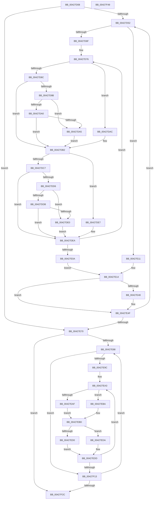

# KiUpdateHgsScores

- RVA: `0x00427D08`–`0x00427F4A` (길이 `578` bytes)
- VA: `0x0000000140427D08`
- 실행 섹션: `.text`
- PDB 이름 있음: `예`; PDB Function 태그: `아니요`
- unwind 정보 RVA: `0x000A06E8`
- 디코드: `153`개 명령, `578/578` bytes 표시
- 미해석 바이트: `0` (있으면 어셈블리에 `.byte`로 보존)

> 이 문서는 커널 이미지의 기계어와 PDB 기호를 분석해 생성했습니다. 4번과 5번은 함수 원형과 자료형을 바이너리 사용 방식에서 추정한 C 해석이며 원본 소스 복구 결과는 아닙니다.

## 1. Dependencies

- 직접 호출 지점: **4**; 고유 호출 대상: **1**
- 직접 호출자로 확인된 함수: **1**
- RIP 상대 이미지 참조: **4**

### Outgoing calls
- `0x00427E34` → [KiComputeHgsScore](KiComputeHgsScore_function_00427F50.md) (function, `0x00427F50`)
- `0x00427E55` → [KiComputeHgsScore](KiComputeHgsScore_function_00427F50.md) (function, `0x00427F50`)
- `0x00427EE8` → [KiComputeHgsScore](KiComputeHgsScore_function_00427F50.md) (function, `0x00427F50`)
- `0x00427EFC` → [KiComputeHgsScore](KiComputeHgsScore_function_00427F50.md) (function, `0x00427F50`)

### Direct callers
- [KeConfigureHeteroProcessors](KeConfigureHeteroProcessors_function_00427338.md) at `0x00427393`

### Static image references
- `0x00427D28` → RVA `0x00F234D8` (`.data`; read)
- `0x00427D2F` → RVA `0x00000000` (`image boundary/outside`; read)
- `0x00427D52` → RVA `0x00FC6A80` (`ALMOSTRO`; read)
- `0x00427E70` → RVA `0x00FC544C` (`ALMOSTRO`; write)

## 2. Other-region calls and transfers

- 다른 실행 섹션으로 향하는 call: **0**
- 별도 외부 분기/꼬리 이동을 확인하지 못했습니다.

## 3. Assembly (complete function range)

```asm
00427D08  48 8B C4                        mov rax, rsp
00427D0B  48 89 58 10                     mov qword ptr [rax + 0x10], rbx
00427D0F  48 89 68 18                     mov qword ptr [rax + 0x18], rbp
00427D13  48 89 70 20                     mov qword ptr [rax + 0x20], rsi
00427D17  48 89 48 08                     mov qword ptr [rax + 8], rcx
00427D1B  57                              push rdi
00427D1C  41 54                           push r12
00427D1E  41 55                           push r13
00427D20  41 56                           push r14
00427D22  41 57                           push r15
00427D24  48 83 EC 20                     sub rsp, 0x20
00427D28  48 8B 2D A9 B7 AF 00            mov rbp, qword ptr [rip + 0xafb7a9]
00427D2F  48 8D 1D CA 82 BD FF            lea rbx, [rip - 0x427d36]
00427D36  45 33 ED                        xor r13d, r13d
00427D39  48 89 6C 24 50                  mov qword ptr [rsp + 0x50], rbp
00427D3E  45 0F B7 E5                     movzx r12d, r13w
00427D42  45 8A FD                        mov r15b, r13b
00427D45  45 8B C5                        mov r8d, r13d
00427D48  44 39 6D 18                     cmp dword ptr [rbp + 0x18], r13d
00427D4C  0F 86 1E 01 00 00               jbe 0x140427e70
00427D52  8B 05 28 ED B9 00               mov eax, dword ptr [rip + 0xb9ed28]
00427D58  41 8A FD                        mov dil, r13b
00427D5B  45 8A F5                        mov r14b, r13b
00427D5E  45 8A D5                        mov r10b, r13b
00427D61  41 8A F5                        mov sil, r13b
00427D64  41 8B DD                        mov ebx, r13d
00427D67  85 C0                           test eax, eax
00427D69  0F 84 A2 00 00 00               je 0x140427e11
00427D6F  48 8D 2D 8A 82 BD FF            lea rbp, [rip - 0x427d76]
00427D76  8B C3                           mov eax, ebx
00427D78  48 8B 84 C5 40 8C FC 00         mov rax, qword ptr [rbp + rax*8 + 0xfc8c40]
00427D80  4C 8B 98 50 8A 00 00            mov r11, qword ptr [rax + 0x8a50]
00427D87  4D 85 DB                        test r11, r11
00427D8A  74 20                           je 0x140427dac
00427D8C  45 0F B6 C8                     movzx r9d, r8b
00427D90  43 8A 44 8B 06                  mov al, byte ptr [r11 + r9*4 + 6]
00427D95  8A D0                           mov dl, al
00427D97  84 C0                           test al, al
00427D99  74 17                           je 0x140427db2
00427D9B  40 84 FF                        test dil, dil
00427D9E  74 05                           je 0x140427da5
00427DA0  40 3A F8                        cmp dil, al
00427DA3  76 0D                           jbe 0x140427db2
00427DA5  40 8A F8                        mov dil, al
00427DA8  8A D0                           mov dl, al
00427DAA  EB 06                           jmp 0x140427db2
00427DAC  41 8A D5                        mov dl, r13b
00427DAF  45 8A C8                        mov r9b, r8b
00427DB2  41 3A D6                        cmp dl, r14b
00427DB5  41 0F B6 CE                     movzx ecx, r14b
00427DB9  0F B6 C2                        movzx eax, dl
00427DBC  0F 47 C8                        cmova ecx, eax
00427DBF  44 8A F1                        mov r14b, cl
00427DC2  4D 85 DB                        test r11, r11
00427DC5  74 20                           je 0x140427de7
00427DC7  41 0F B6 C1                     movzx eax, r9b
00427DCB  41 8A 4C 83 07                  mov cl, byte ptr [r11 + rax*4 + 7]
00427DD0  8A D1                           mov dl, cl
00427DD2  84 C9                           test cl, cl
00427DD4  74 14                           je 0x140427dea
00427DD6  45 84 D2                        test r10b, r10b
00427DD9  74 05                           je 0x140427de0
00427DDB  44 3A D1                        cmp r10b, cl
00427DDE  76 0A                           jbe 0x140427dea
00427DE0  44 8A D1                        mov r10b, cl
00427DE3  8A D1                           mov dl, cl
00427DE5  EB 03                           jmp 0x140427dea
00427DE7  41 8A D5                        mov dl, r13b
00427DEA  40 3A D6                        cmp dl, sil
00427DED  40 0F B6 CE                     movzx ecx, sil
00427DF1  0F B6 C2                        movzx eax, dl
00427DF4  0F 47 C8                        cmova ecx, eax
00427DF7  8B 05 83 EC B9 00               mov eax, dword ptr [rip + 0xb9ec83]
00427DFD  FF C3                           inc ebx
00427DFF  40 8A F1                        mov sil, cl
00427E02  3B D8                           cmp ebx, eax
00427E04  0F 82 6C FF FF FF               jb 0x140427d76
00427E0A  48 8B 6C 24 50                  mov rbp, qword ptr [rsp + 0x50]
00427E0F  EB 03                           jmp 0x140427e14
00427E11  45 8A C8                        mov r9b, r8b
00427E14  45 8B D8                        mov r11d, r8d
00427E17  48 8D 1D E2 81 BD FF            lea rbx, [rip - 0x427e1e]
00427E1E  40 8A D7                        mov dl, dil
00427E21  41 8A CE                        mov cl, r14b
00427E24  41 88 BC 1B 1C 54 FC 00         mov byte ptr [r11 + rbx + 0xfc541c], dil
00427E2C  45 88 94 1B 24 54 FC 00         mov byte ptr [r11 + rbx + 0xfc5424], r10b
00427E34  E8 17 01 00 00                  call 0x140427f50
00427E39  66 42 89 84 5B 2C 54 FC 00      mov word ptr [rbx + r11*2 + 0xfc542c], ax
00427E42  66 41 3B C4                     cmp ax, r12w
00427E46  76 07                           jbe 0x140427e4f
00427E48  44 0F B7 E0                     movzx r12d, ax
00427E4C  45 8A F9                        mov r15b, r9b
00427E4F  41 8A D2                        mov dl, r10b
00427E52  40 8A CE                        mov cl, sil
00427E55  E8 F6 00 00 00                  call 0x140427f50
00427E5A  41 FF C0                        inc r8d
00427E5D  66 42 89 84 5B 3C 54 FC 00      mov word ptr [rbx + r11*2 + 0xfc543c], ax
00427E66  44 3B 45 18                     cmp r8d, dword ptr [rbp + 0x18]
00427E6A  0F 82 E2 FE FF FF               jb 0x140427d52
00427E70  44 88 3D D5 D5 B9 00            mov byte ptr [rip + 0xb9d5d5], r15b
00427E77  45 8B D5                        mov r10d, r13d
00427E7A  8B 05 00 EC B9 00               mov eax, dword ptr [rip + 0xb9ec00]
00427E80  85 C0                           test eax, eax
00427E82  0F 84 A4 00 00 00               je 0x140427f2c
00427E88  45 8B CD                        mov r9d, r13d
00427E8B  41 8B C2                        mov eax, r10d
00427E8E  48 8B 9C C3 40 8C FC 00         mov rbx, qword ptr [rbx + rax*8 + 0xfc8c40]
00427E96  44 39 6D 18                     cmp dword ptr [rbp + 0x18], r13d
00427E9A  76 77                           jbe 0x140427f13
00427E9C  4C 8D 35 5D 81 BD FF            lea r14, [rip - 0x427ea3]
00427EA3  48 8B 8B 50 8A 00 00            mov rcx, qword ptr [rbx + 0x8a50]
00427EAA  48 85 C9                        test rcx, rcx
00427EAD  74 0B                           je 0x140427eba
00427EAF  41 0F B6 C1                     movzx eax, r9b
00427EB3  40 8A 74 81 06                  mov sil, byte ptr [rcx + rax*4 + 6]
00427EB8  EB 03                           jmp 0x140427ebd
00427EBA  41 8A F5                        mov sil, r13b
00427EBD  45 8B D9                        mov r11d, r9d
00427EC0  41 8A C1                        mov al, r9b
00427EC3  43 8A 94 33 1C 54 FC 00         mov dl, byte ptr [r11 + r14 + 0xfc541c]
00427ECB  48 85 C9                        test rcx, rcx
00427ECE  74 0A                           je 0x140427eda
00427ED0  0F B6 C0                        movzx eax, al
00427ED3  40 8A 7C 81 07                  mov dil, byte ptr [rcx + rax*4 + 7]
00427ED8  EB 03                           jmp 0x140427edd
00427EDA  41 8A FD                        mov dil, r13b
00427EDD  47 8A 84 33 24 54 FC 00         mov r8b, byte ptr [r11 + r14 + 0xfc5424]
00427EE5  40 8A CE                        mov cl, sil
00427EE8  E8 63 00 00 00                  call 0x140427f50
00427EED  41 8A D0                        mov dl, r8b
00427EF0  66 42 89 84 5B BC 86 00 00      mov word ptr [rbx + r11*2 + 0x86bc], ax
00427EF9  40 8A CF                        mov cl, dil
00427EFC  E8 4F 00 00 00                  call 0x140427f50
00427F01  41 FF C1                        inc r9d
00427F04  66 42 89 84 5B CC 86 00 00      mov word ptr [rbx + r11*2 + 0x86cc], ax
00427F0D  44 3B 4D 18                     cmp r9d, dword ptr [rbp + 0x18]
00427F11  72 90                           jb 0x140427ea3
00427F13  8B 05 67 EB B9 00               mov eax, dword ptr [rip + 0xb9eb67]
00427F19  48 8D 1D E0 80 BD FF            lea rbx, [rip - 0x427f20]
00427F20  41 FF C2                        inc r10d
00427F23  44 3B D0                        cmp r10d, eax
00427F26  0F 82 5C FF FF FF               jb 0x140427e88
00427F2C  48 8B 5C 24 58                  mov rbx, qword ptr [rsp + 0x58]
00427F31  48 8B 6C 24 60                  mov rbp, qword ptr [rsp + 0x60]
00427F36  48 8B 74 24 68                  mov rsi, qword ptr [rsp + 0x68]
00427F3B  48 83 C4 20                     add rsp, 0x20
00427F3F  41 5F                           pop r15
00427F41  41 5E                           pop r14
00427F43  41 5D                           pop r13
00427F45  41 5C                           pop r12
00427F47  5F                              pop rdi
00427F48  C3                              ret
00427F49  CC                              int3
```

## 4. C-style interpretation (structured pseudocode)

```c
__int64 __fastcall KiUpdateHgsScores(__int64 a1)
{
    __int64 result;
    __int64 v_r10;
    __int64 v_r12;
    __int64 v_r13;
    __int64 v_r15;
    __int64 v_rbx;
    __int64 v_rsp;
    unsigned __int64 v_stack_p10;
    unsigned __int64 v_stack_p18;
    unsigned __int64 v_stack_p20;
    unsigned __int64 v_stack_p8;

    *(unsigned __int64 *)(v_rsp + 16) = v_rbx;
    *(unsigned __int64 *)(v_rsp + 24) = v_rbp;
    *(unsigned __int64 *)(v_rsp + 32) = v_rsi;
    *(unsigned __int64 *)(v_rsp + 8) = a1;
    v_rsp = (v_rsp) - (32);
    v_r13 = 0;
    v_stack_p8 = *(unsigned __int64 *)(v_rip + 11515817);
    if ((*(unsigned int *)(*(unsigned __int64 *)(v_rip + 11515817) + 24)) <= 0) goto loc_00427E70;
loc_00427D52:
    if ((unsigned int)((unsigned int)(*(unsigned int *)(v_rip + 12184872))) == 0) goto loc_00427E11;
loc_00427D76:
    if (*(unsigned __int64 *)(*(unsigned __int64 *)(v_rip - 4357494 + 0 * 8 + 16550976) + 35408) == 0) goto loc_00427DAC;
    if ((unsigned __int8)(*(unsigned __int8 *)(*(unsigned __int64 *)(*(unsigned __int64 *)(v_rip - 4357494 + 0 * 8 + 16550976) + 35408) + 0 * 4 + 6)) == 0) goto loc_00427DB2;
    if (0 == 0) goto loc_00427DA5;
    if (0 <= ((unsigned __int8)(*(unsigned __int8 *)(*(unsigned __int64 *)(*(unsigned __int64 *)(v_rip - 4357494 + 0 * 8 + 16550976) + 35408) + 0 * 4 + 6)))) goto loc_00427DB2;
loc_00427DA5:
    goto loc_00427DB2;
loc_00427DAC:
loc_00427DB2:
    a1 = 0;
    if (0 > 0) { a1 = 0; }
    if (*(unsigned __int64 *)(*(unsigned __int64 *)(v_rip - 4357494 + 0 * 8 + 16550976) + 35408) == 0) goto loc_00427DE7;
    if ((unsigned __int8)(*(unsigned __int8 *)(*(unsigned __int64 *)(*(unsigned __int64 *)(v_rip - 4357494 + 0 * 8 + 16550976) + 35408) + 0 * 4 + 7)) == 0) goto loc_00427DEA;
    if (0 == 0) goto loc_00427DE0;
    if (0 <= ((unsigned __int8)(*(unsigned __int8 *)(*(unsigned __int64 *)(*(unsigned __int64 *)(v_rip - 4357494 + 0 * 8 + 16550976) + 35408) + 0 * 4 + 7)))) goto loc_00427DEA;
loc_00427DE0:
    goto loc_00427DEA;
loc_00427DE7:
loc_00427DEA:
    a1 = 0;
    if (0 > 0) { a1 = 0; }
    v_rbx = (unsigned int)((0) + 1);
    if (((unsigned int)(v_rbx)) < ((unsigned int)((unsigned int)(*(unsigned int *)(v_rip + 12184707))))) goto loc_00427D76;
    goto loc_00427E14;
loc_00427E11:
loc_00427E14:
    *(unsigned __int8 *)(0 + v_rip - 4357662 * 1 + 16536604) = (unsigned __int8)((unsigned __int8)(*(unsigned __int8 *)(*(unsigned __int64 *)(*(unsigned __int64 *)(v_rip - 4357494 + 0 * 8 + 16550976) + 35408) + 0 * 4 + 6)));
    *(unsigned __int8 *)(0 + v_rip - 4357662 * 1 + 16536612) = (unsigned __int8)((unsigned __int8)(*(unsigned __int8 *)(*(unsigned __int64 *)(*(unsigned __int64 *)(v_rip - 4357494 + 0 * 8 + 16550976) + 35408) + 0 * 4 + 7)));
    result = KiComputeHgsScore((unsigned __int8)((unsigned __int8)(a1)), (unsigned __int8)((unsigned __int8)(*(unsigned __int8 *)(*(unsigned __int64 *)(*(unsigned __int64 *)(v_rip - 4357494 + 0 * 8 + 16550976) + 35408) + 0 * 4 + 6))), 0, 0);
    *(unsigned __int16 *)(v_rip - 4357662 + 0 * 2 + 16536620) = (unsigned __int16)(result);
    v_r12 = 0;
    v_r15 = 0;
    if (((unsigned __int16)(result)) >= = 0) {
        v_r12 = (unsigned __int16)(result);
        v_r15 = 0;
    }
    result = KiComputeHgsScore((unsigned __int8)((unsigned __int8)(a1)), (unsigned __int8)((unsigned __int8)(*(unsigned __int8 *)(*(unsigned __int64 *)(*(unsigned __int64 *)(v_rip - 4357494 + 0 * 8 + 16550976) + 35408) + 0 * 4 + 7))), 0, 0);
    a3 = (unsigned int)((0) + 1);
    *(unsigned __int16 *)(v_rip - 4357662 + 0 * 2 + 16536636) = (unsigned __int16)(result);
    if (((unsigned int)(a3)) < (*(unsigned int *)(v_stack_p8 + 24))) goto loc_00427D52;
loc_00427E70:
    *(unsigned __int8 *)(v_rip + 12178901) = (unsigned __int8)(v_r15);
    if ((unsigned int)((unsigned int)(*(unsigned int *)(v_rip + 12184576))) == 0) goto loc_00427F2C;
loc_00427E88:
    if ((*(unsigned int *)(v_stack_p8 + 24)) <= 0) goto loc_00427F13;
loc_00427EA3:
    if (*(unsigned __int64 *)(*(unsigned __int64 *)(v_rip - 4357662 + 0 * 8 + 16550976) + 35408) == 0) goto loc_00427EBA;
    goto loc_00427EBD;
loc_00427EBA:
loc_00427EBD:
    if (*(unsigned __int64 *)(*(unsigned __int64 *)(v_rip - 4357662 + 0 * 8 + 16550976) + 35408) == 0) goto loc_00427EDA;
    goto loc_00427EDD;
loc_00427EDA:
loc_00427EDD:
    result = KiComputeHgsScore(0, *(unsigned __int8 *)(0 + v_rip - 4357795 * 1 + 16536604), *(unsigned __int8 *)(0 + v_rip - 4357795 * 1 + 16536612), 0);
    *(unsigned __int16 *)(*(unsigned __int64 *)(v_rip - 4357662 + 0 * 8 + 16550976) + 0 * 2 + 34492) = (unsigned __int16)(result);
    result = KiComputeHgsScore(0, (unsigned __int8)(*(unsigned __int8 *)(0 + v_rip - 4357795 * 1 + 16536612)), *(unsigned __int8 *)(0 + v_rip - 4357795 * 1 + 16536612), 0);
    a4 = (unsigned int)((0) + 1);
    *(unsigned __int16 *)(*(unsigned __int64 *)(v_rip - 4357662 + 0 * 8 + 16550976) + 0 * 2 + 34508) = (unsigned __int16)(result);
    if (((unsigned int)(a4)) < (*(unsigned int *)(v_stack_p8 + 24))) goto loc_00427EA3;
loc_00427F13:
    v_r10 = (unsigned int)((0) + 1);
    if (((unsigned int)(v_r10)) < ((unsigned int)((unsigned int)(*(unsigned int *)(v_rip + 12184423))))) goto loc_00427E88;
loc_00427F2C:
    v_rsp = (v_rsp) + (32);
    return (unsigned int)(*(unsigned int *)(v_rip + 12184423));
}
```

## 5. (Beta) C Style

```c
int64_t KiUpdateHgsScores(int64_t Arg1)
{
    int64_t result;
    int64_t local_r10;
    int64_t local_r12;
    int64_t local_r13;
    int64_t local_r15;
    int64_t local_rbx;
    int64_t local_rsp;
    uint64_t v_stack_p10;
    uint64_t v_stack_p18;
    uint64_t v_stack_p20;
    uint64_t v_stack_p8;

    *(uint64_t *)(local_rsp + 0x10) = local_rbx;
    *(uint64_t *)(local_rsp + 0x18) = local_rbp;
    *(uint64_t *)(local_rsp + 0x20) = local_rsi;
    *(uint64_t *)(local_rsp + 0x8) = Arg1;
    local_rsp = (local_rsp) - (32);
    local_r13 = 0;
    v_stack_p8 = *(uint64_t *)(v_rip + 0xAFB7A9);
    if ((*(uint32_t *)(*(uint64_t *)(v_rip + 0xAFB7A9) + 0x18)) <= 0) goto loc_00427E70;
loc_00427D52:
    if ((uint32_t)((uint32_t)(*(uint32_t *)(v_rip + 0xB9ED28))) == 0) goto loc_00427E11;
loc_00427D76:
    if (*(uint64_t *)(*(uint64_t *)(v_rip - 0x427D76 + 0x0 * 8 + 0xFC8C40) + 0x8A50) == 0) goto loc_00427DAC;
    if ((uint8_t)(*(uint8_t *)(*(uint64_t *)(*(uint64_t *)(v_rip - 0x427D76 + 0x0 * 8 + 0xFC8C40) + 0x8A50) + 0x0 * 4 + 0x6)) == 0) goto loc_00427DB2;
    if (0 == 0) goto loc_00427DA5;
    if (0 <= ((uint8_t)(*(uint8_t *)(*(uint64_t *)(*(uint64_t *)(v_rip - 0x427D76 + 0x0 * 8 + 0xFC8C40) + 0x8A50) + 0x0 * 4 + 0x6)))) goto loc_00427DB2;
loc_00427DA5:
    goto loc_00427DB2;
loc_00427DAC:
loc_00427DB2:
    Arg1 = 0;
    if (0 > 0) { Arg1 = 0; }
    if (*(uint64_t *)(*(uint64_t *)(v_rip - 0x427D76 + 0x0 * 8 + 0xFC8C40) + 0x8A50) == 0) goto loc_00427DE7;
    if ((uint8_t)(*(uint8_t *)(*(uint64_t *)(*(uint64_t *)(v_rip - 0x427D76 + 0x0 * 8 + 0xFC8C40) + 0x8A50) + 0x0 * 4 + 0x7)) == 0) goto loc_00427DEA;
    if (0 == 0) goto loc_00427DE0;
    if (0 <= ((uint8_t)(*(uint8_t *)(*(uint64_t *)(*(uint64_t *)(v_rip - 0x427D76 + 0x0 * 8 + 0xFC8C40) + 0x8A50) + 0x0 * 4 + 0x7)))) goto loc_00427DEA;
loc_00427DE0:
    goto loc_00427DEA;
loc_00427DE7:
loc_00427DEA:
    Arg1 = 0;
    if (0 > 0) { Arg1 = 0; }
    local_rbx = (uint32_t)((0) + 1);
    if (((uint32_t)(local_rbx)) < ((uint32_t)((uint32_t)(*(uint32_t *)(v_rip + 0xB9EC83))))) goto loc_00427D76;
    goto loc_00427E14;
loc_00427E11:
loc_00427E14:
    *(uint8_t *)(0 + v_rip - 0x427E1E * 1 + 0xFC541C) = (uint8_t)((uint8_t)(*(uint8_t *)(*(uint64_t *)(*(uint64_t *)(v_rip - 0x427D76 + 0x0 * 8 + 0xFC8C40) + 0x8A50) + 0x0 * 4 + 0x6)));
    *(uint8_t *)(0 + v_rip - 0x427E1E * 1 + 0xFC5424) = (uint8_t)((uint8_t)(*(uint8_t *)(*(uint64_t *)(*(uint64_t *)(v_rip - 0x427D76 + 0x0 * 8 + 0xFC8C40) + 0x8A50) + 0x0 * 4 + 0x7)));
    result = KiComputeHgsScore((uint8_t)((uint8_t)(Arg1)), (uint8_t)((uint8_t)(*(uint8_t *)(*(uint64_t *)(*(uint64_t *)(v_rip - 0x427D76 + 0x0 * 8 + 0xFC8C40) + 0x8A50) + 0x0 * 4 + 0x6))), 0, 0);
    *(uint16_t *)(v_rip - 0x427E1E + 0x0 * 2 + 0xFC542C) = (uint16_t)(result);
    local_r12 = 0;
    local_r15 = 0;
    if (((uint16_t)(result)) >= = 0) {
        local_r12 = (uint16_t)(result);
        local_r15 = 0;
    }
    result = KiComputeHgsScore((uint8_t)((uint8_t)(Arg1)), (uint8_t)((uint8_t)(*(uint8_t *)(*(uint64_t *)(*(uint64_t *)(v_rip - 0x427D76 + 0x0 * 8 + 0xFC8C40) + 0x8A50) + 0x0 * 4 + 0x7))), 0, 0);
    a3 = (uint32_t)((0) + 1);
    *(uint16_t *)(v_rip - 0x427E1E + 0x0 * 2 + 0xFC543C) = (uint16_t)(result);
    if (((uint32_t)(a3)) < (*(uint32_t *)(v_stack_p8 + 0x18))) goto loc_00427D52;
loc_00427E70:
    *(uint8_t *)(v_rip + 0xB9D5D5) = (uint8_t)(local_r15);
    if ((uint32_t)((uint32_t)(*(uint32_t *)(v_rip + 0xB9EC00))) == 0) goto loc_00427F2C;
loc_00427E88:
    if ((*(uint32_t *)(v_stack_p8 + 0x18)) <= 0) goto loc_00427F13;
loc_00427EA3:
    if (*(uint64_t *)(*(uint64_t *)(v_rip - 0x427E1E + 0x0 * 8 + 0xFC8C40) + 0x8A50) == 0) goto loc_00427EBA;
    goto loc_00427EBD;
loc_00427EBA:
loc_00427EBD:
    if (*(uint64_t *)(*(uint64_t *)(v_rip - 0x427E1E + 0x0 * 8 + 0xFC8C40) + 0x8A50) == 0) goto loc_00427EDA;
    goto loc_00427EDD;
loc_00427EDA:
loc_00427EDD:
    result = KiComputeHgsScore(0, *(uint8_t *)(0 + v_rip - 0x427EA3 * 1 + 0xFC541C), *(uint8_t *)(0 + v_rip - 0x427EA3 * 1 + 0xFC5424), 0);
    *(uint16_t *)(*(uint64_t *)(v_rip - 0x427E1E + 0x0 * 8 + 0xFC8C40) + 0x0 * 2 + 0x86BC) = (uint16_t)(result);
    result = KiComputeHgsScore(0, (uint8_t)(*(uint8_t *)(0 + v_rip - 0x427EA3 * 1 + 0xFC5424)), *(uint8_t *)(0 + v_rip - 0x427EA3 * 1 + 0xFC5424), 0);
    a4 = (uint32_t)((0) + 1);
    *(uint16_t *)(*(uint64_t *)(v_rip - 0x427E1E + 0x0 * 8 + 0xFC8C40) + 0x0 * 2 + 0x86CC) = (uint16_t)(result);
    if (((uint32_t)(a4)) < (*(uint32_t *)(v_stack_p8 + 0x18))) goto loc_00427EA3;
loc_00427F13:
    local_r10 = (uint32_t)((0) + 1);
    if (((uint32_t)(local_r10)) < ((uint32_t)((uint32_t)(*(uint32_t *)(v_rip + 0xB9EB67))))) goto loc_00427E88;
loc_00427F2C:
    local_rsp = (local_rsp) + (32);
    return (uint32_t)(*(uint32_t *)(v_rip + 0xB9EB67));
}
```

## 6. Execution-region graph

[열기: 2D/3D 그래프와 함수 탐색 컨트롤 패널](../../../control-panel.html?section=text&rva=0x00427D08&view=graph)

- 2D 그래프는 위에서 아래로 흐르고, 3D 그래프는 빈 공간을 드래그해 회전합니다. Shift+드래그는 이동, 휠은 확대·축소, 함수 노드 선택은 대상 보고서 이동입니다.

### Static fallback


