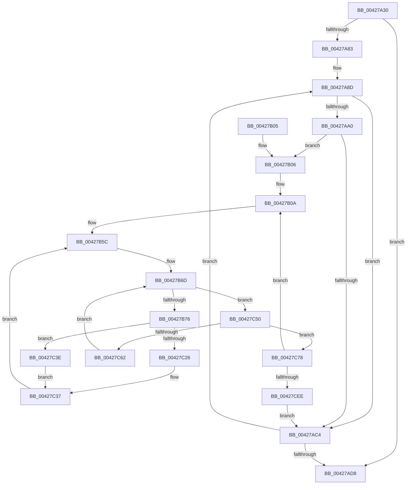

# KiUpdateProcessorClasses

- RVA: `0x00427A30`–`0x00427CFF` (길이 `719` bytes)
- VA: `0x0000000140427A30`
- 실행 섹션: `.text`
- PDB 이름 있음: `예`; PDB Function 태그: `아니요`
- unwind 정보 RVA: `0x000A06BC`
- 디코드: `170`개 명령, `719/719` bytes 표시
- 미해석 바이트: `0` (있으면 어셈블리에 `.byte`로 보존)

> 이 문서는 커널 이미지의 기계어와 PDB 기호를 분석해 생성했습니다. 4번과 5번은 함수 원형과 자료형을 바이너리 사용 방식에서 추정한 C 해석이며 원본 소스 복구 결과는 아닙니다.

## 1. Dependencies

- 직접 호출 지점: **5**; 고유 호출 대상: **3**
- 직접 호출자로 확인된 함수: **1**
- RIP 상대 이미지 참조: **7**

### Outgoing calls
- `0x00427ADF` → [_security_check_cookie](../6A/_security_check_cookie_function_006AC640.md) (function, `0x006AC640`)
- `0x00427B18` → [memset](../6C/memset_function_006C6C40.md) (function, `0x006C6C40`)
- `0x00427B27` → [memset](../6C/memset_function_006C6C40.md) (function, `0x006C6C40`)
- `0x00427C96` → [RtlCopyVolatileMemory](../6B/RtlCopyVolatileMemory_function_006BC9D0.md) (function, `0x006BC9D0`)
- `0x00427CAF` → [RtlCopyVolatileMemory](../6B/RtlCopyVolatileMemory_function_006BC9D0.md) (function, `0x006BC9D0`)

### Direct callers
- [KeConfigureHeteroProcessors](KeConfigureHeteroProcessors_function_00427338.md) at `0x0042738E`

### Static image references
- `0x00427A53` → RVA `0x00E0A740` (`.data`; read)
- `0x00427A61` → RVA `0x00F234D8` (`.data`; read)
- `0x00427A6A` → RVA `0x00F21AC8` (`.data`; read)
- `0x00427A83` → RVA `0x00000000` (`image boundary/outside`; read)
- `0x00427A8D` → RVA `0x00F21AD0` (`.data`; read)
- `0x00427B90` → RVA `0x00F231B8` (`.data`; read)
- `0x00427C0C` → RVA `0x00FC8828` (`ALMOSTRO`; read)

## 2. Other-region calls and transfers

- 다른 실행 섹션으로 향하는 call: **0**
- 별도 외부 분기/꼬리 이동을 확인하지 못했습니다.

## 3. Assembly (complete function range)

```asm
00427A30  48 8B C4                        mov rax, rsp
00427A33  48 89 58 08                     mov qword ptr [rax + 8], rbx
00427A37  48 89 70 10                     mov qword ptr [rax + 0x10], rsi
00427A3B  48 89 78 18                     mov qword ptr [rax + 0x18], rdi
00427A3F  55                              push rbp
00427A40  41 54                           push r12
00427A42  41 55                           push r13
00427A44  41 56                           push r14
00427A46  41 57                           push r15
00427A48  48 8D 68 A1                     lea rbp, [rax - 0x5f]
00427A4C  48 81 EC F0 00 00 00            sub rsp, 0xf0
00427A53  48 8B 05 E6 2C 9E 00            mov rax, qword ptr [rip + 0x9e2ce6]
00427A5A  48 33 C4                        xor rax, rsp
00427A5D  48 89 45 27                     mov qword ptr [rbp + 0x27], rax
00427A61  4C 8B 25 70 BA AF 00            mov r12, qword ptr [rip + 0xafba70]
00427A68  33 DB                           xor ebx, ebx
00427A6A  66 3B 1D 57 A0 AF 00            cmp bx, word ptr [rip + 0xafa057]
00427A71  44 8B F3                        mov r14d, ebx
00427A74  89 5C 24 28                     mov dword ptr [rsp + 0x28], ebx
00427A78  49 8B 3C 24                     mov rdi, qword ptr [r12]
00427A7C  48 89 7C 24 30                  mov qword ptr [rsp + 0x30], rdi
00427A81  73 55                           jae 0x140427ad8
00427A83  4C 8D 05 76 85 BD FF            lea r8, [rip - 0x427a8a]
00427A8A  8D 53 01                        lea edx, [rbx + 1]
00427A8D  48 8B 05 3C A0 AF 00            mov rax, qword ptr [rip + 0xafa03c]
00427A94  41 8B CE                        mov ecx, r14d
00427A97  48 8B 34 C8                     mov rsi, qword ptr [rax + rcx*8]
00427A9B  48 85 F6                        test rsi, rsi
00427A9E  74 24                           je 0x140427ac4
00427AA0  44 8B FB                        mov r15d, ebx
00427AA3  0F B7 86 8A 00 00 00            movzx eax, word ptr [rsi + 0x8a]
00427AAA  49 8B 8C C0 C0 F6 FC 00         mov rcx, qword ptr [r8 + rax*8 + 0xfcf6c0]
00427AB2  0F B7 86 88 00 00 00            movzx eax, word ptr [rsi + 0x88]
00427AB9  48 89 4D 9F                     mov qword ptr [rbp - 0x61], rcx
00427ABD  41 39 5C 24 18                  cmp dword ptr [r12 + 0x18], ebx
00427AC2  77 42                           ja 0x140427b06
00427AC4  0F B7 05 FD 9F AF 00            movzx eax, word ptr [rip + 0xaf9ffd]
00427ACB  44 03 F2                        add r14d, edx
00427ACE  44 89 74 24 28                  mov dword ptr [rsp + 0x28], r14d
00427AD3  44 3B F0                        cmp r14d, eax
00427AD6  72 B5                           jb 0x140427a8d
00427AD8  48 8B 4D 27                     mov rcx, qword ptr [rbp + 0x27]
00427ADC  48 33 CC                        xor rcx, rsp
00427ADF  E8 5C 4B 28 00                  call 0x1406ac640
00427AE4  4C 8D 9C 24 F0 00 00 00         lea r11, [rsp + 0xf0]
00427AEC  49 8B 5B 30                     mov rbx, qword ptr [r11 + 0x30]
00427AF0  49 8B 73 38                     mov rsi, qword ptr [r11 + 0x38]
00427AF4  49 8B 7B 40                     mov rdi, qword ptr [r11 + 0x40]
00427AF8  49 8B E3                        mov rsp, r11
00427AFB  41 5F                           pop r15
00427AFD  41 5E                           pop r14
00427AFF  41 5D                           pop r13
00427B01  41 5C                           pop r12
00427B03  5D                              pop rbp
00427B04  C3                              ret
00427B05  CC                              int3
00427B06  48 89 45 97                     mov qword ptr [rbp - 0x69], rax
00427B0A  33 D2                           xor edx, edx
00427B0C  48 89 5D 8F                     mov qword ptr [rbp - 0x71], rbx
00427B10  48 8D 4D A7                     lea rcx, [rbp - 0x59]
00427B14  44 8D 42 40                     lea r8d, [rdx + 0x40]
00427B18  E8 23 F1 29 00                  call 0x1406c6c40
00427B1D  33 D2                           xor edx, edx
00427B1F  48 8D 4D E7                     lea rcx, [rbp - 0x19]
00427B23  44 8D 42 40                     lea r8d, [rdx + 0x40]
00427B27  E8 14 F1 29 00                  call 0x1406c6c40
00427B2C  44 0F B7 8E 88 00 00 00         movzx r9d, word ptr [rsi + 0x88]
00427B34  4C 8D 35 C5 84 BD FF            lea r14, [rip - 0x427b3b]
00427B3B  4C 8B 9E 80 00 00 00            mov r11, qword ptr [rsi + 0x80]
00427B42  8A CB                           mov cl, bl
00427B44  89 4C 24 24                     mov dword ptr [rsp + 0x24], ecx
00427B48  45 8B D1                        mov r10d, r9d
00427B4B  66 44 89 4D 8F                  mov word ptr [rbp - 0x71], r9w
00427B50  44 8A EB                        mov r13b, bl
00427B53  4C 89 5D 87                     mov qword ptr [rbp - 0x79], r11
00427B57  48 89 5C 24 38                  mov qword ptr [rsp + 0x38], rbx
00427B5C  88 4C 24 21                     mov byte ptr [rsp + 0x21], cl
00427B60  41 8D 4A 01                     lea ecx, [r10 + 1]
00427B64  44 88 6C 24 20                  mov byte ptr [rsp + 0x20], r13b
00427B69  89 5C 24 2C                     mov dword ptr [rsp + 0x2c], ebx
00427B6D  4D 85 DB                        test r11, r11
00427B70  0F 84 DA 00 00 00               je 0x140427c50
00427B76  49 0F BC D3                     bsf rdx, r11
00427B7A  41 8B CA                        mov ecx, r10d
00427B7D  0F B6 C2                        movzx eax, dl
00427B80  49 0F B3 C3                     btr r11, rax
00427B84  C1 E1 06                        shl ecx, 6
00427B87  0F B6 C2                        movzx eax, dl
00427B8A  03 C8                           add ecx, eax
00427B8C  89 54 24 2C                     mov dword ptr [rsp + 0x2c], edx
00427B90  48 8B 05 21 B6 AF 00            mov rax, qword ptr [rip + 0xafb621]
00427B97  4C 89 5D 87                     mov qword ptr [rbp - 0x79], r11
00427B9B  8B 14 88                        mov edx, dword ptr [rax + rcx*4]
00427B9E  49 8B 9C D6 40 8C FC 00         mov rbx, qword ptr [r14 + rdx*8 + 0xfc8c40]
00427BA6  0F AF 57 04                     imul edx, dword ptr [rdi + 4]
00427BAA  0F B6 8B D1 00 00 00            movzx ecx, byte ptr [rbx + 0xd1]
00427BB1  41 03 D7                        add edx, r15d
00427BB4  44 8B C2                        mov r8d, edx
00427BB7  8A 44 97 18                     mov al, byte ptr [rdi + rdx*4 + 0x18]
00427BBB  88 44 0D A7                     mov byte ptr [rbp + rcx - 0x59], al
00427BBF  44 0F B6 6C 97 18               movzx r13d, byte ptr [rdi + rdx*4 + 0x18]
00427BC5  8A 44 97 19                     mov al, byte ptr [rdi + rdx*4 + 0x19]
00427BC9  0F B6 4C 24 20                  movzx ecx, byte ptr [rsp + 0x20]
00427BCE  44 3A E9                        cmp r13b, cl
00427BD1  44 0F 46 E9                     cmovbe r13d, ecx
00427BD5  0F B6 8B D1 00 00 00            movzx ecx, byte ptr [rbx + 0xd1]
00427BDC  88 44 0D E7                     mov byte ptr [rbp + rcx - 0x19], al
00427BE0  0F B6 4C 97 19                  movzx ecx, byte ptr [rdi + rdx*4 + 0x19]
00427BE5  42 8A 44 87 18                  mov al, byte ptr [rdi + r8*4 + 0x18]
00427BEA  0F B6 54 24 21                  movzx edx, byte ptr [rsp + 0x21]
00427BEF  3A CA                           cmp cl, dl
00427BF1  88 83 0A 8A 00 00               mov byte ptr [rbx + 0x8a0a], al
00427BF7  42 8A 44 87 19                  mov al, byte ptr [rdi + r8*4 + 0x19]
00427BFC  0F 46 CA                        cmovbe ecx, edx
00427BFF  88 83 09 8A 00 00               mov byte ptr [rbx + 0x8a09], al
00427C05  0F B6 93 D0 00 00 00            movzx edx, byte ptr [rbx + 0xd0]
00427C0C  48 8D 05 15 0C BA 00            lea rax, [rip + 0xba0c15]
00427C13  48 C1 E2 05                     shl rdx, 5
00427C17  48 03 D0                        add rdx, rax
00427C1A  89 4C 24 24                     mov dword ptr [rsp + 0x24], ecx
00427C1E  42 80 7C 87 19 00               cmp byte ptr [rdi + r8*4 + 0x19], 0
00427C24  75 18                           jne 0x140427c3e
00427C26  48 8B 8B C8 00 00 00            mov rcx, qword ptr [rbx + 0xc8]
00427C2D  48 0B 0A                        or rcx, qword ptr [rdx]
00427C30  48 89 0A                        mov qword ptr [rdx], rcx
00427C33  8B 4C 24 24                     mov ecx, dword ptr [rsp + 0x24]
00427C37  33 DB                           xor ebx, ebx
00427C39  E9 1E FF FF FF                  jmp 0x140427b5c
00427C3E  48 8B 83 C8 00 00 00            mov rax, qword ptr [rbx + 0xc8]
00427C45  48 F7 D0                        not rax
00427C48  48 23 02                        and rax, qword ptr [rdx]
00427C4B  48 89 02                        mov qword ptr [rdx], rax
00427C4E  EB E7                           jmp 0x140427c37
00427C50  66 41 FF C1                     inc r9w
00427C54  45 0F B7 D1                     movzx r10d, r9w
00427C58  66 44 89 55 8F                  mov word ptr [rbp - 0x71], r10w
00427C5D  44 3B D1                        cmp r10d, ecx
00427C60  73 16                           jae 0x140427c78
00427C62  4E 8B 1C D5 08 00 00 00         mov r11, qword ptr [r10*8 + 8]
00427C6A  44 0F B7 4D 8F                  movzx r9d, word ptr [rbp - 0x71]
00427C6F  4C 89 5D 87                     mov qword ptr [rbp - 0x79], r11
00427C73  E9 F5 FE FF FF                  jmp 0x140427b6d
00427C78  48 8B 8E D0 00 00 00            mov rcx, qword ptr [rsi + 0xd0]
00427C7F  48 8D 55 A7                     lea rdx, [rbp - 0x59]
00427C83  41 8B DF                        mov ebx, r15d
00427C86  41 B8 40 00 00 00               mov r8d, 0x40
00427C8C  48 C1 E3 06                     shl rbx, 6
00427C90  48 03 CB                        add rcx, rbx
00427C93  41 8B FF                        mov edi, r15d
00427C96  E8 35 4D 29 00                  call 0x1406bc9d0
00427C9B  48 8B 8E C8 00 00 00            mov rcx, qword ptr [rsi + 0xc8]
00427CA2  48 8D 55 E7                     lea rdx, [rbp - 0x19]
00427CA6  48 03 CB                        add rcx, rbx
00427CA9  41 B8 40 00 00 00               mov r8d, 0x40
00427CAF  E8 1C 4D 29 00                  call 0x1406bc9d0
00427CB4  48 8B 5D 9F                     mov rbx, qword ptr [rbp - 0x61]
00427CB8  BA 01 00 00 00                  mov edx, 1
00427CBD  8B 44 24 24                     mov eax, dword ptr [rsp + 0x24]
00427CC1  44 03 FA                        add r15d, edx
00427CC4  48 C1 E7 05                     shl rdi, 5
00427CC8  48 03 7D 97                     add rdi, qword ptr [rbp - 0x69]
00427CCC  44 88 AC 1F 38 02 00 00         mov byte ptr [rdi + rbx + 0x238], r13b
00427CD4  88 84 1F 38 01 00 00            mov byte ptr [rdi + rbx + 0x138], al
00427CDB  8D 5A FF                        lea ebx, [rdx - 1]
00427CDE  48 8B 7C 24 30                  mov rdi, qword ptr [rsp + 0x30]
00427CE3  45 3B 7C 24 18                  cmp r15d, dword ptr [r12 + 0x18]
00427CE8  0F 82 1C FE FF FF               jb 0x140427b0a
00427CEE  44 8B 74 24 28                  mov r14d, dword ptr [rsp + 0x28]
00427CF3  4C 8D 05 06 83 BD FF            lea r8, [rip - 0x427cfa]
00427CFA  E9 C5 FD FF FF                  jmp 0x140427ac4
```

## 4. C-style interpretation (structured pseudocode)

```c
__int64 __fastcall KiUpdateProcessorClasses(void)
{
    __int64 result;
    __int64 v_r13;
    __int64 v_r14;
    __int64 v_r15;
    __int64 v_rbx;
    __int64 v_rdi;
    __int64 v_rsp;
    unsigned __int64 v_stack_m28;
    unsigned __int64 v_stack_mB8;
    unsigned __int64 v_stack_mC0;
    unsigned int v_stack_mC4;
    unsigned int v_stack_mC8;
    unsigned int v_stack_mCC;
    unsigned __int8 v_stack_mCF;
    unsigned __int8 v_stack_mD0;
    unsigned __int64 v_stack_mE8;
    unsigned int v_stack_mF0;

    *(unsigned __int64 *)(v_rsp + 8) = v_rbx;
    *(unsigned __int64 *)(v_rsp + 16) = v_rsi;
    *(unsigned __int64 *)(v_rsp + 24) = v_rdi;
    v_rsp = (v_rsp) - (240);
    result = (*(unsigned __int64 *)(v_rip + 10366182)) ^ (v_rsp);
    *(unsigned __int64 *)(v_rsp - 95 + 39) = result;
    v_rbx = 0;
    v_stack_mF0 = 0;
    v_stack_mE8 = *(unsigned __int64 *)(*(unsigned __int64 *)(v_rip + 11516528));
    if (0 >= (*(unsigned __int16 *)(v_rip + 11509847))) goto loc_00427AD8;
loc_00427A8D:
    if (*(unsigned __int64 *)(*(unsigned __int64 *)(v_rip + 11509820) + 0 * 8) == 0) goto loc_00427AC4;
    *(unsigned __int64 *)(v_rsp - 95 - 97) = *(unsigned __int64 *)(v_rip - 4356746 + *(unsigned __int16 *)(*(unsigned __int64 *)(*(unsigned __int64 *)(v_rip + 11509820) + 0 * 8) + 138) * 8 + 16578240);
    if ((*(unsigned int *)(*(unsigned __int64 *)(v_rip + 11516528) + 24)) > 0) goto loc_00427B06;
loc_00427AC4:
    v_r14 = (unsigned int)((0) + ((unsigned int)(v_rbx + 1)));
    v_stack_mF0 = (unsigned int)(v_r14);
    if (((unsigned int)(v_r14)) < ((unsigned int)(*(unsigned __int16 *)(v_rip + 11509757)))) goto loc_00427A8D;
loc_00427AD8:
    a1 = (*(unsigned __int64 *)(v_rsp - 95 + 39)) ^ (v_rsp);
    result = _security_check_cookie(a1, v_rbx + 1, v_rip - 4356746, a4);
    return result;
loc_00427B06:
    *(unsigned __int64 *)(v_rsp - 95 - 105) = result;
loc_00427B0A:
    a2 = 0;
    *(unsigned __int64 *)(v_rsp - 95 - 113) = *(unsigned __int64 *)(v_stack_m28 + 48);
    result = memset(v_rsp - 95 - 89, a2, a2 + 64, a4);
    a2 = 0;
    result = memset(v_rsp - 95 - 25, a2, a2 + 64, a4);
    v_stack_mCC = (unsigned int)((unsigned __int8)(*(unsigned __int64 *)(v_stack_m28 + 48)));
    *(unsigned __int16 *)(v_rsp - 95 - 113) = (unsigned __int16)(*(unsigned __int16 *)(*(unsigned __int64 *)(v_stack_m28 + 56) + 136));
    *(unsigned __int64 *)(v_rsp - 95 - 121) = *(unsigned __int64 *)(*(unsigned __int64 *)(v_stack_m28 + 56) + 128);
    v_stack_mB8 = *(unsigned __int64 *)(v_stack_m28 + 48);
loc_00427B5C:
    v_stack_mCF = (unsigned __int8)((unsigned __int8)(*(unsigned __int64 *)(v_stack_m28 + 48)));
    v_stack_mD0 = (unsigned __int8)((unsigned __int8)(*(unsigned __int64 *)(v_stack_m28 + 48)));
    v_stack_mC4 = (unsigned int)(*(unsigned __int64 *)(v_stack_m28 + 48));
loc_00427B6D:
    if (*(unsigned __int64 *)(*(unsigned __int64 *)(v_stack_m28 + 56) + 128) == 0) goto loc_00427C50;
    a1 = (unsigned int)(((unsigned int)((unsigned int)((unsigned int)((unsigned int)(*(unsigned __int16 *)(*(unsigned __int64 *)(v_stack_m28 + 56) + 136)))))) << (6));
    a1 = (unsigned int)((a1) + (0));
    v_stack_mC4 = 0;
    *(unsigned __int64 *)(v_rsp - 95 - 121) = *(unsigned __int64 *)(*(unsigned __int64 *)(v_stack_m28 + 56) + 128);
    a2 = (unsigned int)(((unsigned int)(*(unsigned int *)(*(unsigned __int64 *)(v_rip + 11515425) + a1 * 4))) * (*(unsigned int *)(*(unsigned __int64 *)(v_stack_m28 + 64) + 4)));
    a2 = (unsigned int)((a2) + (0));
    *(unsigned __int8 *)(v_rsp - 95 + *(unsigned __int8 *)(*(unsigned __int64 *)(v_rip - 4356923 + (unsigned int)(*(unsigned int *)(*(unsigned __int64 *)(v_rip + 11515425) + a1 * 4)) * 8 + 16550976) + 209) * 1 - 89) = (unsigned __int8)(*(unsigned __int8 *)(*(unsigned __int64 *)(v_stack_m28 + 64) + a2 * 4 + 24));
    v_r13 = *(unsigned __int8 *)(*(unsigned __int64 *)(v_stack_m28 + 64) + a2 * 4 + 24);
    if (((unsigned __int8)(*(unsigned __int8 *)(*(unsigned __int64 *)(v_stack_m28 + 64) + a2 * 4 + 24))) <= ((unsigned __int8)(v_stack_mD0))) { v_r13 = (unsigned int)(v_stack_mD0); }
    *(unsigned __int8 *)(v_rsp - 95 + *(unsigned __int8 *)(*(unsigned __int64 *)(v_rip - 4356923 + (unsigned int)(*(unsigned int *)(*(unsigned __int64 *)(v_rip + 11515425) + a1 * 4)) * 8 + 16550976) + 209) * 1 - 25) = (unsigned __int8)(*(unsigned __int8 *)(*(unsigned __int64 *)(v_stack_m28 + 64) + a2 * 4 + 25));
    *(unsigned __int8 *)(*(unsigned __int64 *)(v_rip - 4356923 + (unsigned int)(*(unsigned int *)(*(unsigned __int64 *)(v_rip + 11515425) + a1 * 4)) * 8 + 16550976) + 35338) = (unsigned __int8)(*(unsigned __int8 *)(*(unsigned __int64 *)(v_stack_m28 + 64) + (unsigned int)((unsigned int)(a2)) * 4 + 24));
    a1 = *(unsigned __int8 *)(*(unsigned __int64 *)(v_stack_m28 + 64) + a2 * 4 + 25);
    if (((unsigned __int8)(*(unsigned __int8 *)(*(unsigned __int64 *)(v_stack_m28 + 64) + a2 * 4 + 25))) <= ((unsigned __int8)(v_stack_mCF))) { a1 = (unsigned int)(v_stack_mCF); }
    *(unsigned __int8 *)(*(unsigned __int64 *)(v_rip - 4356923 + (unsigned int)(*(unsigned int *)(*(unsigned __int64 *)(v_rip + 11515425) + a1 * 4)) * 8 + 16550976) + 35337) = (unsigned __int8)(*(unsigned __int8 *)(*(unsigned __int64 *)(v_stack_m28 + 64) + (unsigned int)((unsigned int)(a2)) * 4 + 25));
    a2 = (*(unsigned __int8 *)(*(unsigned __int64 *)(v_rip - 4356923 + (unsigned int)(*(unsigned int *)(*(unsigned __int64 *)(v_rip + 11515425) + a1 * 4)) * 8 + 16550976) + 208)) << (5);
    a2 = (a2) + (v_rip + 12192789);
    v_stack_mCC = (unsigned int)(a1);
    if ((*(unsigned __int8 *)(*(unsigned __int64 *)(v_stack_m28 + 64) + (unsigned int)((unsigned int)(a2)) * 4 + 25)) != 0) goto loc_00427C3E;
    a1 = (*(unsigned __int64 *)(*(unsigned __int64 *)(v_rip - 4356923 + (unsigned int)(*(unsigned int *)(*(unsigned __int64 *)(v_rip + 11515425) + a1 * 4)) * 8 + 16550976) + 200)) | (*(unsigned __int64 *)(a2));
    *(unsigned __int64 *)(a2) = a1;
loc_00427C37:
    v_rbx = 0;
    goto loc_00427B5C;
loc_00427C3E:
    result = ~(*(unsigned __int64 *)(v_rbx + 200));
    result = (result) & (*(unsigned __int64 *)(a2));
    *(unsigned __int64 *)(a2) = result;
    goto loc_00427C37;
loc_00427C50:
    a4 = (unsigned __int16)((*(unsigned __int16 *)(*(unsigned __int64 *)(v_stack_m28 + 56) + 136)) + 1);
    *(unsigned __int16 *)(v_rsp - 95 - 113) = (unsigned __int16)((unsigned __int16)(a4));
    if (((unsigned int)((unsigned __int16)(a4))) >= ((unsigned int)((unsigned int)(v_stack_mCC)))) goto loc_00427C78;
    *(unsigned __int64 *)(v_rsp - 95 - 121) = *(unsigned __int64 *)((unsigned __int16)(a4) * 8 + 8);
    goto loc_00427B6D;
loc_00427C78:
    v_rbx = (0) << (6);
    a1 = (*(unsigned __int64 *)(*(unsigned __int64 *)(v_stack_m28 + 56) + 208)) + (v_rbx);
    result = RtlCopyVolatileMemory(a1, v_rsp - 95 - 89, 64, *(unsigned __int16 *)(v_rsp - 95 - 113));
    a1 = (*(unsigned __int64 *)(*(unsigned __int64 *)(v_stack_m28 + 56) + 200)) + (v_rbx);
    result = RtlCopyVolatileMemory(a1, v_rsp - 95 - 25, 64, *(unsigned __int16 *)(v_rsp - 95 - 113));
    v_r15 = (unsigned int)((0) + (1));
    v_rdi = (0) << (5);
    v_rdi = (v_rdi) + (*(unsigned __int64 *)(v_rsp - 95 - 105));
    *(unsigned __int8 *)(v_rdi + *(unsigned __int64 *)(v_rsp - 95 - 97) * 1 + 568) = (unsigned __int8)(v_r13);
    *(unsigned __int8 *)(v_rdi + *(unsigned __int64 *)(v_rsp - 95 - 97) * 1 + 312) = (unsigned __int8)((unsigned int)(v_stack_mCC));
    if (((unsigned int)(v_r15)) < (*(unsigned int *)(*(unsigned __int64 *)(v_rip + 11516528) + 24))) goto loc_00427B0A;
    goto loc_00427AC4;
}
```

## 5. (Beta) C Style

```c
void KiUpdateProcessorClasses(void)
{
    int64_t result;
    int64_t local_r13;
    int64_t local_r14;
    int64_t local_r15;
    int64_t local_rbx;
    int64_t local_rdi;
    int64_t local_rsp;
    uint64_t v_stack_m28;
    uint64_t v_stack_mB8;
    uint64_t v_stack_mC0;
    uint32_t v_stack_mC4;
    uint32_t v_stack_mC8;
    uint32_t v_stack_mCC;
    uint8_t v_stack_mCF;
    uint8_t v_stack_mD0;
    uint64_t v_stack_mE8;
    uint32_t v_stack_mF0;

    *(uint64_t *)(local_rsp + 0x8) = local_rbx;
    *(uint64_t *)(local_rsp + 0x10) = local_rsi;
    *(uint64_t *)(local_rsp + 0x18) = local_rdi;
    local_rsp = (local_rsp) - (240);
    result = (*(uint64_t *)(v_rip + 0x9E2CE6)) ^ (local_rsp);
    *(uint64_t *)(local_rsp - 0x5F + 0x27) = result;
    local_rbx = 0;
    v_stack_mF0 = 0;
    v_stack_mE8 = *(uint64_t *)(*(uint64_t *)(v_rip + 0xAFBA70));
    if (0 >= (*(uint16_t *)(v_rip + 0xAFA057))) goto loc_00427AD8;
loc_00427A8D:
    if (*(uint64_t *)(*(uint64_t *)(v_rip + 0xAFA03C) + 0x0 * 8) == 0) goto loc_00427AC4;
    *(uint64_t *)(local_rsp - 0x5F - 0x61) = *(uint64_t *)(v_rip - 0x427A8A + *(uint16_t *)(*(uint64_t *)(*(uint64_t *)(v_rip + 0xAFA03C) + 0x0 * 8) + 0x8A) * 8 + 0xFCF6C0);
    if ((*(uint32_t *)(*(uint64_t *)(v_rip + 0xAFBA70) + 0x18)) > 0) goto loc_00427B06;
loc_00427AC4:
    local_r14 = (uint32_t)((0) + ((uint32_t)(local_rbx + 1)));
    v_stack_mF0 = (uint32_t)(local_r14);
    if (((uint32_t)(local_r14)) < ((uint32_t)(*(uint16_t *)(v_rip + 0xAF9FFD)))) goto loc_00427A8D;
loc_00427AD8:
    a1 = (*(uint64_t *)(local_rsp - 0x5F + 0x27)) ^ (local_rsp);
    result = _security_check_cookie(a1, local_rbx + 1, v_rip - 4356746, a4);
    return result;
loc_00427B06:
    *(uint64_t *)(local_rsp - 0x5F - 0x69) = result;
loc_00427B0A:
    a2 = 0;
    *(uint64_t *)(local_rsp - 0x5F - 0x71) = *(uint64_t *)(v_stack_m28 + 0x30);
    result = memset(local_rsp - 95 - 89, a2, a2 + 64, a4);
    a2 = 0;
    result = memset(local_rsp - 95 - 25, a2, a2 + 64, a4);
    v_stack_mCC = (uint32_t)((uint8_t)(*(uint64_t *)(v_stack_m28 + 0x30)));
    *(uint16_t *)(local_rsp - 0x5F - 0x71) = (uint16_t)(*(uint16_t *)(*(uint64_t *)(v_stack_m28 + 0x38) + 0x88));
    *(uint64_t *)(local_rsp - 0x5F - 0x79) = *(uint64_t *)(*(uint64_t *)(v_stack_m28 + 0x38) + 0x80);
    v_stack_mB8 = *(uint64_t *)(v_stack_m28 + 0x30);
loc_00427B5C:
    v_stack_mCF = (uint8_t)((uint8_t)(*(uint64_t *)(v_stack_m28 + 0x30)));
    v_stack_mD0 = (uint8_t)((uint8_t)(*(uint64_t *)(v_stack_m28 + 0x30)));
    v_stack_mC4 = (uint32_t)(*(uint64_t *)(v_stack_m28 + 0x30));
loc_00427B6D:
    if (*(uint64_t *)(*(uint64_t *)(v_stack_m28 + 0x38) + 0x80) == 0) goto loc_00427C50;
    a1 = (uint32_t)(((uint32_t)((uint32_t)((uint32_t)((uint32_t)(*(uint16_t *)(*(uint64_t *)(v_stack_m28 + 0x38) + 0x88)))))) << (6));
    a1 = (uint32_t)((a1) + (0));
    v_stack_mC4 = 0;
    *(uint64_t *)(local_rsp - 0x5F - 0x79) = *(uint64_t *)(*(uint64_t *)(v_stack_m28 + 0x38) + 0x80);
    a2 = (uint32_t)(((uint32_t)(*(uint32_t *)(*(uint64_t *)(v_rip + 0xAFB621) + a1 * 4))) * (*(uint32_t *)(*(uint64_t *)(v_stack_m28 + 0x40) + 0x4)));
    a2 = (uint32_t)((a2) + (0));
    *(uint8_t *)(local_rsp - 0x5F + *(uint8_t *)(*(uint64_t *)(v_rip - 0x427B3B + (uint32_t)(*(uint32_t *)(*(uint64_t *)(v_rip + 0xAFB621) + a1 * 4)) * 8 + 0xFC8C40) + 0xD1) * 1 - 0x59) = (uint8_t)(*(uint8_t *)(*(uint64_t *)(v_stack_m28 + 0x40) + a2 * 4 + 0x18));
    local_r13 = *(uint8_t *)(*(uint64_t *)(v_stack_m28 + 0x40) + a2 * 4 + 0x18);
    if (((uint8_t)(*(uint8_t *)(*(uint64_t *)(v_stack_m28 + 0x40) + a2 * 4 + 0x18))) <= ((uint8_t)(v_stack_mD0))) { local_r13 = (uint32_t)(v_stack_mD0); }
    *(uint8_t *)(local_rsp - 0x5F + *(uint8_t *)(*(uint64_t *)(v_rip - 0x427B3B + (uint32_t)(*(uint32_t *)(*(uint64_t *)(v_rip + 0xAFB621) + a1 * 4)) * 8 + 0xFC8C40) + 0xD1) * 1 - 0x19) = (uint8_t)(*(uint8_t *)(*(uint64_t *)(v_stack_m28 + 0x40) + a2 * 4 + 0x19));
    *(uint8_t *)(*(uint64_t *)(v_rip - 0x427B3B + (uint32_t)(*(uint32_t *)(*(uint64_t *)(v_rip + 0xAFB621) + a1 * 4)) * 8 + 0xFC8C40) + 0x8A0A) = (uint8_t)(*(uint8_t *)(*(uint64_t *)(v_stack_m28 + 0x40) + (uint32_t)((uint32_t)(a2)) * 4 + 0x18));
    a1 = *(uint8_t *)(*(uint64_t *)(v_stack_m28 + 0x40) + a2 * 4 + 0x19);
    if (((uint8_t)(*(uint8_t *)(*(uint64_t *)(v_stack_m28 + 0x40) + a2 * 4 + 0x19))) <= ((uint8_t)(v_stack_mCF))) { a1 = (uint32_t)(v_stack_mCF); }
    *(uint8_t *)(*(uint64_t *)(v_rip - 0x427B3B + (uint32_t)(*(uint32_t *)(*(uint64_t *)(v_rip + 0xAFB621) + a1 * 4)) * 8 + 0xFC8C40) + 0x8A09) = (uint8_t)(*(uint8_t *)(*(uint64_t *)(v_stack_m28 + 0x40) + (uint32_t)((uint32_t)(a2)) * 4 + 0x19));
    a2 = (*(uint8_t *)(*(uint64_t *)(v_rip - 0x427B3B + (uint32_t)(*(uint32_t *)(*(uint64_t *)(v_rip + 0xAFB621) + a1 * 4)) * 8 + 0xFC8C40) + 0xD0)) << (5);
    a2 = (a2) + (v_rip + 12192789);
    v_stack_mCC = (uint32_t)(a1);
    if ((*(uint8_t *)(*(uint64_t *)(v_stack_m28 + 0x40) + (uint32_t)((uint32_t)(a2)) * 4 + 0x19)) != 0) goto loc_00427C3E;
    a1 = (*(uint64_t *)(*(uint64_t *)(v_rip - 0x427B3B + (uint32_t)(*(uint32_t *)(*(uint64_t *)(v_rip + 0xAFB621) + a1 * 4)) * 8 + 0xFC8C40) + 0xC8)) | (*(uint64_t *)(a2));
    *(uint64_t *)(a2) = a1;
loc_00427C37:
    local_rbx = 0;
    goto loc_00427B5C;
loc_00427C3E:
    result = ~(*(uint64_t *)(local_rbx + 0xC8));
    result = (result) & (*(uint64_t *)(a2));
    *(uint64_t *)(a2) = result;
    goto loc_00427C37;
loc_00427C50:
    a4 = (uint16_t)((*(uint16_t *)(*(uint64_t *)(v_stack_m28 + 0x38) + 0x88)) + 1);
    *(uint16_t *)(local_rsp - 0x5F - 0x71) = (uint16_t)((uint16_t)(a4));
    if (((uint32_t)((uint16_t)(a4))) >= ((uint32_t)((uint32_t)(v_stack_mCC)))) goto loc_00427C78;
    *(uint64_t *)(local_rsp - 0x5F - 0x79) = *(uint64_t *)((uint16_t)(a4) * 8 + 0x8);
    goto loc_00427B6D;
loc_00427C78:
    local_rbx = (0) << (6);
    a1 = (*(uint64_t *)(*(uint64_t *)(v_stack_m28 + 0x38) + 0xD0)) + (local_rbx);
    result = RtlCopyVolatileMemory(a1, local_rsp - 95 - 89, 64, *(uint16_t *)(local_rsp - 0x5F - 0x71));
    a1 = (*(uint64_t *)(*(uint64_t *)(v_stack_m28 + 0x38) + 0xC8)) + (local_rbx);
    result = RtlCopyVolatileMemory(a1, local_rsp - 95 - 25, 64, *(uint16_t *)(local_rsp - 0x5F - 0x71));
    local_r15 = (uint32_t)((0) + (1));
    local_rdi = (0) << (5);
    local_rdi = (local_rdi) + (*(uint64_t *)(local_rsp - 0x5F - 0x69));
    *(uint8_t *)(local_rdi + *(uint64_t *)(local_rsp - 0x5F - 0x61) * 1 + 0x238) = (uint8_t)(local_r13);
    *(uint8_t *)(local_rdi + *(uint64_t *)(local_rsp - 0x5F - 0x61) * 1 + 0x138) = (uint8_t)((uint32_t)(v_stack_mCC));
    if (((uint32_t)(local_r15)) < (*(uint32_t *)(*(uint64_t *)(v_rip + 0xAFBA70) + 0x18))) goto loc_00427B0A;
    goto loc_00427AC4;
}
```

## 6. Execution-region graph

[열기: 2D/3D 그래프와 함수 탐색 컨트롤 패널](../../../control-panel.html?section=text&rva=0x00427A30&view=graph)

- 2D 그래프는 위에서 아래로 흐르고, 3D 그래프는 빈 공간을 드래그해 회전합니다. Shift+드래그는 이동, 휠은 확대·축소, 함수 노드 선택은 대상 보고서 이동입니다.

### Static fallback


