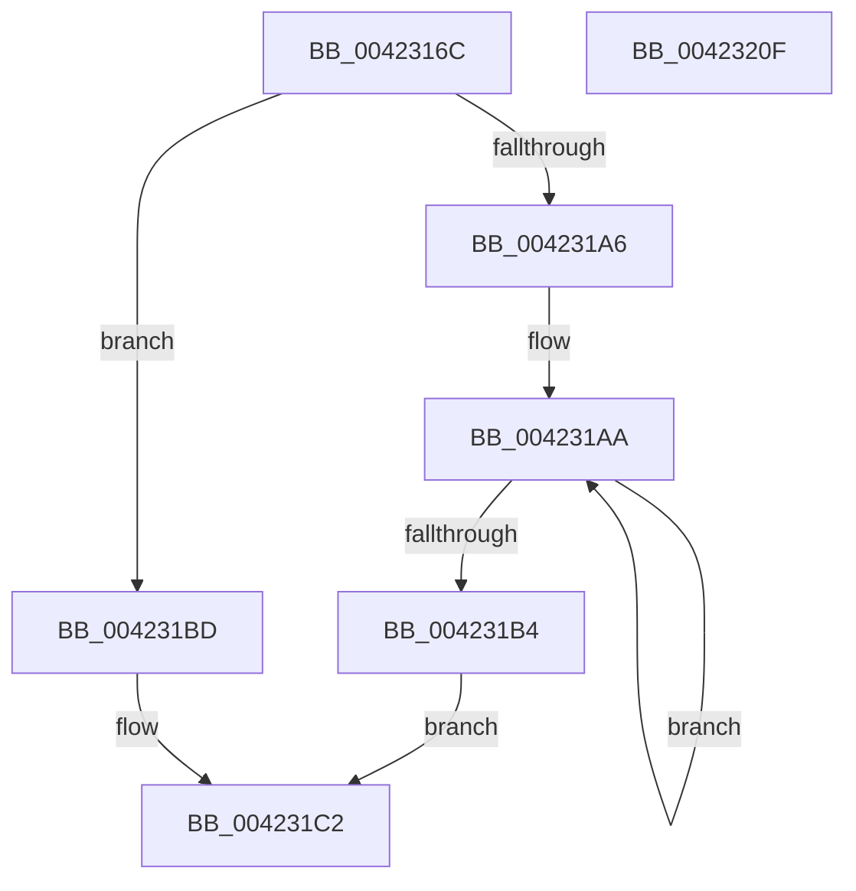

# McTemplateK0dz_EtwWriteTransfer

- RVA: `0x0042316C`–`0x00423210` (길이 `164` bytes)
- VA: `0x000000014042316C`
- 실행 섹션: `.text`
- PDB 이름 있음: `예`; PDB Function 태그: `아니요`
- unwind 정보 RVA: `0x000A030C`
- 디코드: `38`개 명령, `164/164` bytes 표시
- 미해석 바이트: `0` (있으면 어셈블리에 `.byte`로 보존)

> 이 문서는 커널 이미지의 기계어와 PDB 기호를 분석해 생성했습니다. 4번과 5번은 함수 원형과 자료형을 바이너리 사용 방식에서 추정한 C 해석이며 원본 소스 복구 결과는 아닙니다.

## 1. Dependencies

- 직접 호출 지점: **2**; 고유 호출 대상: **2**
- 직접 호출자로 확인된 함수: **6**
- RIP 상대 이미지 참조: **3**

### Outgoing calls
- `0x004231F8` → [McGenEventWrite_EtwWriteTransfer](McGenEventWrite_EtwWriteTransfer_function_00424FC8.md) (function, `0x00424FC8`)
- `0x00423205` → [_security_check_cookie](../6A/_security_check_cookie_function_006AC640.md) (function, `0x006AC640`)

### Direct callers
- [PipProcessRestartPhase1](../../page/74/PipProcessRestartPhase1_function_007407EC.md) at `0x00740826`
- [PipProcessRestartPhase1](../../page/74/PipProcessRestartPhase1_function_007407EC.md) at `0x00740893`
- [PipProcessRestartPhase2](../../page/74/PipProcessRestartPhase2_function_007408B8.md) at `0x007408F0`
- [PipProcessRestartPhase2](../../page/74/PipProcessRestartPhase2_function_007408B8.md) at `0x00740996`
- [PipProcessStartPhase3](../../page/8F/PipProcessStartPhase3_function_008FBAF8.md) at `0x008FBC58`
- [PipProcessStartPhase3](../../page/8F/PipProcessStartPhase3_function_008FBAF8.md) at `0x008FBCD7`
- [PipProcessStartPhase1](../../page/8F/PipProcessStartPhase1_function_008FE1F8.md) at `0x008FE2A1`
- [PipProcessStartPhase1](../../page/8F/PipProcessStartPhase1_function_008FE1F8.md) at `0x008FE2C1`
- [PipProcessStartPhase2](../../page/94/PipProcessStartPhase2_function_0094EE60.md) at `0x0094EEE2`
- [PipProcessStartPhase2](../../page/94/PipProcessStartPhase2_function_0094EE60.md) at `0x0094EF58`
- [PiCMQueryRemove](../../page/AD/PiCMQueryRemove_function_00AD43F4.md) at `0x00AD44AB`

### Static image references
- `0x00423177` → RVA `0x00E0A740` (`.data`; read)
- `0x004231C9` → RVA `0x006CB080` (` ?? ::FNODOBFM::`string'`; read)
- `0x004231E9` → RVA `0x00E06DA0` (`.data`; read)

## 2. Other-region calls and transfers

- 다른 실행 섹션으로 향하는 call: **0**
- 별도 외부 분기/꼬리 이동을 확인하지 못했습니다.

## 3. Assembly (complete function range)

```asm
0042316C  4C 8B DC                        mov r11, rsp
0042316F  45 89 4B 20                     mov dword ptr [r11 + 0x20], r9d
00423173  48 83 EC 78                     sub rsp, 0x78
00423177  48 8B 05 C2 75 9E 00            mov rax, qword ptr [rip + 0x9e75c2]
0042317E  48 33 C4                        xor rax, rsp
00423181  48 89 44 24 60                  mov qword ptr [rsp + 0x60], rax
00423186  48 8B 8C 24 A0 00 00 00         mov rcx, qword ptr [rsp + 0xa0]
0042318E  49 8D 43 20                     lea rax, [r11 + 0x20]
00423192  45 33 C9                        xor r9d, r9d
00423195  49 89 43 C8                     mov qword ptr [r11 - 0x38], rax
00423199  49 C7 43 D0 04 00 00 00         mov qword ptr [r11 - 0x30], 4
004231A1  48 85 C9                        test rcx, rcx
004231A4  74 17                           je 0x1404231bd
004231A6  48 83 C8 FF                     or rax, 0xffffffffffffffff
004231AA  48 FF C0                        inc rax
004231AD  66 44 39 0C 41                  cmp word ptr [rcx + rax*2], r9w
004231B2  75 F6                           jne 0x1404231aa
004231B4  8D 04 45 02 00 00 00            lea eax, [rax*2 + 2]
004231BB  EB 05                           jmp 0x1404231c2
004231BD  B8 0A 00 00 00                  mov eax, 0xa
004231C2  48 85 C9                        test rcx, rcx
004231C5  89 44 24 58                     mov dword ptr [rsp + 0x58], eax
004231C9  4C 8D 05 B0 7E 2A 00            lea r8, [rip + 0x2a7eb0]
004231D0  44 89 4C 24 5C                  mov dword ptr [rsp + 0x5c], r9d
004231D5  49 0F 44 C8                     cmove rcx, r8
004231D9  48 8D 44 24 30                  lea rax, [rsp + 0x30]
004231DE  48 89 4C 24 50                  mov qword ptr [rsp + 0x50], rcx
004231E3  41 B9 03 00 00 00               mov r9d, 3
004231E9  48 8D 0D B0 3B 9E 00            lea rcx, [rip + 0x9e3bb0]
004231F0  48 89 44 24 20                  mov qword ptr [rsp + 0x20], rax
004231F5  45 33 C0                        xor r8d, r8d
004231F8  E8 CB 1D 00 00                  call 0x140424fc8
004231FD  48 8B 4C 24 60                  mov rcx, qword ptr [rsp + 0x60]
00423202  48 33 CC                        xor rcx, rsp
00423205  E8 36 94 28 00                  call 0x1406ac640
0042320A  48 83 C4 78                     add rsp, 0x78
0042320E  C3                              ret
0042320F  CC                              int3
```

## 4. C-style interpretation (structured pseudocode)

```c
__int64 __fastcall McTemplateK0dz_EtwWriteTransfer(__int64 a1, __int64 a2, __int64 a3, int a4, __int64 a5)
{
    __int64 result;
    __int64 v_rsp;
    unsigned __int64 v_stack_m18;
    unsigned int v_stack_m1C;
    unsigned int v_stack_m20;
    unsigned __int64 v_stack_m28;
    unsigned __int64 v_stack_m48;
    unsigned __int64 v_stack_m58;

    *(unsigned int *)(v_rsp + 32) = a4;
    v_rsp = (v_rsp) - (120);
    result = (*(unsigned __int64 *)(v_rip + 10384834)) ^ (v_rsp);
    v_stack_m18 = result;
    a4 = 0;
    *(unsigned __int64 *)(v_rsp - 56) = v_rsp + 32;
    *(unsigned __int64 *)(v_rsp - 48) = 4;
    if (a5 == 0) goto loc_004231BD;
    result = (v_rsp + 32) | (-1);
loc_004231AA:
    result = (result) + 1;
    if ((*(unsigned __int16 *)(a5 + result * 2)) != 0) goto loc_004231AA;
    goto loc_004231C2;
loc_004231BD:
loc_004231C2:
    v_stack_m20 = 10;
    v_stack_m1C = 0;
    if (a5 == 0) { a5 = v_rip + 2784944; }
    v_stack_m28 = a5;
    v_stack_m58 = v_stack_m48;
    a3 = 0;
    result = McGenEventWrite_EtwWriteTransfer(v_rip + 10369968, a2, a3, 3);
    a1 = (v_stack_m18) ^ (v_rsp);
    result = _security_check_cookie(a1, a2, a3, 3);
    v_rsp = (v_rsp) + (120);
    return result;
}
```

## 5. (Beta) C Style

```c
int64_t McTemplateK0dz_EtwWriteTransfer(int64_t Arg1, int64_t Arg2, int64_t Arg3, int32_t Arg4, int64_t Arg5)
{
    int64_t result;
    int64_t local_rsp;
    uint64_t v_stack_m18;
    uint32_t v_stack_m1C;
    uint32_t v_stack_m20;
    uint64_t v_stack_m28;
    uint64_t v_stack_m48;
    uint64_t v_stack_m58;

    *(uint32_t *)(local_rsp + 0x20) = Arg4;
    local_rsp = (local_rsp) - (120);
    result = (*(uint64_t *)(v_rip + 0x9E75C2)) ^ (local_rsp);
    v_stack_m18 = result;
    Arg4 = 0;
    *(uint64_t *)(local_rsp - 0x38) = local_rsp + 32;
    *(uint64_t *)(local_rsp - 0x30) = 4;
    if (Arg5 == 0) goto loc_004231BD;
    result = (local_rsp + 32) | (-1);
loc_004231AA:
    result = (result) + 1;
    if ((*(uint16_t *)(Arg5 + result * 2)) != 0) goto loc_004231AA;
    goto loc_004231C2;
loc_004231BD:
loc_004231C2:
    v_stack_m20 = 10;
    v_stack_m1C = 0;
    if (Arg5 == 0) { Arg5 = v_rip + 2784944; }
    v_stack_m28 = Arg5;
    v_stack_m58 = v_stack_m48;
    Arg3 = 0;
    result = McGenEventWrite_EtwWriteTransfer(v_rip + 10369968, Arg2, Arg3, 3);
    Arg1 = (v_stack_m18) ^ (local_rsp);
    result = _security_check_cookie(Arg1, Arg2, Arg3, 3);
    local_rsp = (local_rsp) + (120);
    return result;
}
```

## 6. Execution-region graph

[열기: 2D/3D 그래프와 함수 탐색 컨트롤 패널](../../../control-panel.html?section=text&rva=0x0042316C&view=graph)

- 2D 그래프는 위에서 아래로 흐르고, 3D 그래프는 빈 공간을 드래그해 회전합니다. Shift+드래그는 이동, 휠은 확대·축소, 함수 노드 선택은 대상 보고서 이동입니다.

### Static fallback


