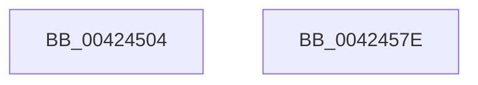

# McTemplateK0jhzr1_EtwWriteTransfer

- RVA: `0x00424504`–`0x0042457F` (길이 `123` bytes)
- VA: `0x0000000140424504`
- 실행 섹션: `.text`
- PDB 이름 있음: `예`; PDB Function 태그: `아니요`
- unwind 정보 RVA: `0x000886E8`
- 디코드: `30`개 명령, `123/123` bytes 표시
- 미해석 바이트: `0` (있으면 어셈블리에 `.byte`로 보존)

> 이 문서는 커널 이미지의 기계어와 PDB 기호를 분석해 생성했습니다. 4번과 5번은 함수 원형과 자료형을 바이너리 사용 방식에서 추정한 C 해석이며 원본 소스 복구 결과는 아닙니다.

## 1. Dependencies

- 직접 호출 지점: **2**; 고유 호출 대상: **2**
- 직접 호출자로 확인된 함수: **1**
- RIP 상대 이미지 참조: **2**

### Outgoing calls
- `0x00424564` → [McGenEventWrite_EtwWriteTransfer](McGenEventWrite_EtwWriteTransfer_function_00424FC8.md) (function, `0x00424FC8`)
- `0x00424570` → [_security_check_cookie](../6A/_security_check_cookie_function_006AC640.md) (function, `0x006AC640`)

### Direct callers
- [IopMountVolume](../../page/A3/IopMountVolume_function_00A329D0.md) at `0x00A32ED1`
- [IopMountVolume](../../page/A3/IopMountVolume_function_00A329D0.md) at `0x00A32FC2`

### Static image references
- `0x00424510` → RVA `0x00E0A740` (`.data`; read)
- `0x0042453F` → RVA `0x00E06E20` (`.data`; read)

## 2. Other-region calls and transfers

- 다른 실행 섹션으로 향하는 call: **0**
- 별도 외부 분기/꼬리 이동을 확인하지 못했습니다.

## 3. Assembly (complete function range)

```asm
00424504  40 55                           push rbp
00424506  48 8B EC                        mov rbp, rsp
00424509  48 81 EC 80 00 00 00            sub rsp, 0x80
00424510  48 8B 05 29 62 9E 00            mov rax, qword ptr [rip + 0x9e6229]
00424517  48 33 C4                        xor rax, rsp
0042451A  48 89 45 F0                     mov qword ptr [rbp - 0x10], rax
0042451E  33 C9                           xor ecx, ecx
00424520  4C 89 4D C0                     mov qword ptr [rbp - 0x40], r9
00424524  48 8D 45 30                     lea rax, [rbp + 0x30]
00424528  89 4D EC                        mov dword ptr [rbp - 0x14], ecx
0042452B  48 89 45 D0                     mov qword ptr [rbp - 0x30], rax
0042452F  48 8B 45 38                     mov rax, qword ptr [rbp + 0x38]
00424533  48 89 45 E0                     mov qword ptr [rbp - 0x20], rax
00424537  44 8D 49 04                     lea r9d, [rcx + 4]
0042453B  0F B7 45 30                     movzx eax, word ptr [rbp + 0x30]
0042453F  48 8D 0D DA 28 9E 00            lea rcx, [rip + 0x9e28da]
00424546  03 C0                           add eax, eax
00424548  48 C7 45 C8 10 00 00 00         mov qword ptr [rbp - 0x38], 0x10
00424550  89 45 E8                        mov dword ptr [rbp - 0x18], eax
00424553  48 8D 45 B0                     lea rax, [rbp - 0x50]
00424557  48 89 44 24 20                  mov qword ptr [rsp + 0x20], rax
0042455C  48 C7 45 D8 02 00 00 00         mov qword ptr [rbp - 0x28], 2
00424564  E8 5F 0A 00 00                  call 0x140424fc8
00424569  48 8B 4D F0                     mov rcx, qword ptr [rbp - 0x10]
0042456D  48 33 CC                        xor rcx, rsp
00424570  E8 CB 80 28 00                  call 0x1406ac640
00424575  48 81 C4 80 00 00 00            add rsp, 0x80
0042457C  5D                              pop rbp
0042457D  C3                              ret
0042457E  CC                              int3
```

## 4. C-style interpretation (structured pseudocode)

```c
__int64 __fastcall McTemplateK0jhzr1_EtwWriteTransfer(int a1, __int64 a2, __int64 a3, __int64 a4, unsigned __int16 a5, __int64 a6)
{
    __int64 result;
    __int64 v_rsp;
    unsigned __int64 v_stack_m18;
    unsigned int v_stack_m1C;
    unsigned int v_stack_m20;
    unsigned __int64 v_stack_m28;
    unsigned __int64 v_stack_m30;
    unsigned __int64 v_stack_m38;
    unsigned __int64 v_stack_m40;
    unsigned __int64 v_stack_m48;
    unsigned __int64 v_stack_m58;
    unsigned __int64 v_stack_m68;

    v_rsp = (v_rsp) - (128);
    result = (*(unsigned __int64 *)(v_rip + 10379817)) ^ (v_rsp);
    v_stack_m18 = result;
    a1 = 0;
    v_stack_m48 = a4;
    v_stack_m1C = 0;
    v_stack_m38 = a5;
    v_stack_m28 = a6;
    result = (unsigned int)((a5) + (a5));
    v_stack_m40 = 16;
    v_stack_m20 = (unsigned int)(result);
    v_stack_m68 = v_stack_m58;
    v_stack_m30 = 2;
    result = McGenEventWrite_EtwWriteTransfer(v_rip + 10365146, a2, a3, a1 + 4);
    a1 = (v_stack_m18) ^ (v_rsp);
    result = _security_check_cookie(a1, a2, a3, a1 + 4);
    v_rsp = (v_rsp) + (128);
    return result;
}
```

## 5. (Beta) C Style

```c
int64_t McTemplateK0jhzr1_EtwWriteTransfer(int32_t Arg1, int64_t Arg2, int64_t Arg3, int64_t Arg4, uint16_t Arg5, int64_t Arg6)
{
    int64_t result;
    int64_t local_rsp;
    uint64_t v_stack_m18;
    uint32_t v_stack_m1C;
    uint32_t v_stack_m20;
    uint64_t v_stack_m28;
    uint64_t v_stack_m30;
    uint64_t v_stack_m38;
    uint64_t v_stack_m40;
    uint64_t v_stack_m48;
    uint64_t v_stack_m58;
    uint64_t v_stack_m68;

    local_rsp = (local_rsp) - (128);
    result = (*(uint64_t *)(v_rip + 0x9E6229)) ^ (local_rsp);
    v_stack_m18 = result;
    Arg1 = 0;
    v_stack_m48 = Arg4;
    v_stack_m1C = 0;
    v_stack_m38 = Arg5;
    v_stack_m28 = Arg6;
    result = (uint32_t)((Arg5) + (Arg5));
    v_stack_m40 = 16;
    v_stack_m20 = (uint32_t)(result);
    v_stack_m68 = v_stack_m58;
    v_stack_m30 = 2;
    result = McGenEventWrite_EtwWriteTransfer(v_rip + 10365146, Arg2, Arg3, Arg1 + 4);
    Arg1 = (v_stack_m18) ^ (local_rsp);
    result = _security_check_cookie(Arg1, Arg2, Arg3, Arg1 + 4);
    local_rsp = (local_rsp) + (128);
    return result;
}
```

## 6. Execution-region graph

[열기: 2D/3D 그래프와 함수 탐색 컨트롤 패널](../../../control-panel.html?section=text&rva=0x00424504&view=graph)

- 2D 그래프는 위에서 아래로 흐르고, 3D 그래프는 빈 공간을 드래그해 회전합니다. Shift+드래그는 이동, 휠은 확대·축소, 함수 노드 선택은 대상 보고서 이동입니다.

### Static fallback


