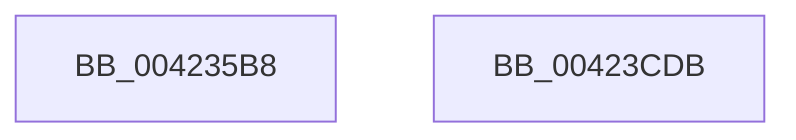

# McTemplateK0jxxxxxxxxxxxxxxxxxxxxxxxxxxxxxxxxxxxxxxxxxxxxxxxxxxxxxxxxxxxxxxxxxxxxxxxxx_EtwWriteTransfer

- RVA: `0x004235B8`–`0x00423CDC` (길이 `1,828` bytes)
- VA: `0x00000001404235B8`
- 실행 섹션: `.text`
- PDB 이름 있음: `예`; PDB Function 태그: `아니요`
- unwind 정보 RVA: `0x000A0364`
- 디코드: `241`개 명령, `1,828/1,828` bytes 표시
- 미해석 바이트: `0` (있으면 어셈블리에 `.byte`로 보존)

> 이 문서는 커널 이미지의 기계어와 PDB 기호를 분석해 생성했습니다. 4번과 5번은 함수 원형과 자료형을 바이너리 사용 방식에서 추정한 C 해석이며 원본 소스 복구 결과는 아닙니다.

## 1. Dependencies

- 직접 호출 지점: **2**; 고유 호출 대상: **2**
- 직접 호출자로 확인된 함수: **1**
- RIP 상대 이미지 참조: **3**

### Outgoing calls
- `0x00423CBE` → [McGenEventWrite_EtwWriteTransfer](McGenEventWrite_EtwWriteTransfer_function_00424FC8.md) (function, `0x00424FC8`)
- `0x00423CCD` → [_security_check_cookie](../6A/_security_check_cookie_function_006AC640.md) (function, `0x006AC640`)

### Direct callers
- [CcPostVolumeTelemetry](CcPostVolumeTelemetry_function_00420FF8.md) at `0x00421DB1`

### Static image references
- `0x004235C9` → RVA `0x00E0A740` (`.data`; read)
- `0x00423AB7` → RVA `0x00013F50` (`.rdata`; read)
- `0x00423AD7` → RVA `0x00E06BD0` (`.data`; read)

## 2. Other-region calls and transfers

- 다른 실행 섹션으로 향하는 call: **0**
- 별도 외부 분기/꼬리 이동을 확인하지 못했습니다.

## 3. Assembly (complete function range)

```asm
004235B8  40 55                           push rbp
004235BA  48 8D AC 24 10 FC FF FF         lea rbp, [rsp - 0x3f0]
004235C2  48 81 EC F0 04 00 00            sub rsp, 0x4f0
004235C9  48 8B 05 70 71 9E 00            mov rax, qword ptr [rip + 0x9e7170]
004235D0  48 33 C4                        xor rax, rsp
004235D3  48 89 85 E0 03 00 00            mov qword ptr [rbp + 0x3e0], rax
004235DA  48 8D 85 20 04 00 00            lea rax, [rbp + 0x420]
004235E1  4C 89 4C 24 40                  mov qword ptr [rsp + 0x40], r9
004235E6  48 89 44 24 50                  mov qword ptr [rsp + 0x50], rax
004235EB  48 8D 85 28 04 00 00            lea rax, [rbp + 0x428]
004235F2  48 89 44 24 60                  mov qword ptr [rsp + 0x60], rax
004235F7  48 8D 85 30 04 00 00            lea rax, [rbp + 0x430]
004235FE  48 89 44 24 70                  mov qword ptr [rsp + 0x70], rax
00423603  48 8D 85 38 04 00 00            lea rax, [rbp + 0x438]
0042360A  48 89 45 80                     mov qword ptr [rbp - 0x80], rax
0042360E  48 8D 85 40 04 00 00            lea rax, [rbp + 0x440]
00423615  48 89 45 90                     mov qword ptr [rbp - 0x70], rax
00423619  48 8D 85 48 04 00 00            lea rax, [rbp + 0x448]
00423620  48 89 45 A0                     mov qword ptr [rbp - 0x60], rax
00423624  48 8D 85 50 04 00 00            lea rax, [rbp + 0x450]
0042362B  48 89 45 B0                     mov qword ptr [rbp - 0x50], rax
0042362F  48 8D 85 58 04 00 00            lea rax, [rbp + 0x458]
00423636  48 89 45 C0                     mov qword ptr [rbp - 0x40], rax
0042363A  48 8D 85 60 04 00 00            lea rax, [rbp + 0x460]
00423641  48 89 45 D0                     mov qword ptr [rbp - 0x30], rax
00423645  48 8D 85 68 04 00 00            lea rax, [rbp + 0x468]
0042364C  48 89 45 E0                     mov qword ptr [rbp - 0x20], rax
00423650  48 8D 85 70 04 00 00            lea rax, [rbp + 0x470]
00423657  48 89 45 F0                     mov qword ptr [rbp - 0x10], rax
0042365B  48 8D 85 78 04 00 00            lea rax, [rbp + 0x478]
00423662  48 89 45 00                     mov qword ptr [rbp], rax
00423666  48 8D 85 80 04 00 00            lea rax, [rbp + 0x480]
0042366D  48 89 45 10                     mov qword ptr [rbp + 0x10], rax
00423671  48 8D 85 88 04 00 00            lea rax, [rbp + 0x488]
00423678  48 89 45 20                     mov qword ptr [rbp + 0x20], rax
0042367C  48 8D 85 90 04 00 00            lea rax, [rbp + 0x490]
00423683  48 89 45 30                     mov qword ptr [rbp + 0x30], rax
00423687  48 8D 85 98 04 00 00            lea rax, [rbp + 0x498]
0042368E  48 89 45 40                     mov qword ptr [rbp + 0x40], rax
00423692  48 8D 85 A0 04 00 00            lea rax, [rbp + 0x4a0]
00423699  48 89 45 50                     mov qword ptr [rbp + 0x50], rax
0042369D  48 8D 85 A8 04 00 00            lea rax, [rbp + 0x4a8]
004236A4  48 89 45 60                     mov qword ptr [rbp + 0x60], rax
004236A8  48 8D 85 B0 04 00 00            lea rax, [rbp + 0x4b0]
004236AF  48 89 45 70                     mov qword ptr [rbp + 0x70], rax
004236B3  48 8D 85 B8 04 00 00            lea rax, [rbp + 0x4b8]
004236BA  48 89 85 80 00 00 00            mov qword ptr [rbp + 0x80], rax
004236C1  48 8D 85 C0 04 00 00            lea rax, [rbp + 0x4c0]
004236C8  48 89 85 90 00 00 00            mov qword ptr [rbp + 0x90], rax
004236CF  48 8D 85 C8 04 00 00            lea rax, [rbp + 0x4c8]
004236D6  48 89 85 A0 00 00 00            mov qword ptr [rbp + 0xa0], rax
004236DD  48 8D 85 D0 04 00 00            lea rax, [rbp + 0x4d0]
004236E4  48 89 85 B0 00 00 00            mov qword ptr [rbp + 0xb0], rax
004236EB  48 8D 85 D8 04 00 00            lea rax, [rbp + 0x4d8]
004236F2  48 89 85 C0 00 00 00            mov qword ptr [rbp + 0xc0], rax
004236F9  48 8D 85 E0 04 00 00            lea rax, [rbp + 0x4e0]
00423700  48 89 85 D0 00 00 00            mov qword ptr [rbp + 0xd0], rax
00423707  48 8D 85 E8 04 00 00            lea rax, [rbp + 0x4e8]
0042370E  48 89 85 E0 00 00 00            mov qword ptr [rbp + 0xe0], rax
00423715  48 8D 85 F0 04 00 00            lea rax, [rbp + 0x4f0]
0042371C  48 C7 44 24 48 10 00 00 00      mov qword ptr [rsp + 0x48], 0x10
00423725  48 C7 44 24 58 08 00 00 00      mov qword ptr [rsp + 0x58], 8
0042372E  48 C7 44 24 68 08 00 00 00      mov qword ptr [rsp + 0x68], 8
00423737  48 C7 44 24 78 08 00 00 00      mov qword ptr [rsp + 0x78], 8
00423740  48 C7 45 88 08 00 00 00         mov qword ptr [rbp - 0x78], 8
00423748  48 C7 45 98 08 00 00 00         mov qword ptr [rbp - 0x68], 8
00423750  48 C7 45 A8 08 00 00 00         mov qword ptr [rbp - 0x58], 8
00423758  48 C7 45 B8 08 00 00 00         mov qword ptr [rbp - 0x48], 8
00423760  48 C7 45 C8 08 00 00 00         mov qword ptr [rbp - 0x38], 8
00423768  48 C7 45 D8 08 00 00 00         mov qword ptr [rbp - 0x28], 8
00423770  48 C7 45 E8 08 00 00 00         mov qword ptr [rbp - 0x18], 8
00423778  48 C7 45 F8 08 00 00 00         mov qword ptr [rbp - 8], 8
00423780  48 C7 45 08 08 00 00 00         mov qword ptr [rbp + 8], 8
00423788  48 C7 45 18 08 00 00 00         mov qword ptr [rbp + 0x18], 8
00423790  48 C7 45 28 08 00 00 00         mov qword ptr [rbp + 0x28], 8
00423798  48 C7 45 38 08 00 00 00         mov qword ptr [rbp + 0x38], 8
004237A0  48 C7 45 48 08 00 00 00         mov qword ptr [rbp + 0x48], 8
004237A8  48 C7 45 58 08 00 00 00         mov qword ptr [rbp + 0x58], 8
004237B0  48 C7 45 68 08 00 00 00         mov qword ptr [rbp + 0x68], 8
004237B8  48 C7 45 78 08 00 00 00         mov qword ptr [rbp + 0x78], 8
004237C0  48 C7 85 88 00 00 00 08 00 00 00  mov qword ptr [rbp + 0x88], 8
004237CB  48 C7 85 98 00 00 00 08 00 00 00  mov qword ptr [rbp + 0x98], 8
004237D6  48 C7 85 A8 00 00 00 08 00 00 00  mov qword ptr [rbp + 0xa8], 8
004237E1  48 C7 85 B8 00 00 00 08 00 00 00  mov qword ptr [rbp + 0xb8], 8
004237EC  48 C7 85 C8 00 00 00 08 00 00 00  mov qword ptr [rbp + 0xc8], 8
004237F7  48 C7 85 D8 00 00 00 08 00 00 00  mov qword ptr [rbp + 0xd8], 8
00423802  48 C7 85 E8 00 00 00 08 00 00 00  mov qword ptr [rbp + 0xe8], 8
0042380D  48 89 85 F0 00 00 00            mov qword ptr [rbp + 0xf0], rax
00423814  48 8D 85 F8 04 00 00            lea rax, [rbp + 0x4f8]
0042381B  48 89 85 00 01 00 00            mov qword ptr [rbp + 0x100], rax
00423822  48 8D 85 00 05 00 00            lea rax, [rbp + 0x500]
00423829  48 89 85 10 01 00 00            mov qword ptr [rbp + 0x110], rax
00423830  48 8D 85 08 05 00 00            lea rax, [rbp + 0x508]
00423837  48 89 85 20 01 00 00            mov qword ptr [rbp + 0x120], rax
0042383E  48 8D 85 10 05 00 00            lea rax, [rbp + 0x510]
00423845  48 89 85 30 01 00 00            mov qword ptr [rbp + 0x130], rax
0042384C  48 8D 85 18 05 00 00            lea rax, [rbp + 0x518]
00423853  48 89 85 40 01 00 00            mov qword ptr [rbp + 0x140], rax
0042385A  48 8D 85 20 05 00 00            lea rax, [rbp + 0x520]
00423861  48 89 85 50 01 00 00            mov qword ptr [rbp + 0x150], rax
00423868  48 8D 85 28 05 00 00            lea rax, [rbp + 0x528]
0042386F  48 89 85 60 01 00 00            mov qword ptr [rbp + 0x160], rax
00423876  48 8D 85 30 05 00 00            lea rax, [rbp + 0x530]
0042387D  48 89 85 70 01 00 00            mov qword ptr [rbp + 0x170], rax
00423884  48 8D 85 38 05 00 00            lea rax, [rbp + 0x538]
0042388B  48 89 85 80 01 00 00            mov qword ptr [rbp + 0x180], rax
00423892  48 8D 85 40 05 00 00            lea rax, [rbp + 0x540]
00423899  48 89 85 90 01 00 00            mov qword ptr [rbp + 0x190], rax
004238A0  48 8D 85 48 05 00 00            lea rax, [rbp + 0x548]
004238A7  48 89 85 A0 01 00 00            mov qword ptr [rbp + 0x1a0], rax
004238AE  48 8D 85 50 05 00 00            lea rax, [rbp + 0x550]
004238B5  48 89 85 B0 01 00 00            mov qword ptr [rbp + 0x1b0], rax
004238BC  48 8D 85 58 05 00 00            lea rax, [rbp + 0x558]
004238C3  48 89 85 C0 01 00 00            mov qword ptr [rbp + 0x1c0], rax
004238CA  48 8D 85 60 05 00 00            lea rax, [rbp + 0x560]
004238D1  48 89 85 D0 01 00 00            mov qword ptr [rbp + 0x1d0], rax
004238D8  48 8D 85 68 05 00 00            lea rax, [rbp + 0x568]
004238DF  48 89 85 E0 01 00 00            mov qword ptr [rbp + 0x1e0], rax
004238E6  48 8D 85 70 05 00 00            lea rax, [rbp + 0x570]
004238ED  48 89 85 F0 01 00 00            mov qword ptr [rbp + 0x1f0], rax
004238F4  48 8D 85 78 05 00 00            lea rax, [rbp + 0x578]
004238FB  48 89 85 00 02 00 00            mov qword ptr [rbp + 0x200], rax
00423902  48 8D 85 80 05 00 00            lea rax, [rbp + 0x580]
00423909  48 89 85 10 02 00 00            mov qword ptr [rbp + 0x210], rax
00423910  48 8D 85 88 05 00 00            lea rax, [rbp + 0x588]
00423917  48 89 85 20 02 00 00            mov qword ptr [rbp + 0x220], rax
0042391E  48 8D 85 90 05 00 00            lea rax, [rbp + 0x590]
00423925  48 89 85 30 02 00 00            mov qword ptr [rbp + 0x230], rax
0042392C  48 8D 85 98 05 00 00            lea rax, [rbp + 0x598]
00423933  48 89 85 40 02 00 00            mov qword ptr [rbp + 0x240], rax
0042393A  48 8D 85 A0 05 00 00            lea rax, [rbp + 0x5a0]
00423941  48 89 85 50 02 00 00            mov qword ptr [rbp + 0x250], rax
00423948  48 8D 85 A8 05 00 00            lea rax, [rbp + 0x5a8]
0042394F  48 89 85 60 02 00 00            mov qword ptr [rbp + 0x260], rax
00423956  48 8D 85 B0 05 00 00            lea rax, [rbp + 0x5b0]
0042395D  48 89 85 70 02 00 00            mov qword ptr [rbp + 0x270], rax
00423964  48 8D 85 B8 05 00 00            lea rax, [rbp + 0x5b8]
0042396B  48 89 85 80 02 00 00            mov qword ptr [rbp + 0x280], rax
00423972  48 8D 85 C0 05 00 00            lea rax, [rbp + 0x5c0]
00423979  48 89 85 90 02 00 00            mov qword ptr [rbp + 0x290], rax
00423980  48 8D 85 C8 05 00 00            lea rax, [rbp + 0x5c8]
00423987  48 C7 85 F8 00 00 00 08 00 00 00  mov qword ptr [rbp + 0xf8], 8
00423992  48 C7 85 08 01 00 00 08 00 00 00  mov qword ptr [rbp + 0x108], 8
0042399D  48 C7 85 18 01 00 00 08 00 00 00  mov qword ptr [rbp + 0x118], 8
004239A8  48 C7 85 28 01 00 00 08 00 00 00  mov qword ptr [rbp + 0x128], 8
004239B3  48 C7 85 38 01 00 00 08 00 00 00  mov qword ptr [rbp + 0x138], 8
004239BE  48 C7 85 48 01 00 00 08 00 00 00  mov qword ptr [rbp + 0x148], 8
004239C9  48 C7 85 58 01 00 00 08 00 00 00  mov qword ptr [rbp + 0x158], 8
004239D4  48 C7 85 68 01 00 00 08 00 00 00  mov qword ptr [rbp + 0x168], 8
004239DF  48 C7 85 78 01 00 00 08 00 00 00  mov qword ptr [rbp + 0x178], 8
004239EA  48 C7 85 88 01 00 00 08 00 00 00  mov qword ptr [rbp + 0x188], 8
004239F5  48 C7 85 98 01 00 00 08 00 00 00  mov qword ptr [rbp + 0x198], 8
00423A00  48 C7 85 A8 01 00 00 08 00 00 00  mov qword ptr [rbp + 0x1a8], 8
00423A0B  48 C7 85 B8 01 00 00 08 00 00 00  mov qword ptr [rbp + 0x1b8], 8
00423A16  48 C7 85 C8 01 00 00 08 00 00 00  mov qword ptr [rbp + 0x1c8], 8
00423A21  48 C7 85 D8 01 00 00 08 00 00 00  mov qword ptr [rbp + 0x1d8], 8
00423A2C  48 C7 85 E8 01 00 00 08 00 00 00  mov qword ptr [rbp + 0x1e8], 8
00423A37  48 C7 85 F8 01 00 00 08 00 00 00  mov qword ptr [rbp + 0x1f8], 8
00423A42  48 C7 85 08 02 00 00 08 00 00 00  mov qword ptr [rbp + 0x208], 8
00423A4D  48 C7 85 18 02 00 00 08 00 00 00  mov qword ptr [rbp + 0x218], 8
00423A58  48 C7 85 28 02 00 00 08 00 00 00  mov qword ptr [rbp + 0x228], 8
00423A63  48 C7 85 38 02 00 00 08 00 00 00  mov qword ptr [rbp + 0x238], 8
00423A6E  48 C7 85 48 02 00 00 08 00 00 00  mov qword ptr [rbp + 0x248], 8
00423A79  48 C7 85 58 02 00 00 08 00 00 00  mov qword ptr [rbp + 0x258], 8
00423A84  48 C7 85 68 02 00 00 08 00 00 00  mov qword ptr [rbp + 0x268], 8
00423A8F  48 C7 85 78 02 00 00 08 00 00 00  mov qword ptr [rbp + 0x278], 8
00423A9A  48 C7 85 88 02 00 00 08 00 00 00  mov qword ptr [rbp + 0x288], 8
00423AA5  48 C7 85 98 02 00 00 08 00 00 00  mov qword ptr [rbp + 0x298], 8
00423AB0  48 89 85 A0 02 00 00            mov qword ptr [rbp + 0x2a0], rax
00423AB7  48 8D 15 92 04 BF FF            lea rdx, [rip - 0x40fb6e]
00423ABE  48 8D 85 D0 05 00 00            lea rax, [rbp + 0x5d0]
00423AC5  48 C7 85 A8 02 00 00 08 00 00 00  mov qword ptr [rbp + 0x2a8], 8
00423AD0  48 89 85 B0 02 00 00            mov qword ptr [rbp + 0x2b0], rax
00423AD7  48 8D 0D F2 30 9E 00            lea rcx, [rip + 0x9e30f2]
00423ADE  48 8D 85 D8 05 00 00            lea rax, [rbp + 0x5d8]
00423AE5  48 C7 85 B8 02 00 00 08 00 00 00  mov qword ptr [rbp + 0x2b8], 8
00423AF0  48 89 85 C0 02 00 00            mov qword ptr [rbp + 0x2c0], rax
00423AF7  41 B9 4B 00 00 00               mov r9d, 0x4b
00423AFD  48 8D 85 E0 05 00 00            lea rax, [rbp + 0x5e0]
00423B04  48 C7 85 C8 02 00 00 08 00 00 00  mov qword ptr [rbp + 0x2c8], 8
00423B0F  48 89 85 D0 02 00 00            mov qword ptr [rbp + 0x2d0], rax
00423B16  45 33 C0                        xor r8d, r8d
00423B19  48 8D 85 E8 05 00 00            lea rax, [rbp + 0x5e8]
00423B20  48 C7 85 D8 02 00 00 08 00 00 00  mov qword ptr [rbp + 0x2d8], 8
00423B2B  48 89 85 E0 02 00 00            mov qword ptr [rbp + 0x2e0], rax
00423B32  48 8D 85 F0 05 00 00            lea rax, [rbp + 0x5f0]
00423B39  48 89 85 F0 02 00 00            mov qword ptr [rbp + 0x2f0], rax
00423B40  48 8D 85 F8 05 00 00            lea rax, [rbp + 0x5f8]
00423B47  48 89 85 00 03 00 00            mov qword ptr [rbp + 0x300], rax
00423B4E  48 8D 85 00 06 00 00            lea rax, [rbp + 0x600]
00423B55  48 89 85 10 03 00 00            mov qword ptr [rbp + 0x310], rax
00423B5C  48 8D 85 08 06 00 00            lea rax, [rbp + 0x608]
00423B63  48 89 85 20 03 00 00            mov qword ptr [rbp + 0x320], rax
00423B6A  48 8D 85 10 06 00 00            lea rax, [rbp + 0x610]
00423B71  48 89 85 30 03 00 00            mov qword ptr [rbp + 0x330], rax
00423B78  48 8D 85 18 06 00 00            lea rax, [rbp + 0x618]
00423B7F  48 89 85 40 03 00 00            mov qword ptr [rbp + 0x340], rax
00423B86  48 8D 85 20 06 00 00            lea rax, [rbp + 0x620]
00423B8D  48 89 85 50 03 00 00            mov qword ptr [rbp + 0x350], rax
00423B94  48 8D 85 28 06 00 00            lea rax, [rbp + 0x628]
00423B9B  48 89 85 60 03 00 00            mov qword ptr [rbp + 0x360], rax
00423BA2  48 8D 85 30 06 00 00            lea rax, [rbp + 0x630]
00423BA9  48 89 85 70 03 00 00            mov qword ptr [rbp + 0x370], rax
00423BB0  48 8D 85 38 06 00 00            lea rax, [rbp + 0x638]
00423BB7  48 89 85 80 03 00 00            mov qword ptr [rbp + 0x380], rax
00423BBE  48 8D 85 40 06 00 00            lea rax, [rbp + 0x640]
00423BC5  48 89 85 90 03 00 00            mov qword ptr [rbp + 0x390], rax
00423BCC  48 8D 85 48 06 00 00            lea rax, [rbp + 0x648]
00423BD3  48 89 85 A0 03 00 00            mov qword ptr [rbp + 0x3a0], rax
00423BDA  48 8D 85 50 06 00 00            lea rax, [rbp + 0x650]
00423BE1  48 89 85 B0 03 00 00            mov qword ptr [rbp + 0x3b0], rax
00423BE8  48 8D 85 58 06 00 00            lea rax, [rbp + 0x658]
00423BEF  48 89 85 C0 03 00 00            mov qword ptr [rbp + 0x3c0], rax
00423BF6  48 8D 85 60 06 00 00            lea rax, [rbp + 0x660]
00423BFD  48 89 85 D0 03 00 00            mov qword ptr [rbp + 0x3d0], rax
00423C04  48 8D 44 24 30                  lea rax, [rsp + 0x30]
00423C09  48 89 44 24 20                  mov qword ptr [rsp + 0x20], rax
00423C0E  48 C7 85 E8 02 00 00 08 00 00 00  mov qword ptr [rbp + 0x2e8], 8
00423C19  48 C7 85 F8 02 00 00 08 00 00 00  mov qword ptr [rbp + 0x2f8], 8
00423C24  48 C7 85 08 03 00 00 08 00 00 00  mov qword ptr [rbp + 0x308], 8
00423C2F  48 C7 85 18 03 00 00 08 00 00 00  mov qword ptr [rbp + 0x318], 8
00423C3A  48 C7 85 28 03 00 00 08 00 00 00  mov qword ptr [rbp + 0x328], 8
00423C45  48 C7 85 38 03 00 00 08 00 00 00  mov qword ptr [rbp + 0x338], 8
00423C50  48 C7 85 48 03 00 00 08 00 00 00  mov qword ptr [rbp + 0x348], 8
00423C5B  48 C7 85 58 03 00 00 08 00 00 00  mov qword ptr [rbp + 0x358], 8
00423C66  48 C7 85 68 03 00 00 08 00 00 00  mov qword ptr [rbp + 0x368], 8
00423C71  48 C7 85 78 03 00 00 08 00 00 00  mov qword ptr [rbp + 0x378], 8
00423C7C  48 C7 85 88 03 00 00 08 00 00 00  mov qword ptr [rbp + 0x388], 8
00423C87  48 C7 85 98 03 00 00 08 00 00 00  mov qword ptr [rbp + 0x398], 8
00423C92  48 C7 85 A8 03 00 00 08 00 00 00  mov qword ptr [rbp + 0x3a8], 8
00423C9D  48 C7 85 B8 03 00 00 08 00 00 00  mov qword ptr [rbp + 0x3b8], 8
00423CA8  48 C7 85 C8 03 00 00 08 00 00 00  mov qword ptr [rbp + 0x3c8], 8
00423CB3  48 C7 85 D8 03 00 00 08 00 00 00  mov qword ptr [rbp + 0x3d8], 8
00423CBE  E8 05 13 00 00                  call 0x140424fc8
00423CC3  48 8B 8D E0 03 00 00            mov rcx, qword ptr [rbp + 0x3e0]
00423CCA  48 33 CC                        xor rcx, rsp
00423CCD  E8 6E 89 28 00                  call 0x1406ac640
00423CD2  48 81 C4 F0 04 00 00            add rsp, 0x4f0
00423CD9  5D                              pop rbp
00423CDA  C3                              ret
00423CDB  CC                              int3
```

## 4. C-style interpretation (structured pseudocode)

```c
__int64 __fastcall McTemplateK0jxxxxxxxxxxxxxxxxxxxxxxxxxxxxxxxxxxxxxxxxxxxxxxxxxxxxxxxxxxxxxxxxxxxxxxxxx_EtwWriteTrans(__int64 a1, __int64 a2, int a3, __int64 a4, __int64 a5, __int64 a6, __int64 a7, __int64 a8, __int64 a9, __int64 a10, __int64 a11, __int64 a12, __int64 a13, __int64 a14, __int64 a15, __int64 a16, __int64 a17, __int64 a18, __int64 a19, __int64 a20, __int64 a21, __int64 a22, __int64 a23, __int64 a24, __int64 a25, __int64 a26, __int64 a27, __int64 a28, __int64 a29, __int64 a30, __int64 a31, __int64 a32, __int64 a33, __int64 a34, __int64 a35, __int64 a36, __int64 a37, __int64 a38, __int64 a39, __int64 a40, __int64 a41, __int64 a42, __int64 a43, __int64 a44, __int64 a45, __int64 a46, __int64 a47, __int64 a48, __int64 a49, __int64 a50, __int64 a51, __int64 a52, __int64 a53, __int64 a54, __int64 a55, __int64 a56, __int64 a57, __int64 a58, __int64 a59, __int64 a60, __int64 a61, __int64 a62, __int64 a63, __int64 a64, __int64 a65, __int64 a66, __int64 a67, __int64 a68, __int64 a69, __int64 a70, __int64 a71, __int64 a72, __int64 a73, __int64 a74, __int64 a75, __int64 a76, __int64 a77)
{
    __int64 result;
    __int64 v_rsp;
    unsigned __int64 v_stack_m100;
    unsigned __int64 v_stack_m108;
    unsigned __int64 v_stack_m110;
    unsigned __int64 v_stack_m118;
    unsigned __int64 v_stack_m120;
    unsigned __int64 v_stack_m128;
    unsigned __int64 v_stack_m130;
    unsigned __int64 v_stack_m138;
    unsigned __int64 v_stack_m140;
    unsigned __int64 v_stack_m148;
    unsigned __int64 v_stack_m150;
    unsigned __int64 v_stack_m158;
    unsigned __int64 v_stack_m160;
    unsigned __int64 v_stack_m168;
    unsigned __int64 v_stack_m170;
    unsigned __int64 v_stack_m178;
    unsigned __int64 v_stack_m18;
    unsigned __int64 v_stack_m180;
    unsigned __int64 v_stack_m188;
    unsigned __int64 v_stack_m190;
    unsigned __int64 v_stack_m198;
    unsigned __int64 v_stack_m1A0;
    unsigned __int64 v_stack_m1A8;
    unsigned __int64 v_stack_m1B0;
    unsigned __int64 v_stack_m1B8;
    unsigned __int64 v_stack_m1C0;
    unsigned __int64 v_stack_m1C8;
    unsigned __int64 v_stack_m1D0;
    unsigned __int64 v_stack_m1D8;
    unsigned __int64 v_stack_m1E0;
    unsigned __int64 v_stack_m1E8;
    unsigned __int64 v_stack_m1F0;
    unsigned __int64 v_stack_m1F8;
    unsigned __int64 v_stack_m20;
    unsigned __int64 v_stack_m200;
    unsigned __int64 v_stack_m208;
    unsigned __int64 v_stack_m210;
    unsigned __int64 v_stack_m218;
    unsigned __int64 v_stack_m220;
    unsigned __int64 v_stack_m228;
    unsigned __int64 v_stack_m230;
    unsigned __int64 v_stack_m238;
    unsigned __int64 v_stack_m240;
    unsigned __int64 v_stack_m248;
    unsigned __int64 v_stack_m250;
    unsigned __int64 v_stack_m258;
    unsigned __int64 v_stack_m260;
    unsigned __int64 v_stack_m268;
    unsigned __int64 v_stack_m270;
    unsigned __int64 v_stack_m278;
    unsigned __int64 v_stack_m28;
    unsigned __int64 v_stack_m280;
    unsigned __int64 v_stack_m288;
    unsigned __int64 v_stack_m290;
    unsigned __int64 v_stack_m298;
    unsigned __int64 v_stack_m2A0;
    unsigned __int64 v_stack_m2A8;
    unsigned __int64 v_stack_m2B0;
    unsigned __int64 v_stack_m2B8;
    unsigned __int64 v_stack_m2C0;
    unsigned __int64 v_stack_m2C8;
    unsigned __int64 v_stack_m2D0;
    unsigned __int64 v_stack_m2D8;
    unsigned __int64 v_stack_m2E0;
    unsigned __int64 v_stack_m2E8;
    unsigned __int64 v_stack_m2F0;
    unsigned __int64 v_stack_m2F8;
    unsigned __int64 v_stack_m30;
    unsigned __int64 v_stack_m300;
    unsigned __int64 v_stack_m308;
    unsigned __int64 v_stack_m310;
    unsigned __int64 v_stack_m318;
    unsigned __int64 v_stack_m320;
    unsigned __int64 v_stack_m328;
    unsigned __int64 v_stack_m330;
    unsigned __int64 v_stack_m338;
    unsigned __int64 v_stack_m340;
    unsigned __int64 v_stack_m348;
    unsigned __int64 v_stack_m350;
    unsigned __int64 v_stack_m358;
    unsigned __int64 v_stack_m360;
    unsigned __int64 v_stack_m368;
    unsigned __int64 v_stack_m370;
    unsigned __int64 v_stack_m378;
    unsigned __int64 v_stack_m38;
    unsigned __int64 v_stack_m380;
    unsigned __int64 v_stack_m388;
    unsigned __int64 v_stack_m390;
    unsigned __int64 v_stack_m398;
    unsigned __int64 v_stack_m3A0;
    unsigned __int64 v_stack_m3A8;
    unsigned __int64 v_stack_m3B0;
    unsigned __int64 v_stack_m3B8;
    unsigned __int64 v_stack_m3C0;
    unsigned __int64 v_stack_m3C8;
    unsigned __int64 v_stack_m3D0;
    unsigned __int64 v_stack_m3D8;
    unsigned __int64 v_stack_m3E0;
    unsigned __int64 v_stack_m3E8;
    unsigned __int64 v_stack_m3F0;
    unsigned __int64 v_stack_m3F8;
    unsigned __int64 v_stack_m40;
    unsigned __int64 v_stack_m400;
    unsigned __int64 v_stack_m408;
    unsigned __int64 v_stack_m410;
    unsigned __int64 v_stack_m418;
    unsigned __int64 v_stack_m420;
    unsigned __int64 v_stack_m428;
    unsigned __int64 v_stack_m430;
    unsigned __int64 v_stack_m438;
    unsigned __int64 v_stack_m440;
    unsigned __int64 v_stack_m448;
    unsigned __int64 v_stack_m450;
    unsigned __int64 v_stack_m458;
    unsigned __int64 v_stack_m460;
    unsigned __int64 v_stack_m468;
    unsigned __int64 v_stack_m470;
    unsigned __int64 v_stack_m478;
    unsigned __int64 v_stack_m48;
    unsigned __int64 v_stack_m480;
    unsigned __int64 v_stack_m488;
    unsigned __int64 v_stack_m490;
    unsigned __int64 v_stack_m498;
    unsigned __int64 v_stack_m4A0;
    unsigned __int64 v_stack_m4A8;
    unsigned __int64 v_stack_m4B0;
    unsigned __int64 v_stack_m4B8;
    unsigned __int64 v_stack_m4C8;
    unsigned __int64 v_stack_m4D8;
    unsigned __int64 v_stack_m50;
    unsigned __int64 v_stack_m58;
    unsigned __int64 v_stack_m60;
    unsigned __int64 v_stack_m68;
    unsigned __int64 v_stack_m70;
    unsigned __int64 v_stack_m78;
    unsigned __int64 v_stack_m80;
    unsigned __int64 v_stack_m88;
    unsigned __int64 v_stack_m90;
    unsigned __int64 v_stack_m98;
    unsigned __int64 v_stack_mA0;
    unsigned __int64 v_stack_mA8;
    unsigned __int64 v_stack_mB0;
    unsigned __int64 v_stack_mB8;
    unsigned __int64 v_stack_mC0;
    unsigned __int64 v_stack_mC8;
    unsigned __int64 v_stack_mD0;
    unsigned __int64 v_stack_mD8;
    unsigned __int64 v_stack_mE0;
    unsigned __int64 v_stack_mE8;
    unsigned __int64 v_stack_mF0;
    unsigned __int64 v_stack_mF8;

    v_rsp = (v_rsp) - (0x4F0ULL);
    result = (*(unsigned __int64 *)(v_rip + 10383728)) ^ (v_rsp);
    v_stack_m18 = result;
    v_stack_m4B8 = a4;
    v_stack_m4A8 = a5;
    v_stack_m498 = a6;
    v_stack_m488 = a7;
    v_stack_m478 = a8;
    v_stack_m468 = a9;
    v_stack_m458 = a10;
    v_stack_m448 = a11;
    v_stack_m438 = a12;
    v_stack_m428 = a13;
    v_stack_m418 = a14;
    v_stack_m408 = a15;
    v_stack_m3F8 = a16;
    v_stack_m3E8 = a17;
    v_stack_m3D8 = a18;
    v_stack_m3C8 = a19;
    v_stack_m3B8 = a20;
    v_stack_m3A8 = a21;
    v_stack_m398 = a22;
    v_stack_m388 = a23;
    v_stack_m378 = a24;
    v_stack_m368 = a25;
    v_stack_m358 = a26;
    v_stack_m348 = a27;
    v_stack_m338 = a28;
    v_stack_m328 = a29;
    v_stack_m318 = a30;
    v_stack_m4B0 = 16;
    v_stack_m4A0 = 8;
    v_stack_m490 = 8;
    v_stack_m480 = 8;
    v_stack_m470 = 8;
    v_stack_m460 = 8;
    v_stack_m450 = 8;
    v_stack_m440 = 8;
    v_stack_m430 = 8;
    v_stack_m420 = 8;
    v_stack_m410 = 8;
    v_stack_m400 = 8;
    v_stack_m3F0 = 8;
    v_stack_m3E0 = 8;
    v_stack_m3D0 = 8;
    v_stack_m3C0 = 8;
    v_stack_m3B0 = 8;
    v_stack_m3A0 = 8;
    v_stack_m390 = 8;
    v_stack_m380 = 8;
    v_stack_m370 = 8;
    v_stack_m360 = 8;
    v_stack_m350 = 8;
    v_stack_m340 = 8;
    v_stack_m330 = 8;
    v_stack_m320 = 8;
    v_stack_m310 = 8;
    v_stack_m308 = a31;
    v_stack_m2F8 = a32;
    v_stack_m2E8 = a33;
    v_stack_m2D8 = a34;
    v_stack_m2C8 = a35;
    v_stack_m2B8 = a36;
    v_stack_m2A8 = a37;
    v_stack_m298 = a38;
    v_stack_m288 = a39;
    v_stack_m278 = a40;
    v_stack_m268 = a41;
    v_stack_m258 = a42;
    v_stack_m248 = a43;
    v_stack_m238 = a44;
    v_stack_m228 = a45;
    v_stack_m218 = a46;
    v_stack_m208 = a47;
    v_stack_m1F8 = a48;
    v_stack_m1E8 = a49;
    v_stack_m1D8 = a50;
    v_stack_m1C8 = a51;
    v_stack_m1B8 = a52;
    v_stack_m1A8 = a53;
    v_stack_m198 = a54;
    v_stack_m188 = a55;
    v_stack_m178 = a56;
    v_stack_m168 = a57;
    v_stack_m300 = 8;
    v_stack_m2F0 = 8;
    v_stack_m2E0 = 8;
    v_stack_m2D0 = 8;
    v_stack_m2C0 = 8;
    v_stack_m2B0 = 8;
    v_stack_m2A0 = 8;
    v_stack_m290 = 8;
    v_stack_m280 = 8;
    v_stack_m270 = 8;
    v_stack_m260 = 8;
    v_stack_m250 = 8;
    v_stack_m240 = 8;
    v_stack_m230 = 8;
    v_stack_m220 = 8;
    v_stack_m210 = 8;
    v_stack_m200 = 8;
    v_stack_m1F0 = 8;
    v_stack_m1E0 = 8;
    v_stack_m1D0 = 8;
    v_stack_m1C0 = 8;
    v_stack_m1B0 = 8;
    v_stack_m1A0 = 8;
    v_stack_m190 = 8;
    v_stack_m180 = 8;
    v_stack_m170 = 8;
    v_stack_m160 = 8;
    v_stack_m158 = a58;
    v_stack_m150 = 8;
    v_stack_m148 = a59;
    v_stack_m140 = 8;
    v_stack_m138 = a60;
    v_stack_m130 = 8;
    v_stack_m128 = a61;
    a3 = 0;
    v_stack_m120 = 8;
    v_stack_m118 = a62;
    v_stack_m108 = a63;
    v_stack_mF8 = a64;
    v_stack_mE8 = a65;
    v_stack_mD8 = a66;
    v_stack_mC8 = a67;
    v_stack_mB8 = a68;
    v_stack_mA8 = a69;
    v_stack_m98 = a70;
    v_stack_m88 = a71;
    v_stack_m78 = a72;
    v_stack_m68 = a73;
    v_stack_m58 = a74;
    v_stack_m48 = a75;
    v_stack_m38 = a76;
    v_stack_m28 = a77;
    v_stack_m4D8 = v_stack_m4C8;
    v_stack_m110 = 8;
    v_stack_m100 = 8;
    v_stack_mF0 = 8;
    v_stack_mE0 = 8;
    v_stack_mD0 = 8;
    v_stack_mC0 = 8;
    v_stack_mB0 = 8;
    v_stack_mA0 = 8;
    v_stack_m90 = 8;
    v_stack_m80 = 8;
    v_stack_m70 = 8;
    v_stack_m60 = 8;
    v_stack_m50 = 8;
    v_stack_m40 = 8;
    v_stack_m30 = 8;
    v_stack_m20 = 8;
    result = McGenEventWrite_EtwWriteTransfer(v_rip + 10367218, v_rip - 4258670, a3, 75);
    a1 = (v_stack_m18) ^ (v_rsp);
    result = _security_check_cookie(a1, v_rip - 4258670, a3, 75);
    v_rsp = (v_rsp) + (0x4F0ULL);
    return result;
}
```

## 5. (Beta) C Style

```c
int64_t McTemplateK0jxxxxxxxxxxxxxxxxxxxxxxxxxxxxxxxxxxxxxxxxxxxxxxxxxxxxxxxxxxxxxxxxxxxxxxxxx_EtwWriteTrans(int64_t Arg1, int64_t Arg2, int32_t Arg3, int64_t Arg4, int64_t Arg5, int64_t Arg6, int64_t Arg7, int64_t Arg8, int64_t Arg9, int64_t Arg10, int64_t Arg11, int64_t Arg12, int64_t Arg13, int64_t Arg14, int64_t Arg15, int64_t Arg16, int64_t Arg17, int64_t Arg18, int64_t Arg19, int64_t Arg20, int64_t Arg21, int64_t Arg22, int64_t Arg23, int64_t Arg24, int64_t Arg25, int64_t Arg26, int64_t Arg27, int64_t Arg28, int64_t Arg29, int64_t Arg30, int64_t Arg31, int64_t Arg32, int64_t Arg33, int64_t Arg34, int64_t Arg35, int64_t Arg36, int64_t Arg37, int64_t Arg38, int64_t Arg39, int64_t Arg40, int64_t Arg41, int64_t Arg42, int64_t Arg43, int64_t Arg44, int64_t Arg45, int64_t Arg46, int64_t Arg47, int64_t Arg48, int64_t Arg49, int64_t Arg50, int64_t Arg51, int64_t Arg52, int64_t Arg53, int64_t Arg54, int64_t Arg55, int64_t Arg56, int64_t Arg57, int64_t Arg58, int64_t Arg59, int64_t Arg60, int64_t Arg61, int64_t Arg62, int64_t Arg63, int64_t Arg64, int64_t Arg65, int64_t Arg66, int64_t Arg67, int64_t Arg68, int64_t Arg69, int64_t Arg70, int64_t Arg71, int64_t Arg72, int64_t Arg73, int64_t Arg74, int64_t Arg75, int64_t Arg76, int64_t Arg77)
{
    int64_t result;
    int64_t local_rsp;
    uint64_t v_stack_m100;
    uint64_t v_stack_m108;
    uint64_t v_stack_m110;
    uint64_t v_stack_m118;
    uint64_t v_stack_m120;
    uint64_t v_stack_m128;
    uint64_t v_stack_m130;
    uint64_t v_stack_m138;
    uint64_t v_stack_m140;
    uint64_t v_stack_m148;
    uint64_t v_stack_m150;
    uint64_t v_stack_m158;
    uint64_t v_stack_m160;
    uint64_t v_stack_m168;
    uint64_t v_stack_m170;
    uint64_t v_stack_m178;
    uint64_t v_stack_m18;
    uint64_t v_stack_m180;
    uint64_t v_stack_m188;
    uint64_t v_stack_m190;
    uint64_t v_stack_m198;
    uint64_t v_stack_m1A0;
    uint64_t v_stack_m1A8;
    uint64_t v_stack_m1B0;
    uint64_t v_stack_m1B8;
    uint64_t v_stack_m1C0;
    uint64_t v_stack_m1C8;
    uint64_t v_stack_m1D0;
    uint64_t v_stack_m1D8;
    uint64_t v_stack_m1E0;
    uint64_t v_stack_m1E8;
    uint64_t v_stack_m1F0;
    uint64_t v_stack_m1F8;
    uint64_t v_stack_m20;
    uint64_t v_stack_m200;
    uint64_t v_stack_m208;
    uint64_t v_stack_m210;
    uint64_t v_stack_m218;
    uint64_t v_stack_m220;
    uint64_t v_stack_m228;
    uint64_t v_stack_m230;
    uint64_t v_stack_m238;
    uint64_t v_stack_m240;
    uint64_t v_stack_m248;
    uint64_t v_stack_m250;
    uint64_t v_stack_m258;
    uint64_t v_stack_m260;
    uint64_t v_stack_m268;
    uint64_t v_stack_m270;
    uint64_t v_stack_m278;
    uint64_t v_stack_m28;
    uint64_t v_stack_m280;
    uint64_t v_stack_m288;
    uint64_t v_stack_m290;
    uint64_t v_stack_m298;
    uint64_t v_stack_m2A0;
    uint64_t v_stack_m2A8;
    uint64_t v_stack_m2B0;
    uint64_t v_stack_m2B8;
    uint64_t v_stack_m2C0;
    uint64_t v_stack_m2C8;
    uint64_t v_stack_m2D0;
    uint64_t v_stack_m2D8;
    uint64_t v_stack_m2E0;
    uint64_t v_stack_m2E8;
    uint64_t v_stack_m2F0;
    uint64_t v_stack_m2F8;
    uint64_t v_stack_m30;
    uint64_t v_stack_m300;
    uint64_t v_stack_m308;
    uint64_t v_stack_m310;
    uint64_t v_stack_m318;
    uint64_t v_stack_m320;
    uint64_t v_stack_m328;
    uint64_t v_stack_m330;
    uint64_t v_stack_m338;
    uint64_t v_stack_m340;
    uint64_t v_stack_m348;
    uint64_t v_stack_m350;
    uint64_t v_stack_m358;
    uint64_t v_stack_m360;
    uint64_t v_stack_m368;
    uint64_t v_stack_m370;
    uint64_t v_stack_m378;
    uint64_t v_stack_m38;
    uint64_t v_stack_m380;
    uint64_t v_stack_m388;
    uint64_t v_stack_m390;
    uint64_t v_stack_m398;
    uint64_t v_stack_m3A0;
    uint64_t v_stack_m3A8;
    uint64_t v_stack_m3B0;
    uint64_t v_stack_m3B8;
    uint64_t v_stack_m3C0;
    uint64_t v_stack_m3C8;
    uint64_t v_stack_m3D0;
    uint64_t v_stack_m3D8;
    uint64_t v_stack_m3E0;
    uint64_t v_stack_m3E8;
    uint64_t v_stack_m3F0;
    uint64_t v_stack_m3F8;
    uint64_t v_stack_m40;
    uint64_t v_stack_m400;
    uint64_t v_stack_m408;
    uint64_t v_stack_m410;
    uint64_t v_stack_m418;
    uint64_t v_stack_m420;
    uint64_t v_stack_m428;
    uint64_t v_stack_m430;
    uint64_t v_stack_m438;
    uint64_t v_stack_m440;
    uint64_t v_stack_m448;
    uint64_t v_stack_m450;
    uint64_t v_stack_m458;
    uint64_t v_stack_m460;
    uint64_t v_stack_m468;
    uint64_t v_stack_m470;
    uint64_t v_stack_m478;
    uint64_t v_stack_m48;
    uint64_t v_stack_m480;
    uint64_t v_stack_m488;
    uint64_t v_stack_m490;
    uint64_t v_stack_m498;
    uint64_t v_stack_m4A0;
    uint64_t v_stack_m4A8;
    uint64_t v_stack_m4B0;
    uint64_t v_stack_m4B8;
    uint64_t v_stack_m4C8;
    uint64_t v_stack_m4D8;
    uint64_t v_stack_m50;
    uint64_t v_stack_m58;
    uint64_t v_stack_m60;
    uint64_t v_stack_m68;
    uint64_t v_stack_m70;
    uint64_t v_stack_m78;
    uint64_t v_stack_m80;
    uint64_t v_stack_m88;
    uint64_t v_stack_m90;
    uint64_t v_stack_m98;
    uint64_t v_stack_mA0;
    uint64_t v_stack_mA8;
    uint64_t v_stack_mB0;
    uint64_t v_stack_mB8;
    uint64_t v_stack_mC0;
    uint64_t v_stack_mC8;
    uint64_t v_stack_mD0;
    uint64_t v_stack_mD8;
    uint64_t v_stack_mE0;
    uint64_t v_stack_mE8;
    uint64_t v_stack_mF0;
    uint64_t v_stack_mF8;

    local_rsp = (local_rsp) - (0x4F0ULL);
    result = (*(uint64_t *)(v_rip + 0x9E7170)) ^ (local_rsp);
    v_stack_m18 = result;
    v_stack_m4B8 = Arg4;
    v_stack_m4A8 = Arg5;
    v_stack_m498 = Arg6;
    v_stack_m488 = Arg7;
    v_stack_m478 = Arg8;
    v_stack_m468 = Arg9;
    v_stack_m458 = Arg10;
    v_stack_m448 = Arg11;
    v_stack_m438 = Arg12;
    v_stack_m428 = Arg13;
    v_stack_m418 = Arg14;
    v_stack_m408 = Arg15;
    v_stack_m3F8 = Arg16;
    v_stack_m3E8 = Arg17;
    v_stack_m3D8 = Arg18;
    v_stack_m3C8 = Arg19;
    v_stack_m3B8 = Arg20;
    v_stack_m3A8 = Arg21;
    v_stack_m398 = Arg22;
    v_stack_m388 = Arg23;
    v_stack_m378 = Arg24;
    v_stack_m368 = Arg25;
    v_stack_m358 = Arg26;
    v_stack_m348 = Arg27;
    v_stack_m338 = Arg28;
    v_stack_m328 = Arg29;
    v_stack_m318 = Arg30;
    v_stack_m4B0 = 16;
    v_stack_m4A0 = 8;
    v_stack_m490 = 8;
    v_stack_m480 = 8;
    v_stack_m470 = 8;
    v_stack_m460 = 8;
    v_stack_m450 = 8;
    v_stack_m440 = 8;
    v_stack_m430 = 8;
    v_stack_m420 = 8;
    v_stack_m410 = 8;
    v_stack_m400 = 8;
    v_stack_m3F0 = 8;
    v_stack_m3E0 = 8;
    v_stack_m3D0 = 8;
    v_stack_m3C0 = 8;
    v_stack_m3B0 = 8;
    v_stack_m3A0 = 8;
    v_stack_m390 = 8;
    v_stack_m380 = 8;
    v_stack_m370 = 8;
    v_stack_m360 = 8;
    v_stack_m350 = 8;
    v_stack_m340 = 8;
    v_stack_m330 = 8;
    v_stack_m320 = 8;
    v_stack_m310 = 8;
    v_stack_m308 = Arg31;
    v_stack_m2F8 = Arg32;
    v_stack_m2E8 = Arg33;
    v_stack_m2D8 = Arg34;
    v_stack_m2C8 = Arg35;
    v_stack_m2B8 = Arg36;
    v_stack_m2A8 = Arg37;
    v_stack_m298 = Arg38;
    v_stack_m288 = Arg39;
    v_stack_m278 = Arg40;
    v_stack_m268 = Arg41;
    v_stack_m258 = Arg42;
    v_stack_m248 = Arg43;
    v_stack_m238 = Arg44;
    v_stack_m228 = Arg45;
    v_stack_m218 = Arg46;
    v_stack_m208 = Arg47;
    v_stack_m1F8 = Arg48;
    v_stack_m1E8 = Arg49;
    v_stack_m1D8 = Arg50;
    v_stack_m1C8 = Arg51;
    v_stack_m1B8 = Arg52;
    v_stack_m1A8 = Arg53;
    v_stack_m198 = Arg54;
    v_stack_m188 = Arg55;
    v_stack_m178 = Arg56;
    v_stack_m168 = Arg57;
    v_stack_m300 = 8;
    v_stack_m2F0 = 8;
    v_stack_m2E0 = 8;
    v_stack_m2D0 = 8;
    v_stack_m2C0 = 8;
    v_stack_m2B0 = 8;
    v_stack_m2A0 = 8;
    v_stack_m290 = 8;
    v_stack_m280 = 8;
    v_stack_m270 = 8;
    v_stack_m260 = 8;
    v_stack_m250 = 8;
    v_stack_m240 = 8;
    v_stack_m230 = 8;
    v_stack_m220 = 8;
    v_stack_m210 = 8;
    v_stack_m200 = 8;
    v_stack_m1F0 = 8;
    v_stack_m1E0 = 8;
    v_stack_m1D0 = 8;
    v_stack_m1C0 = 8;
    v_stack_m1B0 = 8;
    v_stack_m1A0 = 8;
    v_stack_m190 = 8;
    v_stack_m180 = 8;
    v_stack_m170 = 8;
    v_stack_m160 = 8;
    v_stack_m158 = Arg58;
    v_stack_m150 = 8;
    v_stack_m148 = Arg59;
    v_stack_m140 = 8;
    v_stack_m138 = Arg60;
    v_stack_m130 = 8;
    v_stack_m128 = Arg61;
    Arg3 = 0;
    v_stack_m120 = 8;
    v_stack_m118 = Arg62;
    v_stack_m108 = Arg63;
    v_stack_mF8 = Arg64;
    v_stack_mE8 = Arg65;
    v_stack_mD8 = Arg66;
    v_stack_mC8 = Arg67;
    v_stack_mB8 = Arg68;
    v_stack_mA8 = Arg69;
    v_stack_m98 = Arg70;
    v_stack_m88 = Arg71;
    v_stack_m78 = Arg72;
    v_stack_m68 = Arg73;
    v_stack_m58 = Arg74;
    v_stack_m48 = Arg75;
    v_stack_m38 = Arg76;
    v_stack_m28 = Arg77;
    v_stack_m4D8 = v_stack_m4C8;
    v_stack_m110 = 8;
    v_stack_m100 = 8;
    v_stack_mF0 = 8;
    v_stack_mE0 = 8;
    v_stack_mD0 = 8;
    v_stack_mC0 = 8;
    v_stack_mB0 = 8;
    v_stack_mA0 = 8;
    v_stack_m90 = 8;
    v_stack_m80 = 8;
    v_stack_m70 = 8;
    v_stack_m60 = 8;
    v_stack_m50 = 8;
    v_stack_m40 = 8;
    v_stack_m30 = 8;
    v_stack_m20 = 8;
    result = McGenEventWrite_EtwWriteTransfer(v_rip + 10367218, v_rip - 4258670, Arg3, 75);
    Arg1 = (v_stack_m18) ^ (local_rsp);
    result = _security_check_cookie(Arg1, v_rip - 4258670, Arg3, 75);
    local_rsp = (local_rsp) + (0x4F0ULL);
    return result;
}
```

## 6. Execution-region graph

[열기: 2D/3D 그래프와 함수 탐색 컨트롤 패널](../../../control-panel.html?section=text&rva=0x004235B8&view=graph)

- 2D 그래프는 위에서 아래로 흐르고, 3D 그래프는 빈 공간을 드래그해 회전합니다. Shift+드래그는 이동, 휠은 확대·축소, 함수 노드 선택은 대상 보고서 이동입니다.

### Static fallback


