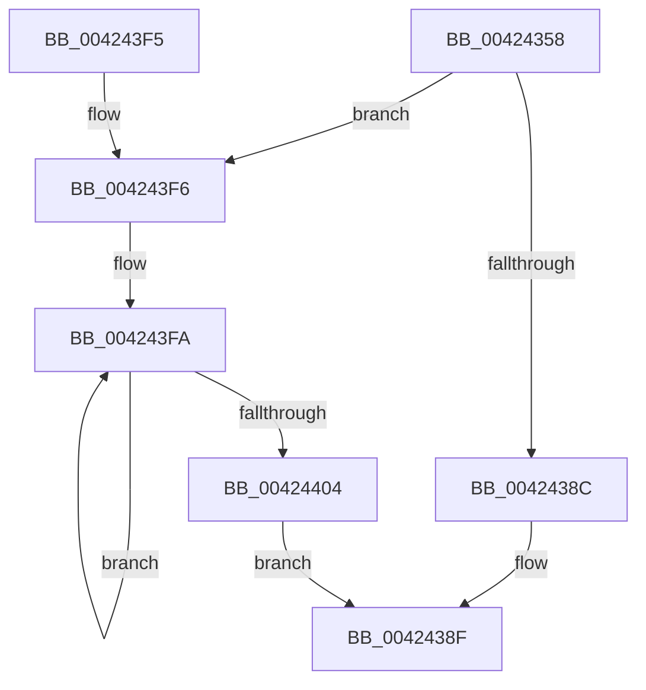

# McTemplateK0jzt_EtwWriteTransfer

- RVA: `0x00424358`–`0x0042440D` (길이 `181` bytes)
- VA: `0x0000000140424358`
- 실행 섹션: `.text`
- PDB 이름 있음: `예`; PDB Function 태그: `아니요`
- unwind 정보 RVA: `0x000A03B8`
- 디코드: `38`개 명령, `181/181` bytes 표시
- 미해석 바이트: `0` (있으면 어셈블리에 `.byte`로 보존)

> 이 문서는 커널 이미지의 기계어와 PDB 기호를 분석해 생성했습니다. 4번과 5번은 함수 원형과 자료형을 바이너리 사용 방식에서 추정한 C 해석이며 원본 소스 복구 결과는 아닙니다.

## 1. Dependencies

- 직접 호출 지점: **2**; 고유 호출 대상: **2**
- 직접 호출자로 확인된 함수: **1**
- RIP 상대 이미지 참조: **4**

### Outgoing calls
- `0x004243DB` → [McGenEventWrite_EtwWriteTransfer](McGenEventWrite_EtwWriteTransfer_function_00424FC8.md) (function, `0x00424FC8`)
- `0x004243E8` → [_security_check_cookie](../6A/_security_check_cookie_function_006AC640.md) (function, `0x006AC640`)

### Direct callers
- [PiCMGetDeviceInterfaceList](../../page/A1/PiCMGetDeviceInterfaceList_function_00A163D0.md) at `0x00A16531`

### Static image references
- `0x0042435F` → RVA `0x00E0A740` (`.data`; read)
- `0x00424396` → RVA `0x006CB080` (` ?? ::FNODOBFM::`string'`; read)
- `0x004243B3` → RVA `0x00013F70` (`.rdata`; read)
- `0x004243CF` → RVA `0x00E06DA0` (`.data`; read)

## 2. Other-region calls and transfers

- 다른 실행 섹션으로 향하는 call: **0**
- 별도 외부 분기/꼬리 이동을 확인하지 못했습니다.

## 3. Assembly (complete function range)

```asm
00424358  48 81 EC 88 00 00 00            sub rsp, 0x88
0042435F  48 8B 05 DA 63 9E 00            mov rax, qword ptr [rip + 0x9e63da]
00424366  48 33 C4                        xor rax, rsp
00424369  48 89 44 24 70                  mov qword ptr [rsp + 0x70], rax
0042436E  48 8B 8C 24 B0 00 00 00         mov rcx, qword ptr [rsp + 0xb0]
00424376  45 33 C0                        xor r8d, r8d
00424379  4C 89 4C 24 40                  mov qword ptr [rsp + 0x40], r9
0042437E  48 C7 44 24 48 10 00 00 00      mov qword ptr [rsp + 0x48], 0x10
00424387  48 85 C9                        test rcx, rcx
0042438A  75 6A                           jne 0x1404243f6
0042438C  8D 41 0A                        lea eax, [rcx + 0xa]
0042438F  48 85 C9                        test rcx, rcx
00424392  89 44 24 58                     mov dword ptr [rsp + 0x58], eax
00424396  48 8D 15 E3 6C 2A 00            lea rdx, [rip + 0x2a6ce3]
0042439D  44 89 44 24 5C                  mov dword ptr [rsp + 0x5c], r8d
004243A2  48 0F 44 CA                     cmove rcx, rdx
004243A6  48 8D 84 24 B8 00 00 00         lea rax, [rsp + 0xb8]
004243AE  48 89 44 24 60                  mov qword ptr [rsp + 0x60], rax
004243B3  48 8D 15 B6 FB BE FF            lea rdx, [rip - 0x41044a]
004243BA  48 89 4C 24 50                  mov qword ptr [rsp + 0x50], rcx
004243BF  48 8D 44 24 30                  lea rax, [rsp + 0x30]
004243C4  41 B9 04 00 00 00               mov r9d, 4
004243CA  48 89 44 24 20                  mov qword ptr [rsp + 0x20], rax
004243CF  48 8D 0D CA 29 9E 00            lea rcx, [rip + 0x9e29ca]
004243D6  4C 89 4C 24 68                  mov qword ptr [rsp + 0x68], r9
004243DB  E8 E8 0B 00 00                  call 0x140424fc8
004243E0  48 8B 4C 24 70                  mov rcx, qword ptr [rsp + 0x70]
004243E5  48 33 CC                        xor rcx, rsp
004243E8  E8 53 82 28 00                  call 0x1406ac640
004243ED  48 81 C4 88 00 00 00            add rsp, 0x88
004243F4  C3                              ret
004243F5  CC                              int3
004243F6  48 83 C8 FF                     or rax, 0xffffffffffffffff
004243FA  48 FF C0                        inc rax
004243FD  66 44 39 04 41                  cmp word ptr [rcx + rax*2], r8w
00424402  75 F6                           jne 0x1404243fa
00424404  8D 04 45 02 00 00 00            lea eax, [rax*2 + 2]
0042440B  EB 82                           jmp 0x14042438f
```

## 4. C-style interpretation (structured pseudocode)

```c
__int64 __fastcall McTemplateK0jzt_EtwWriteTransfer(__int64 a1, __int64 a2, int a3, __int64 a4, __int64 a5, __int64 a6)
{
    __int64 result;
    __int64 v_rsp;
    unsigned __int64 v_stack_m18;
    unsigned __int64 v_stack_m20;
    unsigned __int64 v_stack_m28;
    unsigned int v_stack_m2C;
    unsigned int v_stack_m30;
    unsigned __int64 v_stack_m38;
    unsigned __int64 v_stack_m40;
    unsigned __int64 v_stack_m48;
    unsigned __int64 v_stack_m58;
    unsigned __int64 v_stack_m68;

    v_rsp = (v_rsp) - (136);
    result = (*(unsigned __int64 *)(v_rip + 10380250)) ^ (v_rsp);
    v_stack_m18 = result;
    a3 = 0;
    v_stack_m48 = a4;
    v_stack_m40 = 16;
    if (a5 != 0) goto loc_004243F6;
loc_0042438F:
    v_stack_m30 = (unsigned int)(a5 + 10);
    v_stack_m2C = 0;
    if (a5 == 0) { a5 = v_rip + 2780387; }
    v_stack_m28 = a6;
    v_stack_m38 = a5;
    v_stack_m68 = v_stack_m58;
    v_stack_m20 = 4;
    result = McGenEventWrite_EtwWriteTransfer(v_rip + 10365386, v_rip - 4260938, a3, 4);
    a1 = (v_stack_m18) ^ (v_rsp);
    result = _security_check_cookie(a1, v_rip - 4260938, a3, 4);
    v_rsp = (v_rsp) + (136);
    return result;
loc_004243F6:
    result = (result) | (-1);
loc_004243FA:
    result = (result) + 1;
    if ((*(unsigned __int16 *)(a1 + result * 2)) != 0) goto loc_004243FA;
    goto loc_0042438F;
}
```

## 5. (Beta) C Style

```c
int64_t McTemplateK0jzt_EtwWriteTransfer(int64_t Arg1, int64_t Arg2, int32_t Arg3, int64_t Arg4, int64_t Arg5, int64_t Arg6)
{
    int64_t result;
    int64_t local_rsp;
    uint64_t v_stack_m18;
    uint64_t v_stack_m20;
    uint64_t v_stack_m28;
    uint32_t v_stack_m2C;
    uint32_t v_stack_m30;
    uint64_t v_stack_m38;
    uint64_t v_stack_m40;
    uint64_t v_stack_m48;
    uint64_t v_stack_m58;
    uint64_t v_stack_m68;

    local_rsp = (local_rsp) - (136);
    result = (*(uint64_t *)(v_rip + 0x9E63DA)) ^ (local_rsp);
    v_stack_m18 = result;
    Arg3 = 0;
    v_stack_m48 = Arg4;
    v_stack_m40 = 16;
    if (Arg5 != 0) goto loc_004243F6;
loc_0042438F:
    v_stack_m30 = (uint32_t)(Arg5 + 10);
    v_stack_m2C = 0;
    if (Arg5 == 0) { Arg5 = v_rip + 2780387; }
    v_stack_m28 = Arg6;
    v_stack_m38 = Arg5;
    v_stack_m68 = v_stack_m58;
    v_stack_m20 = 4;
    result = McGenEventWrite_EtwWriteTransfer(v_rip + 10365386, v_rip - 4260938, Arg3, 4);
    Arg1 = (v_stack_m18) ^ (local_rsp);
    result = _security_check_cookie(Arg1, v_rip - 4260938, Arg3, 4);
    local_rsp = (local_rsp) + (136);
    return result;
loc_004243F6:
    result = (result) | (-1);
loc_004243FA:
    result = (result) + 1;
    if ((*(uint16_t *)(Arg1 + result * 2)) != 0) goto loc_004243FA;
    goto loc_0042438F;
}
```

## 6. Execution-region graph

[열기: 2D/3D 그래프와 함수 탐색 컨트롤 패널](../../../control-panel.html?section=text&rva=0x00424358&view=graph)

- 2D 그래프는 위에서 아래로 흐르고, 3D 그래프는 빈 공간을 드래그해 회전합니다. Shift+드래그는 이동, 휠은 확대·축소, 함수 노드 선택은 대상 보고서 이동입니다.

### Static fallback


