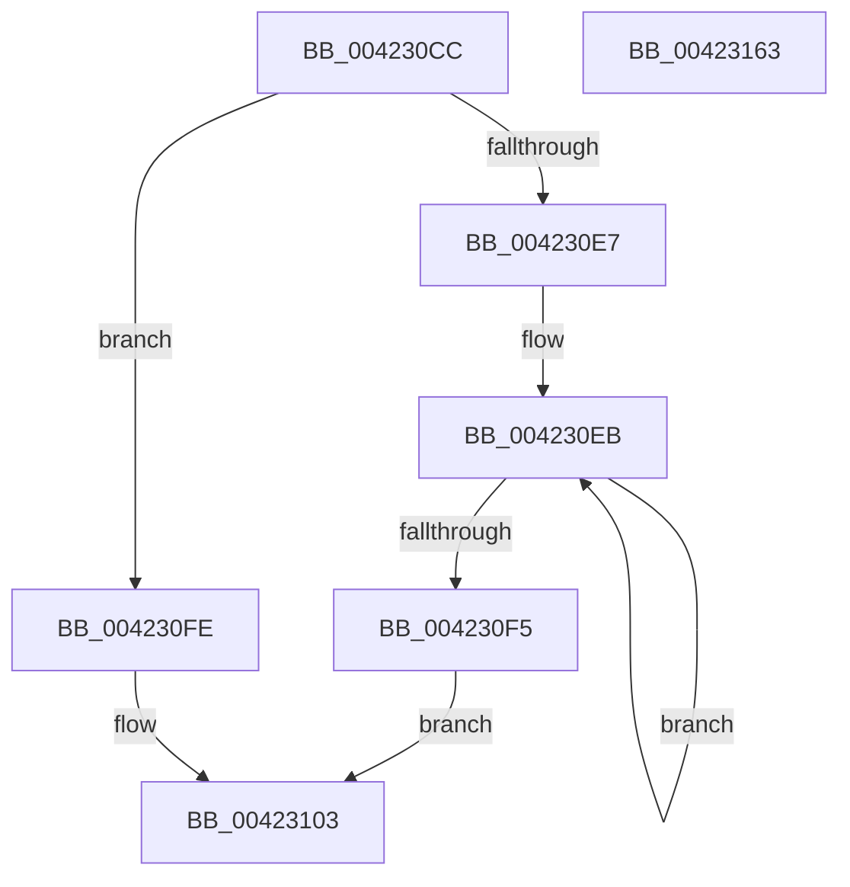

# McTemplateK0zd_EtwWriteTransfer

- RVA: `0x004230CC`–`0x00423164` (길이 `152` bytes)
- VA: `0x00000001404230CC`
- 실행 섹션: `.text`
- PDB 이름 있음: `예`; PDB Function 태그: `아니요`
- unwind 정보 RVA: `0x000A02F8`
- 디코드: `34`개 명령, `152/152` bytes 표시
- 미해석 바이트: `0` (있으면 어셈블리에 `.byte`로 보존)

> 이 문서는 커널 이미지의 기계어와 PDB 기호를 분석해 생성했습니다. 4번과 5번은 함수 원형과 자료형을 바이너리 사용 방식에서 추정한 C 해석이며 원본 소스 복구 결과는 아닙니다.

## 1. Dependencies

- 직접 호출 지점: **2**; 고유 호출 대상: **2**
- 직접 호출자로 확인된 함수: **1**
- RIP 상대 이미지 참조: **3**

### Outgoing calls
- `0x0042314C` → [McGenEventWrite_EtwWriteTransfer](McGenEventWrite_EtwWriteTransfer_function_00424FC8.md) (function, `0x00424FC8`)
- `0x00423159` → [_security_check_cookie](../6A/_security_check_cookie_function_006AC640.md) (function, `0x006AC640`)

### Direct callers
- [sub_006F4704](../6F/Unknown_function_006F4704.md) at `0x006F47D8`

### Static image references
- `0x004230D0` → RVA `0x00E0A740` (`.data`; read)
- `0x0042310A` → RVA `0x006CB080` (` ?? ::FNODOBFM::`string'`; read)
- `0x00423135` → RVA `0x00E06DA0` (`.data`; read)

## 2. Other-region calls and transfers

- 다른 실행 섹션으로 향하는 call: **0**
- 별도 외부 분기/꼬리 이동을 확인하지 못했습니다.

## 3. Assembly (complete function range)

```asm
004230CC  48 83 EC 78                     sub rsp, 0x78
004230D0  48 8B 05 69 76 9E 00            mov rax, qword ptr [rip + 0x9e7669]
004230D7  48 33 C4                        xor rax, rsp
004230DA  48 89 44 24 60                  mov qword ptr [rsp + 0x60], rax
004230DF  45 33 C0                        xor r8d, r8d
004230E2  4D 85 C9                        test r9, r9
004230E5  74 17                           je 0x1404230fe
004230E7  48 83 C8 FF                     or rax, 0xffffffffffffffff
004230EB  48 FF C0                        inc rax
004230EE  66 45 39 04 41                  cmp word ptr [r9 + rax*2], r8w
004230F3  75 F6                           jne 0x1404230eb
004230F5  8D 04 45 02 00 00 00            lea eax, [rax*2 + 2]
004230FC  EB 05                           jmp 0x140423103
004230FE  B8 0A 00 00 00                  mov eax, 0xa
00423103  4D 85 C9                        test r9, r9
00423106  89 44 24 48                     mov dword ptr [rsp + 0x48], eax
0042310A  48 8D 0D 6F 7F 2A 00            lea rcx, [rip + 0x2a7f6f]
00423111  44 89 44 24 4C                  mov dword ptr [rsp + 0x4c], r8d
00423116  4C 0F 44 C9                     cmove r9, rcx
0042311A  48 C7 44 24 58 04 00 00 00      mov qword ptr [rsp + 0x58], 4
00423123  48 8D 84 24 A0 00 00 00         lea rax, [rsp + 0xa0]
0042312B  4C 89 4C 24 40                  mov qword ptr [rsp + 0x40], r9
00423130  48 89 44 24 50                  mov qword ptr [rsp + 0x50], rax
00423135  48 8D 0D 64 3C 9E 00            lea rcx, [rip + 0x9e3c64]
0042313C  48 8D 44 24 30                  lea rax, [rsp + 0x30]
00423141  41 B9 03 00 00 00               mov r9d, 3
00423147  48 89 44 24 20                  mov qword ptr [rsp + 0x20], rax
0042314C  E8 77 1E 00 00                  call 0x140424fc8
00423151  48 8B 4C 24 60                  mov rcx, qword ptr [rsp + 0x60]
00423156  48 33 CC                        xor rcx, rsp
00423159  E8 E2 94 28 00                  call 0x1406ac640
0042315E  48 83 C4 78                     add rsp, 0x78
00423162  C3                              ret
00423163  CC                              int3
```

## 4. C-style interpretation (structured pseudocode)

```c
__int64 __fastcall McTemplateK0zd_EtwWriteTransfer(__int64 a1, __int64 a2, int a3, __int64 a4, __int64 a5)
{
    __int64 result;
    __int64 v_rsp;
    unsigned __int64 v_stack_m18;
    unsigned __int64 v_stack_m20;
    unsigned __int64 v_stack_m28;
    unsigned int v_stack_m2C;
    unsigned int v_stack_m30;
    unsigned __int64 v_stack_m38;
    unsigned __int64 v_stack_m48;
    unsigned __int64 v_stack_m58;

    v_rsp = (v_rsp) - (120);
    result = (*(unsigned __int64 *)(v_rip + 10385001)) ^ (v_rsp);
    v_stack_m18 = result;
    a3 = 0;
    if (a4 == 0) goto loc_004230FE;
    result = (result) | (-1);
loc_004230EB:
    result = (result) + 1;
    if ((*(unsigned __int16 *)(a4 + result * 2)) != 0) goto loc_004230EB;
    goto loc_00423103;
loc_004230FE:
loc_00423103:
    v_stack_m30 = 10;
    v_stack_m2C = 0;
    if (a4 == 0) { a4 = v_rip + 2785135; }
    v_stack_m20 = 4;
    v_stack_m38 = a4;
    v_stack_m28 = a5;
    v_stack_m58 = v_stack_m48;
    result = McGenEventWrite_EtwWriteTransfer(v_rip + 10370148, a2, a3, 3);
    a1 = (v_stack_m18) ^ (v_rsp);
    result = _security_check_cookie(a1, a2, a3, 3);
    v_rsp = (v_rsp) + (120);
    return result;
}
```

## 5. (Beta) C Style

```c
int64_t McTemplateK0zd_EtwWriteTransfer(int64_t Arg1, int64_t Arg2, int32_t Arg3, int64_t Arg4, int64_t Arg5)
{
    int64_t result;
    int64_t local_rsp;
    uint64_t v_stack_m18;
    uint64_t v_stack_m20;
    uint64_t v_stack_m28;
    uint32_t v_stack_m2C;
    uint32_t v_stack_m30;
    uint64_t v_stack_m38;
    uint64_t v_stack_m48;
    uint64_t v_stack_m58;

    local_rsp = (local_rsp) - (120);
    result = (*(uint64_t *)(v_rip + 0x9E7669)) ^ (local_rsp);
    v_stack_m18 = result;
    Arg3 = 0;
    if (Arg4 == 0) goto loc_004230FE;
    result = (result) | (-1);
loc_004230EB:
    result = (result) + 1;
    if ((*(uint16_t *)(Arg4 + result * 2)) != 0) goto loc_004230EB;
    goto loc_00423103;
loc_004230FE:
loc_00423103:
    v_stack_m30 = 10;
    v_stack_m2C = 0;
    if (Arg4 == 0) { Arg4 = v_rip + 2785135; }
    v_stack_m20 = 4;
    v_stack_m38 = Arg4;
    v_stack_m28 = Arg5;
    v_stack_m58 = v_stack_m48;
    result = McGenEventWrite_EtwWriteTransfer(v_rip + 10370148, Arg2, Arg3, 3);
    Arg1 = (v_stack_m18) ^ (local_rsp);
    result = _security_check_cookie(Arg1, Arg2, Arg3, 3);
    local_rsp = (local_rsp) + (120);
    return result;
}
```

## 6. Execution-region graph

[열기: 2D/3D 그래프와 함수 탐색 컨트롤 패널](../../../control-panel.html?section=text&rva=0x004230CC&view=graph)

- 2D 그래프는 위에서 아래로 흐르고, 3D 그래프는 빈 공간을 드래그해 회전합니다. Shift+드래그는 이동, 휠은 확대·축소, 함수 노드 선택은 대상 보고서 이동입니다.

### Static fallback


