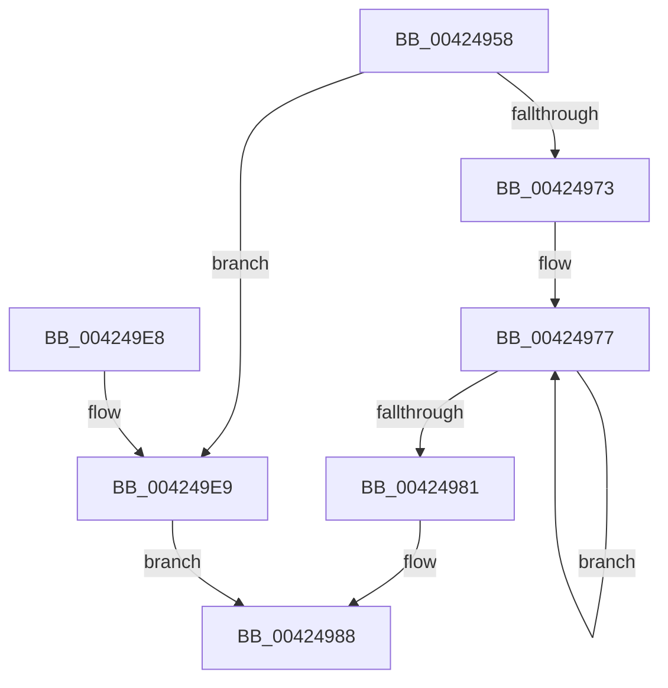

# McTemplateK0zq_EtwWriteTransfer

- RVA: `0x00424958`–`0x004249F0` (길이 `152` bytes)
- VA: `0x0000000140424958`
- 실행 섹션: `.text`
- PDB 이름 있음: `예`; PDB Function 태그: `아니요`
- unwind 정보 RVA: `0x000A0420`
- 디코드: `34`개 명령, `152/152` bytes 표시
- 미해석 바이트: `0` (있으면 어셈블리에 `.byte`로 보존)

> 이 문서는 커널 이미지의 기계어와 PDB 기호를 분석해 생성했습니다. 4번과 5번은 함수 원형과 자료형을 바이너리 사용 방식에서 추정한 C 해석이며 원본 소스 복구 결과는 아닙니다.

## 1. Dependencies

- 직접 호출 지점: **2**; 고유 호출 대상: **2**
- 직접 호출자로 확인된 함수: **2**
- RIP 상대 이미지 참조: **3**

### Outgoing calls
- `0x004249D1` → [McGenEventWrite_EtwWriteTransfer](McGenEventWrite_EtwWriteTransfer_function_00424FC8.md) (function, `0x00424FC8`)
- `0x004249DE` → [_security_check_cookie](../6A/_security_check_cookie_function_006AC640.md) (function, `0x006AC640`)

### Direct callers
- [PiProcessDeviceResetAction](../5A/PiProcessDeviceResetAction_function_005A5CD8.md) at `0x005A5D47`
- [PiLogSurpriseRemoveEvent](../../page/AC/PiLogSurpriseRemoveEvent_function_00ACEF28.md) at `0x00ACEF8B`

### Static image references
- `0x0042495C` → RVA `0x00E0A740` (`.data`; read)
- `0x0042498F` → RVA `0x006CB080` (` ?? ::FNODOBFM::`string'`; read)
- `0x004249BA` → RVA `0x00E06DA0` (`.data`; read)

## 2. Other-region calls and transfers

- 다른 실행 섹션으로 향하는 call: **0**
- 별도 외부 분기/꼬리 이동을 확인하지 못했습니다.

## 3. Assembly (complete function range)

```asm
00424958  48 83 EC 78                     sub rsp, 0x78
0042495C  48 8B 05 DD 5D 9E 00            mov rax, qword ptr [rip + 0x9e5ddd]
00424963  48 33 C4                        xor rax, rsp
00424966  48 89 44 24 60                  mov qword ptr [rsp + 0x60], rax
0042496B  45 33 D2                        xor r10d, r10d
0042496E  4D 85 C9                        test r9, r9
00424971  74 76                           je 0x1404249e9
00424973  48 83 C8 FF                     or rax, 0xffffffffffffffff
00424977  48 FF C0                        inc rax
0042497A  66 45 39 14 41                  cmp word ptr [r9 + rax*2], r10w
0042497F  75 F6                           jne 0x140424977
00424981  8D 04 45 02 00 00 00            lea eax, [rax*2 + 2]
00424988  4D 85 C9                        test r9, r9
0042498B  89 44 24 48                     mov dword ptr [rsp + 0x48], eax
0042498F  48 8D 0D EA 66 2A 00            lea rcx, [rip + 0x2a66ea]
00424996  44 89 54 24 4C                  mov dword ptr [rsp + 0x4c], r10d
0042499B  4C 0F 44 C9                     cmove r9, rcx
0042499F  48 C7 44 24 58 04 00 00 00      mov qword ptr [rsp + 0x58], 4
004249A8  48 8D 84 24 A0 00 00 00         lea rax, [rsp + 0xa0]
004249B0  4C 89 4C 24 40                  mov qword ptr [rsp + 0x40], r9
004249B5  48 89 44 24 50                  mov qword ptr [rsp + 0x50], rax
004249BA  48 8D 0D DF 23 9E 00            lea rcx, [rip + 0x9e23df]
004249C1  48 8D 44 24 30                  lea rax, [rsp + 0x30]
004249C6  41 B9 03 00 00 00               mov r9d, 3
004249CC  48 89 44 24 20                  mov qword ptr [rsp + 0x20], rax
004249D1  E8 F2 05 00 00                  call 0x140424fc8
004249D6  48 8B 4C 24 60                  mov rcx, qword ptr [rsp + 0x60]
004249DB  48 33 CC                        xor rcx, rsp
004249DE  E8 5D 7C 28 00                  call 0x1406ac640
004249E3  48 83 C4 78                     add rsp, 0x78
004249E7  C3                              ret
004249E8  CC                              int3
004249E9  B8 0A 00 00 00                  mov eax, 0xa
004249EE  EB 98                           jmp 0x140424988
```

## 4. C-style interpretation (structured pseudocode)

```c
__int64 __fastcall McTemplateK0zq_EtwWriteTransfer(__int64 a1, __int64 a2, __int64 a3, __int64 a4, __int64 a5)
{
    __int64 result;
    __int64 v_r10;
    __int64 v_rsp;
    unsigned __int64 v_stack_m18;
    unsigned __int64 v_stack_m20;
    unsigned __int64 v_stack_m28;
    unsigned int v_stack_m2C;
    unsigned int v_stack_m30;
    unsigned __int64 v_stack_m38;
    unsigned __int64 v_stack_m48;
    unsigned __int64 v_stack_m58;

    v_rsp = (v_rsp) - (120);
    result = (*(unsigned __int64 *)(v_rip + 10378717)) ^ (v_rsp);
    v_stack_m18 = result;
    v_r10 = 0;
    if (a4 == 0) goto loc_004249E9;
    result = (result) | (-1);
loc_00424977:
    result = (result) + 1;
    if ((*(unsigned __int16 *)(a4 + result * 2)) != 0) goto loc_00424977;
loc_00424988:
    v_stack_m30 = (unsigned int)(result * 2 + 2);
    v_stack_m2C = 0;
    if (a4 == 0) { a4 = v_rip + 2778858; }
    v_stack_m20 = 4;
    v_stack_m38 = a4;
    v_stack_m28 = a5;
    v_stack_m58 = v_stack_m48;
    result = McGenEventWrite_EtwWriteTransfer(v_rip + 10363871, a2, a3, 3);
    a1 = (v_stack_m18) ^ (v_rsp);
    result = _security_check_cookie(a1, a2, a3, 3);
    v_rsp = (v_rsp) + (120);
    return result;
loc_004249E9:
    goto loc_00424988;
}
```

## 5. (Beta) C Style

```c
int64_t McTemplateK0zq_EtwWriteTransfer(int64_t Arg1, int64_t Arg2, int64_t Arg3, int64_t Arg4, int64_t Arg5)
{
    int64_t result;
    int64_t local_r10;
    int64_t local_rsp;
    uint64_t v_stack_m18;
    uint64_t v_stack_m20;
    uint64_t v_stack_m28;
    uint32_t v_stack_m2C;
    uint32_t v_stack_m30;
    uint64_t v_stack_m38;
    uint64_t v_stack_m48;
    uint64_t v_stack_m58;

    local_rsp = (local_rsp) - (120);
    result = (*(uint64_t *)(v_rip + 0x9E5DDD)) ^ (local_rsp);
    v_stack_m18 = result;
    local_r10 = 0;
    if (Arg4 == 0) goto loc_004249E9;
    result = (result) | (-1);
loc_00424977:
    result = (result) + 1;
    if ((*(uint16_t *)(Arg4 + result * 2)) != 0) goto loc_00424977;
loc_00424988:
    v_stack_m30 = (uint32_t)(result * 2 + 2);
    v_stack_m2C = 0;
    if (Arg4 == 0) { Arg4 = v_rip + 2778858; }
    v_stack_m20 = 4;
    v_stack_m38 = Arg4;
    v_stack_m28 = Arg5;
    v_stack_m58 = v_stack_m48;
    result = McGenEventWrite_EtwWriteTransfer(v_rip + 10363871, Arg2, Arg3, 3);
    Arg1 = (v_stack_m18) ^ (local_rsp);
    result = _security_check_cookie(Arg1, Arg2, Arg3, 3);
    local_rsp = (local_rsp) + (120);
    return result;
loc_004249E9:
    goto loc_00424988;
}
```

## 6. Execution-region graph

[열기: 2D/3D 그래프와 함수 탐색 컨트롤 패널](../../../control-panel.html?section=text&rva=0x00424958&view=graph)

- 2D 그래프는 위에서 아래로 흐르고, 3D 그래프는 빈 공간을 드래그해 회전합니다. Shift+드래그는 이동, 휠은 확대·축소, 함수 노드 선택은 대상 보고서 이동입니다.

### Static fallback


