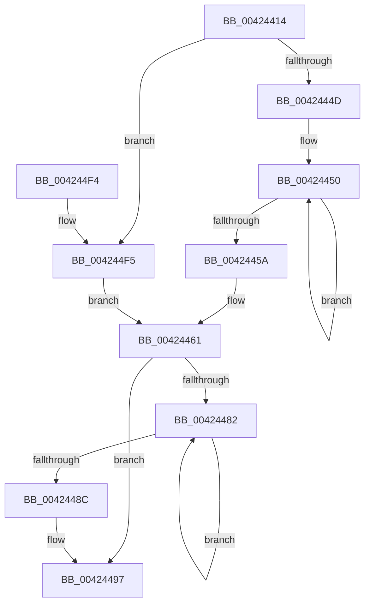

# McTemplateK0zzd_EtwWriteTransfer

- RVA: `0x00424414`–`0x004244FD` (길이 `233` bytes)
- VA: `0x0000000140424414`
- 실행 섹션: `.text`
- PDB 이름 있음: `예`; PDB Function 태그: `아니요`
- unwind 정보 RVA: `0x000A03CC`
- 디코드: `53`개 명령, `233/233` bytes 표시
- 미해석 바이트: `0` (있으면 어셈블리에 `.byte`로 보존)

> 이 문서는 커널 이미지의 기계어와 PDB 기호를 분석해 생성했습니다. 4번과 5번은 함수 원형과 자료형을 바이너리 사용 방식에서 추정한 C 해석이며 원본 소스 복구 결과는 아닙니다.

## 1. Dependencies

- 직접 호출 지점: **2**; 고유 호출 대상: **2**
- 직접 호출자로 확인된 함수: **11**
- RIP 상대 이미지 참조: **3**

### Outgoing calls
- `0x004244D9` → [McGenEventWrite_EtwWriteTransfer](McGenEventWrite_EtwWriteTransfer_function_00424FC8.md) (function, `0x00424FC8`)
- `0x004244E6` → [_security_check_cookie](../6A/_security_check_cookie_function_006AC640.md) (function, `0x006AC640`)

### Direct callers
- [PiSwIrpCleanup](../../page/73/PiSwIrpCleanup_function_0073AC10.md) at `0x0073ADE3`
- [PiSwIrpSetAttributes](../../page/73/PiSwIrpSetAttributes_function_0073AF44.md) at `0x0073B055`
- [PiSwIrpSetLifetime](../../page/73/PiSwIrpSetLifetime_function_0073B080.md) at `0x0073B190`
- [PiSwCompleteCreate](../../page/8D/PiSwCompleteCreate_function_008DAB90.md) at `0x008DAED1`
- [PiSwIrpStartCreateWorker](../../page/8D/PiSwIrpStartCreateWorker_function_008DB398.md) at `0x008DB7BA`
- [PiSwIrpInterfacePropertySet](../../page/8F/PiSwIrpInterfacePropertySet_function_008F7900.md) at `0x008F7B0C`
- [PiSwIrpInterfaceSetState](../../page/94/PiSwIrpInterfaceSetState_function_0094DC24.md) at `0x0094DDDF`
- [PiSwIrpPropertySet](../../page/94/PiSwIrpPropertySet_function_0094E97C.md) at `0x0094EB81`
- [PiSwIrpInterfaceRegister](../../page/94/PiSwIrpInterfaceRegister_function_0094F01C.md) at `0x0094F487`
- [PiCreateDriverSwDeviceCallback](../../page/AB/PiCreateDriverSwDeviceCallback_function_00ABB420.md) at `0x00ABBAAF`
- [sub_00B392DC](../../page/B3/Unknown_function_00B392DC.md) at `0x00B39381`

### Static image references
- `0x0042441D` → RVA `0x00E0A740` (`.data`; read)
- `0x00424468` → RVA `0x006CB080` (` ?? ::FNODOBFM::`string'`; read)
- `0x004244B2` → RVA `0x00E06DA0` (`.data`; read)

## 2. Other-region calls and transfers

- 다른 실행 섹션으로 향하는 call: **0**
- 별도 외부 분기/꼬리 이동을 확인하지 못했습니다.

## 3. Assembly (complete function range)

```asm
00424414  40 53                           push rbx
00424416  48 81 EC 80 00 00 00            sub rsp, 0x80
0042441D  48 8B 05 1C 63 9E 00            mov rax, qword ptr [rip + 0x9e631c]
00424424  48 33 C4                        xor rax, rsp
00424427  48 89 44 24 70                  mov qword ptr [rsp + 0x70], rax
0042442C  48 83 C8 FF                     or rax, 0xffffffffffffffff
00424430  45 33 DB                        xor r11d, r11d
00424433  4C 8B D2                        mov r10, rdx
00424436  48 8B 94 24 B0 00 00 00         mov rdx, qword ptr [rsp + 0xb0]
0042443E  41 B8 0A 00 00 00               mov r8d, 0xa
00424444  4D 85 C9                        test r9, r9
00424447  0F 84 A8 00 00 00               je 0x1404244f5
0042444D  48 8B C8                        mov rcx, rax
00424450  48 FF C1                        inc rcx
00424453  66 45 39 1C 49                  cmp word ptr [r9 + rcx*2], r11w
00424458  75 F6                           jne 0x140424450
0042445A  8D 0C 4D 02 00 00 00            lea ecx, [rcx*2 + 2]
00424461  4D 85 C9                        test r9, r9
00424464  89 4C 24 48                     mov dword ptr [rsp + 0x48], ecx
00424468  48 8D 1D 11 6C 2A 00            lea rbx, [rip + 0x2a6c11]
0042446F  44 89 5C 24 4C                  mov dword ptr [rsp + 0x4c], r11d
00424474  4C 0F 44 CB                     cmove r9, rbx
00424478  4C 89 4C 24 40                  mov qword ptr [rsp + 0x40], r9
0042447D  48 85 D2                        test rdx, rdx
00424480  74 15                           je 0x140424497
00424482  48 FF C0                        inc rax
00424485  66 44 39 1C 42                  cmp word ptr [rdx + rax*2], r11w
0042448A  75 F6                           jne 0x140424482
0042448C  44 8D 04 45 02 00 00 00         lea r8d, [rax*2 + 2]
00424494  48 85 D2                        test rdx, rdx
00424497  48 0F 44 D3                     cmove rdx, rbx
0042449B  44 89 44 24 58                  mov dword ptr [rsp + 0x58], r8d
004244A0  48 8D 84 24 B8 00 00 00         lea rax, [rsp + 0xb8]
004244A8  48 89 54 24 50                  mov qword ptr [rsp + 0x50], rdx
004244AD  48 89 44 24 60                  mov qword ptr [rsp + 0x60], rax
004244B2  48 8D 0D E7 28 9E 00            lea rcx, [rip + 0x9e28e7]
004244B9  48 8D 44 24 30                  lea rax, [rsp + 0x30]
004244BE  44 89 5C 24 5C                  mov dword ptr [rsp + 0x5c], r11d
004244C3  41 B9 04 00 00 00               mov r9d, 4
004244C9  48 89 44 24 20                  mov qword ptr [rsp + 0x20], rax
004244CE  45 33 C0                        xor r8d, r8d
004244D1  4C 89 4C 24 68                  mov qword ptr [rsp + 0x68], r9
004244D6  49 8B D2                        mov rdx, r10
004244D9  E8 EA 0A 00 00                  call 0x140424fc8
004244DE  48 8B 4C 24 70                  mov rcx, qword ptr [rsp + 0x70]
004244E3  48 33 CC                        xor rcx, rsp
004244E6  E8 55 81 28 00                  call 0x1406ac640
004244EB  48 81 C4 80 00 00 00            add rsp, 0x80
004244F2  5B                              pop rbx
004244F3  C3                              ret
004244F4  CC                              int3
004244F5  41 8B C8                        mov ecx, r8d
004244F8  E9 64 FF FF FF                  jmp 0x140424461
```

## 4. C-style interpretation (structured pseudocode)

```c
__int64 __fastcall McTemplateK0zzd_EtwWriteTransfer(__int64 a1, __int64 a2, __int64 a3, __int64 a4, __int64 a5, __int64 a6)
{
    __int64 result;
    __int64 v_r11;
    __int64 v_rsp;
    unsigned __int64 v_stack_m18;
    unsigned __int64 v_stack_m20;
    unsigned __int64 v_stack_m28;
    unsigned int v_stack_m2C;
    unsigned int v_stack_m30;
    unsigned __int64 v_stack_m38;
    unsigned int v_stack_m3C;
    unsigned int v_stack_m40;
    unsigned __int64 v_stack_m48;
    unsigned __int64 v_stack_m58;
    unsigned __int64 v_stack_m68;

    v_rsp = (v_rsp) - (128);
    result = (*(unsigned __int64 *)(v_rip + 10380060)) ^ (v_rsp);
    v_stack_m18 = result;
    result = (result) | (-1);
    v_r11 = 0;
    if (a4 == 0) goto loc_004244F5;
loc_00424450:
    a1 = (result) + 1;
    if ((*(unsigned __int16 *)(a4 + a1 * 2)) != 0) goto loc_00424450;
loc_00424461:
    v_stack_m40 = (unsigned int)(a1 * 2 + 2);
    v_stack_m3C = 0;
    if (a4 == 0) { a4 = v_rip + 2780177; }
    v_stack_m48 = a4;
    if (a5 == 0) goto loc_00424497;
loc_00424482:
    result = (result) + 1;
    if ((*(unsigned __int16 *)(a5 + result * 2)) != 0) goto loc_00424482;
loc_00424497:
    if (a5 == 0) { a5 = v_rip + 2780177; }
    v_stack_m30 = (unsigned int)(result * 2 + 2);
    v_stack_m38 = a5;
    v_stack_m28 = a6;
    v_stack_m2C = 0;
    v_stack_m68 = v_stack_m58;
    a3 = 0;
    v_stack_m20 = 4;
    result = McGenEventWrite_EtwWriteTransfer(v_rip + 10365159, a2, a3, 4);
    a1 = (v_stack_m18) ^ (v_rsp);
    result = _security_check_cookie(a1, a2, a3, 4);
    v_rsp = (v_rsp) + (128);
    return result;
loc_004244F5:
    goto loc_00424461;
}
```

## 5. (Beta) C Style

```c
int64_t McTemplateK0zzd_EtwWriteTransfer(int64_t Arg1, int64_t Arg2, int64_t Arg3, int64_t Arg4, int64_t Arg5, int64_t Arg6)
{
    int64_t result;
    int64_t local_r11;
    int64_t local_rsp;
    uint64_t v_stack_m18;
    uint64_t v_stack_m20;
    uint64_t v_stack_m28;
    uint32_t v_stack_m2C;
    uint32_t v_stack_m30;
    uint64_t v_stack_m38;
    uint32_t v_stack_m3C;
    uint32_t v_stack_m40;
    uint64_t v_stack_m48;
    uint64_t v_stack_m58;
    uint64_t v_stack_m68;

    local_rsp = (local_rsp) - (128);
    result = (*(uint64_t *)(v_rip + 0x9E631C)) ^ (local_rsp);
    v_stack_m18 = result;
    result = (result) | (-1);
    local_r11 = 0;
    if (Arg4 == 0) goto loc_004244F5;
loc_00424450:
    Arg1 = (result) + 1;
    if ((*(uint16_t *)(Arg4 + Arg1 * 2)) != 0) goto loc_00424450;
loc_00424461:
    v_stack_m40 = (uint32_t)(Arg1 * 2 + 2);
    v_stack_m3C = 0;
    if (Arg4 == 0) { Arg4 = v_rip + 2780177; }
    v_stack_m48 = Arg4;
    if (Arg5 == 0) goto loc_00424497;
loc_00424482:
    result = (result) + 1;
    if ((*(uint16_t *)(Arg5 + result * 2)) != 0) goto loc_00424482;
loc_00424497:
    if (Arg5 == 0) { Arg5 = v_rip + 2780177; }
    v_stack_m30 = (uint32_t)(result * 2 + 2);
    v_stack_m38 = Arg5;
    v_stack_m28 = Arg6;
    v_stack_m2C = 0;
    v_stack_m68 = v_stack_m58;
    Arg3 = 0;
    v_stack_m20 = 4;
    result = McGenEventWrite_EtwWriteTransfer(v_rip + 10365159, Arg2, Arg3, 4);
    Arg1 = (v_stack_m18) ^ (local_rsp);
    result = _security_check_cookie(Arg1, Arg2, Arg3, 4);
    local_rsp = (local_rsp) + (128);
    return result;
loc_004244F5:
    goto loc_00424461;
}
```

## 6. Execution-region graph

[열기: 2D/3D 그래프와 함수 탐색 컨트롤 패널](../../../control-panel.html?section=text&rva=0x00424414&view=graph)

- 2D 그래프는 위에서 아래로 흐르고, 3D 그래프는 빈 공간을 드래그해 회전합니다. Shift+드래그는 이동, 휠은 확대·축소, 함수 노드 선택은 대상 보고서 이동입니다.

### Static fallback


