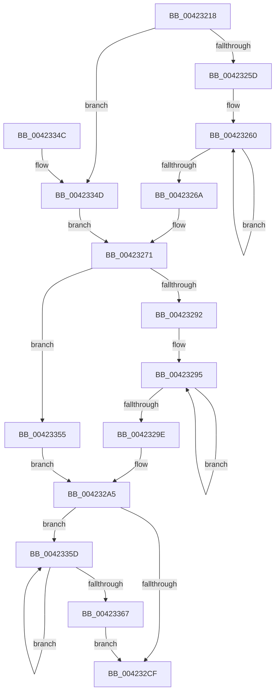

# McTemplateK0zzjzitd_EtwWriteTransfer

- RVA: `0x00423218`–`0x00423377` (길이 `351` bytes)
- VA: `0x0000000140423218`
- 실행 섹션: `.text`
- PDB 이름 있음: `예`; PDB Function 태그: `아니요`
- unwind 정보 RVA: `0x000A0320`
- 디코드: `84`개 명령, `351/351` bytes 표시
- 미해석 바이트: `0` (있으면 어셈블리에 `.byte`로 보존)

> 이 문서는 커널 이미지의 기계어와 PDB 기호를 분석해 생성했습니다. 4번과 5번은 함수 원형과 자료형을 바이너리 사용 방식에서 추정한 C 해석이며 원본 소스 복구 결과는 아닙니다.

## 1. Dependencies

- 직접 호출 지점: **2**; 고유 호출 대상: **2**
- 직접 호출자로 확인된 함수: **1**
- RIP 상대 이미지 참조: **3**

### Outgoing calls
- `0x00423326` → [McGenEventWrite_EtwWriteTransfer](McGenEventWrite_EtwWriteTransfer_function_00424FC8.md) (function, `0x00424FC8`)
- `0x00423332` → [_security_check_cookie](../6A/_security_check_cookie_function_006AC640.md) (function, `0x006AC640`)

### Direct callers
- [PiDevCfgLogDeviceMigrated](../../page/70/PiDevCfgLogDeviceMigrated_function_00701EC0.md) at `0x00701FA1`

### Static image references
- `0x0042322F` → RVA `0x00E0A740` (`.data`; read)
- `0x00423277` → RVA `0x006CB080` (` ?? ::FNODOBFM::`string'`; read)
- `0x004232E3` → RVA `0x00E06DA0` (`.data`; read)

## 2. Other-region calls and transfers

- 다른 실행 섹션으로 향하는 call: **0**
- 별도 외부 분기/꼬리 이동을 확인하지 못했습니다.

## 3. Assembly (complete function range)

```asm
00423218  48 89 5C 24 08                  mov qword ptr [rsp + 8], rbx
0042321D  48 89 7C 24 18                  mov qword ptr [rsp + 0x18], rdi
00423222  55                              push rbp
00423223  48 8D 6C 24 D9                  lea rbp, [rsp - 0x27]
00423228  48 81 EC C0 00 00 00            sub rsp, 0xc0
0042322F  48 8B 05 0A 75 9E 00            mov rax, qword ptr [rip + 0x9e750a]
00423236  48 33 C4                        xor rax, rsp
00423239  48 89 45 17                     mov qword ptr [rbp + 0x17], rax
0042323D  4C 8B 55 67                     mov r10, qword ptr [rbp + 0x67]
00423241  48 83 C9 FF                     or rcx, 0xffffffffffffffff
00423245  48 8B 45 57                     mov rax, qword ptr [rbp + 0x57]
00423249  33 DB                           xor ebx, ebx
0042324B  4C 8B DA                        mov r11, rdx
0042324E  41 B8 0A 00 00 00               mov r8d, 0xa
00423254  4D 85 C9                        test r9, r9
00423257  0F 84 F0 00 00 00               je 0x14042334d
0042325D  48 8B D1                        mov rdx, rcx
00423260  48 FF C2                        inc rdx
00423263  66 41 39 1C 51                  cmp word ptr [r9 + rdx*2], bx
00423268  75 F6                           jne 0x140423260
0042326A  8D 14 55 02 00 00 00            lea edx, [rdx*2 + 2]
00423271  4D 85 C9                        test r9, r9
00423274  89 55 AF                        mov dword ptr [rbp - 0x51], edx
00423277  48 8D 3D 02 7E 2A 00            lea rdi, [rip + 0x2a7e02]
0042327E  89 5D B3                        mov dword ptr [rbp - 0x4d], ebx
00423281  4C 0F 44 CF                     cmove r9, rdi
00423285  4C 89 4D A7                     mov qword ptr [rbp - 0x59], r9
00423289  48 85 C0                        test rax, rax
0042328C  0F 84 C3 00 00 00               je 0x140423355
00423292  48 8B D1                        mov rdx, rcx
00423295  48 FF C2                        inc rdx
00423298  66 39 1C 50                     cmp word ptr [rax + rdx*2], bx
0042329C  75 F7                           jne 0x140423295
0042329E  8D 14 55 02 00 00 00            lea edx, [rdx*2 + 2]
004232A5  48 85 C0                        test rax, rax
004232A8  89 55 BF                        mov dword ptr [rbp - 0x41], edx
004232AB  89 5D C3                        mov dword ptr [rbp - 0x3d], ebx
004232AE  48 0F 44 C7                     cmove rax, rdi
004232B2  48 C7 45 CF 10 00 00 00         mov qword ptr [rbp - 0x31], 0x10
004232BA  48 89 45 B7                     mov qword ptr [rbp - 0x49], rax
004232BE  48 8B 45 5F                     mov rax, qword ptr [rbp + 0x5f]
004232C2  48 89 45 C7                     mov qword ptr [rbp - 0x39], rax
004232C6  4D 85 D2                        test r10, r10
004232C9  0F 85 8E 00 00 00               jne 0x14042335d
004232CF  4C 0F 44 D7                     cmove r10, rdi
004232D3  44 89 45 DF                     mov dword ptr [rbp - 0x21], r8d
004232D7  48 8D 45 6F                     lea rax, [rbp + 0x6f]
004232DB  4C 89 55 D7                     mov qword ptr [rbp - 0x29], r10
004232DF  48 89 45 E7                     mov qword ptr [rbp - 0x19], rax
004232E3  48 8D 0D B6 3A 9E 00            lea rcx, [rip + 0x9e3ab6]
004232EA  48 8D 45 77                     lea rax, [rbp + 0x77]
004232EE  89 5D E3                        mov dword ptr [rbp - 0x1d], ebx
004232F1  48 89 45 F7                     mov qword ptr [rbp - 9], rax
004232F5  41 B9 08 00 00 00               mov r9d, 8
004232FB  48 8D 45 7F                     lea rax, [rbp + 0x7f]
004232FF  4C 89 4D EF                     mov qword ptr [rbp - 0x11], r9
00423303  48 89 45 07                     mov qword ptr [rbp + 7], rax
00423307  45 33 C0                        xor r8d, r8d
0042330A  48 8D 45 97                     lea rax, [rbp - 0x69]
0042330E  48 C7 45 FF 04 00 00 00         mov qword ptr [rbp - 1], 4
00423316  49 8B D3                        mov rdx, r11
00423319  48 89 44 24 20                  mov qword ptr [rsp + 0x20], rax
0042331E  48 C7 45 0F 04 00 00 00         mov qword ptr [rbp + 0xf], 4
00423326  E8 9D 1C 00 00                  call 0x140424fc8
0042332B  48 8B 4D 17                     mov rcx, qword ptr [rbp + 0x17]
0042332F  48 33 CC                        xor rcx, rsp
00423332  E8 09 93 28 00                  call 0x1406ac640
00423337  4C 8D 9C 24 C0 00 00 00         lea r11, [rsp + 0xc0]
0042333F  49 8B 5B 10                     mov rbx, qword ptr [r11 + 0x10]
00423343  49 8B 7B 20                     mov rdi, qword ptr [r11 + 0x20]
00423347  49 8B E3                        mov rsp, r11
0042334A  5D                              pop rbp
0042334B  C3                              ret
0042334C  CC                              int3
0042334D  41 8B D0                        mov edx, r8d
00423350  E9 1C FF FF FF                  jmp 0x140423271
00423355  41 8B D0                        mov edx, r8d
00423358  E9 48 FF FF FF                  jmp 0x1404232a5
0042335D  48 FF C1                        inc rcx
00423360  66 41 39 1C 4A                  cmp word ptr [r10 + rcx*2], bx
00423365  75 F6                           jne 0x14042335d
00423367  44 8D 04 4D 02 00 00 00         lea r8d, [rcx*2 + 2]
0042336F  4D 85 D2                        test r10, r10
00423372  E9 58 FF FF FF                  jmp 0x1404232cf
```

## 4. C-style interpretation (structured pseudocode)

```c
__int64 __fastcall McTemplateK0zzjzitd_EtwWriteTransfer(__int64 a1, __int64 a2, __int64 a3, __int64 a4, __int64 a5, __int64 a6, __int64 a7, __int64 a8, __int64 a9, __int64 a10)
{
    __int64 result;
    __int64 v_rbx;
    __int64 v_rsp;
    unsigned __int64 v_stack_m18;
    unsigned __int64 v_stack_m20;
    unsigned __int64 v_stack_m28;
    unsigned __int64 v_stack_m2F;
    unsigned __int64 v_stack_m30;
    unsigned __int64 v_stack_m38;
    unsigned __int64 v_stack_m40;
    unsigned __int64 v_stack_m48;
    unsigned int v_stack_m4C;
    unsigned int v_stack_m50;
    unsigned __int64 v_stack_m58;
    unsigned __int64 v_stack_m60;
    unsigned __int64 v_stack_m68;
    unsigned int v_stack_m6C;
    unsigned int v_stack_m70;
    unsigned __int64 v_stack_m78;
    unsigned int v_stack_m7C;
    unsigned __int64 v_stack_m8;
    unsigned int v_stack_m80;
    unsigned __int64 v_stack_m88;
    unsigned __int64 v_stack_m98;
    unsigned __int64 v_stack_mA8;
    unsigned __int64 v_stack_p18;
    unsigned __int64 v_stack_p8;

    v_stack_p8 = v_rbx;
    v_stack_p18 = v_rdi;
    v_rsp = (v_rsp) - (192);
    result = (*(unsigned __int64 *)(v_rip + 10384650)) ^ (v_rsp);
    v_stack_m18 = result;
    a1 = (a1) | (-1);
    v_rbx = 0;
    if (a4 == 0) goto loc_0042334D;
loc_00423260:
    a2 = (a1) + 1;
    if ((*(unsigned __int16 *)(a4 + a2 * 2)) != 0) goto loc_00423260;
loc_00423271:
    v_stack_m80 = (unsigned int)(a2 * 2 + 2);
    v_stack_m7C = 0;
    if (a4 == 0) { a4 = v_rip + 2784770; }
    v_stack_m88 = a4;
    if (a5 == 0) goto loc_00423355;
loc_00423295:
    a2 = (a1) + 1;
    if ((*(unsigned __int16 *)(a5 + a2 * 2)) != 0) goto loc_00423295;
loc_004232A5:
    v_stack_m70 = (unsigned int)(a2 * 2 + 2);
    v_stack_m6C = 0;
    if (a5 == 0) { a5 = v_rip + 2784770; }
    v_stack_m60 = 16;
    v_stack_m78 = a5;
    v_stack_m68 = a6;
    if (a7 != 0) goto loc_0042335D;
loc_004232CF:
    if (a7 == 0) { a7 = v_rip + 2784770; }
    v_stack_m50 = 10;
    v_stack_m58 = a7;
    v_stack_m48 = a8;
    v_stack_m4C = 0;
    v_stack_m38 = a9;
    v_stack_m40 = 8;
    v_stack_m28 = a10;
    a3 = 0;
    v_stack_m30 = 4;
    v_stack_mA8 = v_stack_m98;
    v_stack_m20 = 4;
    result = McGenEventWrite_EtwWriteTransfer(v_rip + 10369718, a2, a3, 8);
    a1 = (v_stack_m18) ^ (v_rsp);
    result = _security_check_cookie(a1, a2, a3, 8);
    return result;
loc_0042334D:
    goto loc_00423271;
loc_00423355:
    goto loc_004232A5;
loc_0042335D:
    a1 = (a1) + 1;
    if ((*(unsigned __int16 *)(a7 + a1 * 2)) != ((unsigned __int16)(*(unsigned __int64 *)(v_stack_m8 + 16)))) goto loc_0042335D;
    goto loc_004232CF;
}
```

## 5. (Beta) C Style

```c
int64_t McTemplateK0zzjzitd_EtwWriteTransfer(int64_t Arg1, int64_t Arg2, int64_t Arg3, int64_t Arg4, int64_t Arg5, int64_t Arg6, int64_t Arg7, int64_t Arg8, int64_t Arg9, int64_t Arg10)
{
    int64_t result;
    int64_t local_rbx;
    int64_t local_rsp;
    uint64_t v_stack_m18;
    uint64_t v_stack_m20;
    uint64_t v_stack_m28;
    uint64_t v_stack_m2F;
    uint64_t v_stack_m30;
    uint64_t v_stack_m38;
    uint64_t v_stack_m40;
    uint64_t v_stack_m48;
    uint32_t v_stack_m4C;
    uint32_t v_stack_m50;
    uint64_t v_stack_m58;
    uint64_t v_stack_m60;
    uint64_t v_stack_m68;
    uint32_t v_stack_m6C;
    uint32_t v_stack_m70;
    uint64_t v_stack_m78;
    uint32_t v_stack_m7C;
    uint64_t v_stack_m8;
    uint32_t v_stack_m80;
    uint64_t v_stack_m88;
    uint64_t v_stack_m98;
    uint64_t v_stack_mA8;
    uint64_t v_stack_p18;
    uint64_t v_stack_p8;

    v_stack_p8 = local_rbx;
    v_stack_p18 = local_rdi;
    local_rsp = (local_rsp) - (192);
    result = (*(uint64_t *)(v_rip + 0x9E750A)) ^ (local_rsp);
    v_stack_m18 = result;
    Arg1 = (Arg1) | (-1);
    local_rbx = 0;
    if (Arg4 == 0) goto loc_0042334D;
loc_00423260:
    Arg2 = (Arg1) + 1;
    if ((*(uint16_t *)(Arg4 + Arg2 * 2)) != 0) goto loc_00423260;
loc_00423271:
    v_stack_m80 = (uint32_t)(Arg2 * 2 + 2);
    v_stack_m7C = 0;
    if (Arg4 == 0) { Arg4 = v_rip + 2784770; }
    v_stack_m88 = Arg4;
    if (Arg5 == 0) goto loc_00423355;
loc_00423295:
    Arg2 = (Arg1) + 1;
    if ((*(uint16_t *)(Arg5 + Arg2 * 2)) != 0) goto loc_00423295;
loc_004232A5:
    v_stack_m70 = (uint32_t)(Arg2 * 2 + 2);
    v_stack_m6C = 0;
    if (Arg5 == 0) { Arg5 = v_rip + 2784770; }
    v_stack_m60 = 16;
    v_stack_m78 = Arg5;
    v_stack_m68 = Arg6;
    if (Arg7 != 0) goto loc_0042335D;
loc_004232CF:
    if (Arg7 == 0) { Arg7 = v_rip + 2784770; }
    v_stack_m50 = 10;
    v_stack_m58 = Arg7;
    v_stack_m48 = Arg8;
    v_stack_m4C = 0;
    v_stack_m38 = Arg9;
    v_stack_m40 = 8;
    v_stack_m28 = Arg10;
    Arg3 = 0;
    v_stack_m30 = 4;
    v_stack_mA8 = v_stack_m98;
    v_stack_m20 = 4;
    result = McGenEventWrite_EtwWriteTransfer(v_rip + 10369718, Arg2, Arg3, 8);
    Arg1 = (v_stack_m18) ^ (local_rsp);
    result = _security_check_cookie(Arg1, Arg2, Arg3, 8);
    return result;
loc_0042334D:
    goto loc_00423271;
loc_00423355:
    goto loc_004232A5;
loc_0042335D:
    Arg1 = (Arg1) + 1;
    if ((*(uint16_t *)(Arg7 + Arg1 * 2)) != ((uint16_t)(*(uint64_t *)(v_stack_m8 + 0x10)))) goto loc_0042335D;
    goto loc_004232CF;
}
```

## 6. Execution-region graph

[열기: 2D/3D 그래프와 함수 탐색 컨트롤 패널](../../../control-panel.html?section=text&rva=0x00423218&view=graph)

- 2D 그래프는 위에서 아래로 흐르고, 3D 그래프는 빈 공간을 드래그해 회전합니다. Shift+드래그는 이동, 휠은 확대·축소, 함수 노드 선택은 대상 보고서 이동입니다.

### Static fallback


