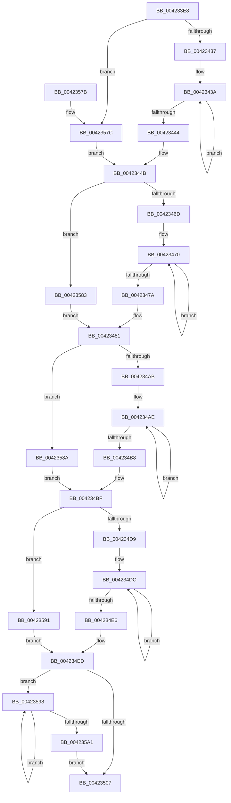

# McTemplateK0zzjzzzdd_EtwWriteTransfer

- RVA: `0x004233E8`–`0x004235B0` (길이 `456` bytes)
- VA: `0x00000001404233E8`
- 실행 섹션: `.text`
- PDB 이름 있음: `예`; PDB Function 태그: `아니요`
- unwind 정보 RVA: `0x000A0340`
- 디코드: `115`개 명령, `456/456` bytes 표시
- 미해석 바이트: `0` (있으면 어셈블리에 `.byte`로 보존)

> 이 문서는 커널 이미지의 기계어와 PDB 기호를 분석해 생성했습니다. 4번과 5번은 함수 원형과 자료형을 바이너리 사용 방식에서 추정한 C 해석이며 원본 소스 복구 결과는 아닙니다.

## 1. Dependencies

- 직접 호출 지점: **2**; 고유 호출 대상: **2**
- 직접 호출자로 확인된 함수: **1**
- RIP 상대 이미지 참조: **3**

### Outgoing calls
- `0x00423552` → [McGenEventWrite_EtwWriteTransfer](McGenEventWrite_EtwWriteTransfer_function_00424FC8.md) (function, `0x00424FC8`)
- `0x0042355E` → [_security_check_cookie](../6A/_security_check_cookie_function_006AC640.md) (function, `0x006AC640`)

### Direct callers
- [PiDevCfgLogDeviceStarted](../../page/AB/PiDevCfgLogDeviceStarted_function_00ABEC8C.md) at `0x00ABF05D`

### Static image references
- `0x00423402` → RVA `0x00E0A740` (`.data`; read)
- `0x00423451` → RVA `0x006CB080` (` ?? ::FNODOBFM::`string'`; read)
- `0x0042351A` → RVA `0x00E06DA0` (`.data`; read)

## 2. Other-region calls and transfers

- 다른 실행 섹션으로 향하는 call: **0**
- 별도 외부 분기/꼬리 이동을 확인하지 못했습니다.

## 3. Assembly (complete function range)

```asm
004233E8  48 89 5C 24 08                  mov qword ptr [rsp + 8], rbx
004233ED  48 89 74 24 18                  mov qword ptr [rsp + 0x18], rsi
004233F2  55                              push rbp
004233F3  57                              push rdi
004233F4  41 56                           push r14
004233F6  48 8D 6C 24 F1                  lea rbp, [rsp - 0xf]
004233FB  48 81 EC D0 00 00 00            sub rsp, 0xd0
00423402  48 8B 05 37 73 9E 00            mov rax, qword ptr [rip + 0x9e7337]
00423409  48 33 C4                        xor rax, rsp
0042340C  48 89 45 FF                     mov qword ptr [rbp - 1], rax
00423410  48 8B 5D 6F                     mov rbx, qword ptr [rbp + 0x6f]
00423414  48 83 C9 FF                     or rcx, 0xffffffffffffffff
00423418  4C 8B 45 67                     mov r8, qword ptr [rbp + 0x67]
0042341C  33 F6                           xor esi, esi
0042341E  4C 8B 55 5F                     mov r10, qword ptr [rbp + 0x5f]
00423422  48 8B FA                        mov rdi, rdx
00423425  4C 8B 5D 4F                     mov r11, qword ptr [rbp + 0x4f]
00423429  BA 0A 00 00 00                  mov edx, 0xa
0042342E  4D 85 C9                        test r9, r9
00423431  0F 84 45 01 00 00               je 0x14042357c
00423437  48 8B C1                        mov rax, rcx
0042343A  48 FF C0                        inc rax
0042343D  66 41 39 34 41                  cmp word ptr [r9 + rax*2], si
00423442  75 F6                           jne 0x14042343a
00423444  8D 04 45 02 00 00 00            lea eax, [rax*2 + 2]
0042344B  4D 85 C9                        test r9, r9
0042344E  89 45 87                        mov dword ptr [rbp - 0x79], eax
00423451  4C 8D 35 28 7C 2A 00            lea r14, [rip + 0x2a7c28]
00423458  89 75 8B                        mov dword ptr [rbp - 0x75], esi
0042345B  4D 0F 44 CE                     cmove r9, r14
0042345F  4C 89 4C 24 40                  mov qword ptr [rsp + 0x40], r9
00423464  4D 85 DB                        test r11, r11
00423467  0F 84 16 01 00 00               je 0x140423583
0042346D  48 8B C1                        mov rax, rcx
00423470  48 FF C0                        inc rax
00423473  66 41 39 34 43                  cmp word ptr [r11 + rax*2], si
00423478  75 F6                           jne 0x140423470
0042347A  8D 04 45 02 00 00 00            lea eax, [rax*2 + 2]
00423481  4D 85 DB                        test r11, r11
00423484  89 45 97                        mov dword ptr [rbp - 0x69], eax
00423487  48 8B 45 57                     mov rax, qword ptr [rbp + 0x57]
0042348B  4D 0F 44 DE                     cmove r11, r14
0042348F  89 75 9B                        mov dword ptr [rbp - 0x65], esi
00423492  4C 89 5D 8F                     mov qword ptr [rbp - 0x71], r11
00423496  48 89 45 9F                     mov qword ptr [rbp - 0x61], rax
0042349A  48 C7 45 A7 10 00 00 00         mov qword ptr [rbp - 0x59], 0x10
004234A2  4D 85 D2                        test r10, r10
004234A5  0F 84 DF 00 00 00               je 0x14042358a
004234AB  48 8B C1                        mov rax, rcx
004234AE  48 FF C0                        inc rax
004234B1  66 41 39 34 42                  cmp word ptr [r10 + rax*2], si
004234B6  75 F6                           jne 0x1404234ae
004234B8  8D 04 45 02 00 00 00            lea eax, [rax*2 + 2]
004234BF  4D 85 D2                        test r10, r10
004234C2  89 45 B7                        mov dword ptr [rbp - 0x49], eax
004234C5  89 75 BB                        mov dword ptr [rbp - 0x45], esi
004234C8  4D 0F 44 D6                     cmove r10, r14
004234CC  4C 89 55 AF                     mov qword ptr [rbp - 0x51], r10
004234D0  4D 85 C0                        test r8, r8
004234D3  0F 84 B8 00 00 00               je 0x140423591
004234D9  48 8B C1                        mov rax, rcx
004234DC  48 FF C0                        inc rax
004234DF  66 41 39 34 40                  cmp word ptr [r8 + rax*2], si
004234E4  75 F6                           jne 0x1404234dc
004234E6  8D 04 45 02 00 00 00            lea eax, [rax*2 + 2]
004234ED  4D 85 C0                        test r8, r8
004234F0  89 45 C7                        mov dword ptr [rbp - 0x39], eax
004234F3  89 75 CB                        mov dword ptr [rbp - 0x35], esi
004234F6  4D 0F 44 C6                     cmove r8, r14
004234FA  4C 89 45 BF                     mov qword ptr [rbp - 0x41], r8
004234FE  48 85 DB                        test rbx, rbx
00423501  0F 85 91 00 00 00               jne 0x140423598
00423507  49 0F 44 DE                     cmove rbx, r14
0042350B  89 55 D7                        mov dword ptr [rbp - 0x29], edx
0042350E  48 8D 45 77                     lea rax, [rbp + 0x77]
00423512  48 89 5D CF                     mov qword ptr [rbp - 0x31], rbx
00423516  48 89 45 DF                     mov qword ptr [rbp - 0x21], rax
0042351A  48 8D 0D 7F 38 9E 00            lea rcx, [rip + 0x9e387f]
00423521  48 8D 45 7F                     lea rax, [rbp + 0x7f]
00423525  89 75 DB                        mov dword ptr [rbp - 0x25], esi
00423528  48 89 45 EF                     mov qword ptr [rbp - 0x11], rax
0042352C  41 B9 09 00 00 00               mov r9d, 9
00423532  48 8D 44 24 30                  lea rax, [rsp + 0x30]
00423537  48 C7 45 E7 04 00 00 00         mov qword ptr [rbp - 0x19], 4
0042353F  45 33 C0                        xor r8d, r8d
00423542  48 89 44 24 20                  mov qword ptr [rsp + 0x20], rax
00423547  48 8B D7                        mov rdx, rdi
0042354A  48 C7 45 F7 04 00 00 00         mov qword ptr [rbp - 9], 4
00423552  E8 71 1A 00 00                  call 0x140424fc8
00423557  48 8B 4D FF                     mov rcx, qword ptr [rbp - 1]
0042355B  48 33 CC                        xor rcx, rsp
0042355E  E8 DD 90 28 00                  call 0x1406ac640
00423563  4C 8D 9C 24 D0 00 00 00         lea r11, [rsp + 0xd0]
0042356B  49 8B 5B 20                     mov rbx, qword ptr [r11 + 0x20]
0042356F  49 8B 73 30                     mov rsi, qword ptr [r11 + 0x30]
00423573  49 8B E3                        mov rsp, r11
00423576  41 5E                           pop r14
00423578  5F                              pop rdi
00423579  5D                              pop rbp
0042357A  C3                              ret
0042357B  CC                              int3
0042357C  8B C2                           mov eax, edx
0042357E  E9 C8 FE FF FF                  jmp 0x14042344b
00423583  8B C2                           mov eax, edx
00423585  E9 F7 FE FF FF                  jmp 0x140423481
0042358A  8B C2                           mov eax, edx
0042358C  E9 2E FF FF FF                  jmp 0x1404234bf
00423591  8B C2                           mov eax, edx
00423593  E9 55 FF FF FF                  jmp 0x1404234ed
00423598  48 FF C1                        inc rcx
0042359B  66 39 34 4B                     cmp word ptr [rbx + rcx*2], si
0042359F  75 F7                           jne 0x140423598
004235A1  8D 14 4D 02 00 00 00            lea edx, [rcx*2 + 2]
004235A8  48 85 DB                        test rbx, rbx
004235AB  E9 57 FF FF FF                  jmp 0x140423507
```

## 4. C-style interpretation (structured pseudocode)

```c
__int64 __fastcall McTemplateK0zzjzzzdd_EtwWriteTransfer(__int64 a1, __int64 a2, __int64 a3, __int64 a4, __int64 a5, __int64 a6, __int64 a7, __int64 a8, __int64 a9, __int64 a10, __int64 a11)
{
    __int64 result;
    __int64 v_rsi;
    __int64 v_rsp;
    unsigned __int64 v_stack_m18;
    unsigned __int64 v_stack_m27;
    unsigned __int64 v_stack_m28;
    unsigned __int64 v_stack_m30;
    unsigned __int64 v_stack_m38;
    unsigned __int64 v_stack_m40;
    unsigned __int64 v_stack_m48;
    unsigned int v_stack_m4C;
    unsigned int v_stack_m50;
    unsigned __int64 v_stack_m58;
    unsigned int v_stack_m5C;
    unsigned int v_stack_m60;
    unsigned __int64 v_stack_m68;
    unsigned int v_stack_m6C;
    unsigned int v_stack_m70;
    unsigned __int64 v_stack_m78;
    unsigned __int64 v_stack_m80;
    unsigned __int64 v_stack_m88;
    unsigned int v_stack_m8C;
    unsigned int v_stack_m90;
    unsigned __int64 v_stack_m98;
    unsigned int v_stack_m9C;
    unsigned int v_stack_mA0;
    unsigned __int64 v_stack_mA8;
    unsigned __int64 v_stack_mB8;
    unsigned __int64 v_stack_mC8;
    unsigned __int64 v_stack_p18;
    unsigned __int64 v_stack_p8;

    v_stack_p8 = v_rbx;
    v_stack_p18 = v_rsi;
    v_rsp = (v_rsp) - (208);
    result = (*(unsigned __int64 *)(v_rip + 10384183)) ^ (v_rsp);
    v_stack_m28 = result;
    a1 = (a1) | (-1);
    v_rsi = 0;
    if (a4 == 0) goto loc_0042357C;
loc_0042343A:
    result = (a1) + 1;
    if ((*(unsigned __int16 *)(a4 + result * 2)) != 0) goto loc_0042343A;
loc_0042344B:
    v_stack_mA0 = (unsigned int)(result * 2 + 2);
    v_stack_m9C = 0;
    if (a4 == 0) { a4 = v_rip + 2784296; }
    v_stack_mA8 = a4;
    if (a5 == 0) goto loc_00423583;
loc_00423470:
    result = (a1) + 1;
    if ((*(unsigned __int16 *)(a5 + result * 2)) != 0) goto loc_00423470;
loc_00423481:
    v_stack_m90 = (unsigned int)(result * 2 + 2);
    if (a5 == 0) { a5 = v_rip + 2784296; }
    v_stack_m8C = 0;
    v_stack_m98 = a5;
    v_stack_m88 = a6;
    v_stack_m80 = 16;
    if (a7 == 0) goto loc_0042358A;
loc_004234AE:
    result = (a1) + 1;
    if ((*(unsigned __int16 *)(a7 + result * 2)) != 0) goto loc_004234AE;
loc_004234BF:
    v_stack_m70 = (unsigned int)(result * 2 + 2);
    v_stack_m6C = 0;
    if (a7 == 0) { a7 = v_rip + 2784296; }
    v_stack_m78 = a7;
    if (a8 == 0) goto loc_00423591;
loc_004234DC:
    result = (a1) + 1;
    if ((*(unsigned __int16 *)(a8 + result * 2)) != 0) goto loc_004234DC;
loc_004234ED:
    v_stack_m60 = (unsigned int)(result * 2 + 2);
    v_stack_m5C = 0;
    if (a8 == 0) { a8 = v_rip + 2784296; }
    v_stack_m68 = a8;
    if (a9 != 0) goto loc_00423598;
loc_00423507:
    if (a9 == 0) { a9 = v_rip + 2784296; }
    v_stack_m50 = 10;
    v_stack_m58 = a9;
    v_stack_m48 = a10;
    v_stack_m4C = 0;
    v_stack_m38 = a11;
    v_stack_m40 = 4;
    a3 = 0;
    v_stack_mC8 = v_stack_mB8;
    v_stack_m30 = 4;
    result = McGenEventWrite_EtwWriteTransfer(v_rip + 10369151, a2, a3, 9);
    a1 = (v_stack_m28) ^ (v_rsp);
    result = _security_check_cookie(a1, a2, a3, 9);
    return result;
loc_0042357C:
    goto loc_0042344B;
loc_00423583:
    goto loc_00423481;
loc_0042358A:
    goto loc_004234BF;
loc_00423591:
    goto loc_004234ED;
loc_00423598:
    a1 = (a1) + 1;
    if ((*(unsigned __int16 *)(*(unsigned __int64 *)(v_stack_m18 + 32) + a1 * 2)) != ((unsigned __int16)(*(unsigned __int64 *)(v_stack_m18 + 48)))) goto loc_00423598;
    goto loc_00423507;
}
```

## 5. (Beta) C Style

```c
int64_t McTemplateK0zzjzzzdd_EtwWriteTransfer(int64_t Arg1, int64_t Arg2, int64_t Arg3, int64_t Arg4, int64_t Arg5, int64_t Arg6, int64_t Arg7, int64_t Arg8, int64_t Arg9, int64_t Arg10, int64_t Arg11)
{
    int64_t result;
    int64_t local_rsi;
    int64_t local_rsp;
    uint64_t v_stack_m18;
    uint64_t v_stack_m27;
    uint64_t v_stack_m28;
    uint64_t v_stack_m30;
    uint64_t v_stack_m38;
    uint64_t v_stack_m40;
    uint64_t v_stack_m48;
    uint32_t v_stack_m4C;
    uint32_t v_stack_m50;
    uint64_t v_stack_m58;
    uint32_t v_stack_m5C;
    uint32_t v_stack_m60;
    uint64_t v_stack_m68;
    uint32_t v_stack_m6C;
    uint32_t v_stack_m70;
    uint64_t v_stack_m78;
    uint64_t v_stack_m80;
    uint64_t v_stack_m88;
    uint32_t v_stack_m8C;
    uint32_t v_stack_m90;
    uint64_t v_stack_m98;
    uint32_t v_stack_m9C;
    uint32_t v_stack_mA0;
    uint64_t v_stack_mA8;
    uint64_t v_stack_mB8;
    uint64_t v_stack_mC8;
    uint64_t v_stack_p18;
    uint64_t v_stack_p8;

    v_stack_p8 = local_rbx;
    v_stack_p18 = local_rsi;
    local_rsp = (local_rsp) - (208);
    result = (*(uint64_t *)(v_rip + 0x9E7337)) ^ (local_rsp);
    v_stack_m28 = result;
    Arg1 = (Arg1) | (-1);
    local_rsi = 0;
    if (Arg4 == 0) goto loc_0042357C;
loc_0042343A:
    result = (Arg1) + 1;
    if ((*(uint16_t *)(Arg4 + result * 2)) != 0) goto loc_0042343A;
loc_0042344B:
    v_stack_mA0 = (uint32_t)(result * 2 + 2);
    v_stack_m9C = 0;
    if (Arg4 == 0) { Arg4 = v_rip + 2784296; }
    v_stack_mA8 = Arg4;
    if (Arg5 == 0) goto loc_00423583;
loc_00423470:
    result = (Arg1) + 1;
    if ((*(uint16_t *)(Arg5 + result * 2)) != 0) goto loc_00423470;
loc_00423481:
    v_stack_m90 = (uint32_t)(result * 2 + 2);
    if (Arg5 == 0) { Arg5 = v_rip + 2784296; }
    v_stack_m8C = 0;
    v_stack_m98 = Arg5;
    v_stack_m88 = Arg6;
    v_stack_m80 = 16;
    if (Arg7 == 0) goto loc_0042358A;
loc_004234AE:
    result = (Arg1) + 1;
    if ((*(uint16_t *)(Arg7 + result * 2)) != 0) goto loc_004234AE;
loc_004234BF:
    v_stack_m70 = (uint32_t)(result * 2 + 2);
    v_stack_m6C = 0;
    if (Arg7 == 0) { Arg7 = v_rip + 2784296; }
    v_stack_m78 = Arg7;
    if (Arg8 == 0) goto loc_00423591;
loc_004234DC:
    result = (Arg1) + 1;
    if ((*(uint16_t *)(Arg8 + result * 2)) != 0) goto loc_004234DC;
loc_004234ED:
    v_stack_m60 = (uint32_t)(result * 2 + 2);
    v_stack_m5C = 0;
    if (Arg8 == 0) { Arg8 = v_rip + 2784296; }
    v_stack_m68 = Arg8;
    if (Arg9 != 0) goto loc_00423598;
loc_00423507:
    if (Arg9 == 0) { Arg9 = v_rip + 2784296; }
    v_stack_m50 = 10;
    v_stack_m58 = Arg9;
    v_stack_m48 = Arg10;
    v_stack_m4C = 0;
    v_stack_m38 = Arg11;
    v_stack_m40 = 4;
    Arg3 = 0;
    v_stack_mC8 = v_stack_mB8;
    v_stack_m30 = 4;
    result = McGenEventWrite_EtwWriteTransfer(v_rip + 10369151, Arg2, Arg3, 9);
    Arg1 = (v_stack_m28) ^ (local_rsp);
    result = _security_check_cookie(Arg1, Arg2, Arg3, 9);
    return result;
loc_0042357C:
    goto loc_0042344B;
loc_00423583:
    goto loc_00423481;
loc_0042358A:
    goto loc_004234BF;
loc_00423591:
    goto loc_004234ED;
loc_00423598:
    Arg1 = (Arg1) + 1;
    if ((*(uint16_t *)(*(uint64_t *)(v_stack_m18 + 0x20) + Arg1 * 2)) != ((uint16_t)(*(uint64_t *)(v_stack_m18 + 0x30)))) goto loc_00423598;
    goto loc_00423507;
}
```

## 6. Execution-region graph

[열기: 2D/3D 그래프와 함수 탐색 컨트롤 패널](../../../control-panel.html?section=text&rva=0x004233E8&view=graph)

- 2D 그래프는 위에서 아래로 흐르고, 3D 그래프는 빈 공간을 드래그해 회전합니다. Shift+드래그는 이동, 휠은 확대·축소, 함수 노드 선택은 대상 보고서 이동입니다.

### Static fallback


