# McTemplateK0zzjzzztzdzztdzz_EtwWriteTransfer

- RVA: `0x00424C50`–`0x00424FBF` (길이 `879` bytes)
- VA: `0x0000000140424C50`
- 실행 섹션: `.text`
- PDB 이름 있음: `예`; PDB Function 태그: `아니요`
- unwind 정보 RVA: `0x000A044C`
- 디코드: `207`개 명령, `879/879` bytes 표시
- 미해석 바이트: `0` (있으면 어셈블리에 `.byte`로 보존)

> 이 문서는 커널 이미지의 기계어와 PDB 기호를 분석해 생성했습니다. 4번과 5번은 함수 원형과 자료형을 바이너리 사용 방식에서 추정한 C 해석이며 원본 소스 복구 결과는 아닙니다.

## 1. Dependencies

- 직접 호출 지점: **2**; 고유 호출 대상: **2**
- 직접 호출자로 확인된 함수: **1**
- RIP 상대 이미지 참조: **3**

### Outgoing calls
- `0x00424F34` → [McGenEventWrite_EtwWriteTransfer](McGenEventWrite_EtwWriteTransfer_function_00424FC8.md) (function, `0x00424FC8`)
- `0x00424F40` → [_security_check_cookie](../6A/_security_check_cookie_function_006AC640.md) (function, `0x006AC640`)

### Direct callers
- [PiDevCfgLogDeviceConfigured](../../page/AD/PiDevCfgLogDeviceConfigured_function_00ADCDD4.md) at `0x00ADD639`
- [PiDevCfgLogDeviceConfigured](../../page/AD/PiDevCfgLogDeviceConfigured_function_00ADCDD4.md) at `0x00ADD75C`

### Static image references
- `0x00424C73` → RVA `0x00E0A740` (`.data`; read)
- `0x00424CF3` → RVA `0x006CB080` (` ?? ::FNODOBFM::`string'`; read)
- `0x00424F2D` → RVA `0x00E06DA0` (`.data`; read)

## 2. Other-region calls and transfers

- 다른 실행 섹션으로 향하는 call: **0**
- 별도 외부 분기/꼬리 이동을 확인하지 못했습니다.

## 3. Assembly (complete function range)

```asm
00424C50  48 8B C4                        mov rax, rsp
00424C53  48 89 58 08                     mov qword ptr [rax + 8], rbx
00424C57  48 89 70 18                     mov qword ptr [rax + 0x18], rsi
00424C5B  48 89 78 20                     mov qword ptr [rax + 0x20], rdi
00424C5F  55                              push rbp
00424C60  41 54                           push r12
00424C62  41 55                           push r13
00424C64  41 56                           push r14
00424C66  41 57                           push r15
00424C68  48 8D 68 98                     lea rbp, [rax - 0x68]
00424C6C  48 81 EC 40 01 00 00            sub rsp, 0x140
00424C73  48 8B 05 C6 5A 9E 00            mov rax, qword ptr [rip + 0x9e5ac6]
00424C7A  48 33 C4                        xor rax, rsp
00424C7D  48 89 45 30                     mov qword ptr [rbp + 0x30], rax
00424C81  4C 8B A5 F8 00 00 00            mov r12, qword ptr [rbp + 0xf8]
00424C88  48 83 C9 FF                     or rcx, 0xffffffffffffffff
00424C8C  4C 8B BD D8 00 00 00            mov r15, qword ptr [rbp + 0xd8]
00424C93  4C 8B EA                        mov r13, rdx
00424C96  4C 8B B5 D0 00 00 00            mov r14, qword ptr [rbp + 0xd0]
00424C9D  BA 0A 00 00 00                  mov edx, 0xa
00424CA2  48 8B B5 C0 00 00 00            mov rsi, qword ptr [rbp + 0xc0]
00424CA9  48 8B 9D B0 00 00 00            mov rbx, qword ptr [rbp + 0xb0]
00424CB0  4C 8B 9D A8 00 00 00            mov r11, qword ptr [rbp + 0xa8]
00424CB7  4C 8B 95 A0 00 00 00            mov r10, qword ptr [rbp + 0xa0]
00424CBE  4C 8B 85 90 00 00 00            mov r8, qword ptr [rbp + 0x90]
00424CC5  4D 85 C9                        test r9, r9
00424CC8  0F 84 CA 02 00 00               je 0x140424f98
00424CCE  48 8B C1                        mov rax, rcx
00424CD1  45 33 E4                        xor r12d, r12d
00424CD4  48 FF C0                        inc rax
00424CD7  66 45 39 24 41                  cmp word ptr [r9 + rax*2], r12w
00424CDC  75 F6                           jne 0x140424cd4
00424CDE  4C 8B A5 F8 00 00 00            mov r12, qword ptr [rbp + 0xf8]
00424CE5  8D 04 45 02 00 00 00            lea eax, [rax*2 + 2]
00424CEC  4D 85 C9                        test r9, r9
00424CEF  89 44 24 48                     mov dword ptr [rsp + 0x48], eax
00424CF3  48 8D 3D 86 63 2A 00            lea rdi, [rip + 0x2a6386]
00424CFA  4C 0F 44 CF                     cmove r9, rdi
00424CFE  4C 89 4C 24 40                  mov qword ptr [rsp + 0x40], r9
00424D03  45 33 C9                        xor r9d, r9d
00424D06  44 89 4C 24 4C                  mov dword ptr [rsp + 0x4c], r9d
00424D0B  4D 85 C0                        test r8, r8
00424D0E  0F 84 53 02 00 00               je 0x140424f67
00424D14  48 8B C1                        mov rax, rcx
00424D17  48 FF C0                        inc rax
00424D1A  66 45 39 0C 40                  cmp word ptr [r8 + rax*2], r9w
00424D1F  75 F6                           jne 0x140424d17
00424D21  8D 04 45 02 00 00 00            lea eax, [rax*2 + 2]
00424D28  4D 85 C0                        test r8, r8
00424D2B  89 44 24 58                     mov dword ptr [rsp + 0x58], eax
00424D2F  48 8B 85 98 00 00 00            mov rax, qword ptr [rbp + 0x98]
00424D36  4C 0F 44 C7                     cmove r8, rdi
00424D3A  44 89 4C 24 5C                  mov dword ptr [rsp + 0x5c], r9d
00424D3F  4C 89 44 24 50                  mov qword ptr [rsp + 0x50], r8
00424D44  48 89 44 24 60                  mov qword ptr [rsp + 0x60], rax
00424D49  48 C7 44 24 68 10 00 00 00      mov qword ptr [rsp + 0x68], 0x10
00424D52  4D 85 D2                        test r10, r10
00424D55  0F 84 13 02 00 00               je 0x140424f6e
00424D5B  48 8B C1                        mov rax, rcx
00424D5E  48 FF C0                        inc rax
00424D61  66 45 39 0C 42                  cmp word ptr [r10 + rax*2], r9w
00424D66  75 F6                           jne 0x140424d5e
00424D68  8D 04 45 02 00 00 00            lea eax, [rax*2 + 2]
00424D6F  4D 85 D2                        test r10, r10
00424D72  89 44 24 78                     mov dword ptr [rsp + 0x78], eax
00424D76  4C 8D 05 03 63 2A 00            lea r8, [rip + 0x2a6303]
00424D7D  44 89 4C 24 7C                  mov dword ptr [rsp + 0x7c], r9d
00424D82  4D 0F 44 D0                     cmove r10, r8
00424D86  4C 89 54 24 70                  mov qword ptr [rsp + 0x70], r10
00424D8B  4D 85 DB                        test r11, r11
00424D8E  0F 84 E1 01 00 00               je 0x140424f75
00424D94  48 8B C1                        mov rax, rcx
00424D97  48 FF C0                        inc rax
00424D9A  66 45 39 0C 43                  cmp word ptr [r11 + rax*2], r9w
00424D9F  75 F6                           jne 0x140424d97
00424DA1  8D 04 45 02 00 00 00            lea eax, [rax*2 + 2]
00424DA8  4D 85 DB                        test r11, r11
00424DAB  89 45 88                        mov dword ptr [rbp - 0x78], eax
00424DAE  4C 8D 15 CB 62 2A 00            lea r10, [rip + 0x2a62cb]
00424DB5  44 89 4D 8C                     mov dword ptr [rbp - 0x74], r9d
00424DB9  4D 0F 44 DA                     cmove r11, r10
00424DBD  4C 89 5D 80                     mov qword ptr [rbp - 0x80], r11
00424DC1  48 85 DB                        test rbx, rbx
00424DC4  0F 84 B2 01 00 00               je 0x140424f7c
00424DCA  48 8B C1                        mov rax, rcx
00424DCD  48 FF C0                        inc rax
00424DD0  66 44 39 0C 43                  cmp word ptr [rbx + rax*2], r9w
00424DD5  75 F6                           jne 0x140424dcd
00424DD7  8D 04 45 02 00 00 00            lea eax, [rax*2 + 2]
00424DDE  48 85 DB                        test rbx, rbx
00424DE1  89 45 98                        mov dword ptr [rbp - 0x68], eax
00424DE4  48 8D 85 B8 00 00 00            lea rax, [rbp + 0xb8]
00424DEB  44 89 4D 9C                     mov dword ptr [rbp - 0x64], r9d
00424DEF  49 0F 44 DA                     cmove rbx, r10
00424DF3  48 89 45 A0                     mov qword ptr [rbp - 0x60], rax
00424DF7  48 89 5D 90                     mov qword ptr [rbp - 0x70], rbx
00424DFB  48 C7 45 A8 04 00 00 00         mov qword ptr [rbp - 0x58], 4
00424E03  48 85 F6                        test rsi, rsi
00424E06  0F 84 7E 01 00 00               je 0x140424f8a
00424E0C  48 8B C1                        mov rax, rcx
00424E0F  48 FF C0                        inc rax
00424E12  66 44 39 0C 46                  cmp word ptr [rsi + rax*2], r9w
00424E17  75 F6                           jne 0x140424e0f
00424E19  8D 04 45 02 00 00 00            lea eax, [rax*2 + 2]
00424E20  48 85 F6                        test rsi, rsi
00424E23  89 45 B8                        mov dword ptr [rbp - 0x48], eax
00424E26  48 8D 85 C8 00 00 00            lea rax, [rbp + 0xc8]
00424E2D  44 89 4D BC                     mov dword ptr [rbp - 0x44], r9d
00424E31  49 0F 44 F2                     cmove rsi, r10
00424E35  48 89 45 C0                     mov qword ptr [rbp - 0x40], rax
00424E39  48 89 75 B0                     mov qword ptr [rbp - 0x50], rsi
00424E3D  48 C7 45 C8 04 00 00 00         mov qword ptr [rbp - 0x38], 4
00424E45  4D 85 F6                        test r14, r14
00424E48  0F 84 51 01 00 00               je 0x140424f9f
00424E4E  48 8B C1                        mov rax, rcx
00424E51  48 FF C0                        inc rax
00424E54  66 45 39 0C 46                  cmp word ptr [r14 + rax*2], r9w
00424E59  75 F6                           jne 0x140424e51
00424E5B  8D 04 45 02 00 00 00            lea eax, [rax*2 + 2]
00424E62  4D 85 F6                        test r14, r14
00424E65  89 45 D8                        mov dword ptr [rbp - 0x28], eax
00424E68  44 89 4D DC                     mov dword ptr [rbp - 0x24], r9d
00424E6C  4D 0F 44 F2                     cmove r14, r10
00424E70  4C 89 75 D0                     mov qword ptr [rbp - 0x30], r14
00424E74  4D 85 FF                        test r15, r15
00424E77  0F 84 06 01 00 00               je 0x140424f83
00424E7D  48 8B C1                        mov rax, rcx
00424E80  48 FF C0                        inc rax
00424E83  66 45 39 0C 47                  cmp word ptr [r15 + rax*2], r9w
00424E88  75 F6                           jne 0x140424e80
00424E8A  8D 04 45 02 00 00 00            lea eax, [rax*2 + 2]
00424E91  48 8B BD F0 00 00 00            mov rdi, qword ptr [rbp + 0xf0]
00424E98  4D 85 FF                        test r15, r15
00424E9B  89 45 E8                        mov dword ptr [rbp - 0x18], eax
00424E9E  48 8D 85 E0 00 00 00            lea rax, [rbp + 0xe0]
00424EA5  4D 0F 44 FA                     cmove r15, r10
00424EA9  48 89 45 F0                     mov qword ptr [rbp - 0x10], rax
00424EAD  4C 89 7D E0                     mov qword ptr [rbp - 0x20], r15
00424EB1  48 8D 85 E8 00 00 00            lea rax, [rbp + 0xe8]
00424EB8  48 89 45 00                     mov qword ptr [rbp], rax
00424EBC  44 89 4D EC                     mov dword ptr [rbp - 0x14], r9d
00424EC0  48 C7 45 F8 04 00 00 00         mov qword ptr [rbp - 8], 4
00424EC8  48 C7 45 08 04 00 00 00         mov qword ptr [rbp + 8], 4
00424ED0  48 85 FF                        test rdi, rdi
00424ED3  0F 84 B8 00 00 00               je 0x140424f91
00424ED9  48 8B C1                        mov rax, rcx
00424EDC  48 FF C0                        inc rax
00424EDF  66 44 39 0C 47                  cmp word ptr [rdi + rax*2], r9w
00424EE4  75 F6                           jne 0x140424edc
00424EE6  8D 04 45 02 00 00 00            lea eax, [rax*2 + 2]
00424EED  48 85 FF                        test rdi, rdi
00424EF0  89 45 18                        mov dword ptr [rbp + 0x18], eax
00424EF3  44 89 4D 1C                     mov dword ptr [rbp + 0x1c], r9d
00424EF7  49 0F 44 FA                     cmove rdi, r10
00424EFB  48 89 7D 10                     mov qword ptr [rbp + 0x10], rdi
00424EFF  4D 85 E4                        test r12, r12
00424F02  0F 85 9E 00 00 00               jne 0x140424fa6
00424F08  4D 0F 44 E2                     cmove r12, r10
00424F0C  89 55 28                        mov dword ptr [rbp + 0x28], edx
00424F0F  44 89 4D 2C                     mov dword ptr [rbp + 0x2c], r9d
00424F13  48 8D 44 24 30                  lea rax, [rsp + 0x30]
00424F18  41 B9 10 00 00 00               mov r9d, 0x10
00424F1E  4C 89 65 20                     mov qword ptr [rbp + 0x20], r12
00424F22  45 33 C0                        xor r8d, r8d
00424F25  48 89 44 24 20                  mov qword ptr [rsp + 0x20], rax
00424F2A  49 8B D5                        mov rdx, r13
00424F2D  48 8D 0D 6C 1E 9E 00            lea rcx, [rip + 0x9e1e6c]
00424F34  E8 8F 00 00 00                  call 0x140424fc8
00424F39  48 8B 4D 30                     mov rcx, qword ptr [rbp + 0x30]
00424F3D  48 33 CC                        xor rcx, rsp
00424F40  E8 FB 76 28 00                  call 0x1406ac640
00424F45  4C 8D 9C 24 40 01 00 00         lea r11, [rsp + 0x140]
00424F4D  49 8B 5B 30                     mov rbx, qword ptr [r11 + 0x30]
00424F51  49 8B 73 40                     mov rsi, qword ptr [r11 + 0x40]
00424F55  49 8B 7B 48                     mov rdi, qword ptr [r11 + 0x48]
00424F59  49 8B E3                        mov rsp, r11
00424F5C  41 5F                           pop r15
00424F5E  41 5E                           pop r14
00424F60  41 5D                           pop r13
00424F62  41 5C                           pop r12
00424F64  5D                              pop rbp
00424F65  C3                              ret
00424F66  CC                              int3
00424F67  8B C2                           mov eax, edx
00424F69  E9 BA FD FF FF                  jmp 0x140424d28
00424F6E  8B C2                           mov eax, edx
00424F70  E9 FA FD FF FF                  jmp 0x140424d6f
00424F75  8B C2                           mov eax, edx
00424F77  E9 2C FE FF FF                  jmp 0x140424da8
00424F7C  8B C2                           mov eax, edx
00424F7E  E9 5B FE FF FF                  jmp 0x140424dde
00424F83  8B C2                           mov eax, edx
00424F85  E9 07 FF FF FF                  jmp 0x140424e91
00424F8A  8B C2                           mov eax, edx
00424F8C  E9 8F FE FF FF                  jmp 0x140424e20
00424F91  8B C2                           mov eax, edx
00424F93  E9 55 FF FF FF                  jmp 0x140424eed
00424F98  8B C2                           mov eax, edx
00424F9A  E9 4D FD FF FF                  jmp 0x140424cec
00424F9F  8B C2                           mov eax, edx
00424FA1  E9 BC FE FF FF                  jmp 0x140424e62
00424FA6  48 FF C1                        inc rcx
00424FA9  66 45 39 0C 4C                  cmp word ptr [r12 + rcx*2], r9w
00424FAE  75 F6                           jne 0x140424fa6
00424FB0  8D 14 4D 02 00 00 00            lea edx, [rcx*2 + 2]
00424FB7  4D 85 E4                        test r12, r12
00424FBA  E9 49 FF FF FF                  jmp 0x140424f08
```

## 4. C-style interpretation (structured pseudocode)

```c
__int64 __fastcall McTemplateK0zzjzzztzdzztdzz_EtwWriteTransfer(__int64 a1, __int64 a2, __int64 a3, __int64 a4)
{
    __int64 result;
    __int64 v_r10;
    __int64 v_r11;
    __int64 v_r12;
    __int64 v_r14;
    __int64 v_r15;
    __int64 v_rbx;
    __int64 v_rdi;
    __int64 v_rsi;
    __int64 v_rsp;
    unsigned __int64 v_stack_m100;
    unsigned __int64 v_stack_m108;
    unsigned int v_stack_m10C;
    unsigned int v_stack_m110;
    unsigned __int64 v_stack_m118;
    unsigned int v_stack_m11C;
    unsigned int v_stack_m120;
    unsigned __int64 v_stack_m128;
    unsigned __int64 v_stack_m138;
    unsigned __int64 v_stack_m148;
    unsigned __int64 v_stack_m28;
    unsigned int v_stack_mEC;
    unsigned int v_stack_mF0;
    unsigned __int64 v_stack_mF8;

    *(unsigned __int64 *)(v_rsp + 8) = v_rbx;
    *(unsigned __int64 *)(v_rsp + 24) = v_rsi;
    *(unsigned __int64 *)(v_rsp + 32) = v_rdi;
    v_rsp = (v_rsp) - (320);
    result = (*(unsigned __int64 *)(v_rip + 10377926)) ^ (v_rsp);
    *(unsigned __int64 *)(v_rsp - 104 + 48) = result;
    a1 = (a1) | (-1);
    if (a4 == 0) goto loc_00424F98;
    v_r12 = 0;
loc_00424CD4:
    result = (a1) + 1;
    if ((*(unsigned __int16 *)(a4 + result * 2)) != 0) goto loc_00424CD4;
loc_00424CEC:
    v_stack_m120 = (unsigned int)(result * 2 + 2);
    if (a4 == 0) { a4 = v_rip + 2777990; }
    v_stack_m128 = a4;
    a4 = 0;
    v_stack_m11C = 0;
    if (*(unsigned __int64 *)(v_rsp - 104 + 144) == 0) goto loc_00424F67;
loc_00424D17:
    result = (a1) + 1;
    if ((*(unsigned __int16 *)(*(unsigned __int64 *)(v_rsp - 104 + 144) + result * 2)) != 0) goto loc_00424D17;
loc_00424D28:
    v_stack_m110 = (unsigned int)(result * 2 + 2);
    a3 = *(unsigned __int64 *)(v_rsp - 104 + 144);
    if (*(unsigned __int64 *)(v_rsp - 104 + 144) == 0) { a3 = v_rip + 2777990; }
    v_stack_m10C = 0;
    v_stack_m118 = a3;
    v_stack_m108 = *(unsigned __int64 *)(v_rsp - 104 + 152);
    v_stack_m100 = 16;
    if (*(unsigned __int64 *)(v_rsp - 104 + 160) == 0) goto loc_00424F6E;
loc_00424D5E:
    result = (a1) + 1;
    if ((*(unsigned __int16 *)(*(unsigned __int64 *)(v_rsp - 104 + 160) + result * 2)) != 0) goto loc_00424D5E;
loc_00424D6F:
    v_stack_mF0 = (unsigned int)(result * 2 + 2);
    v_stack_mEC = 0;
    v_r10 = *(unsigned __int64 *)(v_rsp - 104 + 160);
    if (*(unsigned __int64 *)(v_rsp - 104 + 160) == 0) { v_r10 = v_rip + 2777859; }
    v_stack_mF8 = v_r10;
    if (*(unsigned __int64 *)(v_rsp - 104 + 168) == 0) goto loc_00424F75;
loc_00424D97:
    result = (a1) + 1;
    if ((*(unsigned __int16 *)(*(unsigned __int64 *)(v_rsp - 104 + 168) + result * 2)) != 0) goto loc_00424D97;
loc_00424DA8:
    *(unsigned int *)(v_rsp - 104 - 120) = (unsigned int)(result * 2 + 2);
    *(unsigned int *)(v_rsp - 104 - 116) = 0;
    v_r11 = *(unsigned __int64 *)(v_rsp - 104 + 168);
    if (*(unsigned __int64 *)(v_rsp - 104 + 168) == 0) { v_r11 = v_rip + 2777803; }
    *(unsigned __int64 *)(v_rsp - 104 - 128) = v_r11;
    if (*(unsigned __int64 *)(v_rsp - 104 + 176) == 0) goto loc_00424F7C;
loc_00424DCD:
    result = (a1) + 1;
    if ((*(unsigned __int16 *)(*(unsigned __int64 *)(v_rsp - 104 + 176) + result * 2)) != 0) goto loc_00424DCD;
loc_00424DDE:
    *(unsigned int *)(v_rsp - 104 - 104) = (unsigned int)(result * 2 + 2);
    *(unsigned int *)(v_rsp - 104 - 100) = 0;
    v_rbx = *(unsigned __int64 *)(v_rsp - 104 + 176);
    if (*(unsigned __int64 *)(v_rsp - 104 + 176) == 0) { v_rbx = v_rip + 2777803; }
    *(unsigned __int64 *)(v_rsp - 104 - 96) = v_rsp - 104 + 184;
    *(unsigned __int64 *)(v_rsp - 104 - 112) = v_rbx;
    *(unsigned __int64 *)(v_rsp - 104 - 88) = 4;
    if (*(unsigned __int64 *)(v_rsp - 104 + 192) == 0) goto loc_00424F8A;
loc_00424E0F:
    result = (a1) + 1;
    if ((*(unsigned __int16 *)(*(unsigned __int64 *)(v_rsp - 104 + 192) + result * 2)) != 0) goto loc_00424E0F;
loc_00424E20:
    *(unsigned int *)(v_rsp - 104 - 72) = (unsigned int)(result * 2 + 2);
    *(unsigned int *)(v_rsp - 104 - 68) = 0;
    v_rsi = *(unsigned __int64 *)(v_rsp - 104 + 192);
    if (*(unsigned __int64 *)(v_rsp - 104 + 192) == 0) { v_rsi = v_rip + 2777803; }
    *(unsigned __int64 *)(v_rsp - 104 - 64) = v_rsp - 104 + 200;
    *(unsigned __int64 *)(v_rsp - 104 - 80) = v_rsi;
    *(unsigned __int64 *)(v_rsp - 104 - 56) = 4;
    if (*(unsigned __int64 *)(v_rsp - 104 + 208) == 0) goto loc_00424F9F;
loc_00424E51:
    result = (a1) + 1;
    if ((*(unsigned __int16 *)(*(unsigned __int64 *)(v_rsp - 104 + 208) + result * 2)) != 0) goto loc_00424E51;
loc_00424E62:
    *(unsigned int *)(v_rsp - 104 - 40) = (unsigned int)(result * 2 + 2);
    *(unsigned int *)(v_rsp - 104 - 36) = 0;
    v_r14 = *(unsigned __int64 *)(v_rsp - 104 + 208);
    if (*(unsigned __int64 *)(v_rsp - 104 + 208) == 0) { v_r14 = v_rip + 2777803; }
    *(unsigned __int64 *)(v_rsp - 104 - 48) = v_r14;
    if (*(unsigned __int64 *)(v_rsp - 104 + 216) == 0) goto loc_00424F83;
loc_00424E80:
    result = (a1) + 1;
    if ((*(unsigned __int16 *)(*(unsigned __int64 *)(v_rsp - 104 + 216) + result * 2)) != 0) goto loc_00424E80;
loc_00424E91:
    *(unsigned int *)(v_rsp - 104 - 24) = (unsigned int)(result * 2 + 2);
    v_r15 = *(unsigned __int64 *)(v_rsp - 104 + 216);
    if (*(unsigned __int64 *)(v_rsp - 104 + 216) == 0) { v_r15 = v_rip + 2777803; }
    *(unsigned __int64 *)(v_rsp - 104 - 16) = v_rsp - 104 + 224;
    *(unsigned __int64 *)(v_rsp - 104 - 32) = v_r15;
    *(unsigned __int64 *)(v_rsp - 104) = v_rsp - 104 + 232;
    *(unsigned int *)(v_rsp - 104 - 20) = 0;
    *(unsigned __int64 *)(v_rsp - 104 - 8) = 4;
    *(unsigned __int64 *)(v_rsp - 104 + 8) = 4;
    if (*(unsigned __int64 *)(v_rsp - 104 + 240) == 0) goto loc_00424F91;
loc_00424EDC:
    result = (a1) + 1;
    if ((*(unsigned __int16 *)(*(unsigned __int64 *)(v_rsp - 104 + 240) + result * 2)) != 0) goto loc_00424EDC;
loc_00424EED:
    *(unsigned int *)(v_rsp - 104 + 24) = (unsigned int)(result * 2 + 2);
    *(unsigned int *)(v_rsp - 104 + 28) = 0;
    v_rdi = *(unsigned __int64 *)(v_rsp - 104 + 240);
    if (*(unsigned __int64 *)(v_rsp - 104 + 240) == 0) { v_rdi = v_rip + 2777803; }
    *(unsigned __int64 *)(v_rsp - 104 + 16) = v_rdi;
    if (*(unsigned __int64 *)(v_rsp - 104 + 248) != 0) goto loc_00424FA6;
loc_00424F08:
    v_r12 = *(unsigned __int64 *)(v_rsp - 104 + 248);
    if (*(unsigned __int64 *)(v_rsp - 104 + 248) == 0) { v_r12 = v_rip + 2777803; }
    *(unsigned int *)(v_rsp - 104 + 40) = 10;
    *(unsigned int *)(v_rsp - 104 + 44) = 0;
    *(unsigned __int64 *)(v_rsp - 104 + 32) = v_r12;
    a3 = 0;
    v_stack_m148 = v_stack_m138;
    result = McGenEventWrite_EtwWriteTransfer(v_rip + 10362476, a2, a3, 16);
    a1 = (*(unsigned __int64 *)(v_rsp - 104 + 48)) ^ (v_rsp);
    result = _security_check_cookie(a1, a2, a3, 16);
    return result;
loc_00424F67:
    goto loc_00424D28;
loc_00424F6E:
    goto loc_00424D6F;
loc_00424F75:
    goto loc_00424DA8;
loc_00424F7C:
    goto loc_00424DDE;
loc_00424F83:
    goto loc_00424E91;
loc_00424F8A:
    goto loc_00424E20;
loc_00424F91:
    goto loc_00424EED;
loc_00424F98:
    goto loc_00424CEC;
loc_00424F9F:
    goto loc_00424E62;
loc_00424FA6:
    a1 = (a1) + 1;
    if ((*(unsigned __int16 *)(v_r12 + a1 * 2)) != 16) goto loc_00424FA6;
    goto loc_00424F08;
}
```

## 5. (Beta) C Style

```c
int64_t McTemplateK0zzjzzztzdzztdzz_EtwWriteTransfer(int64_t Arg1, int64_t Arg2, int64_t Arg3, int64_t Arg4)
{
    int64_t result;
    int64_t local_r10;
    int64_t local_r11;
    int64_t local_r12;
    int64_t local_r14;
    int64_t local_r15;
    int64_t local_rbx;
    int64_t local_rdi;
    int64_t local_rsi;
    int64_t local_rsp;
    uint64_t v_stack_m100;
    uint64_t v_stack_m108;
    uint32_t v_stack_m10C;
    uint32_t v_stack_m110;
    uint64_t v_stack_m118;
    uint32_t v_stack_m11C;
    uint32_t v_stack_m120;
    uint64_t v_stack_m128;
    uint64_t v_stack_m138;
    uint64_t v_stack_m148;
    uint64_t v_stack_m28;
    uint32_t v_stack_mEC;
    uint32_t v_stack_mF0;
    uint64_t v_stack_mF8;

    *(uint64_t *)(local_rsp + 0x8) = local_rbx;
    *(uint64_t *)(local_rsp + 0x18) = local_rsi;
    *(uint64_t *)(local_rsp + 0x20) = local_rdi;
    local_rsp = (local_rsp) - (320);
    result = (*(uint64_t *)(v_rip + 0x9E5AC6)) ^ (local_rsp);
    *(uint64_t *)(local_rsp - 0x68 + 0x30) = result;
    Arg1 = (Arg1) | (-1);
    if (Arg4 == 0) goto loc_00424F98;
    local_r12 = 0;
loc_00424CD4:
    result = (Arg1) + 1;
    if ((*(uint16_t *)(Arg4 + result * 2)) != 0) goto loc_00424CD4;
loc_00424CEC:
    v_stack_m120 = (uint32_t)(result * 2 + 2);
    if (Arg4 == 0) { Arg4 = v_rip + 2777990; }
    v_stack_m128 = Arg4;
    Arg4 = 0;
    v_stack_m11C = 0;
    if (*(uint64_t *)(local_rsp - 0x68 + 0x90) == 0) goto loc_00424F67;
loc_00424D17:
    result = (Arg1) + 1;
    if ((*(uint16_t *)(*(uint64_t *)(local_rsp - 0x68 + 0x90) + result * 2)) != 0) goto loc_00424D17;
loc_00424D28:
    v_stack_m110 = (uint32_t)(result * 2 + 2);
    Arg3 = *(uint64_t *)(local_rsp - 0x68 + 0x90);
    if (*(uint64_t *)(local_rsp - 0x68 + 0x90) == 0) { Arg3 = v_rip + 2777990; }
    v_stack_m10C = 0;
    v_stack_m118 = Arg3;
    v_stack_m108 = *(uint64_t *)(local_rsp - 0x68 + 0x98);
    v_stack_m100 = 16;
    if (*(uint64_t *)(local_rsp - 0x68 + 0xA0) == 0) goto loc_00424F6E;
loc_00424D5E:
    result = (Arg1) + 1;
    if ((*(uint16_t *)(*(uint64_t *)(local_rsp - 0x68 + 0xA0) + result * 2)) != 0) goto loc_00424D5E;
loc_00424D6F:
    v_stack_mF0 = (uint32_t)(result * 2 + 2);
    v_stack_mEC = 0;
    local_r10 = *(uint64_t *)(local_rsp - 0x68 + 0xA0);
    if (*(uint64_t *)(local_rsp - 0x68 + 0xA0) == 0) { local_r10 = v_rip + 2777859; }
    v_stack_mF8 = local_r10;
    if (*(uint64_t *)(local_rsp - 0x68 + 0xA8) == 0) goto loc_00424F75;
loc_00424D97:
    result = (Arg1) + 1;
    if ((*(uint16_t *)(*(uint64_t *)(local_rsp - 0x68 + 0xA8) + result * 2)) != 0) goto loc_00424D97;
loc_00424DA8:
    *(uint32_t *)(local_rsp - 0x68 - 0x78) = (uint32_t)(result * 2 + 2);
    *(uint32_t *)(local_rsp - 0x68 - 0x74) = 0;
    local_r11 = *(uint64_t *)(local_rsp - 0x68 + 0xA8);
    if (*(uint64_t *)(local_rsp - 0x68 + 0xA8) == 0) { local_r11 = v_rip + 2777803; }
    *(uint64_t *)(local_rsp - 0x68 - 0x80) = local_r11;
    if (*(uint64_t *)(local_rsp - 0x68 + 0xB0) == 0) goto loc_00424F7C;
loc_00424DCD:
    result = (Arg1) + 1;
    if ((*(uint16_t *)(*(uint64_t *)(local_rsp - 0x68 + 0xB0) + result * 2)) != 0) goto loc_00424DCD;
loc_00424DDE:
    *(uint32_t *)(local_rsp - 0x68 - 0x68) = (uint32_t)(result * 2 + 2);
    *(uint32_t *)(local_rsp - 0x68 - 0x64) = 0;
    local_rbx = *(uint64_t *)(local_rsp - 0x68 + 0xB0);
    if (*(uint64_t *)(local_rsp - 0x68 + 0xB0) == 0) { local_rbx = v_rip + 2777803; }
    *(uint64_t *)(local_rsp - 0x68 - 0x60) = local_rsp - 104 + 184;
    *(uint64_t *)(local_rsp - 0x68 - 0x70) = local_rbx;
    *(uint64_t *)(local_rsp - 0x68 - 0x58) = 4;
    if (*(uint64_t *)(local_rsp - 0x68 + 0xC0) == 0) goto loc_00424F8A;
loc_00424E0F:
    result = (Arg1) + 1;
    if ((*(uint16_t *)(*(uint64_t *)(local_rsp - 0x68 + 0xC0) + result * 2)) != 0) goto loc_00424E0F;
loc_00424E20:
    *(uint32_t *)(local_rsp - 0x68 - 0x48) = (uint32_t)(result * 2 + 2);
    *(uint32_t *)(local_rsp - 0x68 - 0x44) = 0;
    local_rsi = *(uint64_t *)(local_rsp - 0x68 + 0xC0);
    if (*(uint64_t *)(local_rsp - 0x68 + 0xC0) == 0) { local_rsi = v_rip + 2777803; }
    *(uint64_t *)(local_rsp - 0x68 - 0x40) = local_rsp - 104 + 200;
    *(uint64_t *)(local_rsp - 0x68 - 0x50) = local_rsi;
    *(uint64_t *)(local_rsp - 0x68 - 0x38) = 4;
    if (*(uint64_t *)(local_rsp - 0x68 + 0xD0) == 0) goto loc_00424F9F;
loc_00424E51:
    result = (Arg1) + 1;
    if ((*(uint16_t *)(*(uint64_t *)(local_rsp - 0x68 + 0xD0) + result * 2)) != 0) goto loc_00424E51;
loc_00424E62:
    *(uint32_t *)(local_rsp - 0x68 - 0x28) = (uint32_t)(result * 2 + 2);
    *(uint32_t *)(local_rsp - 0x68 - 0x24) = 0;
    local_r14 = *(uint64_t *)(local_rsp - 0x68 + 0xD0);
    if (*(uint64_t *)(local_rsp - 0x68 + 0xD0) == 0) { local_r14 = v_rip + 2777803; }
    *(uint64_t *)(local_rsp - 0x68 - 0x30) = local_r14;
    if (*(uint64_t *)(local_rsp - 0x68 + 0xD8) == 0) goto loc_00424F83;
loc_00424E80:
    result = (Arg1) + 1;
    if ((*(uint16_t *)(*(uint64_t *)(local_rsp - 0x68 + 0xD8) + result * 2)) != 0) goto loc_00424E80;
loc_00424E91:
    *(uint32_t *)(local_rsp - 0x68 - 0x18) = (uint32_t)(result * 2 + 2);
    local_r15 = *(uint64_t *)(local_rsp - 0x68 + 0xD8);
    if (*(uint64_t *)(local_rsp - 0x68 + 0xD8) == 0) { local_r15 = v_rip + 2777803; }
    *(uint64_t *)(local_rsp - 0x68 - 0x10) = local_rsp - 104 + 224;
    *(uint64_t *)(local_rsp - 0x68 - 0x20) = local_r15;
    *(uint64_t *)(local_rsp - 0x68) = local_rsp - 104 + 232;
    *(uint32_t *)(local_rsp - 0x68 - 0x14) = 0;
    *(uint64_t *)(local_rsp - 0x68 - 0x8) = 4;
    *(uint64_t *)(local_rsp - 0x68 + 0x8) = 4;
    if (*(uint64_t *)(local_rsp - 0x68 + 0xF0) == 0) goto loc_00424F91;
loc_00424EDC:
    result = (Arg1) + 1;
    if ((*(uint16_t *)(*(uint64_t *)(local_rsp - 0x68 + 0xF0) + result * 2)) != 0) goto loc_00424EDC;
loc_00424EED:
    *(uint32_t *)(local_rsp - 0x68 + 0x18) = (uint32_t)(result * 2 + 2);
    *(uint32_t *)(local_rsp - 0x68 + 0x1C) = 0;
    local_rdi = *(uint64_t *)(local_rsp - 0x68 + 0xF0);
    if (*(uint64_t *)(local_rsp - 0x68 + 0xF0) == 0) { local_rdi = v_rip + 2777803; }
    *(uint64_t *)(local_rsp - 0x68 + 0x10) = local_rdi;
    if (*(uint64_t *)(local_rsp - 0x68 + 0xF8) != 0) goto loc_00424FA6;
loc_00424F08:
    local_r12 = *(uint64_t *)(local_rsp - 0x68 + 0xF8);
    if (*(uint64_t *)(local_rsp - 0x68 + 0xF8) == 0) { local_r12 = v_rip + 2777803; }
    *(uint32_t *)(local_rsp - 0x68 + 0x28) = 10;
    *(uint32_t *)(local_rsp - 0x68 + 0x2C) = 0;
    *(uint64_t *)(local_rsp - 0x68 + 0x20) = local_r12;
    Arg3 = 0;
    v_stack_m148 = v_stack_m138;
    result = McGenEventWrite_EtwWriteTransfer(v_rip + 10362476, Arg2, Arg3, 16);
    Arg1 = (*(uint64_t *)(local_rsp - 0x68 + 0x30)) ^ (local_rsp);
    result = _security_check_cookie(Arg1, Arg2, Arg3, 16);
    return result;
loc_00424F67:
    goto loc_00424D28;
loc_00424F6E:
    goto loc_00424D6F;
loc_00424F75:
    goto loc_00424DA8;
loc_00424F7C:
    goto loc_00424DDE;
loc_00424F83:
    goto loc_00424E91;
loc_00424F8A:
    goto loc_00424E20;
loc_00424F91:
    goto loc_00424EED;
loc_00424F98:
    goto loc_00424CEC;
loc_00424F9F:
    goto loc_00424E62;
loc_00424FA6:
    Arg1 = (Arg1) + 1;
    if ((*(uint16_t *)(local_r12 + Arg1 * 2)) != 16) goto loc_00424FA6;
    goto loc_00424F08;
}
```

## 6. Execution-region graph

[열기: 2D/3D 그래프와 함수 탐색 컨트롤 패널](../../../control-panel.html?section=text&rva=0x00424C50&view=graph)

- 2D 그래프는 위에서 아래로 흐르고, 3D 그래프는 빈 공간을 드래그해 회전합니다. Shift+드래그는 이동, 휠은 확대·축소, 함수 노드 선택은 대상 보고서 이동입니다.

### Static fallback

```mermaid
flowchart TD
  bb_00424C50[BB_00424C50]
  bb_00424CCE[BB_00424CCE]
  bb_00424CD4[BB_00424CD4]
  bb_00424CDE[BB_00424CDE]
  bb_00424CEC[BB_00424CEC]
  bb_00424D14[BB_00424D14]
  bb_00424D17[BB_00424D17]
  bb_00424D21[BB_00424D21]
  bb_00424D28[BB_00424D28]
  bb_00424D5B[BB_00424D5B]
  bb_00424D5E[BB_00424D5E]
  bb_00424D68[BB_00424D68]
  bb_00424D6F[BB_00424D6F]
  bb_00424D94[BB_00424D94]
  bb_00424D97[BB_00424D97]
  bb_00424DA1[BB_00424DA1]
  bb_00424DA8[BB_00424DA8]
  bb_00424DCA[BB_00424DCA]
  bb_00424DCD[BB_00424DCD]
  bb_00424DD7[BB_00424DD7]
  bb_00424DDE[BB_00424DDE]
  bb_00424E0C[BB_00424E0C]
  bb_00424E0F[BB_00424E0F]
  bb_00424E19[BB_00424E19]
  bb_00424E20[BB_00424E20]
  bb_00424E4E[BB_00424E4E]
  bb_00424E51[BB_00424E51]
  bb_00424E5B[BB_00424E5B]
  bb_00424E62[BB_00424E62]
  bb_00424E7D[BB_00424E7D]
  bb_00424E80[BB_00424E80]
  bb_00424E8A[BB_00424E8A]
  bb_00424E91[BB_00424E91]
  bb_00424ED9[BB_00424ED9]
  bb_00424EDC[BB_00424EDC]
  bb_00424EE6[BB_00424EE6]
  bb_00424EED[BB_00424EED]
  bb_00424F08[BB_00424F08]
  bb_00424F66[BB_00424F66]
  bb_00424F67[BB_00424F67]
  bb_00424F6E[BB_00424F6E]
  bb_00424F75[BB_00424F75]
  bb_00424F7C[BB_00424F7C]
  bb_00424F83[BB_00424F83]
  bb_00424F8A[BB_00424F8A]
  bb_00424F91[BB_00424F91]
  bb_00424F98[BB_00424F98]
  bb_00424F9F[BB_00424F9F]
  bb_00424FA6[BB_00424FA6]
  bb_00424FB0[BB_00424FB0]
  bb_00424C50 -->|branch| bb_00424F98
  bb_00424C50 -->|fallthrough| bb_00424CCE
  bb_00424CCE -->|flow| bb_00424CD4
  bb_00424CD4 -->|branch| bb_00424CD4
  bb_00424CD4 -->|fallthrough| bb_00424CDE
  bb_00424CDE -->|flow| bb_00424CEC
  bb_00424CEC -->|branch| bb_00424F67
  bb_00424CEC -->|fallthrough| bb_00424D14
  bb_00424D14 -->|flow| bb_00424D17
  bb_00424D17 -->|branch| bb_00424D17
  bb_00424D17 -->|fallthrough| bb_00424D21
  bb_00424D21 -->|flow| bb_00424D28
  bb_00424D28 -->|branch| bb_00424F6E
  bb_00424D28 -->|fallthrough| bb_00424D5B
  bb_00424D5B -->|flow| bb_00424D5E
  bb_00424D5E -->|branch| bb_00424D5E
  bb_00424D5E -->|fallthrough| bb_00424D68
  bb_00424D68 -->|flow| bb_00424D6F
  bb_00424D6F -->|branch| bb_00424F75
  bb_00424D6F -->|fallthrough| bb_00424D94
  bb_00424D94 -->|flow| bb_00424D97
  bb_00424D97 -->|branch| bb_00424D97
  bb_00424D97 -->|fallthrough| bb_00424DA1
  bb_00424DA1 -->|flow| bb_00424DA8
  bb_00424DA8 -->|branch| bb_00424F7C
  bb_00424DA8 -->|fallthrough| bb_00424DCA
  bb_00424DCA -->|flow| bb_00424DCD
  bb_00424DCD -->|branch| bb_00424DCD
  bb_00424DCD -->|fallthrough| bb_00424DD7
  bb_00424DD7 -->|flow| bb_00424DDE
  bb_00424DDE -->|branch| bb_00424F8A
  bb_00424DDE -->|fallthrough| bb_00424E0C
  bb_00424E0C -->|flow| bb_00424E0F
  bb_00424E0F -->|branch| bb_00424E0F
  bb_00424E0F -->|fallthrough| bb_00424E19
  bb_00424E19 -->|flow| bb_00424E20
  bb_00424E20 -->|branch| bb_00424F9F
  bb_00424E20 -->|fallthrough| bb_00424E4E
  bb_00424E4E -->|flow| bb_00424E51
  bb_00424E51 -->|branch| bb_00424E51
  bb_00424E51 -->|fallthrough| bb_00424E5B
  bb_00424E5B -->|flow| bb_00424E62
  bb_00424E62 -->|branch| bb_00424F83
  bb_00424E62 -->|fallthrough| bb_00424E7D
  bb_00424E7D -->|flow| bb_00424E80
  bb_00424E80 -->|branch| bb_00424E80
  bb_00424E80 -->|fallthrough| bb_00424E8A
  bb_00424E8A -->|flow| bb_00424E91
  bb_00424E91 -->|branch| bb_00424F91
  bb_00424E91 -->|fallthrough| bb_00424ED9
  bb_00424ED9 -->|flow| bb_00424EDC
  bb_00424EDC -->|branch| bb_00424EDC
  bb_00424EDC -->|fallthrough| bb_00424EE6
  bb_00424EE6 -->|flow| bb_00424EED
  bb_00424EED -->|branch| bb_00424FA6
  bb_00424EED -->|fallthrough| bb_00424F08
  bb_00424F66 -->|flow| bb_00424F67
  bb_00424F67 -->|branch| bb_00424D28
  bb_00424F6E -->|branch| bb_00424D6F
  bb_00424F75 -->|branch| bb_00424DA8
  bb_00424F7C -->|branch| bb_00424DDE
  bb_00424F83 -->|branch| bb_00424E91
  bb_00424F8A -->|branch| bb_00424E20
  bb_00424F91 -->|branch| bb_00424EED
  bb_00424F98 -->|branch| bb_00424CEC
  bb_00424F9F -->|branch| bb_00424E62
  bb_00424FA6 -->|branch| bb_00424FA6
  bb_00424FA6 -->|fallthrough| bb_00424FB0
  bb_00424FB0 -->|branch| bb_00424F08
```


