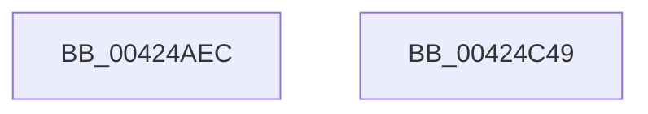

# McTemplateU0qqzr1qzr3qqqqpqqzr11_EtwWriteTransfer

- RVA: `0x00424AEC`–`0x00424C4A` (길이 `350` bytes)
- VA: `0x0000000140424AEC`
- 실행 섹션: `.text`
- PDB 이름 있음: `예`; PDB Function 태그: `아니요`
- unwind 정보 RVA: `0x000A0434`
- 디코드: `71`개 명령, `350/350` bytes 표시
- 미해석 바이트: `0` (있으면 어셈블리에 `.byte`로 보존)

> 이 문서는 커널 이미지의 기계어와 PDB 기호를 분석해 생성했습니다. 4번과 5번은 함수 원형과 자료형을 바이너리 사용 방식에서 추정한 C 해석이며 원본 소스 복구 결과는 아닙니다.

## 1. Dependencies

- 직접 호출 지점: **2**; 고유 호출 대상: **2**
- 직접 호출자로 확인된 함수: **1**
- RIP 상대 이미지 참조: **3**

### Outgoing calls
- `0x00424C2F` → [McGenEventWrite_EtwWriteTransfer](McGenEventWrite_EtwWriteTransfer_function_00424FC8.md) (function, `0x00424FC8`)
- `0x00424C3B` → [_security_check_cookie](../6A/_security_check_cookie_function_006AC640.md) (function, `0x006AC640`)

### Direct callers
- [Pdcv2EventWrite_ACTIVATION_CLIENT_ACTIVATE](Pdcv2EventWrite_ACTIVATION_CLIENT_ACTIVATE_function_004249F8.md) at `0x00424AC2`

### Static image references
- `0x00424B03` → RVA `0x00E0A740` (`.data`; read)
- `0x00424B28` → RVA `0x00E08870` (`.data`; read)
- `0x00424B5E` → RVA `0x00013F98` (`.rdata`; read)

## 2. Other-region calls and transfers

- 다른 실행 섹션으로 향하는 call: **0**
- 별도 외부 분기/꼬리 이동을 확인하지 못했습니다.

## 3. Assembly (complete function range)

```asm
00424AEC  44 89 4C 24 20                  mov dword ptr [rsp + 0x20], r9d
00424AF1  44 89 44 24 18                  mov dword ptr [rsp + 0x18], r8d
00424AF6  55                              push rbp
00424AF7  48 8D 6C 24 D0                  lea rbp, [rsp - 0x30]
00424AFC  48 81 EC 30 01 00 00            sub rsp, 0x130
00424B03  48 8B 05 36 5C 9E 00            mov rax, qword ptr [rip + 0x9e5c36]
00424B0A  48 33 C4                        xor rax, rsp
00424B0D  48 89 45 20                     mov qword ptr [rbp + 0x20], rax
00424B11  33 D2                           xor edx, edx
00424B13  C7 44 24 30 02 00 00 00         mov dword ptr [rsp + 0x30], 2
00424B1B  48 8D 45 50                     lea rax, [rbp + 0x50]
00424B1F  89 54 24 7C                     mov dword ptr [rsp + 0x7c], edx
00424B23  48 89 44 24 50                  mov qword ptr [rsp + 0x50], rax
00424B28  48 8D 0D 41 3D 9E 00            lea rcx, [rip + 0x9e3d41]
00424B2F  48 8D 45 58                     lea rax, [rbp + 0x58]
00424B33  89 55 9C                        mov dword ptr [rbp - 0x64], edx
00424B36  48 89 44 24 60                  mov qword ptr [rsp + 0x60], rax
00424B3B  45 33 C0                        xor r8d, r8d
00424B3E  48 8B 45 60                     mov rax, qword ptr [rbp + 0x60]
00424B42  48 89 44 24 70                  mov qword ptr [rsp + 0x70], rax
00424B47  43 8D 04 09                     lea eax, [r9 + r9]
00424B4B  89 44 24 78                     mov dword ptr [rsp + 0x78], eax
00424B4F  44 8D 4A 0E                     lea r9d, [rdx + 0xe]
00424B53  48 8D 45 68                     lea rax, [rbp + 0x68]
00424B57  89 55 1C                        mov dword ptr [rbp + 0x1c], edx
00424B5A  48 89 45 80                     mov qword ptr [rbp - 0x80], rax
00424B5E  48 8D 15 33 F4 BE FF            lea rdx, [rip - 0x410bcd]
00424B65  48 8B 45 70                     mov rax, qword ptr [rbp + 0x70]
00424B69  48 89 45 90                     mov qword ptr [rbp - 0x70], rax
00424B6D  8B 45 68                        mov eax, dword ptr [rbp + 0x68]
00424B70  03 C0                           add eax, eax
00424B72  48 C7 44 24 58 04 00 00 00      mov qword ptr [rsp + 0x58], 4
00424B7B  89 45 98                        mov dword ptr [rbp - 0x68], eax
00424B7E  48 8D 45 78                     lea rax, [rbp + 0x78]
00424B82  48 89 45 A0                     mov qword ptr [rbp - 0x60], rax
00424B86  48 8D 85 80 00 00 00            lea rax, [rbp + 0x80]
00424B8D  48 89 45 B0                     mov qword ptr [rbp - 0x50], rax
00424B91  48 8D 85 88 00 00 00            lea rax, [rbp + 0x88]
00424B98  48 89 45 C0                     mov qword ptr [rbp - 0x40], rax
00424B9C  48 8D 85 90 00 00 00            lea rax, [rbp + 0x90]
00424BA3  48 89 45 D0                     mov qword ptr [rbp - 0x30], rax
00424BA7  48 8D 85 98 00 00 00            lea rax, [rbp + 0x98]
00424BAE  48 89 45 E0                     mov qword ptr [rbp - 0x20], rax
00424BB2  48 8D 44 24 30                  lea rax, [rsp + 0x30]
00424BB7  48 89 45 F0                     mov qword ptr [rbp - 0x10], rax
00424BBB  48 8D 85 A8 00 00 00            lea rax, [rbp + 0xa8]
00424BC2  48 89 45 00                     mov qword ptr [rbp], rax
00424BC6  48 8B 85 B0 00 00 00            mov rax, qword ptr [rbp + 0xb0]
00424BCD  48 89 45 10                     mov qword ptr [rbp + 0x10], rax
00424BD1  8B 85 A8 00 00 00               mov eax, dword ptr [rbp + 0xa8]
00424BD7  03 C0                           add eax, eax
00424BD9  48 C7 44 24 68 04 00 00 00      mov qword ptr [rsp + 0x68], 4
00424BE2  89 45 18                        mov dword ptr [rbp + 0x18], eax
00424BE5  48 8D 44 24 40                  lea rax, [rsp + 0x40]
00424BEA  48 89 44 24 20                  mov qword ptr [rsp + 0x20], rax
00424BEF  48 C7 45 88 04 00 00 00         mov qword ptr [rbp - 0x78], 4
00424BF7  48 C7 45 A8 04 00 00 00         mov qword ptr [rbp - 0x58], 4
00424BFF  48 C7 45 B8 04 00 00 00         mov qword ptr [rbp - 0x48], 4
00424C07  48 C7 45 C8 04 00 00 00         mov qword ptr [rbp - 0x38], 4
00424C0F  48 C7 45 D8 04 00 00 00         mov qword ptr [rbp - 0x28], 4
00424C17  48 C7 45 E8 08 00 00 00         mov qword ptr [rbp - 0x18], 8
00424C1F  48 C7 45 F8 04 00 00 00         mov qword ptr [rbp - 8], 4
00424C27  48 C7 45 08 04 00 00 00         mov qword ptr [rbp + 8], 4
00424C2F  E8 94 03 00 00                  call 0x140424fc8
00424C34  48 8B 4D 20                     mov rcx, qword ptr [rbp + 0x20]
00424C38  48 33 CC                        xor rcx, rsp
00424C3B  E8 00 7A 28 00                  call 0x1406ac640
00424C40  48 81 C4 30 01 00 00            add rsp, 0x130
00424C47  5D                              pop rbp
00424C48  C3                              ret
00424C49  CC                              int3
```

## 4. C-style interpretation (structured pseudocode)

```c
__int64 __fastcall McTemplateU0qqzr1qzr3qqqqpqqzr11_EtwWriteTransfer(__int64 a1, int a2, int a3, __int64 a4, __int64 a5, unsigned int a6, __int64 a7, __int64 a8, __int64 a9, __int64 a10, __int64 a11, __int64 a12, __int64 a13, unsigned int a14, __int64 a15)
{
    __int64 result;
    __int64 v_rsp;
    unsigned int v_stack_m108;
    unsigned __int64 v_stack_m118;
    unsigned __int64 v_stack_m18;
    unsigned int v_stack_m1C;
    unsigned int v_stack_m20;
    unsigned __int64 v_stack_m28;
    unsigned __int64 v_stack_m30;
    unsigned __int64 v_stack_m38;
    unsigned __int64 v_stack_m40;
    unsigned __int64 v_stack_m48;
    unsigned __int64 v_stack_m50;
    unsigned __int64 v_stack_m58;
    unsigned __int64 v_stack_m60;
    unsigned __int64 v_stack_m68;
    unsigned __int64 v_stack_m70;
    unsigned __int64 v_stack_m78;
    unsigned __int64 v_stack_m80;
    unsigned __int64 v_stack_m88;
    unsigned __int64 v_stack_m90;
    unsigned __int64 v_stack_m98;
    unsigned int v_stack_m9C;
    unsigned int v_stack_mA0;
    unsigned __int64 v_stack_mA8;
    unsigned __int64 v_stack_mB0;
    unsigned __int64 v_stack_mB8;
    unsigned int v_stack_mBC;
    unsigned int v_stack_mC0;
    unsigned __int64 v_stack_mC8;
    unsigned __int64 v_stack_mD0;
    unsigned __int64 v_stack_mD8;
    unsigned __int64 v_stack_mE0;
    unsigned __int64 v_stack_mE8;
    unsigned __int64 v_stack_mF8;
    unsigned int v_stack_p18;
    unsigned int v_stack_p20;

    v_stack_p20 = (unsigned int)(a4);
    v_stack_p18 = a3;
    v_rsp = (v_rsp) - (304);
    result = (*(unsigned __int64 *)(v_rip + 10378294)) ^ (v_rsp);
    v_stack_m18 = result;
    a2 = 0;
    v_stack_m108 = 2;
    v_stack_mBC = 0;
    v_stack_mE8 = v_stack_p18;
    v_stack_m9C = 0;
    v_stack_mD8 = v_stack_p20;
    a3 = 0;
    v_stack_mC8 = a5;
    v_stack_mC0 = (unsigned int)(a4 + a4 * 1);
    v_stack_m1C = 0;
    v_stack_mB8 = a6;
    v_stack_mA8 = a7;
    result = (unsigned int)(((unsigned int)(a6)) + ((unsigned int)((unsigned int)(a6))));
    v_stack_mE0 = 4;
    v_stack_mA0 = (unsigned int)(result);
    v_stack_m98 = a8;
    v_stack_m88 = a9;
    v_stack_m78 = a10;
    v_stack_m68 = a11;
    v_stack_m58 = a12;
    v_stack_m48 = v_stack_m108;
    v_stack_m38 = a14;
    v_stack_m28 = a15;
    result = (unsigned int)(((unsigned int)(a14)) + ((unsigned int)((unsigned int)(a14))));
    v_stack_mD0 = 4;
    v_stack_m20 = (unsigned int)(result);
    v_stack_m118 = v_stack_mF8;
    v_stack_mB0 = 4;
    v_stack_m90 = 4;
    v_stack_m80 = 4;
    v_stack_m70 = 4;
    v_stack_m60 = 4;
    v_stack_m50 = 8;
    v_stack_m40 = 4;
    v_stack_m30 = 4;
    result = McGenEventWrite_EtwWriteTransfer(v_rip + 10370369, v_rip - 4262861, a3, a2 + 14);
    a1 = (v_stack_m18) ^ (v_rsp);
    result = _security_check_cookie(a1, v_rip - 4262861, a3, a2 + 14);
    v_rsp = (v_rsp) + (304);
    return result;
}
```

## 5. (Beta) C Style

```c
int64_t McTemplateU0qqzr1qzr3qqqqpqqzr11_EtwWriteTransfer(int64_t Arg1, int32_t Arg2, int32_t Arg3, void *Arg4, int64_t Arg5, uint32_t Arg6, int64_t Arg7, int64_t Arg8, int64_t Arg9, int64_t Arg10, int64_t Arg11, int64_t Arg12, uint64_t Arg13, uint32_t Arg14, int64_t Arg15)
{
    uint8_t *arg4 = (uint8_t *)Arg4;

    int64_t result;
    int64_t local_rsp;
    uint32_t v_stack_m108;
    uint64_t v_stack_m118;
    uint64_t v_stack_m18;
    uint32_t v_stack_m1C;
    uint32_t v_stack_m20;
    uint64_t v_stack_m28;
    uint64_t v_stack_m30;
    uint64_t v_stack_m38;
    uint64_t v_stack_m40;
    uint64_t v_stack_m48;
    uint64_t v_stack_m50;
    uint64_t v_stack_m58;
    uint64_t v_stack_m60;
    uint64_t v_stack_m68;
    uint64_t v_stack_m70;
    uint64_t v_stack_m78;
    uint64_t v_stack_m80;
    uint64_t v_stack_m88;
    uint64_t v_stack_m90;
    uint64_t v_stack_m98;
    uint32_t v_stack_m9C;
    uint32_t v_stack_mA0;
    uint64_t v_stack_mA8;
    uint64_t v_stack_mB0;
    uint64_t v_stack_mB8;
    uint32_t v_stack_mBC;
    uint32_t v_stack_mC0;
    uint64_t v_stack_mC8;
    uint64_t v_stack_mD0;
    uint64_t v_stack_mD8;
    uint64_t v_stack_mE0;
    uint64_t v_stack_mE8;
    uint64_t v_stack_mF8;
    uint32_t v_stack_p18;
    uint32_t v_stack_p20;

    v_stack_p20 = (uint32_t)(Arg4);
    v_stack_p18 = Arg3;
    local_rsp = (local_rsp) - (304);
    result = (*(uint64_t *)(v_rip + 0x9E5C36)) ^ (local_rsp);
    v_stack_m18 = result;
    Arg2 = 0;
    v_stack_m108 = 2;
    v_stack_mBC = 0;
    v_stack_mE8 = v_stack_p18;
    v_stack_m9C = 0;
    v_stack_mD8 = v_stack_p20;
    Arg3 = 0;
    v_stack_mC8 = Arg5;
    v_stack_mC0 = (uint32_t)(Arg4 + Arg4 * 1);
    v_stack_m1C = 0;
    v_stack_mB8 = Arg6;
    v_stack_mA8 = Arg7;
    result = (uint32_t)(((uint32_t)(Arg6)) + ((uint32_t)((uint32_t)(Arg6))));
    v_stack_mE0 = 4;
    v_stack_mA0 = (uint32_t)(result);
    v_stack_m98 = Arg8;
    v_stack_m88 = Arg9;
    v_stack_m78 = Arg10;
    v_stack_m68 = Arg11;
    v_stack_m58 = Arg12;
    v_stack_m48 = v_stack_m108;
    v_stack_m38 = Arg14;
    v_stack_m28 = Arg15;
    result = (uint32_t)(((uint32_t)(Arg14)) + ((uint32_t)((uint32_t)(Arg14))));
    v_stack_mD0 = 4;
    v_stack_m20 = (uint32_t)(result);
    v_stack_m118 = v_stack_mF8;
    v_stack_mB0 = 4;
    v_stack_m90 = 4;
    v_stack_m80 = 4;
    v_stack_m70 = 4;
    v_stack_m60 = 4;
    v_stack_m50 = 8;
    v_stack_m40 = 4;
    v_stack_m30 = 4;
    result = McGenEventWrite_EtwWriteTransfer(v_rip + 10370369, v_rip - 4262861, Arg3, Arg2 + 14);
    Arg1 = (v_stack_m18) ^ (local_rsp);
    result = _security_check_cookie(Arg1, v_rip - 4262861, Arg3, Arg2 + 14);
    local_rsp = (local_rsp) + (304);
    return result;
}
```

### 관측된 메모리 오프셋

구조체 형식이 확인되지 않은 접근은 인자 기준의 오프셋으로만 기록했습니다.

| 기준 인자 | 오프셋 표현 | 폭 (bit) | 접근 |
|---|---:|---:|---|
| `Arg4` | `+ 0x0 + r9*1` | `32` | `R` |

## 6. Execution-region graph

[열기: 2D/3D 그래프와 함수 탐색 컨트롤 패널](../../../control-panel.html?section=text&rva=0x00424AEC&view=graph)

- 2D 그래프는 위에서 아래로 흐르고, 3D 그래프는 빈 공간을 드래그해 회전합니다. Shift+드래그는 이동, 휠은 확대·축소, 함수 노드 선택은 대상 보고서 이동입니다.

### Static fallback


